## Am Feld

Die Straße Am Feld, eine Seitenstraße der Bismarckstraße wurde um 1900 als Planstraße B angelegt und erhielt am 4. April 1905 den Namen Auerstraße. Mit dieser Bezeichnung sollte der sozialdemokratische Politiker und Reichstagsabgeordnete Ignaz Auer (1846-1907) geehrt werden. Da es diesen Namen nach der Eingemeindung von Niedersedlitz zweimal gab, erfolgte am 30. September 1953 die Umbenennung in Am Feld.

## Am Steingarten

Die heutige Straße Am Steingarten hieß bis zur Eingemeindung von Niedersedlitz nach dem Luftschiffpionier Ferdinand von Zeppelin (1838-1917) Zeppelinstraße. Offiziell erfolgte die Namensgebung am 6. Oktober 1913. Da es bereits in Loschwitz eine Zeppelinstraße gab, wurde die Straße am 30. September 1953 in Am Steingarten umbenannt.

## An der Post

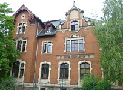Die Straße An der Post entstand Ende des 19. Jahrhunderts und ist seit 1891 als Neue Straße im Adressbuch verzeichnet. Wenig später wechselte der Name in Wilhelmstraße, wobei wahrscheinlich der deutsche Kaiser Wilhelm II. Pate stand. Nach 1945 erfolgte die Umbenennung in Rudolf-Breitscheid-Straße. Um Namensdopplungen zu vermeiden, erhielt die Straße am 30. September 1953 die Bezeichnung An der Post, da sich hier das Niedersedlitzer [Postamt](../../../ost/niedersedlitz/) befand (Nr. 15). Das Gebäude _(Foto)_ steht als Baudenkmal unter Schutz, wird seit 2008 jedoch nur noch als Wohnhaus genutzt. Auch das gegenüberstehende Mietshaus Nr. 16 ist als Baudenkmal eingetragen.

## An der Siedlung

Die Straße An der Siedlung entstand 1927 beim Bau des Wohngebiet nördlich der Windmühlenstraße und wurde zunächst Friedensstraße genannt. Nach der Eingemeindung von Niedersedlitz erfolgte am 30. September 1953 die Umbenennung in An der Siedlung.

## Antonin-Dvorak-Straße

Die Antonin-Dvorak-Straße entstand in den Dreißiger Jahren im Zusammenhang mit dem Ausbau der Niedersedlitzer Siedlung an der Windmühlenstraße. Am 20. Mai 1938 wurde sie nach dem deutschen „Turnvater“ Friedrich Ludwig Jahn (1778-1852) zunächst Ludwig-Jahn-Straße benannt. 1945 erfolgte eine Umbenennung in Gottfried-Keller-Straße. Namenspate war der schweizerische Schriftsteller Gottfried Keller (1819-1890), der vor allem durch seine Novellen bekannt wurde. Da es in Cotta jedoch bereits eine Gottfried-Keller-Straße gab, machte sich durch die Eingemeindung von Niedersedlitz 1954 eine weitere Namensänderung erforderlich. Ihren neuen Namen erhielt die Straße nach dem tschechischen Komponisten Antonin Dvorak (1841-1904).

## Bahnhofstraße

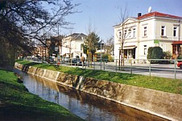Die Niedersedlitzer Bahnhofstraße verbindet den alten Dorfkern mit dem benachbarten Großzschachwitz. Im Bereich um den Bahnhof liegt auch das Ortszentrum mit [Rathaus](../../../ost/niedersedlitz/), Schule und dem Endpunkt der Straßenbahn. 1871 wurde östlich der Bahnhofes der Güterbahnhof angelegt. 1893 ist der Name Bahnhofstraße erstmals im Adressbuch verzeichnet und bezog sich damals nur auf den Abschnitt südlich der Eisenbahn. Der anschließende Weg nach Großzschachwitz wurde um 1900 ebenfalls ausgebaut und ab 1903 Zschachwitzer Straße genannt. 1906 entstand an Stelle des bisherigen Bahnüberganges die noch heute erhaltene Unterführung. Gleichzeitig nahm die bis 1977 über die Bahnhofstraße nach Lockwitz und Kreischa verkehrende [Lockwitztalbahn](../../../sudost/lockwitz/lockwitztalbahn/) ihren Betrieb auf. Außerdem entstand die nach Kleinzschachwitz führende [Dresdner Vorortbahn](../../../ost/niedersedlitz/dresdner_vorortbahn/), initiiert vom Unternehmer Oskar Ludwig Kummer.

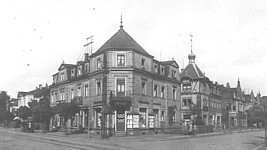Der auf Großzschachwitzer Flur gelegene Straßenteil ist erstmals im Adressbuch von 1906 als Niedersedlitzer Straße genannt. Zwei Jahre später kam auch die bisherige Dorfstraße in Großzschachwitz hinzu. Nach Machtübernahme der Nationalsozialisten beschloss der Gemeinderat der damals noch selbständigen Ortschaft Großzschachwitz die Umbenennung dieser Straße in Killingerstraße. Manfred von Killinger war SA-Obergruppenführer und Ministerpräsident von Sachsen. 1936 wechselte die Bezeichnung erneut in Rudolf-Heß-Straße. Nach dem der Stellvertreter Hitlers 1941 nach England geflohen war und deshalb als "Verräter" betrachtet wurde, entschloss man sich per 30. Mai 1941 zur Namensänderung in Bahnhofstraße, womit der bereits in Niedersedlitz verwendete Name auch auf den Großzschachwitzer Abschnitt überging.

Mit der Eingemeindung von Niedersedlitz wurden 1953 die bisherige Bahnhofstraße und die Zschachwitzer Straße vereinigt. Bereits 1941 war die frühere Niedersedlitzer Straße in Großzschachwitz, zuletzt Rudolf-Heß-Straße genannt, ebenfalls in Bahnhofstraße umbenannt worden.

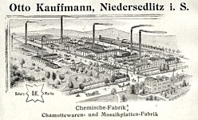Firma Otto Kauffmann: Die Chemische Fabrik, Schamottewaren- und Mosaikplatten-Fabrik von Otto Kauffmann entstand als eines der ersten größeren Unternehmen im Dresdner Osten und war Auftakt zur Ansiedlung weiterer Betriebe in Niedersedlitz und Kleinzschachwitz. Ausschlaggebend war die günstige Lage an der 1848 eröffneten Sächsisch-Böhmischen Eisenbahn. Gründer war der aus Thüringen stammende Otto Kauffmann (1845-1900), der zuvor in einer Dresdner Papierfabrik tätig war und zeitweise am Polytechnikum Chemie und Maschinentechnik studierte. Nachdem seine Pläne zur Übernahme einer Papierfabrik in Königstein gescheitert waren, erwarb er in Niedersedlitz ein 2,7 Hektar großes Grundstück an der damaligen Zschachwitzer Straße 2/4.

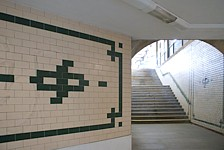Am 1. November 1871 nahm die Firma ihren Betrieb auf und stellte zunächst schwefelsaure Tonerde, ein wichtiger Rohstoff bei der Papierherstellung, her. Später spezialisierte man sich auf die Produktion von Schamotte & Façonsteinen und ähnlichen keramischen Erzeugnissen. Bekannt wurde die Firma Otto Kauffmann für ihre künstlerisch gestalteten Mosaikplatten, die als Wand- und Bodenfliesen zahlreiche Gebäude dieser Zeit zieren. In Dresden sind Mosaikplatten der Firma u.a. in den Bahnhofsgebäuden Dresden-Neustadt, Strehlen _( **Foto:** Erfurth/Stadtwiki Dresden)_, Reick und Niedersedlitz und in mehreren Schulen erhalten. Auch Teile der Ausstattung des Leipziger Hauptbahnhofs stammen von Kauffmann. Von den früheren Fabrikgebäuden ist heute noch das Kontorhaus in der Nähe des Niedersedlitzer Bahnhofes zu sehen.

Alter Gasthof (Nr. 3): Bis Mitte des 19. Jahrhunderts gab es in Niedersedlitz wie in den meisten kleineren Orten der Umgebung den Reiheschank. Dabei erhielten die Besitzer der Bauernhöfe monatlich abwechselnd das Recht zum Ausschank von Bier und Schnaps und mussten dafür zwei Taler in die Gemeindekasse entrichten. Als Gastgeber beliebt war vor allem der Gutsbesitzer Beil, der neben Getränken auch mehrere Speisen anbot und so zum Anziehungspunikt für Fuhrkeute wurde. 1860 verkaufte die Gemeinde das Schankrecht dauerhaft an Karl Gotthilf Beil. Fortan diente dessen Bauerngut bis 1875 als Gasthof und wurde dann durch einen Neubau auf dem Nachbargrundstück abgelöst.

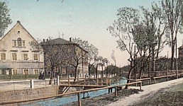

**_Foto:_** _Alter und Neuer Gasthof Niedersedlitz um 1900_

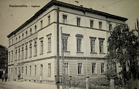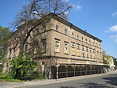Gasthof "Zum Goldenen Löwen" (Nr. 5): Der Gasthof entstand 1875 und erhielt 1898 durch Umbau und Erweiterung sein heutiges Aussehen. Im Erdgeschoss befanden sich die Gasträume, im Obergeschoss ein großer Saal. Außerdem gab es einige Fremdenzimmer und eine Asphaltkegelbahn. Ab 1906 brachte die Lockwitztalbahn zahlreiche Gäste direkt bis vor das Haus, wo sich bis 1914 deshalb sogar eine eigene Haltestelle befand. Besitzer war der Fleischer und Gastwirt Karl Gotthilf Beil, ab 1898 Theodor Rudolf Freitag. Nach 1945 wurde das Gebäude zeitweise auch für Theateraufführungen genutzt. Statische Gründe führten 1965 zur Sperrung des Saales für eine öffentliche Nutzung, so dass dieser fortan als Lager diente. Später schloss auch die Gaststätte. Bis in die 1990er Jahren gab es jedoch noch einen Optiker und einen Schuhreparaturservice im Haus. Planungen zur Sanierung, u.a. als Burschenschaftszentrum blieben bislang unrealisiert, so dass das sich das Haus heute in einem verfallenen Zustand befindet.

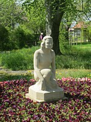Blumenpflückerin:Die vom Bildhauer Otto Poertzel geschaffene Plastik „Blumenpflückerin“ entstand in den Dreißiger Jahren und wurde im April 1938 in einer kleinen Parkanlage an der Einmündung Bahnhofstraße / Lugaer Straße aufgestellt. Die Finanzierung der Figur, welche auch als „Knieender Frauenakt“ bzw. im Volksmund als „Nacksche“ bekannt ist, übernahm die damals noch selbständige Gemeinde Niedersedlitz. Das Kunstwerk besteht aus künstlichem Muschelkalkstein und kostete 550 RM.

1950 wurde die Plastik aus unbekannten Gründen von ihrem Platz entfernt und zum Hepkeplatz nach Gruna versetzt. Erst 2012 kehrte sie auf Initiative des Niedersedlitzer Heimatverein an ihren ursprünglichen Standort zurück und wurde nach Restaurierung im Juni wieder aufgestellt.

Nr. 23: Zu den ersten Fabrikantenvillen des Dorfes gehörte die um 1880 erbaute Villa des Fliesenfabrikanten Otto Kaufmann. Der neoklassizistische Bau diente nach 1945 viele Jahre als Kindergarten und wurde stand wegen seiner Innenausstattung im Art-deco-Stil unter Denkmalschutz. 1993 wurde das Gebäude unter Missachtung gesetzlicher Bestimmungen abgerissen.
Bemerkenswert ist das Nachbargebäude Nr. 25, welches 1911/12 vom Architektenbüro Lossow & Kühne errichtet wurde. Die repräsentative Villa ist auch im Inneren noch weitgehend im Ursprungszustand erhalten.

Auen-Apotheke: Die Apotheke auf Großzschachwitzer Flur wurde Mitte der Dreißiger Jahre im Wohn- und Geschäftshaus Bahnhofstraße 97 gegründet. Ihren Namen erhielt sie nach der einst hier gelegenen feuchten Aue, welche sich heute noch im Straßennamen “An der Aue” wiederfindet. Im Zusammenhang mit dem Bau eines Plattenbaugebietes wurde sie 1982 ins Erdgeschoss des Wohnblocks Schönaer Straße 34/36 verlegt und die bisherigen Räume nur noch als Lager genutzt.

## Bedrich-Smetana-Straße

Die kurze Bedrich-Smetana-Straße wurde 1905 als Planstraße XII angelegt und am 4. April Goethestraße benannt. Nach Ausbau und Verlängerung der Straße um 1912 bestand sie aus zwei Teilabschnitten zu beiden Seiten der Lockwitztalstraße. Da das immer wieder zu Verwechslungen führte, beschloss der Niedersedlitzer Gemeinderat am 13. Februar 1915 die Umbenennung des östlichen Abschnitts in Schillerstraße. Die bisherige Schillerstraße (heute Heidenauer Straße) erhielt den Namen Hindenburgstraße. Nach der Eingemeindung von Niedersedlitz wurde die Goethestraße 1953 umbenannt. Mit dem jetzigen Namen wird an den Komponisten Bedrich Smetana (1824-1884) erinnert, der zu den Begründern der tschechischen Nationalmusik gehört.

## Bismarckstraße

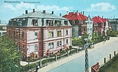Die Bismarckstraße wurde Ende des 19. Jahrhunderts zur Erschließung der Baugebiete parallel zur Eisenbahnstrecke angelegt. Mit der 1903 erstmals nachweisbaren Namensgebung sollte an den bis 1890 amtierenden “Eisernen Kanzler” Otto von Bismarck (1815-1898) erinnert werden. Bismarck gilt als Architekt der Reichseinigung und führte in seiner Amtszeit umfassende Sozialreformen durch, bekämpfte zugleich aber die entstehende Sozialdemokratie. Nach 1945 wurde die Niedersedlitzer Bismarckstraße umbenannt und erhielt den Namen Edgar-André-Straße. Edgar André (1894-1936) gehörte ab 1923 der KPD an und galt als enger Vertrauter Ernst Thälmanns. 1936 wurde er von den Nationalsozialisten wegen seiner angeblichen Schuld am “Altonaer Blutsonntag” hingerichtet. Die Edgar-André-Straße erhielt auf Beschluss des Stadtrates am 25. Februar 1993 wieder ihren alten Namen Bismarckstraße zurück.

Das Straßenbild prägen bis heute neben verschiedenen Industriebauten vor allem Fabrikantenvillen und Wohnhäuser. Zu den hier ansässigen Firmen gehörten u.a. die Aktiengesellschaft für Kunstdruck (Nr. 49), die Kamerawerkstätten Niedersedlitz (Nr. 56), die Dresdner Schulbankfabrik Lickroth & Cie. (Nr. 57) und die Schokoladenfabrik EMERKA (Nr. 66). Architektonisch bemerkenswert sind die unter Denkmalschutz stehenden Häuser Nr. 3 (Deus-Nobiscum-Villa), Nr. 17 (Villa Oskar), Nr. 23 (Manß-Villa) und Nr. 26, 27 und 29. Im Haus Bismarckstraße 47 befand sich einst die Gastwirtschaft "Zur Wartburg". 2013 entstand zwischen Reisstraße und Saydaer Straße ein kleines Wohngebiet.

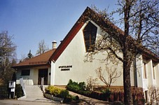Apostolische Kirche:
Das Gebäude an der Bismarckstraße 30 entstand 1996 für die Apostolische Gemeinde Dresden. Diese Freikirche ging 1955 aus einer Abspaltung der um 1860 in Deutschland entstandenen Neuapostolischen Kirche hervor. Bis 1945 hatte die Neuapostolische Kirche in Dresden ihren Sitz an der Freiberger Straße. Nach dessen Zerstörung nutzte sie die Striesener Versöhnungskirche für ihre Gottesdienste. 1994 schloss sie sich mit dem in Dresden seit 1921 aktiven Reformiert-Apostolischen Gemeindebund zusammen. Architekt des Neubaus an der Bismarckstraße war Rudolf Büche. Im Inneren befindet sich ein schlichter Gemeindesaal mit Altartisch, Taufbecken, Orgel und einigen Glasfenstern. Gegenwärtig gehören der Gemeinde, welche sich an der Urkirche des Neuen Testaments orientiert, ca. 100 Mitglieder an.

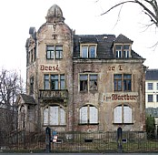Zur Wartburg (Nr. 47): Das Gebäude wurde um 1900 errichtet und beherbergte viele Jahre die Gaststätte "Zur Wartburg". Im Obergeschoss befanden sich Wohnungen. An dem seit vielen Jahren leer stehenden Haus erinnern bis heute verschiedene Inschriften und Details an die einstige Nutzung _(Foto links: Wikipedia / Adornix)_. Eine Sanierung des Baudenkmals ist geplant.

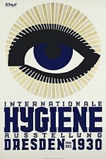Aktiengesellschaft für Kunstdruck:  Das Unternehmen wurde als Kunstdruckerei Willner & Pick gegründet und firmierte ab 1896 unter dem Namen Aktiengesellschaft für Kunstdruck vorm. Willner & Pick. Ab 6. Februar 1900 war nur noch der Name Aktiengesellschaft für Kunstdruck gebräuchlich. Stammsitz und Produktionsräume des deutschlandweit tätigen Unternehmens war die Bismarckstraße 49. Bis 1945 befand sich die Firma mehrheitlich im Besitz des Nürnberger Großaktionärs Dr. Carl Soldau GmbH. Zum Produktionsprogramm gehörten graphische Erzeugnisse unterschiedlichster Art, u.a. Werbeplakate, Kalender, Postkarten, Prospekte und Kataloge, wobei die Entwürfe zum Teil von renommierten Grafikern stammten. Aber auch Wahlplakate und Wertpapiere sowie Notgeldscheine wurden hier gedruckt. Die Gebäude der AG sind noch erhalten und dienen als Wohnhaus bzw. Bürogebäude.

**_Bild:_** _Werbeplakat zur Internationalen Hygieneausstellung 1930 in Dresden_

_(Entwurf von Willy Petzold, Druck Aktiengesellschaft für Kunstdruck Niedersedlitz)_

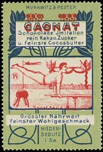Munkwitz & Pester: Die Zuckerwarenfabrik Munkwitz & Pester wurde um 1907 von Richard Otto Munkwitz gegründet und hatte ihren Sitz auf der Bismarckstraße 56. Nach einem Wechsel des Geschäftpartners fungierte der Betrieb als Munkwitz & Müller. Hergestellt wurden verschiedene Süßwaren und "Schokoladen-Imitationen", die unter dem Markennamen "Caonat" verkauft wurden. Beliebt waren vor allem die bunt bemalten Blecheier, die - innen mit Schokolade gefüllt - ein Vorläufer der Überraschungseier waren. Sie wurden über einen im Volksmund "gackernde Henne" genannten Automaten angeboten und konnten durch den Einwurf einer 10-Pfennig-Münze erworben werden. Einer dieser Automaten ist noch heute im Dresdner Stadtmuseum zu sehen. Nach der Produktionseinstellung übernahm 1938 der Kamerafabrikant Charles Noble die Betriebsgebäude und nutzte sie für seine Kamera-Werkstätten.

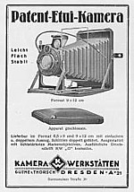Kamera-Werkstätten Dresden-Niedersedlitz: Das Unternehmen entstand 1919 durch Zusammenschluss der Kamerawerkstätten von Paul Guthe und Benno Thorsch und hatte seine Produktionsstätten auf der Serrestraße 12 und der Zinzendorfstraße 48 in der Pirnaischen Vorstadt. Der wachsende wirtschaftliche Erfolg ermöglichte wenig später den Umzug zur Bärensteiner Straße 30. Hergestellt wurden neben einfachen Patent-Etui-Kameras _(Werbung)_ ab 1931 auch Spiegelreflexkameras. Nach dem Ausscheiden und dem Tod Guthes führte Benno Thorsch das Unternehmen gemeinsam mit Julius Thorsch weiter.

1938 erwarb der Amerikaner Charles Adolf Noble den Betrieb im Tausch gegen seine Fotokopieranstalt in Detroit und ermöglichte damit den jüdischen Inhabern die Ausreise in die USA. Fortan firmierte das Werk unter dem Namen Kamera-Werkstätten Charles A. Noble und verlegte seinen Stammsitz nach Niedersedlitz zur Bismarckstraße 56. Diese Firma wurde wenig später durch die legendäre “Praktiflex”, eine 1938 von Alois Hoheisel entwickelte Spiegelreflexkamera, berühmt und blieb bis 1946 in Familienbesitz. Während des Zweiten Weltkriegs wurden hier u.a. Flugzeugfilter angefertigt.

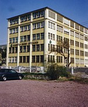Wegen des völlig absurden Vorwurfs, Noble habe von seiner Loschwitzer [Villa “San Remo”](../../../nordost/page10246/strassen_weisser_hirsch/bergbahnstrasse/) den Luftangriff auf Dresden gesteuert, wurde er 1945, sein Sohn John Noble 1948 verhaftet und bis 1955 in einem Internierungslager gefangen gehalten. Erst auf Druck der amerikanischen Regierung gelang ihm schließlich die Ausreise in die USA. Nobles Unternehmen kam als VEB Kamerawerke Dresden-Niedersedlitz in staatlichem Besitz und wurde erst 1991 an die Eigentümer zurückgegeben. Ab 1949 wurde hier mit der “Praktica” eines der erfolgreichsten Kameramodelle der DDR gebaut. Zehn Jahre später kam auch dieser Betrieb zum neu gebildeten Kombinat VEB Kamera- und Kinowerke Dresden (ab 1964 PENTACON). Nach der Wende erhielten John Noble und sein Bruder George ihren Betrieb sowie die Villa zurück und begannen nach verlorenem Rechtsstreit um die Markennamen “Practica” und Praktina” mit dem Bau moderner Panoramakameras (“Noblex”). Trotz der Weltneuheit einer 180° - Panoramakamera gelang es jedoch nicht, sich dauerhaft auf dem Markt zu behaupten. 1997 musste das Unternehmen Konkurs anmelden, wird jedoch heute von neuen Besitzern als Kamera Werk Dresden GmbH fortgeführt _(Foto)_.

## Buchsbaumstraße

Die Buchsbaumstraße wurde Mitte der 1930er Jahre beim Bau der Wohnsiedlung an der Windmühlenstraße angelegt und am 20. Mai 1938 Braunauer Straße genannt. Die Namensgebung erfolgte nach der Stadt Braunau am Inn in Österreich, dem Geburtsort Adolf Hitlers. Das war auch der Grund für die Umbenennung in Heinrich-Heine-Straße unmittelbar nach Kriegsende. Da es jedoch in Leubnitz-Neuostra bereits eine gleichnamige Straße gab, machte sich mit der Eingemeindung von Niedersedlitz eine erneute Umbenennung erforderlich. In Anlehnung an die benachbarten Föhren- und Wacholderstraße wurde auch hier der Name einer Baumart gewählt. Zuvor war kurzzeitig auch der Name Erlenstraße im Gespräch.

## Christian-Morgenstern-Straße

Die Christian-Morgenstern-Straße wurde Ende der 1970er Jahre im Zusammenhang mit dem Neubaugebiet Prohlis südlich der Windmühlenstraße angelegt. Ihren Namen erhielt sie am 13. April 1978 nach dem deutschen Schriftsteller und Lyriker Christian Morgenstern (1871–1914).

## Curt-Guratzsch-Straße

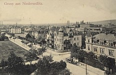Die Curt-Guratzsch-Straße wurde um 1900 im Zusammenhang mit der Entwicklung des Ortes zur Industriegemeinde angelegt. Finanziert wurde der Bau durch den Privatier Ernst Schanze, der seine Grundstücke wenig später an die Gemeinde verkaufte. In diesem Zusammenhang erhielt sie offiziell den Namen Albertstraße, wohl nach dem sächsischen König Albert.

Nach 1945 trug sie zeitweise den Namen Ernst-Thälmann-Straße. Da es in Dresden jedoch bereits eine Ernst-Thälmann-Straße gab, machte sich mit der Eingemeindung von Niedersedlitz eine erneute Umbenennung erforderlich. Seit dem 30. September 1953 war sie als Wilhelm-Florin-Straße nach einem kommunistischen Arbeiterfunktionär benannt. Wilhelm Florin (1894-1944) gehörte ab 1920 der KPD an und war später Mitglied des Zentralkomitees und des Politbüros der Partei. 1993 wurde die Straße in Curt-Guratzsch-Straße umbenannnt. Curt Guratzsch (1891-1965) erwarb sich große Verdienste um die Dresdner Kultur und war ab 1930 Vorsitzender des Verbandes zur Förderung der Neustadt. Außerdem widmete er sich pädagogischen und sprachwissenschaftlichen Forschungen und regte 1945 das alljährliche Gedenkläuten am 13. Februar an.

## Dorfstraße

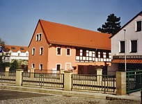Als Dorfstraße wird bis heute der zwischen Windmühlenstraße und Bahnhofstraße gelegene Teil des alten Niedersedlitzer Ortskerns bezeichnet _(Foto)_. Ursprünglich entstand dieser als Rundling und wurde später zum Gassendorf erweitert. Noch bis 1895 bestand der Ort mit Ausnahme einiger Industriebetriebe und Fabrikantenvillen fast ausschließlich aus den Häusern der Dorfstraße. Größtes Anwesen war das Käfersteinsches Gut (Nr. 8), welches als Allodial- bzw. Freigut der Gerichtsbarkeit des Religionsamtes Dresden unterstand und von vielen Abgaben und Dienstpflichten befreit war.

Bis heute blieben an der Dorfstraße einige Zwei- und Vierseithöfe sowie ehemalige Häusleranwesen erhalten. Nach der Jahrhundertwende entstanden am Rande des Dorfkerns an der Lockwitztalstraße / Ecke Dorfstraße einige mehrgeschossige Wohn- und Geschäftshäuser.

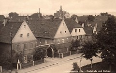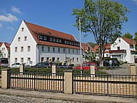

**_Fotos:_** _Der Niedersedlitzer Dorfkern um 1930 und 2015_

## Erich-Kästner-Straße

Die Erich-Kästner-Straße wurde Anfang der 1980er Jahre im Zusammenhang mit dem Ausbau des Neubaugebietes Prohlis auf Niedersedlitzer Flur angelegt und mit mehrgeschossigen Wohnhäusern bebaut. Die wegen ihres Grundrisses auch als “Sternhäuser” bekannten Zehngeschosser sind heute nicht mehr vorhanden und wurden 2008 im Rahmen des Rückbaus von Plattenbauwohnungen abgerissen. Ihren Namen verdankt die Straße dem bekannten Schriftsteller und Kinderbuchautor Erich Kästner (1899-1974), der 1899 in Dresden geboren wurde und seine Kindheitserlebnisse in seiner Autobiografie “Als ich ein kleiner Junge war” beschrieb. Benannt wurde sie am 13. April 1978.

## Ernst-Toller-Straße

Die Ernst-Toller-Straße wurde in den 1930 Jahren beim Bau der Wohnsiedlung an der Windmühlenstraße angelegt. Am 20. Mai 1938 erhielt die bisherige Planstraße XXIII den Namen Andreas-Hofer-Straße, womit der Südtiroler Freiheitsheld Andreas Hofer (1767-1810) geehrt werden sollte. Hofer war Anführer des gegen die napoleonische Freiherrschaft gerichteten Tiroler Volksaufstand und wurde 1810 in Mantua hingerichtet.

Da es nach der Eingemeinung von Niedersedlitz bereits eine weitere [Andreas-Hofer-Straße](../../../ost/meusslitz/strassen_meusslitz/) in Meußlitz gab, erfolgte in den 1950er Jahren die Umbenennung in Ernst-Toller-Straße. Ihren Namen verdankt sie dem deutschen Lyriker und Dramatiker Ernst Toller (1893-1939). Der vom Expressionismus beeinflusste Autor verfasste verschiedene revolutionäre und antimilitaristische Dramen. Bei der Premiere seines Stückes “Hinkemann” über das Schicksal eines Kriegsverwundeten kam es am 17. Januar 1924 zu einem Theaterskandal im Dresdner Schauspielhaus, der zum Abbruch der Vorstellung und zu heftigen politischen Auseinandersetzungen im Stadtrat sowie im Landtag führte.

## Falkenhainer Straße

Die heutige Falkenhainer Straße entstand um 1935 beim Bau einer neuen Wohnsiedlung an der Windmühlenstraße. In Bezug auf die im Zuge des Versailler Vertrags verlorenen Gebiete des Deutschen Reiches erhielt sie zunächst den Namen Iglauer Straße nach der Stadt Iglau (Jihlava) in Tschechien. Wenig später begann hier der Bau von standardisierten Siedlungshäusern. Mit der Eingemeindung von Niedersedlitz machte sich eine Umbenennung erforderlich, da es in Laubegast ebenfalls eine Iglauer Straße gab. Auf Beschluss des Stadtrates vom 30. September 1953 wurde die Straße nach dem kleinen Ort Falkenhain im Müglitztal in Falkenhainer Straße umbenannt.

## Föhrenstraße

Die heutige Föhrenstraße wurde 1935 beim Bau des Wohngebietes an der Windmühlenstraße angelegt und auf Beschluss des Niedersedlitzer Gemeinderates am 20. Mai 1938 Planettastraße benannt. Otto Planetta (1899-1934) gehörte zu den Mitbegründern des nationalsozialistischen „Deutschen Soldatenbundes” und tötete am 25. Juli 1934 bei einem Attentat den damaligen österreichischen Bundeskanzler Dollfuß. Gemeinsam mit seinem Mittäter Franz Holzweber wurde er für seine Tat zum Tode verurteilt und am 31. Juli 1934 hingerichtet. Während der Nazizeit galt Planetta als ein “Märtyrer” und Vorkämpfer für den Anschluss Österreichs an das Deutsche Reich.

Unmittelbar nach Kriegsende erfolgte 1945 die Umbenennung in G.-E.-Lessing-Straße. Da es in Dresden jedoch bereits eine Lessingstraße gab, machte sich nach der Eingemeindung von Niedersedlitz eine erneute Namensänderung erforderlich. Am 16. Januar 1954 erfolgte in Anlehnung an weitere nach Bäumen benannte Straßen der Umgebung die Umbenennung in Föhrenstraße.

## Franz-Werfel-Straße

Die im Zusammenhang mit dem Bau einer Wohnsiedlung Mitte der Dreißiger Jahre angelegte Straße erhielt ihren Namen am 20. Mai 1938 nach dem Nürnberger Buchhändler Johann Philipp Palm (1766-1806). Palm hatte in seiner Buchhandlung das gegen Napoleon gerichtete Flugblatt “Deutschland in seiner tiefen Erniedrigung” veröffentlicht und war auf Befehl Napoleons standrechtlich erschossen worden. Nach 1945 wurde die Johannes-Palm-Straße nach dem österreichischen Dichter und Romancier Franz Werfel (1890-1945) umbenannt. Werfel gilt als Begründer des österreichischen Expressionismus und verbrachte seine letzten Lebensjahre in der USA.

## Friedrich-Adolph-Sorge-Straße

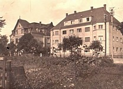Die Friedrich-Adolph-Sorge-Straße entstand kurz nach 1900 bei der Bebauung der Flächen nördlich des alten Dorfkerns. Bauherr war der Privatus Ernst Schanze, der die hier gelegenen Grundstücke wenig später verkaufte. Nach dem sächsischen König Friedrich August III. wurde sie zunächst Friedrichstraße genannt. Da es nach der Eingemeindung von Niedersedlitz jedoch bereits eine Friedrichstraße in Dresden gab, erhielt sie im September 1953 den Namen Friedrich-Adolph-Sorge-Straße. Friedrich Adolph Sorge (1828-1906) war ein Revolutionär, der 1849 am badischen Aufstand teilnahm, später in die USA emigrierte und dort Leiter der amerikanischen Sektion der I. Internationale war.

## Friedrich-Ebert-Straße

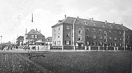Die Friedrich-Ebert-Straße entstand 1925 beim Bau einer Arbeiterwohnsiedlung im Osten der Niedersedlitzer Flur. Der Name erinnert an den ersten deutschen Reichspräsidenten Friedrich Ebert (1871-1925). Ebert war bis zu seiner Wahl ab 1913 Vorsitzender der SPD und gehörte zu den führenden Köpfen des gemäßigten Flügels der Partei. Aus politischen Gründen erfolgte am 20. März 1933 die Umbenennung in Leo-Schlageter-Straße. Albert Leo Schlageter (1894-1923) war als Mitglied der nationalsozialistischen Großdeutschen Arbeiterpartei an mehreren Sprengstoffanschlägen im französisch besetzten Ruhrgebiet beteiligt und wurde wegen dieser Anschläge und Spionage 1923 zum Tode verurteilt und hingerichtet.Während der NS-Zeit galt er als ein “Vorkämpfer der Bewegung”. Bereits 1945 wurde die Straße wieder rückbenannt und erhielt ihren alten Namen Friedrich-Ebert-Straße zurück.

## Geranienweg

Der Geranienweg entstand beim Bau des Wohnpark am Niedersedlitzer Platz und wurde am 7. Oktober 1993 benannt. Wie auch bei einigen älteren benachbarten Straßen erfolgte die Namensgebung nach einer Zierpflanzenart.

## Gersdorfer Weg

Sowohl der Gersdorfer Weg als auch der benachbarte Göppersdorfer Weg wurden Mitte der 1970er Jahre beim Bau einer kleinen Eigenheimsiedlung nördlich der Windmühlenstraße angelegt. Die Namensgebung erfolgte am 12. Juli 1973 nach dem Ort Gersdorf, einem Ortsteil von Bahretal im Kreis Pirna (heute Landkreis Sächsische-Schweiz-Osterzgebirge.

Der Göppersdorfer Weg entstand gemeinsam mit dem Gersdorfer Weg beim Bau einer Eigenheimsiedlung an der Windmühlenstraße. Am 12. Juli 1973 entschied der Rat der Stadt Dresden, diesen Weg nach der Ortschaft Göppersdorf, heute ein Ortsteil von Bahretal im Landkreis Sächsische Schweiz-Osterzgebirge, zu benennen.

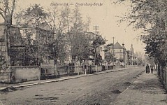Die heute über Niedersedlitzer und Großlugaer Flur führende Heidenauer Straße entstand Ende des 19. Jahrhunderts und ist am 16. Juli 1897 erstmals als Poststraße erwähnt. Am 4. April 1905 beschloss der Niedersedlitzer Gemeinderat die Umbenennung in Schillerstraße. Bereits 1917 kam es jedoch zu einer erneuten Namensänderung, da man sich entschieden hatte, die bestehende Goethestraße zu teilen und einem Abschnitt den Namen Schillerstraße zu geben. Beide Abschnitte tragen heute den Namen Bedrich-Smetana-Straße. Die bestehende Schillerstraße wurde nach General Paul von Hindenburg in Hindenburgstraße umbenannt. Der Beschluss des Gemeinderates dazu wurde am 13. Februar 1917 getroffen.

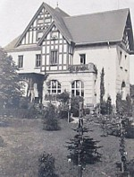In Großluga gab es ab 1900 die Planstraße V, wobei eine Verbindung nach Niedersedlitz bereits zu diesem Zeitpunkt vorgesehen war. Am 30. Januar 1900 beschloss der Gemeinderat einstimmig, mit dem Ausbau zu beginnen. Nach der Fertigstellung 1907 erhielt die Straße bis zur Ortsgrenze den Namen Albertstraße. Im Zuge der Vereinigung der Gemeinden Luga und Niedersedlitz kam es zu einer Doppelung, worauf man den Straßennamen 1922 in Emil-Häntzschel-Straße änderte. Damit sollte der frühere Großlugaer Gemeindevorstand geehrt werden, unter dessen Regie der Ausbau erfolgt war. Nach 1945 wurden beide Straßenabschnitte vereinigt und nach dem benachbarten Heidenau in Heidenauer Straße umbenannt.

Das Straßenbild prägen bis heute vorrangig Villen und Wohnhäuser. Im Haus Nr. 4 _(Foto rechts)_ ist die Kindertagesstätte "Sonnenschein" untergebracht. Ursprünglich entstand diese Villa 1910 für den Unternehmer Heinrich Weeren, Inhaber der Firma Staeding & Meysel Nachf. Das 1945 verstaatlichte und demontierte Unternehmen produzierte vorrangig Armaturen, Ventile und ähnliches Zubehör für Dampfheizungsanlagen. 1921 wurde auf dem Grundstück Heidenauer Straße 45 das Hauptumspannwerk des Ortes errichtet. 2016 erfolgte die Grundsteinlegung für einen kleinen Wohnpark der Wohnungsgenossenschaft "Flüwo" aus Baden-Württemberg (Nr. 11-19).

Die Straße Heimgarten entstand 1912 als Erschließungsstraße einer geplanten genossenschaftlichen Wohnanlage westlich der Lugaer Straße. Als eines der ersten ihrer Bauprojekte errichtete die Baugenossenschaft Dresden-Land eGmbH mit Sitz in (Freital)-Döhlen hier die "Kolonie Niedersedlitz" mit Einzel- und Doppelhäusern. Die Straßennamen wurden dabei in Erinnerung an die Gartenbautradition der Region gewählt. Nach einem Vorschlag der Genossenschaft erhielt eine dieser Straßen am 4. Oktober 1913 den Namen Heimgarten.

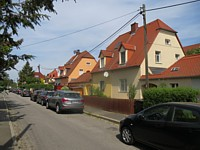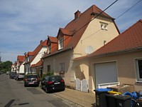

**_Fotos:_** _Die Niedersedlitzer "Blumensiedlung" mit den Straßen Heimgarten (links) und Rosenweg (rechts)_

## Heinrich-Mann-Straße

Die Heinrich-Mann-Straße wurde Ende der 1930er Jahre angelegt, bestand damals jedoch nur aus einem kurzen Straßenabschnitt am Rand der Siedlung Windmühlenstraße. Erstmals ist sie im Adressbuch von 1942 als Hermann-Löns-Straße erwähnt, benannt nach dem "Dichter der Lüneburger Heide" Hermann Löns. Wegen der Nähe von Löns zum Nationalsozialismus entschied man sich unmittelbar nach Ende des Zweiten Weltkriegs zur Umbenennung in Friedrich-Hölderlin-Straße. Auch diesmal stand ein Dichter Pate. Friedrich Hölderlin (1770-1843) verfasste verschiedene mythologische Werke und den Briefroman "Hyperion".

Da es nach der Eingemeindung von Niedersedlitz jedoch bereits in Cotta eine Hölderlinstraße gab, machte sich 1953 eine erneute Namensänderung erforderlich. Dabei entschied man sich für den deutschen Schriftsteller Heinrich Mann (1871-1950), der von den Nazis 1933 ins Exil getrieben wurde und zu den bedeutendsten bürgerlich-humanistischen Autoren des 20. Jahrhunderts gehört. Bekannt wurde er u.a. durch seine Romane “Professor Unrat” und “Der Untertan”.

Im Zuge des zum Teil auch auf Niedersedlitzer Flur errichteten Neubaugebietes Prohlis wurde die Heinrich-Mann-Straße nach 1980 über die Windmühlenstraße hinaus verlängert und bildete seitdem die Zufahrt zu den sogenannten “Sternhäusern”, einer im Zusammenhang mit dem Neubaugebiet Prohlis entstandenen Wohnsiedlung mit sternförmig angeordneten Zehngeschossern. Dieses Gebiet, welches auf Niedersedlitzer, Prohliser und Lockwitzer Flur liegt, wird heute meist zu Prohlis gerechnet. 2006 wurde mit dem Abriss der “Sternhäuser” begonnen. Auch die sechsgeschossigen Wohnblocks im östlichen Teil der Heinrich-Mann-Straße sind heute nicht mehr vorhanden.

## Hermann-Schmitt-Platz

Der Hermann-Schmitt-Platz wurde kurz vor dem Ersten Weltkrieg angelegt und ab 6. Oktober 1913 Rosenplatz genannt. Wie auch bei den benachbarten Straßen stand dafür eine Blumenart Pate. Seinen jetzigen Namen verdankt er dem früheren Vorsitzenden der Baugenossenschaft Dresden-Land Dr. Hermann Schmitt (1874-1932).Schmitt war ab 1903 im Staatsdienst tätig und übernahm 1923 das Amt des sächsischen Innenministers. Die Umbennung erfolgte auf Wunsch der Genossenschaft zur Ehrung ihres ausscheidenden Vorsitzenden am 10. Oktober 1916.

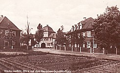Die Gebäude um den Platz und in den angrenzenden Straßen wurden ab 1912 als „Kolonie Niedersedlitz II“ für die Baugenossenschaft Dresden-Land e.G.m.b.H erbaut. Diese hatte kurz zuvor ein ca. 11 Hektar großes Flurstück an der Lugaer Straße für den Bau von Arbeiterwohnhäusern mit Gärten erworben. Ziel war es, nach dem Vorbild der drei Jahre zuvor gegründeten Gartenstadt Hellerau preiswerte Wohnungen für Arbeiter in ruhiger und grüner Umgebung zu schaffen. In Anlehnung an die hier vergebenen Straßennamen wird die Wohnanlage auch als „Blumensiedlung“ bezeichnet. Heute stehen die Häuser unter Denkmalschutz.

## Kleinborthener Straße

Die Kleinborthener Straße, seit dem 30. September 1953 benannt nach dem Dohnaer Ortsteil Kleinborthen, wurde in den 1920er Jahren angelegt und mit Wohnhäusern bebaut. Da sie in Richtung des benachbarten Stadtteils Prohlis führt, erhielt sie 1926 zunächst den Namen Prohliser Straße. Da es jedoch in Reick bereits eine gleichnamige Straße gab, erfolgte im Zuge der Eingemeindung von Niedersedlitz 1953 die Umbenennung. Auf den verbliebenen Freiflächen in leichter Hanglage entstand ab 2008 eine kleine Eigenheimsiedlung.

Die Kleine Straße verbindet die Bismarck- mit der Sosaer Straße und erhielt am 4. April 1905 nach dem Erfinder des Buchdrucks Johannes Gutenberg zunächst den Namen Gutenbergstraße. Da es nach der Eingemeindung des Ortes jedoch bereits eine gleichnamige Straße in der Johannstadt gab, erfolgte am 30. September 1953 die Umbenennung in Kurze Straße.

## Kurt-Tucholsky-Straße

Im Zusammenhang mit der Erweiterung des Neubaugebietes Prohlis entstanden um 1980 auch auf Niedersedlitzer Flur einige neue Straßen, darunter die Kurt-Tucholsky-Straße. Ihren Namen erhielt diese Straße am 13. April 1978 nach dem deutschen Schriftsteller und Publizisten Kurt Tucholsky (1890-1935), der vor allem durch seine politisch-satirischen Schriften bekannt wurde. Die nach Ihrem Grundriss als “Sternhäuser” bekannten Zehngeschosser an der Kurt-Tucholsky-Straße wurden 2009/11 abgerissen.

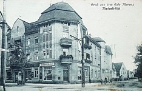Die Lockwitztalstraße verbindet Niedersedlitz mit dem benachbarten Stadtteil Lockwitz und wurde um 1890 deshalb bis zur Flurgrenze zwischen beiden Orten Lockwitzer Straße bzw. Niedersedlitzer Straße genannt. Um Straßendoppelungen zu vermeiden, erhielt sie am 30. September 1953 den Namen Lockwitztalstraße. Von 1906 bis 1977 verkehrte hier die [Lockwitztalbahn](../../../sudost/lockwitz/lockwitztalbahn/). Einige Gleisreste sind stellenweise noch vorhanden.

Das Straßenbild prägen vorrangig Mietshäuser und einige Villen, die im letzten Drittel des 19. Jahrhunderts entstanden. Im Haus Nr. 24 gab es einst "Kelbs Gaststätte". Einige Grundstücke dienen auch gewerblichen Zwecken. Die historische Aufnahme zeigt das Eckhaus zur Dorfstraße (Nr. 2) mit dem Café Morenz um 1920.

Buchdruckerei Schreiter: Im Hintergebäude der Lockwitztalstraße 72 befand sich einst die Buchdruckerei Welzel. Inhaber war Paul Welzel (1864-1921), der zeitweise auch dem Lockwitzer Gemeinderat angehörte. Ende 1945 übernahm der Drucker Oswald Schreiter die Geschäftsräume. Der aus Borthen stammende Unternehmer hatte bereits in den Zwanziger Jahren auf der Zöllnerstraße 38/40 in der Johannstadt eine Buchdruckerei gekauft, die jedoch 1945 dem Luftangriff zum Opfer fiel. In Niedersedlitz gelang mit einigen aufgearbeiteten Druckmaschinen der Neustart. Das Familienunternehmen blieb auch zu DDR-Zeiten in privatem Besitz. Produziert wurden hauptsächlich Plakate, Programmhefte und Prospekte. 1996 verlegte die Familie ihren Betrieb nach Borthen. Das Areal an der Lockwitztalstraße wurde nach dem Abriss des Vordergebäudes von der Arzneimittelfirma [Apogepha](../../Ost/Striesen/Strassen_Striesen/strassen_striesen.html) übernommen.

## Lugaer Straße

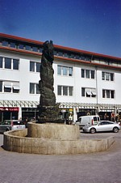Die Lugaer Straße verbindet den Ortskern von Niedersedlitz mit dem 1922 eingemeindeten Dorf [Großluga](../../../sudost/grossluga/). Zunächst wurde sie als Niedersedlitz-Lugaer Communicationsweg, ab 1903 als Lugaer Straße bezeichnet. Diese Namensgebung galt zunächst jedoch nur für den Niedersedlitzer Abschnitt, während die Verlängerung auf Lugaer Flur vor dem Ersten Weltkrieg Niedersedlitzer Straße hieß. Erst mit der Vereinigung beider Orte 1922 erfolgte eine einheitliche und bis heute gültige Namensgebung.

Bereits in den 1920er Jahren entstand an der Flurgrenze zwischen beiden Ortsteilen eine kleine Wohnsiedlung, deren Straßen Blumennamen erhielten und welche deshalb im Volksmund als “Blumensiedlung” bezeichnet wird. 1991/94 wurde diese Siedlung um einen Wohnpark erweitert. Die Grundsteinlegung erfolgte am 18. September 1991. Im Mittelpunkt der Anlage mit ca. 300 Wohnungen liegt der neu angelegte Niedersedlitzer Platz mit dem sogenannten “Sachsenstein”. Das Denkmal wurde von Karl-Heinz Seemann geschaffen und zeigt historische Persönlichkeiten und Ereignisse der sächsischen Geschichte _(Foto)_. Hier befindet sich auch das Dienstleistungszentrum der Siedlung mit einigen Läden.

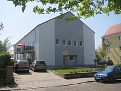Lehrschwimmbecken Niedersedlitz: Das Gebäude an der Lugaer Straße 12 entstand in den 1930er Jahren und beherbergte ab 1938 zunächst die “Filmschau Niedersedlitz” mit ca. 400 Plätzen. Zeitweise ist dieses Kino auch als "Capitol-Lichtspiele" im Adressbuch verzeichnet. Betreiber war der auf der Gartenstraße (heute Lungkwitzer Straße) 16 wohnende Unternehmer Albert Heinze. 1967 endete der Spielbetrieb. Kurz danach erfolgte der Umbau des früheren Kinos zu einer Lehrschwimmhalle. Diese Schwimmhalle blieb bis zum Jahr 2000 erhalten. Nach mehrjährigem Leerstand erfolgte ein Verkauf des Gebäudes und der Umbau zum Wohnhaus mit mehreren Loftwohnungen.

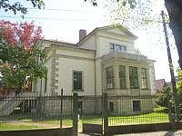Die heutige Lungkwitzer Straße verband schon vor ihrem Ausbau als sogenannter "Communicationsweg" Niedersedlitz mit dem benachbarten Sporbitz. 1888 begann der Bau des Abschnitts zwischen Lugaer Straße und Bismarckstraße, der im Anschluss Gartenstraße genannt wurde. Noch bis 1929 war diese Straße eine Privatstraße, bevor sie von der Gemeinde übernommen wurde. Nachdem Niedersedlitz 1950 zu Dresden gekommen war, machte sich eine Umbenennung erforderlich. Ursprünglich war dafür der Name Am Bach (nach dem hier fließenden Lockwitzbach) vorgesehen. Letztlich entschied man sich jedoch für die Namensgebung nach dem Ort Lungkwitz, einem Ortsteil von Kreischa. Das Foto zeigt die Villa Lungkwitzer Straße 4. Im Haus Nr. 20 gab es bis ca. 1990 die Gastwirtschaft "Zur Börse". Heute werden die Räume von einer Praxis genutzt.

## Maxie-Wander-Straße

Die Maxie-Wander-Straße entstand in den 80er Jahren des 20. Jahrhunderts im Zusammenhang mit dem Bau einer neuen
Wohnsiedlung. Ihren ursprünglichen Namen Fritz-Selbmann-Straße erhielt sie nach dem Schriftsteller und früheren DDR- Industrieminister Fritz Selbmann, der bis zu seinem Tod 1975 Vizepräsident des DDR-Schriftstellerverbandes war.

1993 wurde sie nach der Schriftstellerin Maxie Wander (1933-1977) benannt. Die aus Österreich stammende Autorin lebte
ab 1958 in der DDR und war hier als kritische Journalistin, Fotografin und Drehbuchautorin tätig. Bekannt wurde sie durch
ihre kritischen Tonbandprotokolle zur Emanzipation der Frau, die sie unter dem Titel “Guten Morgen, du Schöne” veröffentlichte.

## Mühlenstraße

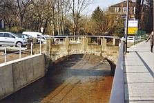Die Mühlenstraße gehört zu den ältesten Straßen im Dorfkern von Niedersedlitz. Der Name erinnert an eine frühere Wassermühle und deren hier verlaufenden Mühlgraben. Ursprünglich wurde dieser vom Lockwitzbach gespeist und trieb das Mühlrad an, bevor 1873 der Niedersedlitzer Unternehmer A. Danckelmann auf dem Grundstück eine Dampfmühle einrichtete. In diesem Zusammenhang wurde sie auf zehn Mahlgänge erweitert und zur Mehl- und Brotfabrik ausgebaut. 1892 zerstörte ein Großbrand diese Fabrik. Beim Wiederaufbau ließen die Besitzer Francisturbinen zur Erzeugung von elektrischen Strom installieren.

Nach 1945 wurden die Gebäude vom VEB Weizenin genutzt. 1992 entstand an der Mühlenstraße/ Ecke Lockwitztalstraße der Wohnpark “Lockwitztal” mit Mehrfamilien- und Bürohäusern. In unmittelbarer Nähe überspannt eine unter Denkmalschutz stehende Bogenbrücke den Lockwitzbach _(Foto)_.

## Nestroystraße

Die Nestroystraße wurde in den Dreißiger Jahren beim Ausbau der Niedersedlitzer Siedlung an der Windmühlenstraße
angelegt. Namensgeber war der österreichische Satiriker Johann Nestroy (1801-1862), der durch seine Lustspiele (“Lumpazivagabundus”) bekannt wurde.

## Niedersedlitzer Straße

Die Niedersedlitzer Straße verbindet die Dresdner Stadtteile Reick und Niedersedlitz und geht auf einen alten Kommunikationsweg zwischen diesen beiden Dörfern zurück. Ende des 19. Jahrhunderts siedelten sich hier erste Industriebetriebe an, die bis heute das Straßenbild prägen. 1980-85 entstanden im westlichen Teil der Straße einige Wohnblocks des Neubaugebietes Prohlis, 2003 die neue Gleistrasse der Straßenbahn zum Endpunkt Prohlis.

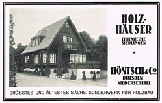Firma Höntsch & Co.: Das Unternehmen wurde 1895 von Georg Höntsch in einer Feldscheune am Rande des Niedersedlitzer Dorfkerns gegründet. Hergestellt wurden Gewächshäuser, Wintergärten, Heizungsanlagen, aber auch Wohnholzhäuser und andere Fertigteilbauten. Bis zum Ersten Weltkrieg entwickelte sich der kleine Handwerksbetrieb zum Großunternehmen mit Geschäftsbeziehungen in aller Welt. U.a. gehörten Zweigbetriebe in der Tschechoslowakei, Österreich, Ungarn, Jugoslawien, Rußland, China und Nordamerika dazu. Zu den markantesten Schöpfungen im Dresdner Raum gehörten die von der Firma errichteten Holzhaussiedlungen in Prohlis (1945 zum Großteil zerstört) und in Stetzsch _(Foto)_.

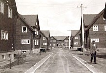1946 wurde der Betrieb verstaatlicht und als VEB Hosta-Glas (Holz-, Stahl- und Glasbau Dresden) weitergeführt. Zunächst lag der Schwerpunkt auf der Herstellung von Fertigteilen für den Wiederaufbau, bevor man in den 1950er und 1960er Jahren zum traditionellen Gewächshausbau zurückkehrte. Ab 1974 war der seit 1969 zum VEB Metallleichtbaukombinat Leipzig gehörende Betrieb Leitunternehmen der Branche in der DDR. Trotz zahlreicher Neuerungen wie der Einführung von Isolierglas und Aluminiumteilen in den Gewächshausbau geriet die Firma nach 1990 in Schwierigkeiten. 1994 übernahm ein schwäbischer Investor den Traditionsbetrieb, der heute unter dem Namen MBM Metallbau Dresden GmbH Fertigteile für die Baubranche herstellt. Teilweise werden auch noch Gewächshäuser gebaut bzw. rekonstruiert wie u.a. das Palmenhaus im Pillnitzer Schlosspark (1992-1994).

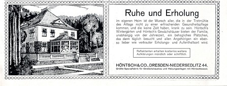

_Werbung der Firma Höntsch & Co. für Wintergärten und Gewächshäuser aus dem Jahr 1911_

## Pfarrer-Schneider-Straße

Die Pfarrer-Schneider-Straße am Rande des Niedersedlitzer Dorfkerns wurde nach 1945 nach dem evangelischen Pfarrer
Paul Schneider (1897-1939) benannt. Schneider war im Rheinland tätig und geriet wegen seiner antifaschistischen Haltung schon bald in Konflikt mit dem NS-Regime. Mehrfach strafversetzt
wurde er 1937 im KZ Buchenwald inhaftiert, wo er 1939 an den Folgen der Haft verstarb.

Gemeindezentrum Niedersedlitz: Das Evangelisch-Lutherische Gemeindezentrum entstand 1982 auf einem bereits 1958 von der Kirche erworbenen Grundstück an der Pfarrer-Schneider-Straße 7. Bereits vor dem Zweiten Weltkrieg hatte es Pläne für eine eigene Kirche gegeben, um den langen Weg zur Leubener Kirche zu verkürzen. Ab 1935 nutzte man zunächst die Räume eines früheren Ladengeschäftes.

Die Grundsteinlegung für den Neubau erfolgte am 13. März 1982, die Weihe am 18. September 1983. Die Bauplanung übernahm der Architekt Dietmar Bach, die Arbeiten erfolgten fast ausschließlich durch die Gemeindemitglieder. Das Gemeindezentrum bietet Platz für 80 Gläubige. Zur Ausstattung gehören ein von Niedersedlitzer Jugendlichen gestalteter Passionszyklus aus Keramik- und Glasmosaiksteinen sowie Altar, Tisch, Lesepult und Leuchter von Werner Juza. Die bereits vor Vollendung des Gebäudes geweihte Orgel wurde von der Firma Eule geschaffen. Neben dem Gemeindezentrum befindet sich ein hölzerner Glockenstuhl, in dem zwei Glocken läuten.

[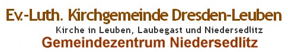](http://www.himmelfahrtskirche-dresden.de)

Der Poetenweg wurde kurz vor dem Ersten Weltkrieg als Planstraße U angelegt und am 6. Oktober 1913 auf Beschluss des Gemeinderates Theodor-Körner-Straße genannt. Namensgeber war der Dichter und Freiheitskämpfer Theodor Körner. Da es jedoch zum Zeitpunkt der Eingemeindung bereits in der Inneren Neustadt eine Körnerstraße gab, erfolgte am 30. September 1953 die Umbenennung in Poetenweg. Vermutlich sollte mit dieser Namensgebung der Bezug zum Dichter aufrecht erhalten werden.

## Prof.-Billroth-Straße

Die Professor-Billroth-Straße entstand im Zusammenhang mit dem Bau neuer Wohnhäuser außerhalb des alten Dorfkerns und erhielt ihren Namen nach dem Mediziner Christian Theodor Billroth (1829-1894). Billroth gehörte zu den bedeutendsten Chirurgen seiner Zeit und führte zahlreiche neue Operationsmethoden in seinem Fachgebiet ein.

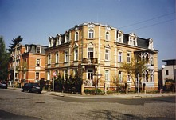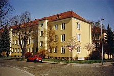

**_Fotos:_** _Wohnhäuser an der Prof.-Billroth-Straße / Lugaer Straße_

## Rosenweg

Der Rosenweg wurde 1913 im Zusammenhang mit dem Bau der sogenannten “Blumensiedlung” westlich der Lugaer Straße
angelegt. Die kleine Wohnanlage entstand nach einem einheitlichen Konzept für die Baugenossenschaft Dresden-Land e.G.m.b.H und umfasst mehrere Reihen- und Doppelhäuser. Markantestes Gebäude ist das Torhaus Rosenweg 23/24.
Sowohl der Rosenweg als auch die benachbarten Straßen sind nach Blumen benannt und erinnern damit an die einst in den östlichen Dresdner Vororten ansässigen zahlreichen Gärtnereien.

## Schongauerstraße

Die kurze Schongauerstraße, eine Seitenstraße der Lockwitztalstraße, bildet die Flurgrenze zwischen Lockwitz und
Niedersedlitz, die bis zur Eingemeindung 1950 zugleich Dresdner Stadtgrenze war. Sie ist 1935 erstmals im Stadtplan verzeichnet und wurde zunächst nach der Adelsfamilie von Osterhausen Osterhausenstraße genannt. Johann Georg von
Osterhausen hatte 1620 die beiden Rittergüter Ober- und Unterlockwitz gekauft und war Bauherr der Lockwitzer Kirche. 1950 erhielt sie nach dem Maler und Kupferstecher Martin Schongauer (um 1435-1491), der neben Dürer zu den
bedeutendsten Künstler des Mittelalters gehörte, ihren heutigen Namen.

## Siemensstraße

Die Siemensstraße wurde als Werksstraße des Industriegebietes nördlich der Bahnlinie angelegt und nach dem Techniker und
Industriellen Werner von Siemens (1816-1892) benannt. Siemens war auf dem Gebiet der Elektrotechnik tätig und
entwickelte u.a. die erste Elektrolokomotive der Welt. In neueren Stadtplänen ist die Straße nicht mehr namentlich erwähnt.

## Sosaer Straße

Die Sosaer Straße wurde Ende des 19. Jahrhunderts angelegt und trug bis zur Eingemeindung von Niedersedlitz den Namen Schulstraße. Hier befand sich das 1876 errichtete Schulhaus und das 1902 eingeweihte Rathaus der Gemeinde. Ihren heutigen Namen verdankt sie der kleinen Gemeinde Sosa im Vogtland, bekannt durch die gleichnamige Talsperre.

Nr. 6 (Villa Trummler): Die Villa wurde 1898 für den Rechtsanwalt Horst Trummler errichtet. Architekt des Gebäudes war der junge Max Hans Kühne (1874-1942), der mit dem Haus seinen ersten größeren Bauauftrag realisierte. Später arbeitete er mit seinem Schwiegervater im Architekturbüro Lossow & Kühne zusammen. Zu seinen bedeutendsten Bauten gehören u.a. das Dresdner Schauspielhaus und der Hauptbahnhof in Leipzig.

Nach der Fertigstellung des Hauses bezog Trummler die Villa auf der damaligen Schulstraße. Der Jurist war zu dieser Zeit als königlicher-sächsischer Notar tätig. 1903 beurkundete er einen Vergleich zwischen dem Niedersedlitzer Verleger Adalbert Fischer und dem Schriftsteller Karl May. Fischer hatte wenige Jahre zuvor den Münchmeyer-Verlag und damit auch die Rechte an einigen Karl-May-Werken erworben, diese jedoch aus Mays Sicht unerlaubt verändert und nachgedruckt. In den Zwanziger Jahren wohnte der Unternehmer Heinrich Weeren, Inhaber einer Armaturenfabrik und Eisengießerei, in der Villa. Das Unternehmen war während des Zweiten Weltkriegs eng in die Rüstungsindustrie eingebunden und wurde nach 1945 verstaatlicht. Die Villa diente zu DDR-Zeiten als Kindergarten. Heute wird sie, vor einigen Jahren denkmalgerecht saniert, als Kita "Villa Naseweis" genutzt.

Im Garten des Hauses befand sich einst ein Zierbrunnen mit einer Darstellung einer "Danaide" aus der griechischen Mythologie. Danaiden wurden die 50 Töchter des Königs Danaos genannt, welche als Strafe für die Ermordung ihrer Ehemänner Wasser in ein durchlöchertes Fass schöpfen mussten. Die Bronzefigur wurde von Johannes Schilling geschaffen und befand sich bis 1945 auf dem Grundstück. 1948 wurde sie ohne das heute verschwundene Brunnenbecken in eine kleine Grünanlage an der Tharandter Straße in Löbtau umgesetzt. Nachdem sie dort mehrfach Opfer von Vandalismus geworden war, kam sie 2009 ins städtische Lapidarium und soll künftig einen neuen Platz finden.

## Sportplatzstraße

Die Sportplatzstraße entstand 1905 als Zufahrtsstraße zum Betriebsgelände des Kunstverlags Krey & Sommerlad und hatte zunächst den Status einer Privatstraße. Die ursprünglich postalisch
der Schillerstraße (heute Heidenauer Straße) zugeordnete Straße erhielt nach der Machtübernahme der Nationalsozialisten 1935 die Benennung Hans-Schemm-Straße. Hans Schemm
(1891-1935) war Gründer des Nationalsozialistischen Lehrerbundes und Gauleiter der NSDAP in Oberfranken. 1935 kam er
bei einem Flugzeugabsturz ums Leben. 1945 erhielt die Straße ihren heutigen Namen, da sie zu einem Sportplatz führt. Dieser wird heute u.a. vom Dresdner Bogenschützenverein und dem Baseballverein Dresden Dukes genutzt.

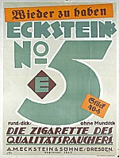Kunstanstalt Krey & Sommerlad:
Bedeutendstes Gebäude ist die frühere Kunstanstalt Krey & Sommerlad. Das Haus (heute Sportplatzstraße 1) entstand zwischen 1903 und 1905 für dieses
Unternehmen und beherbergte die Verwaltungs- und Produktionsräume der Firma, die als graphischer Betrieb, Lithografieanstalt und Buch- und Steindruckerei tätig war. Hergestellt wurden
vor allem Ansichtskarten, Musterbücher, Werbebroschüren und Plakate _(Bild)_. Zwischen 1911 und 1914 erschien im Verlag die Zeitschrift “Die Kunstwelt”. In den Zwanziger Jahren besaß die
Firma zudem eine Genehmigung für den Druck von Wertpapieren. Später wechselten mehrfach die Eigentümer, bevor um 1935 Wilhelm Berg in den Räumen eine Stahlmatratzenfabrik einrichtete.
Nach 1945 ging das Unternehmen in staatlichen Besitz über und gehörte als Bettenfabrik zum Kombinat VEB Polstermöbel Oelsa-Rabenau. 2013/14 erfolgte der Umbau der denkmalgeschützten Bauten zu einer Wohnanlage.

## Straße des 17. Juni

Die parallel zur Bahnlinie verlaufende Straße bestand ursprünglich aus zwei Teilen. Der ältere Abschnitt zwischen Bahnhof- und Reisstraße entstand 1876/77 und erhielt am 20. November 1876 den Namen Güterbahnhofstraße. Teilweise wurde sie auch als Große Güterbahnhofstraße bezeichnet. Um 1900 erfolgte eine Verlängerung in Richtung Dobritz, nachdem der Bauunternehmer Robert Berndt in diesem Gebiet zahlreiche neue Gebäude errichtet hatte. Wegen seiner Lage gab man diesem Straßenabschnitt zunächst den Namen Dobritzer Straße. Am 4. April 1905 beschloss der Niedersedlitzer Gemeinderat, beide Straßenteile unter dem neuen Namen Nordstraße zu vereinigen.

Nach 1945 wurde die Nordstraße zunächst in August-Bebel-Straße umbenannt. Namensgeber war der deutsche SPD-Politiker und Reichstagsabgeordnete August Bebel.
Zur Vermeidung von Verwechslungen mit einer gleichnamigen Straße in Strehlen erhielt sie am 30. September 1953 den Namen Hennigsdorfer Straße.

Bereits Ende des 19. Jahrhunderts waren an diesem Teil von Niedersedlitz zahlreiche Industriebetriebe entstanden, darunter als bedeutendstes Unternehmen das spätere [Sachsenwerk](../../../ost/niedersedlitz/sachsenwerk/). Der Betrieb war 1953 eines der Zentren des Aufstandes in Dresden gegen die herrschenden politischen Zustände in der DDR. Zu den Führern der streikenden Arbeiter gehörte der SPD-Funktionär Wilhelm Grothaus, der später zu einer langjährigen Haftstrafe verurteilt wurde. In Erinnerung an diese Ereignisse wurde die Hennigsdorfer Straße 2003 in Straße des 17. Juni umbenannt. Auf der Straße des 17. Juni Nr. 102c hat seit 1993 die Evangelisch-Freikirchliche Gemeinde Dresden Süd-Ost ihr Gemeindezentrum. Die Religionsgemeinschaft entstand als Ableger der Gemeinde in Striesen und gehört dem Bund Evangelisch-Freikirchlicher Gemeinden BEFG an.

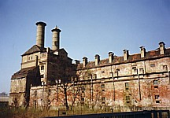Malzfabrik Niedersedlitz (Nr. 21): Der Betrieb wurde zwischen 1873 und 1875 unmittelbar an der Bahnlinie errichtet und ab 1889 als Aktiengesellschaft von den Gebrüdern Pick geführt. Die zu ihrer Entstehungszeit modernste Fabrik ihrer Art in Sachsen diente der Versorgung der zahlreichen Dresdner Brauereien mit Braumalz. Die für die Herstellung erforderliche Gerste kam per Schiff über die Elbe nach Kleinzschachwitz, wurde dort entladen und anschließend mit Fuhrwerken nach Niedersedlitz gebracht. Mit der industriellen Malzherstellung entfiel der zuvor notwendige aufwendige Produktionsprozess in den Brauereien selbst, was zu einer deutlichen Erhöhung der Produktivität beitrug. Der zunehmende Bedarf machte 1897/98 und 1914/16 Erweiterungen und Modernisierungen erforderlich.

Nach 1945 wurde die Malzfabrik verstaatlicht und gehörte später als VEB Malzwerke zum Getränkekombinat Dresden. Größere Umbauarbeiten erfolgten letztmals 1956. Zeitweise befand sich hier auch ein Lager des VEB Saat- und Pflanzgut. Seit 1990 stehen die markanten Gebäude leer und verfallen. Pläne für eine künftige Nutzung gibt es derzeit nicht.

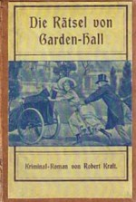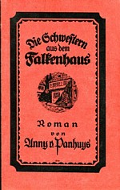Nr. 26: Das heute nicht mehr vorhandene Gebäude war ab 1902 Sitz des bekannten Münchmeyer-Verlages. Der von Heinrich Gotthold Münchmeyer gegründete Verlag gab hauptsächlich Kolportageromane heraus und wurde vor allem durch seinen populärsten Autor Karl May bekannt. Wirtschaftliche Schwierigkeiten zwangen Münchmeyers Witwe Pauline 1899 zum Verkauf an den Buchhändler Adalbert Fischer. Fischer verlegte den Firmensitz im Juni 1902 nach Niedersedlitz. Hier besaß er auch eine Villa auf der Gartenstraße 4. Wenig später kam es zu einem Streit zwischen Fischer und May, da der Schriftsteller dem Verleger den unerlaubten Nachdruck seiner Werke mit von May nicht autorisierten Änderungen vorwarf. Erst ein vom Niedersedlitzer Rechtsanwalt Trummler beglaubigter Vergleich beendete 1903 den Konflikt.

Am 15. Mai des gleichen Jahres gründete Adalbert Fischer den "Belletristischen Verlag Dresden-Niedersedlitz", in dem er u.a. Mays Frühwerke unter dem Titel "Erzgebirgische Dorfgeschichten" veröffentlichte. Nach Fischers Tod 1907 übernahm zunächst seine Witwe, danach sein Schwiegersohn Arthur Schubert die Geschäftsleitung. Nach 1933 firmierte der Verlag unter Regie von Adele Preatorius als "Verlag Das Vaterhaus" und gab u.a. die Illustrierte Roman-Zeitschrift "Das Vaterhaus" heraus. Hinzu kamen Autoren wie der Science-Fiction-Schriftsteller Robert Kraft und die zu ihrer Zeit durch Frauen- und Adelsromane bekannte Schriftstellerin Anny von Panhuys _(Cover-Abbildungen)_. Das frühere Verlagsgebäude wurde 2012 abgerissen.

## Windmühlenstraße

Die Windmühlenstraße wurde als Verbindungsstraße zwischen Niedersedlitz und der alten Pirnaischen Straße (heute Dohnaer Straße angelegt). Ihren Namen verdankt sie der 1825 hier errichteten Holländerwindmühle auf dem Hinterberg. Erst nach dem Ersten Weltkrieg entstanden an der Windmühlenstraße durch eine Baugenossenschaft die ersten Wohnhäuser, die 1935 um eine größere Wohnsiedlung ergänzt wurden. Auf den verbliebenen Freiflächen südlich der Straße errichtete man ab 1980 zehngeschossige Wohnhäuser. Die wegen ihres Grundrisses “Sternhäuser” genannten Gebäude wurden ab 2005 abgerissen.

Holländerwindmühle: Die Niedersedlitzer Windmühle entstand 1825 als Ersatz für die Laubegaster Schiffsmühle auf dem Hinterberg. Bauherr war der Müllermeister Schreger, um so auch in wasserarmen Zeiten mahlen zu können. 1859 brannte die Mühle nach einem Blitzschlag ab, wurde jedoch schon bald wieder aufgebaut. Neuer Besitzer war der Dresdner Kaufmann und Farbwarenhändler H. A. Matthaes. Ursprünglich als Mahlmühle genutzt, diente sie nun als Holzmühle zur Herstellung von Farbstoffen für die Niedersedlitzer Papier- und Kartonnagenindustrie. Betreiber war 1878 der aus Rübenau stammende Ernst Ludwig von Otto. 1894 fiel die Windmühle erneut einem Brand zum Opfer und wurde daraufhin abgerissen. Erhalten blieb lediglich das Wohnhaus des früheren Mühlenbesitzer (Windmühlenstraße 49).

[Niedersedlitz auf OpenStreetMap](https://www.openstreetmap.org/search?query=Dresden+Niedersedlitz)

* * *

 \[ [Home](../../../index.html)\] \[ [Nord](../../../nord/)\] \[ [Nordwest](../../../nordwest/)\] \[ [Neustadt](../../../neustadt/)\] \[ [Nordost](../../../nordost/)\] \[ [West](../../../west/)\] \[ [Zentrum](../../../zentrum/)\] \[ [Südwest](../../../sudwest/)\] \[ [Süd](../../../sud/)\] \[ [Südost](../../../sudost/)\] \[ [Ost](../../../ost/)\] \[ [Register](../../../Register/register.html)\] \[ [Kontakt](../../../Kontakt/kontakt.html)\] \[ [Impressum](../../../impressum/)\]
