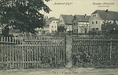
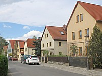
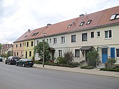
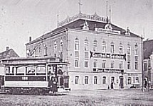
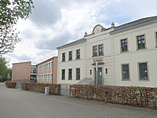

* * *

**Gemeindesiegel von Seidnitz**

**Schulen in Seidnitz:**

Die Fluren des Dresdner Stadtteils Seidnitz liegen zwischen der Eisenbahnstrecke Dresden - Prag, dem Grunaer Landgraben, der Wehlener Straße und der Paracelsusstraße. Der Ort entstand im Mittelalter als slawisches Platzdorf auf einer hochwasserfreien Erhebung zwischen zwei Elbealtarmen und wurde 1378 erstmals urkundlich erwähnt. Der aus dem altsorbischen stammende Name “Syticz” bedeutet übersetzt “Leute des Zideta” und deutet auf den Ortsgründer hin. Umgeben war das Dorf ursprünglich von kleinen Seen und Tümpeln, die als Seewiesen noch bis 1898 existierten und erst nach Senkung des Grundwasserspiegels im Zusammenhang mit dem Bau des Tolkewitzer Wasserwerkes verschwanden.

Zum Dorf gehörte einst ein Vorwerk, welches den Burggrafen von Dohna gehörte und ab 1388 zur Frauenkirche zinspflichtig war. 1445 war Seidnitz im Besitz der Meißner Domherren und kam nach der Reformation 1546 an das Dresdner Religionsamt. Auch das Brückenamt des Rates sowie das kurfürstliche Ostravorwerk besaßen später Rechte in Seidnitz. Jahrhundertelang blieb der kleine Ort ein unbedeutendes Bauerndorf an der alten Landstraße nach Pirna. 1745 wurde Seidnitz bei einem Dorfbrand fast völlig zerstört. Kirchlich unterstand der Ort ab 1539 der Leubener Kirche, zeitweise auch der Dresdner Frauenkirche. Erst 1951 entstand aus einer früheren Scheune ein Gemeindehaus für die ev.-luth. [Nazareth-Gemeinde](../../ost/seidnitz/nazarethkirche/).

Im 19. Jahrhundert entwickelte sich Seidnitz zur Arbeiterwohngemeinde, begünstigt durch den Aufschwung der Industrie im benachbarten Striesen und in Niedersedlitz. 1891 wurde auf  der Flur des Ortes die Dresdner [Pferderennbahn](../../ost/seidnitz/pferderennbahn/) angelegt. Außerdem entstanden zahlreiche neue Wohnhäuser, die meist an Arbeiter und Angestellte vermietet wurden. Schrittweise verlor der Ort so seinen ländlichen Charakter und wurde am 1. Juli 1902 nach Dresden eingemeindet. Nach dem Ersten Weltkrieg begann die Bebauung der bis dahin noch verbliebenen Freiflächen durch verschiedene Wohnungsbaugenossenschaften, die u.a. Siedlungen südlich der [Bodenbacher Straße](../../ost/gruna/strassen_gruna/bodenbacher_strasse/) errichteten _( **Foto:** Dobritzer Straße)_. Hinzu kamen einige Betriebe entlang der Bahnstrecke.

**_Foto:_** _Straßenbahn am alten Seidnitzer Gasthof um 1910_

Nach dem Zweiten Weltkrieg setzte sich die Industrialisierung des Vorortes weiter fort. So errichteten der damalige VEB Chemieanlagen und der VEB Robotron-Elektronik an der Bodenbacher Straße ausgedehnte Werksanlagen. Wohnungsneubauten, zunächst in Großblock-, später in Plattenbauweise folgten zwischen 1974 und 1976 an der Bodenbacher Straße in Richtung Gruna sowie 1980/81 im Gebiet um die Marienberger Straße. Bedeutendstes Bauvorhaben der letzten Jahre war das 1997 eröffnete moderne Einkaufszentrum “Seidnitz-Center” an der Enderstraße. Teile des alten Dorfkerns mit einem historischen Feuerwehr-Gerätehaus sind noch in Altseidnitz und an der Bodenbacher Straße erhalten geblieben.

Schulen in Seidnitz:

33\. Grundschule: Seidnitz erhielt sein erstes eigenes Schulhaus relativ spät. Erst am 10. August 1877 konnte die bescheidene Dorfschule in einem Gebäude an der Marienberger Straße 5 übergeben werden. Zuvor mussten die Kinder des Ortes die Schule im benachbarten Leuben besuchen. Mit zunehmender Bevölkerungszahl machte sich jedoch bereits 1898 ein Erweiterungsbau erforderlich, der seit 1902 von der 33. Bezirksschule (ab 1919 33. Volksschule) genutzt wurde. 1929 erhielt diese eine aus Reick stammende Baracke mit drei weiteren Klassenzimmern und einer kleinen Turnhalle. Mit dem Neubau eines Schulgebäudes 1959 verbesserten sich die Lernbedingungen deutlich. Zwischen 1985 und 1992 trug dieses den Namen der Schriftstellerin Anna Seghers (33. POS). Seit 1992 wird die Seidnitzer Schule nur noch als Grundschule genutzt und in den vergangenen Jahren teilweise saniert.

96\. Grundschule: Ein weiteres Schulhaus befindet sich auf der Liebstädter Straße 37. Es entstand im Zuge eines Neubaugebietes als 96. Polytechnische Oberschule und wurde am 1. September 1975 eröffnet. Am 5. Juli 1984 erhielt diese Schule den Namen des Bergsportlers und antifaschistischen Widerstandskämpfers Kurt Aehlig (1901-1944). Zwischen 1998 und 2002 erfolgte eine grundlegende Sanierung. Heute nutzt die 96. Grundschule "Am Froschtunnel" das Gebäude. Die offizielle Benennung erfolgte am 31. Mai 2005.

57\. POS: Die 57. Polytechnische Oberschule (POS) entstand 1974 als Plattenbau vom Typ "Dresden" an der Hausdorfer Straße 4. Noch im gleichen Jahr erhielt sie nach der Politikerin und Widerstandskämpferin Olga Körner (1887-1969) ihren Beinamen. Olga Körner war während der NS-Zeit im Konzentrationslager Ravensbrück inhaftiert, wirkte nach 1945 in der sächsischen Landesleitung der KPD und war Abgeordnete des Landtags. Ab 1991 war hier die 57. Grundschule untergebracht.

Im August 2003 übernahm der Evangelische Schulverein einige Räume und richtete hier die Freie Evangelische Schule (FES) ein. Der 1991 gegründete Verein hatte zuvor ab 1993 einige Räume der 95. Grundschule an der Donathstraße genutzt, die wegen der wachsenden Schülerzahl jedoch nicht ausreichten. Zunächst gab es nur eine Grundschule, ab 2006 auch eine Mittelschule. Mit Schließung der 57. Grundschule zum Ende des Schuljahres 2007/08 war die FES alleiniger Nutzer des Schulhauses. 2014 wurde es abgerissen und durch einen modernen Neubau nach Plänen des Dresdner Architekturbüros Code Unique ersetzt.

## [Seidnitzer Straßen](../../ost/seidnitz/strassen_seidnitz/)

[_Weiterführende Literatur und Quellen_](../../impressum/quellenverzeichnis/)

 \[ [Home](../../index.html)\] \[ [Nord](../../nord/)\] \[ [Nordwest](../../nordwest/)\] \[ [Neustadt](../../neustadt/)\] \[ [Nordost](../../nordost/)\] \[ [West](../../west/)\] \[ [Zentrum](../../zentrum/)\] \[ [Südwest](../../sudwest/)\] \[ [Süd](../../sud/)\]
 \[ [Südost](../../sudost/)\] \[ [Ost](../../ost/)\] \[ [Register](../../Register/register.html)\] \[ [Kontakt](../../Kontakt/kontakt.html)\] \[ [Impressum](../../impressum/)\]
