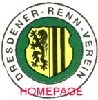
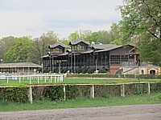
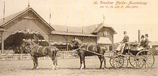
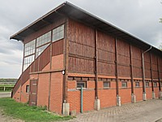
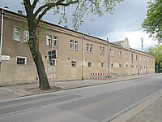

* * *

Die Geschichte von Pferderennen in Dresden reicht bis ins 18. Jahrhundert zurück, als solche Rennen zum Programm höfischer Feste gehörten. Das erste wettkampfmäßige Rennen veranstaltete jedoch erst 1805 der englische Gesandte Lord Wynn auf einem Gelände im Ostragehege. Für die Förderung des Pferdesports setzten sich später vor allem Offiziere der sächsischen Armee ein. Diese gründeten am 17. Dezember 1890 den Verein “Dresdner Reiterheim” (ab 1893 Dresdner Rennverein e.V.), der sich den Bau einer ständigen Pferderennbahn zum Ziel setzte. Initiator und erster Vorsitzender des Vereins wurde der Premierleutnant a. D. Walter von Treskow. Walter von Treskow, durch seine Hochzeit mit der Erbin der Musikinstrumentenfabrik F. A. Glier zu Wohlstand gekommen, hatte bereits zuvor einen eigenen Rennstall aufgebaut und veranstaltete private Rennen auf verschiedenen Plätzen in Dresden.

Allerdings stießen diese Pläne zunächst auf wenig Gegenliebe. Vor allem das Kriegsministerium lehnte die Veranstaltung von Pferderennen ab, da diese wegen der damit verbundenen Pferdewetten die Moral der Offiziere beeinträchtigen würden. Letztlich setzte sich der Rennverein jedoch durch und erhielt Anfang 1891 die Genehmigung zum Bau einer Pferderennbahn. Für diese pachtete der Verein Flächen von acht Seidnitzer Bauern und begann bereits im Februar mit den Bauarbeiten. Schon am 7. Mai 1891 fand in Seidnitz das erste Rennen auf der neu geschaffenen Bahn statt. 1893 konnte der Verein das ca. 33 Hektar große Gelände mit allem Zubehör käuflich erwerben. Zur Eröffnung der im gleichen Jahr fertiggestellten Renntribüne war Sachsens König Albert vor Ort, der dabei den “Großen Dresdner Armee-Steeple-Chase” als Ehrenpreis stiftete.

In den Folgejahren wurde die Rennbahn immer wieder erweitert. Neben Ställen und Wirtschaftsgebäuden errichte der Dresdner Rennverein ein Vereinslokal mit Namen “Reiterheim”, welches für die regelmäßigen Treffen der Mitglieder genutzt wurde. Außerdem entstand eine “Trainieranstalt” für Pferde und Reiter. 1894 fand zum ersten Mal eine Pferdeausstellung in Seidnitz statt, für die man einen Ausstellungsplatz neben der Rennbahn anlegte. Derartige Ausstellungen hatte es in Dresden bereits seit 1875 auf dem Gelände des [Städtischen Vieh- und Schlachthofes](../../../neustadt/leipziger_vorstadt/leipziger_strasse/alter_schlachthof/) an der Leipziger Straße gegeben. Wirtschaftliche Schwierigkeiten überwand man der Verein durch großzügige Zuwendungen wohlhabender Mitglieder wie Bruno Naumann (Seidel & Naumann) und Hugo von Hoesch, Inhaber einer Papierfabrik.

In den Jahren nach 1900 gelang es, die Seidnitzer Pferderennbahn zu einer der führenden in Deutschland weiterzuentwickeln. Neben der Anlage des Eisenbahnhaltepunktes und dem Bau einer eigenen Straßenbahngleisschleife trugen auch die ständigen Modernisierungen und Erweiterungen des Geländes zu diesem Erfolg bei. So wurden 1909 erstmals “Wettmaschinen” angeschafft, 1912 entstanden neue Trainingsanlagen. Bereits drei Jahre zuvor konnte das 1000. Pferderennen auf der Seidnitzer Rennbahn mit einem festlichen Blumencorso durch den Großen Garten begangen werden.

Bis zum Zweiten Weltkrieg war die Pferderennbahn in Seidnitz regelmäßig Schauplatz für Pferdesportveranstaltungen, die oft tausende Besucher anzogen. Selbst während des Krieges wurden Renntage veranstaltet. Hinzu kamen Gastrenntage der Rennvereine Hamburg, Bad Harzburg, Leipzig und Breslau. Letztmals starteten die Reiter am 1. Dezember 1944, wenige Wochen vor der Zerstörung Dresdens. Während das Vereinsbüro mit dem Archiv des Dresdner Rennvereins, welches sich auf der Prager Straße in der Innenstadt befand, den Bomben zum Opfer fiel, blieben die Anlagen in Seidnitz weitgehend unbeschädigt. Lediglich die zweite Tribüne an der Winterbergstraße brannte ab. Eine geplante Nutzung des Geländes als Feldflugplatz der Luftwaffe kam nicht mehr zustande.

So konnte bereits am 14. Oktober 1945 das erste Pferderennen der Nachkriegszeit durchgeführt werden. Statt des zwangsweise aufgelösten Dresdner Rennvereins übernahm 1946 die neu gegründete Pferdezucht- und Reitgenossenschaft Dresden-Seidnitz die Veranstaltung der Pferderennen. 1953 wurde diese zum volkseigenen VE Rennbetrieb Dresden umgewandelt, der 1974 als “Betriebsteil” an den VEB Vollblutrennbahnen Berlin-Hoppegarten angeschlossen wurde. 1990 entstand als Nachfolger der “Dresdner Rennverein 1890 e.V.”, der die Traditionen des Dresdner Pferderennsports fortsetzt.

In den Jahren 2012/13 wurden umfangreiche Erneuerungs- und Modernisierungsarbeiten durchgeführt, wobei die unter Denkmalschutz stehenden Gebäude weitgehend originalgetreu rekonstruiert werden konnten. Wahrzeichen der Seidnitzer Rennbahn ist die 1891 erbaute hölzerne Haupttribüne mit ca. 1000 Sitzplätzen. Das zur Bauzeit technisch wegweisende Bauwerk besteht aus einem Ziegelsockel und dem auf 22 Pfeilern ruhenden Aufbau mit Satteldach. Im 1911 errichteten Waagegebäude, 1964 bei einem Brand schwer beschädigt, befindet sich heute der Sitz der Rennleitung, der Jockeys und des Tierarztes. Der gastronomischen Versorgung der Besucher dient ein Pavillon, der seit 2003 den Namen "Walter von Tresckow".
