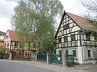
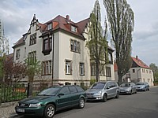
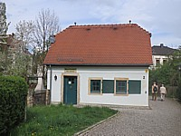
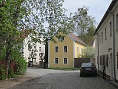
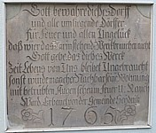
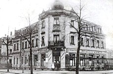
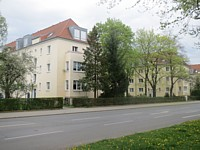
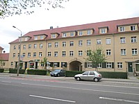
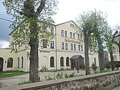

Der auf Seidnitzer Flur gelegene Altenberger Platz erhielt seinen Namen am 14. August 1930 nach der Stadt Altenberg im Osterzgebirge. Die Namensgebung erfolgte in Anlehnung an die den Platz überquerende [Altenberger Straße](../../../ost/striesen/strassen_striesen/), die sich hier mit der Enderstraße vereinigt. Die Platzanlage selbst ist jedoch deutlich älter und bereits in einem Bauplan von 1896 verzeichnet. Erst in den 1930er Jahren entstanden jedoch die ersten Gebäude an der Südseite (Nr. 18-22), die heute unter Denkmalschutz stehen. 1994 folgte das Einkaufszentrum “Striesen Center” mit verschiedenen Läden.

Der noch gut erhaltene frühere Anger von Seidnitz wird seit 11. November 1903 offiziell als Altseidnitz bezeichnet. Früher hieß die Anlage Dorfplatz bzw. im östlichen Teil bis 1939 Sorbenstraße. Die Gehöfte entstanden nach dem großen Brand von 1745 und stehen unter Denkmalschutz. Noch bis 1898 befand sich inmitten des Platzes ein kleiner Teich, der nach dem Bau des Tolkewitzer Wasserwerkes jedoch verlandete und schließlich zugeschüttet wurde.

Zu den noch erhaltenen Gebäuden gehören das Gehöft Nr. 11 mit einem villenartigen Herrenhaus sowie die Fachwerkhäuser Nr. 17, 19 _(Foto)_ und 25. Am Giebel des Wohnhauses Altseidnitz 16 erinnert die Jahreszahl 1859 an seine Bauzeit. Hier befand sich später viele Jahre eine kleine Verkaufsstelle. In unmittelbarer Nähe gab es früher auch die Gastwirtschaft “Zur Erholung” (Nr. 10) von Paul Greif.

**_Fotos:_** _Impressionen aus dem Dorfkern Altseidnitz: Villa Nr. 9 (links), Spritzenhaus (Mitte) und Nr. 12 (rechts)_

Neben diesen Bauten und der früheren Dorfschule ist das Gemeindespritzenhaus von 1765 bemerkenswert. An der Fassade erinnert eine Gedenktafel an dessen frühere Funktion. Heute wird dieses Gebäude, welches zugleich Polizeiwache des Ortes war, von einem Kunsthandwerker als Werkstatt genutzt. Das Bauerngut Altseidnitz 12 befindet sich seit 1938 im Besitz der Kirchgemeinde, welche es 1951 zur [Nazarethkirche](../../../ost/seidnitz/nazarethkirche/) umbauen ließ. 1997 wurde für Altseidnitz ein Bebauungs- und Erhaltungsplan verabschiedet.

_Tafel und_ _Inschrift am Gemeindespritzenhaus von 1765_

__

Die Straße Am Torbogen erhielt am 24. Juni 1920 offiziell ihren Namen. Zuvor war hier eine neue Wohnsiedlung der Heimstättengesellschaft errichtet worden. Da die Straße durch einen Torbogen in die Siedlung führt, entschied man sich für diese Namensgebung. Ursprünglich endete sie am Steinigtwiesenweg, wurde jedoch später durch Überbauung auf das noch heute vorhandene Teilstück verkürzt.

Die kleine Straße Am Winkelsprung entstand im Zusammenhang mit dem Bau der Siedlung der Heimstättengesellschaft und erhielt am 24. Juni 1920 ihren Namen. Ursprünglich war sie als Straße 4 im Bebauungsplan verzeichnet und führte von der Winterbergstraße zum Steinigtwiesenweg, wurde um 1930 jedoch auf das noch heute vorhandene Reststück zwischen Bergfelderweg und dem Steinigtwiesenweg verkürzt.

Die Straße geht auf einen alten Verbindungsweg zwischen Seidnitz und Dobritz zurück und wurde 1891 im Zusammenhang mit dem Bau der Dresdner [Pferderennbahn](../../../ost/seidnitz/pferderennbahn/) ausgebaut. Auf Seidnitzer Flur wurde sie einst Dobritzer Straße, in Dobritz Seidnitzer Straße genannt. Am 1. Juni 1926 erfolgte eine Vereinigung beider Straßenabschnitte und die Umbenennung in An der Rennbahn.

Die Aussiger Straße geht auf eine erstmals im Seidnitzer Bebauungsplan von 1896 verzeichnete Planstraße T zurück. Im Juni
1897 wurde diese fertig gestellt und erhielt 1904 ihren Namen nach der böhmischen Stadt Aussig (Usti nad Ladem).

Der Bärenburger Weg wurde beim Bau des Neubaugebietes
Bodenbacher Straße angelegt und am 24. Juli 1975 nach dem kleinen Ort Bärenburg, einem Ortsteil von Altenberg, benannt.

Die Basedowstraße, 1935 unmittelbar auf der einstigen Flurgrenze zwischen Seidnitz und Dobritz als Planstraße F angelegt, erhielt ihren Namen am 27. September 1945 nach dem Pädagogen und Erziehungsreformer Johann Bernhard Basedow (1723-1790). Basedow setzte sich für eine Erneuerung des Erziehungswesens nach philantropischen Grundsätzen ein und gründete 1774 das Philantropikum in Dessau. Während der Nazizeit hieß die Straße Wilhelm-Ehrlich-Straße nach einem am 9. November 1923 an der Feldherrenhalle in München ums Leben gekommenen Nationalsozialisten.

Der Bergfelderweg entstand um 1920 zur Erschließung der Wohnsiedlung der Heimstättengesellschaft und wurde am 24. Juni 1920 benannt. Zuvor ist er als Planstraße 1 in den Unterlagen verzeichnet.

Die Berggießhübler Straße wurde 1897 als Planstraße M angelegt und wenig später mit Wohnhäusern bebaut. Nach der Eingemeindung von Seidnitz erfolgte 1904 die Umbenennung nach dem Bergbau- und Kurort Berggießhübel im Osterzgebirge. Im Eckhaus zur Kipsdorfer Straße (Nr. 14) befand sich bis 1945 das Restaurant "Almenrausch". Ein weiteres Lokal gab es vor dem Ersten Weltkrieg mit dem "Heidenauer Hof" im Haus Nr. 2.

**_Foto:_** _Das frühere Restaurant "Almenrausch" an der Berggießhübler Straße_

Der Berthelsdorfer Weg entstand im Zusammenhang mit dem Neubaugebiet Seidnitz. Wie auch einige benachbarte Straßen
erhielt er auf Beschluss des Stadtrates am 2. August 1979 seinen Namen nach einem Ort im Osterzgebirge. Berthelsdorf liegt in der Nähe von Glashütte und gehört heute als Ortsteil zu Liebstadt.

Die von der Winterbergstraße abgehende Borthener Straße entstand in den 1920er Jahren beim Bau neuer Wohnhäuser in
diesem Gebiet und erhielt am 5. Oktober 1928 ihren Namen nach der kleinen Gemeinde Borthen, welche vor allem durch den Obstanbau bekannt ist. Zuvor wurde die Straße als Planstraße 19 bezeichnet.

Die Breitenauer Straße entstand in den 1970er Jahren beim Bau des neuen Wohngebietes an der Marienberger Straße. Am 12.
Januar 1977 wurde sie nach kleinen Ort Breitenau, heute ein Ortsteil von Bad Gottleuba-Berggießhübel, benannt.

Die Dittersdorfer Straße entstand Ende der 1970er Jahre im Zusammenhang mit dem Neubaugebiet an der Löwenhainer Straße. Am 2. August 1979 erhielt sie ihren Namen nach dem Ort Dittersdorf im Osterzgebirge, heute Ortsteil von Glashütte. Ein Teil der hier befindlichen Plattenbauten wurde 2012 abgetragen.

Die heutige Dobritzer Straße geht auf einen alten Verbindungsweg zwischen Seidnitz und dem nahegelegenen Dorf Großdobritz
zurück. Um 1885 erhielt er offiziell den Namen Dobritzer Straße.

Die Enderstraße verdankt ihren Namen dem Stifter und Mäzen Karl Ender (1840-1914), der Anfang des 20. Jahrhunderts in
Neukirch/Oberlausitz ein Erholungsheim für bedürftige Dresdner Bürger einrichtete. Die Finanzierung des Hauses erfolgte mit
Hilfe der von Ender begründeten und nach seiner Frau benannten Elisabethstiftung. Am 21. Juli 1921 erhielt die neue Straße
amtlich ihren Namen, der sich zunächst nur auf einen kurzen Abschnitt an der Bodenbacher Straße bezog. Später wurde sie bis
zum Altenberger Platz verlägert. An der Enderstraße entstand nach der Wende das am 13. September 1994 eröffnete “Seidnitz Center”, größtes Einkaufszentrum im Osten der Stadt.

Die Gohrischstraße war in ihrem Verlauf bereits im Bebauungsplan von 1894 als Planstraße F verzeichnet, wurde jedoch erst Ende der Zwanziger Jahre ausgebaut und am 5. Oktober 1928 offiziell Bärensteiner Straße benannt. Allerdings war diese Straße nicht durchführend und blieb zwischen Frauensteiner Platz und Winterbergstraße unterbrochen. Hier gab es nur einen schmalen Fußweg, der nach 1945 eingezogen und seitdem namenlos blieb.

Da die zweigeteilte Straßenführung zu Problemen für ortsunkundige Besucher führte, entschloss man sich in den 1970er Jahren, den an der Winterbergstraße gelegenen Abschnitt in Gohrischstraße umzubenennen. Namensgeber war der Fels Gohrisch in der Nähe des gleichnamigen Kurortes bei Königstein in der Sächsischen Schweiz. Zugleich erhielt der kurze Abschnitt der Bärensteiner Straße nördlich der Bodenbacher Straße den Namen Rauensteinstraße.

Die Hahnemannstraße wurde in den 1930er Jahren als Planstraße 18b angelegt und erhielt am 19. Dezember 1934 den Namen Wilhelm-Wolf-Straße. Wilhelm Wolf war beim Putschversuch am 9. November 1923 an der Feldherrenhalle in München gefallen und galt in der Nazizeit als "Vorkämpfer des Nationalsozialismus". Ursprünglich war geplant, diese Straße von der Paracelsusstraße bis zur Suttnerstraße durchzuführen. Letztlich blieb es jedoch bei der bis heute existierenden kurzen Sackgasse, die seit dem 24. Juli 1945 Hahnemannstraße heißt. Samuel Hahnemann (1755-1843) war Arzt und Naturheilkundler und gilt als Vater der Homöopathie.

Die Hausdorfer Straße in Neuseidnitz ist bereits in Bebauungsplänen von 1896 verzeichnet (Planstraße X),wurde jedoch erst nach dem Ersten Weltkrieg ausgebaut und am 5. Juli 1928 nach dem Ort Hausdorf in der Nähe von Reinhardtsgrimma benannt. 1974 entstand hier die [57\. POS "Olga Körner"](../../../ost/seidnitz/). An ihrer Stelle befindet sich seit 2013 der Neubau der Freien Evangelischen Schule.

Die Hellendorfer Straße entstand in den 1970er Jahren zur Erschließung des Neubaugebietes an der Marienberger Straße. Auf Beschluss des Stadtrates erhielt sie am 12. Januar 1977 nach dem Ort Hellendorf im Osterzgebirge ihren Namen. Das Dorf in der Nähe der tschechischen Grenze gehört heute zu Bad Gottleuba-Berggießhübel.

Der Hirschbacher Weg entstand in den 1970er Jahren mit der Bebauung des Neubaugebietes zwischen Bodenbacher Straße und Liebstädter Straße. Am 24. Juli 1975 wurde er nach dem Ort Hirschbach bei Dippoldiswalde im Osterzgebirge benannt.

Die Straße Im Stillen Winkel entstand beim Bau der Wohnsiedlung der Heimstättengesellschaft Sachsen zwischen Winterberg- und Bodenbacher Straße und wurde 24. Juni 1920 benannt.

Ende der 1970er Jahre wurde zwischen Marienberger und Altenberger Straße ein weiteres Neubaugebiet abgelegt. In diesem Zusammenhang entstanden mehrere neue Straßen, darunter auch der Johnsbacher Weg. Auf Beschluss des Stadtrates erhielt er am 2. August 1979 seinen Namen nach dem Ort Johnsbach im Osterzgebirge, heute ein Stadtteil von Glashütte. 2012 wurden die Plattenbauten an der Straße (Nr. 1-11, 22-26) abgetragen, so dass der Johnsbacher Weg heute ohne Bebauung ist.

Die Marienberger Straße geht auf einen früheren Verbindungsweg zwischen Seidnitz und Tolkewitz zurück. Ursprünglich wurde
sie deshalb auf Seidnitzer Flur Tolkewitzer Straße, auf Tolkewitzer Flur Seidnitzer bzw. Hosterwitzer Straße genannt. Der südliche Teil in der Nähe des Dorfplatzes Altseidnitz trug bis zur Eingemeindung
den Namen Schulstraße, da hier 1878 das erste Seidnitzer [Schulhaus](../../../ost/seidnitz/) eingeweiht worden war. Im noch erhaltenen Gebäude Marienberger Straße 71 hatte um 1900 der
Tolkewitzer Gemeindevorstand Markus Arnold seine Wohnung. Zwischen 1902 und 1905 war in diesen Räumen das Tolkewitzer Gemeindeamt untergebracht.

Weitere Wohnhäuser entstanden ab 1925 für die Gemeinnützige Baugenossenschaft Laubegast e.G.m.H. Ab 1961 wurden im Gebiet Marienberger/Altenberger Straße ca. 2000 Wohnungen in Großblockbauweise errichtet. Außerdem entstanden hier
zwei neue Schulen für dieses Wohngebiet.

Nr. 86: Das um 1905 erbaute repräsentative Verwaltungsgebäude mit seiner halbrunden Eckfassade zur Toeplerstraße war bis
zur Eingemeindung Domizil des Tolkewitzer Gemeindeamtes. Danach diente es u.a. als Polizeidienststelle, Sparkassenfiliale und Polizeirevier. An der Fassade ist ein interessanter Relieffries “Mädchenreigen” zu sehen.

Die Oskar-Röder-Straße bildet den nördlichen Abschnitt der Rennplatzstraße, welche Seidnitz mit dem Bahnhof Reick
verbindet. 1956 wurde dieser Teil zwischen Pferderennbahn und Pferdeausstellungsplatz anlässlich der Einweihung einer neuen
Tierklinik in Oskar-Röder-Straße umbenannt. Professor Dr. med. vet. Dr. sc. nat. Oskar Röder (1862-1954) war viele Jahre Leiter der Klinik für große Haustiere an der Tierärztlichen Hochschule in Dresden.

Die Paracelsusstraße wurde im Zusammenhang mit dem Bau einer kleinen Wohnsiedlung 1935 angelegt. Ihren Namen erhielt
sie nach dem Arzt und Naturforscher Theophrastus Bombastus von Hohenheim (1493-1541), der sich selbst den Namen Paracelsus gab. Paracelsus gilt als Wegbereiter der modernen Medizin und nutzte erstmals chemische Heilmittel.

Die ringförmig angelegte Prof.-Ricker-Straße in Seidnitz erhielt in den Zwanziger Jahren zunächst den Namen Auerstraße nach
dem sozialdemokratischen Politiker Ignaz Auer (1846-1907). 1933 wurde sie von den Nazis in Kurt-Neubauer- Straße umbenannt, eine Namensgebung, die man 1945 wieder rückgängig machte . Der heutige Name Prof.-Ricker- Straße erinnert
an den Magdeburger Arzt und Pathologen Professor Gustav Ricker (1870-1948). 1928 errichtete der Dobritzer Spar- und Bauverein hier nach Plänen von Max Herfurth eine kleine Wohnanlage.

Die Rennplatzstraße wurde im Zusammenhang mit dem Bau der Seidnitzer [Pferderennbahn](../../../ost/seidnitz/pferderennbahn/) als Zufahrt angelegt. Ursprünglich wurde sie nach dem ersten Vorsitzenden des Dresdner
Rennvereins Treskowstraße genannt, später jedoch umbenannt. Nach dem Ersten Weltkrieg entstand an der Rennplatz- /Winterbergstraße eine große Schleife der
Straßenbahn, um an den Renntagen die Schaulustigen zur Rennbahn befördern zu können. Am südlichen Ende der Straße befinden sich die 1894/95 errichteten Gebäude für die Dresdner Pferdeausstellungen. Die Wohngebäude an der Straße _(Foto)_ wurden in den 1920er Jahren errichtet.

Die Winterbergstraße bildet die Verlängerung der Hauptallee des Großen Gartens und durchquert dabei die Fluren von Gruna und Seidnitz. Die alleeartige Straße wurde kurz nach 1900 mit zwei getrennten Fahrbahnen, Fuß- und Reitwegen angelegt und sollte eine bequeme Verbindung zwischen dem Park und der Seidnitzer Rennbahn schaffen. Bis zur Eingemeindung von Seidnitz wurde sie in diesem Abschnitt Große-Garten-Straße genannt. Ihren heutigen Namen erhielt sie nach dem mit 552 m höchsten Berg der Sächsischen Schweiz, dem Großen Winterberg in der Nähe von Bad Schandau. Die ersten Gebäude an der Winterbergstraße entstanden bereits um 1900, weitere Wohnhäuser auf Grunaer und Seidnitzer Flur folgten in den Zwanziger Jahren bzw. nach dem Zweiten Weltkrieg.

Café Winterberg: Das an der Flurgrenze zwischen Gruna und Seidnitz gelegene Gebäude (Nr. 33) entstand Mitte der 1920er Jahre an einer kleinen, heute teilweise überbauten Platzanlage. Bis 1983 gab es hier ein Café und Speiselokal, dass sich vor allem wegen seines Gartens mit Freiplätzen und Liegewiese großer Beliebtheit erfreute. Heute dient das Haus Wohnzwecken.

Hotel “An der Rennbahn”: In der Nähe der Seidnitzer Rennbahn befindet sich das bereits 1891 eröffnete Lokal “An der Rennbahn”, welches mit Dokumenten und Requisiten rund um den Pferderennsport ausgestattet ist. Das Traditionshaus wurde unter dem Namen “Zum Deutschen Sport” für den damaligen Seidnitzer Bürgermeister Wilhelm Herfurth errichtet und besaß neben mehreren Gasträumen auch einige Pensionszimmer im Obergeschoss sowie Unterstellmöglichkeiten für Pferde. Nach 1945 diente es als Familiengaststätte mit
angeschlossener Kegelbahn und wurde 1993/94 renoviert. Seitdem gibt es auch wieder Hotelzimmer im Gebäude.

[Seidnitz auf OpenStreetMap](https://www.openstreetmap.org/search?query=Dresden+Seidnitz)

.

* * *

 \[ [Home](../../../index.html)\] \[ [Nord](../../../nord/)\] \[ [Nordwest](../../../nordwest/)\] \[ [Neustadt](../../../neustadt/)\] \[ [Nordost](../../../nordost/)\] \[ [West](../../../west/)\] \[ [Zentrum](../../../zentrum/)\] \[ [Südwest](../../../sudwest/)\] \[ [Süd](../../../sud/)\] \[ [Südost](../../../sudost/)\] \[ [Ost](../../../ost/)\] \[ [Register](../../../Register/register.html)\] \[ [Kontakt](../../../Kontakt/kontakt.html)\] \[ [Impressum](../../../impressum/)\]
