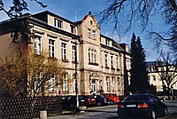

* * *

**Gemeindesiegel von Sporbitz**

* * *

Sporbitz entstand als slawisches Platzdorf auf einer vermutlich durch Brandrodung
entstandenen Fläche, da der Ortsname übersetzt “ausgebrannte Stelle” bedeutet. 1465 gehörte das Dorf der Familie von Korbitz, 1662 dem Adligen Johann
Siegemund von Liebenau, Besitzer des Rittergutes Zehista bei Pirna. Noch bis ins 19. Jahrhundert blieb diese Zuordnung zur Grundherrschaft Zehista erhalten.
Verwaltungsmäßig unterstand Sporbitz 1547 dem Amt Dresden, seit Ende des 16. Jahrhunderts dem Amt Pirna. Wegen seiner Lage an der strategisch wichtigen
Landstraße nach Pirna hatte Sporbitz in Kriegszeiten immer wieder zu leiden. Am schlimmsten traf es den Ort 1639, als durchziehende Soldaten das Dorf komplett niederbrannten.

Dominierender Erwerbszweig der Sporbitzer Einwohner war einst die Landwirtschaft, die große Flächen der
Auenlandschaft nördlich des Dorfkerns in Anspruch nahm. Heute erinnern nur noch die vier erhaltenen Gehöfte von [Altsporbitz](../../ost/grosszschachwitz/strassen_grosszschachwitz/) an diese Zeit. Um die kargen Einkommen aufzubessern, widmeten sich viele Bewohner der Zwirnerei und
Strohflechterei, die meist in Heimarbeit betrieben wurde.

Im 19. Jahrhundert wandelte sich, begünstigt durch die industrielle Entwicklung in den Nachbarorten, die
Bevölkerungsstruktur. Neue Wohngebäude traten an Stelle einstiger landwirtschaftlicher Nutzflächen. Kirchlich unterstand Sporbitz ab 1897 der neu gebildeten Kleinzschachwitzer Kirchgemeinde, nachdem der Ort zuvor
jahrhundertelang nach Dohna gepfarrt war. 1900 erhielt er auch ein eigenes Schulhaus. Außerdem siedelten sich auf Sporbitzer Flur einige Industriebetriebe an, von denen die [Mühlen- und Maschinenfabrik Seck](../../ost/grosszschachwitz/strassen_grosszschachwitz/) am bedeutendsten war.
Die örtlichen Sand- und Kiesvorkommen führten zum Aufschluss einiger Kiesgruben, die nach 1945 den Rohstoff für
Dresdens größtes Plattenwerk für den industriellen Wohnungsbau lieferten. Heute befindet sich hier ein Gewerbepark. 1922 wurde Sporbitz nach Großzschachwitz eingemeindet und gehört seit 1950 als Stadtteil zu Dresden.

Schulen in Sporbitz:

Nachdem die Kinder des Dorfes zuvor die Schulen der Nachbargemeinden besucht hatten, machte die gewachsene Bevölkerungszahl um 1900 den Bau eines eigenen
Schulhauses erforderlich. Dieses wurde an der heute Am Werk genannten Straße errichtet und zuletzt als Außenstelle des Beruflichen Schulzentrums für
Agrarwirtschaft und Ernährung genutzt. Ende Juli 2009 wurde die Schule jedoch geschlossen und nach Löbtau und Roßthal verlegt.

Brüchigtgraben:

Der Brüchigtgraben ist östlichster linkselbischer Zufluss im Dresdner Stadtgebiet und hat seinen Ursprung im Sporbitzer
Kiessee. Zunächst verläuft er nördlich des Sees und fließt dann entlang der Stadtgrenze zu Heidenau in Richtung Elbe.
Die Mündung des Grabens befindet sich in der Nähe der Einmündung Struppener Straße / Elbstraße. Seine Länge beträgt ca. 650 Meter. Ursprünglich hatte der Graben eine Verbindung zum Lockwitzbach, welche jedoch infolge
späterer Bebauung und der landwirtschaftlichen Nutzung des Areals verlorenging. Auch der noch bis in die 1950er
Jahre vorhandene Unterlauf zum sogenannten “Pferdeloch”, einer heute verlandeten früheren Elblache, besteht nicht
mehr. Von Bedeutung ist der Bach als Entwässerungsgraben eines alten Elbarms. Außerdem ist er als naturnahes Biotop
und Teil des Landschaftschutzgebietes “Dresdner Elbwiesen und -altarme” geschützt. Neben verschiedenen Vogelarten wurden am Brüchigtgraben auch Fischotter beobachtet.

