* * *

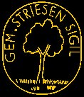

**Gemeindesiegel von Striesen**

* * *

* * *

**Bildungseinrichtungen in Striesen:**

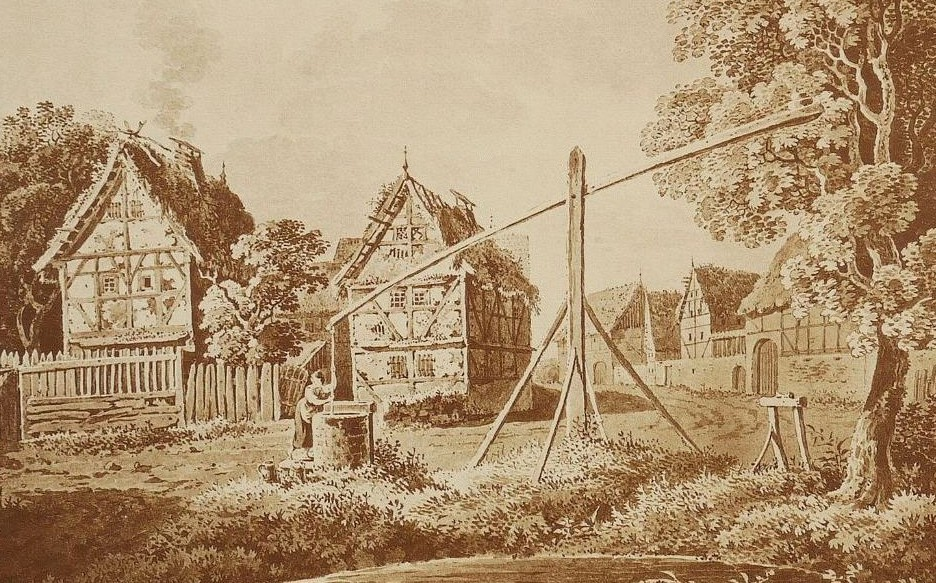Der aus einem slawischen Platzdorf hervorgegangene Stadtteil Striesen wurde 1350 erstmals als Stresen urkundlich erwähnt, wobei der Name von einem Personennamen abgeleitet wurde (Dorf des Streza). Das Dorf, dessen Kern nördlich der heutigen Schandauer Straße lag, besaß ein Vorwerk und bestand aus mehreren Bauerngütern. Durch mehrfache Erbteilungen wurde dieses Vorwerk, welches sich im 14. Jahrhundert im Besitz des Dresdner Bürgers Ulrich Große befand, schrittweise in Bauernstellen aufgeteilt. Da sich auf Striesener Flur einst ein alter Eltarm befand, waren die Böden um Striesen sehr fruchtbar, was die Entwicklung des Ortes positiv beeinflusste. Später wurde dieser Elbarm durch den um 1300 zur Entwässerung der Felder angelegten [Landgraben](../../ost/striesen/landgraben/) genutzt.

Striesen unterstand 1445 dem Meißner Domstift und kam nach der Reformation zum Religionsamt sowie zum kurfürstlichen Amt Dresden. Von den Zerstörungen des Dreißigjährigen Krieges blieb Striesen im Gegensatz zu seinen Nachbarorten verschont. Teile der ausgedehnten Dorfflur mussten 1676 an den Kurfürsten zur Anlage des [Großen Gartens](../../zentrum/grosser_garten/) abgetreten werden. Trotzdem verblieben noch ausreichend landwirtschaftliche Nutzflächen, die im 18. Jahrhundert durch 28 Bauern und Gärtner bewirtschaftet wurden. Hinzu kamen einige Häusler und Tagelöhner sowie Handwerker, die sich im Ort niedergelassen hatten. Der durch den Dorfkern führende Fahrweg nach Pillnitz wurde 1765 verlegt und umging so das Dorf. Aus diesem Weg entwickelte sich später die Chaussee, die heute als [Borsberg-](../../ost/striesen/strassen_striesen/borsbergstrasse/) bzw. [Schandauer Straße](../../ost/striesen/strassen_striesen/schandauer_strasse/) bezeichnet wird.

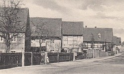Schwer getroffen wurde Striesen während der Napoleonischen Kriege. Da der Ort im Vorfeld der Festung Dresden lag, wurden 1813 über 70 Gehöfte rund um den alten Dorfplatz bei Gefechten zwischen Franzosen und Russen niedergebrannt. Lediglich drei Gebäude blieben von den Zerstörungen verschont. Den Kampfhandlungen fielen auch vier um 1790 errichtete Windmühlen zum Opfer, an die später noch die Gaststätte [“Zum Windmühlenberg”](../../ost/striesen/strassen_striesen/) erinnerte. Erst nach Ende der Kämpfe konnten die Bewohner ihr Dorf
wiederaufbauen, welches bis 1945 sein ländliches Aussehen behielt _(Foto)_. Neben kostenlosen Holzlieferungen aus den königlichen Wäldern durften auch die Steine der nach 1813 abgetragenen Umfassungsmauer des Großen Gartens für den Aufbau verwendet werden. Auch die häufigen Überschwemmungen brachten Not und Leid über den Ort, so in den Jahren 1784 und 1845, wo weite Teile der Dorfflur bis zu zwei Meter hoch unter Wasser standen.

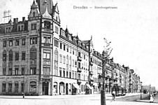1856 begann mit der Errichtung des ersten Wohnhauses außerhalb des Dorfkerns ein neues Kapitel der Ortsgeschichte. Vier Jahre später wurde von Ratsgeometer Lehmann in Abstimmung mit dem Gemeinderat ein Bebauungsplan erarbeitet, der auf schachbrettartigem Grundriss Parzellen zum Bau von Mietshäusern und Villen auswies. Nach amerikanischem Vorbild erhielten die neuen Straßen zunächst nur Zahlen und Buchstaben, bevor sich nach der Eingemeindung auch hier richtige Straßennamen durchsetzten. Die Bebauung war in offener Bauweise vorgeschrieben, so dass Striesen zu einem “grünen” Wohnvorort Dresdens wurde. Dieser Stadtteil, der sich auf den Flächen nördlich des alten Dorfes bis zum Blasewitzer Tännicht erstreckte, wurde als Neustriesen bezeichnet. Um die Jahrhundertwende hatte die Bebauung die Ortsgrenze erreicht. Da Striesen im Westen mittlerweile mit der ab 1874 angelegten Johannstadt zusammengewachsen war, wurde der Ort am 1. Juli 1892 mit ca. 11.000 Einwohnern nach Dresden eingemeindet. Das Foto zeigt die Borsbergstraße an der Grenze zwischen Striesen und Johannstadt.

Von wirtschaftlicher Bedeutung war Ende des 19. Jahrhunderts der Gartenbau, nachdem sich in Striesen über 50 Kunst- und Handelsgärtnereien niedergelassen hatten. Einige dieser Unternehmen erlangten Weltruf, wie die [Gärtnerei Hermann Seidels](../../ost/striesen/strassen_striesen/seidelsche_gartnerei/), der durch seine Kamelien- und Azaleenzucht berühmt wurde. Auf Seidels Rhododendronpflanzungen geht auch die Anlage des Striesener [Volksparkes](../../ost/striesen/strassen_striesen/seidelsche_gartnerei/hermann-seidel-park/) zurück. Im Zusammenhang mit der fortschreitenden Bebauung mussten die meisten Gärtnereien um 1900 weichen und wurden nach Laubegast, Tolkewitz, Reick. Leuben und Dobritz verlegt. 1883/91 hatte Striesen als einer der ersten Stadtteile Straßenbahnanschluss nach Dresden erhalten. Für die religiöse Betreuung der Bewohner entstanden 1878/80 die [Erlöserkirche](../../ost/striesen/erloserkirche/) und 1905/09 die [Versöhnungskirche](../../ost/striesen/versohnungskirche/). Zeitgleich errichteten auch die Katholiken ein eigenes Gotteshaus, die [Herz-Jesu-Kirche](../../ost/striesen/herz-jesu-kirche/) an der Grenze zur Johannstadt. Hinzu kamen mehrere Schulbauten sowie das katholische [Kinderheim St. Vinzentius](../../ost/striesen/herz-jesu-kirche/kapellknabeninstitut/) (heute Kapellknabeninstitut) an der Wittenberger Straße. An der Glashütter Straße wurde für den Vorort 1880 ein eigener [Friedhof](../../ost/striesen/striesener_friedhof/) angelegt.

Obwohl bis 1900 die meisten Freiflächen um den früheren Dorfkern geschlossen worden waren, konnten in den folgenden Jahren durch zwei Wohnungsgenossenschaften neue [Wohnsiedlungen](../../ost/striesen/strassen_striesen/) an der Wormser und der Holbeinstraße sowie an der Junghansstraße errichtet werden. An Stelle früherer Kiesgruben entstanden Kleingartenanlagen. Erweiterungen erfolgten in den Zwanziger Jahren mit der Bebauung der Straßen um den Stresemannplatz in der Nähe des Großen Gartens.

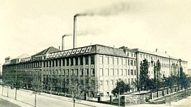Um 1900 begann in Striesen die zunehmende Industrialisierung, nachdem zuvor durch die strengen Bauvorschriften die Errichtung gewerblicher Anlagen nur sehr eingeschränkt möglich war. Von überregionaler Bedeutung war die Striesener [Kameraproduktion](../../ost/striesen/strassen_striesen/schandauer_strasse/ihagee/) sowie die [Zigarettenherstellung](../../ost/striesen/striesener_zigarettenfabriken/). Hinzu kamen Firmen der Kartonnagen- und Kunstdruckbranche. Bevorzugt siedelten sich diese Unternehmen an der Schandauer Straße an, wo mit dem [Ernemann-Turm](../../ost/striesen/strassen_striesen/schandauer_strasse/ernemann-werke/) 1923 ein neues Wahrzeichen des Stadtteils entstand. Weitere bekannte Striesener Firmen waren das 1904 gegründete Mimosa-Werk zur Herstellung von Fotopapier an der Bärensteiner Straße _(Foto)_, die Großwäscherei und Färberei Märksch sowie die Zigarettenfabriken Jasmatzi und Lande. 1912 entstand auf der Mosenstraße der Dresdner Kunstverlag, dessen Tradition ab 1952 vom “Verlag der Kunst” fortgesetzt wurde. Hinzu kamen zahlreiche kleinere Handwerksbetriebe, die in den Hinterhöfen der Striesener Wohnviertel Schuhe, Kinderwagen, Taschen und andere handwerkliche Produkte herstellten. Während derartige Gewerke überall erlaubt waren, durften sich Industriebetriebe nur auf den Flächen südlich der Schandauer Straße niederlassen, um einen ausreichenden Abstand zur Wohnbebauung zu gewährleisten. Mit der Industrialisierung wuchs auch der Arbeiteranteil in Striesen, wobei diese sich gern in einem der zahlreichen Tanz- und Versammlungslokale des Stadtteils trafen. Bekannte Treffpunkte waren neben dem “Sächsischen Prinzen” auch Hammers Hotel an der Augsburger Straße und das Volkshaus Ost, welches heute als Programmkino genutzt wird.

Die Luftangriffe vom Februar 1945 trafen auch den Stadtteil Striesen und richteten hier erhebliche Verwüstungen an. Vor allem die Gebäude des früheren Dorfkerns fielen mit wenigen Ausnahmen den Bomben zum Opfer. Getroffen wurden auch die Wohn- und Gewerbegebiete an der Borsberg- und der Schandauer Straße, während die Villenviertel relativ glimpflich davonkamen. 1955/58 begann in Striesen der Wiederaufbau, wobei an der Borsbergstraße zum ersten Mal in Dresden Großblockbauten errichtet wurden. Bis 1970 konnte der Aufbau des neuen Ortszentrums mit Gaststätten und Läden abgeschlossen werden. Nach 1990 begann die Sanierung der vorhandenen Altbausubstanz, so dass Striesen heute wieder zu den gefragtesten Wohnlagen in Dresden gehört. Im früheren Stammhaus der Ernemann-Werke, zuletzt vom VEB Pentacon genutzt, haben seit 1997 die [Technischen Sammlungen](../../ost/striesen/strassen_striesen/schandauer_strasse/ernemann-werke/technische_sammlungen/) der Stadt Dresden ihren Sitz. Striesener Industrietraditionen werden heute von der f6 Cigarettenfabrik fortgeführt, während die Kameraherstellung nach vergeblichen Rettungsversuchen mittlerweile eingestellt wurde.

Gemeindeamt:

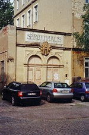 Nachdem die Versammlungen des Gemeinderates zunächst in den Privaträumen der Mitglieder bzw. im Gasthof “Zum Sächsischen Prinzen” stattgefunden hatten, bezog dieser 1875 ein zuvor als Schule genutztes Gebäude an der Tittmannstraße 21. Hier waren neben der Verwaltung auch das Standesamt, ein Post- und Telegrafenamt sowie ab 1877 auch die Sparkasse untergebracht. Mit der Eingemeindung des Ortes übernahm die Stadt Dresden das Gebäude als Stadtteilrathaus. 1945 wurde das Haus zerstört und in der Nachkriegszeit abgetragen.

Bereits 1874 war auf dem Nachbargrundstück Wartburgstraße 23 ein neues größeres Schulgebäude errichtet worden, welches bis 1907 seinem Zweck diente. Danach wurde auch dieses für Verwaltungszwecke genutzt. Unter dem Namen “Stadthaus Striesen” _(Foto)_ befanden sich hier u.a. das aus dem alten Gemeindeamt ausgelagerte Standesamt, eine Polizeidienststelle, eine Filiale der städtischen Sparkasse sowie Dienstwohnungen. Nach 1945 nutzte der VEB Technische Gebäudeausrüstungen das Haus. 2008 begann eine umfassende Rekonstruktion und der Umbau zum Wohnhaus (“Stadtpalais Striesen”).

Schulen in Striesen:

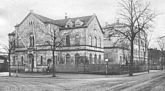Alte Schule: Die erste Dorfschule Striesens wurde 1839 am Landgraben Nr. 3 eingerichtet, nachdem die Kinder zuvor den langen Weg in die Schulen der Innenstadt antreten mussten. Allerdings gab es bereits im 18. Jahrhundert einen besoldeten Kinderlehrer, der seinen Unterricht in wechselnden Bauernstuben abhalten musste. Kirchlich unterstand Striesen bis zum 19. Jahrhundert der Parochie der Frauen- bzw. der Kreuzkirche, die auch für die Bildung verantwortlich waren. Nachdem diese Schule nicht mehr den Anforderungen genügte, wurde 1869 ein weiteres Schulhaus an der Tittmannstraße 21 eingeweiht. Ein drittes Schulgebäude entstand 1874 auf dem Nachbargrundstück Wartburgstraße 23. Mit dessen Fertigstellung wurde die alte Schule geschlossen und fortan bis zur Zerstörung 1945 als Gemeindeamt bzw. Stadtteilrathaus des Ortes genutzt.

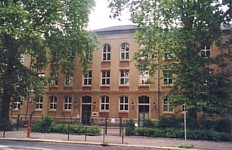Volks- und Bürgerschulen: Zur Entlastung der zu klein gewordenen Dorfschulen entschloss sich die Gemeinde Striesen Ende des 19. Jahrhundert zum Neubau dreier Schulen. 1874 wurde die erste an der Wartburgstraße 23 eingeweiht (ab 1907 Stadthaus mit verschiedenen Verwaltungseinrichtungen). 1886 entstand die Bürgerschule an der heutigen Rosa-Menzer-Straße, die jetzt von der 51. Grundschule “An den Platanen” genutzt wird _(Foto)_.

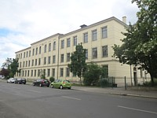1892 folgte die 25. Bezirksschule am Pohlandplatz (seit 1992 25. Grund- und Mittelschule “Am Pohlandplatz”). Mit der Eingemeindung des Ortes wurden diese Schulen in das Dresdner Bildungssystem eingegliedert. Zu DDR-Zeiten trugen sie den Namen der Antifaschistin Rosa Menzer (51. POS) und des Arbeiterführers Ernst Thälmann (25. POS). Die um 1900 erbaute und nach Kriegszerstörung 1964 wiederaufgebaute Sporthalle der 25. Grund- und Mittelschule wurde 2009 durch einen modernen Neubau ersetzt.

20\. Grundschule: Ein weiteres Schulgebäude vom weitverbreiteten Typ “Dresden” entstand in den 1970er Jahren an der Alemannenstraße 15. Bis 1990 wurde es von der 20. Polytechnischen Oberschule “Otto Galle” genutzt. Namensgeber war der Dresdner Antifaschist Otto Galle (1897-1944), der sich im Widerstandskampf gegen die Nazis engagierte und als Mitglied der kommunistischen Gruppe um Kurt Schlosser 1944 zum Tode verurteilt und hingerichtet wurde. Galle hatte in unmittelbarer Nähe des Schulstandorts auf der Kyffhäuserstraße 30 gelebt. 1991 übernahm die 20. Grundschule das Haus bis zu ihrer Schließung im Jahr 2000. Seitdem wird das Gebäude als “Carus Akademie” für die Berufsausbildung junger Geburtshelfer, Krankenpfleger und anderer Berufe des Gesundheitswesens genutzt.

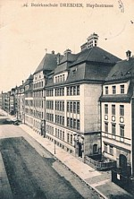Gymnasium Striesen: Das Gebäude des Striesener Gymnasiums wurde 1907 von Stadtbaurat Hans Erlwein entworfen und gehörte zu den modernsten Schulbauten seiner Zeit _(Foto)_. Der repräsentative Bau an der Haydnstraße 49 besaß neben getrennten Klassenräumen für Mädchen und Knaben moderne Turnsäle, Bade- und Duschräume, eine Aula, Lehrküche, Volksbibliothek und sogar ein eigenes Schultheater. Der Fassadenschmuck mit mehreren Figurengruppen und Reliefs stammt von ernst Hottenroth.

Die zunächst von der 24. Bezirksschule und der 1. Mädchenberufsschule genutzte, ab 1959 als 24. Polytechnische Oberschule “Johannes R. Becher” bezeichnete Einrichtung dient seit 1992 als Gymnasium und erhielt 1997 den Namen Joseph Haydns. 2004 wurde diese Schule geschlossen und nach ihrer Sanierung 2008 vom [Martin-Andersen-Nexö-Gymnasium](../../ost/blasewitz/) übernommen. Von Erlwein stammt auch der Entwurf für die 31. Volksschule auf der Junghansstraße.

Städtische Oberschule für Mädchen: Die im Besitz der Stadt Dresden befindliche Schule bestand vor dem Zweiten Weltkrieg im Gebäude der Bürgerschule an der heutigen Rosa-Menzer-Straße (51. Grundschule “An den Platanen”). Als das Haus während des Krieges in ein Lazarett umgewandelt wurde, verlegte man den Unterricht zunächst in die Altstädter Mädchenschule auf der Zinzendorfstraße, danach in die Loschwitzer Körnerschule. Da beide Gebäude 1945 dem Luftangriff zum Opfer fielen, musste die Oberschule erneut umziehen. Nach provisorischer Unterbringung in der Schillerschule Loschwitz wurde sie 1946 im Blasewitzer Gymnasium Kretschmerstraße mit der Jungenschule zusammengelegt, womit die Geschichte als eigenständige Bildungseinrichtung endete.

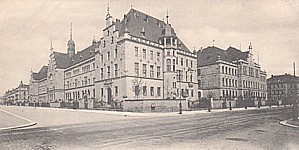 Freimauerinstitut: Das Dresdner Freimaurerinstitut geht auf eine 1772 gegründete Lehr- und Erziehungsanstalt für Knaben zurück, die ihr Domizil ursprünglich in der Friedrichstadt hatte. Träger dieser Schule waren die in Dresden ansässigen Freimaurerlogen “Zu den drei Schwertern” und “Asträa zur grünenden Raute”. 1801 wurde sie in eine Allgemeine Bürgerschule, 1876 in eine Realschule umgewandelt und bildete seit 1840 ausschließlich Knaben aus. Zu den bekanntesten Schülern gehörten der Maler Ferdinand von Rayski sowie der Ingenieur Johann Andreas Schubert. Neben der Vermittlung bürgerlich-humanistischer Ideale standen auch militärisch-erzieherische Programme auf dem Stundenplan, die zum Teil von der Freimaurerbewegung nahestehenden Offizieren geleitet wurden. Das Freimauerinstitut ermöglichte Dank einer zugehörigen Stiftung auch Kindern aus ärmeren Schichten sowie Waisen den Schulbesuch.

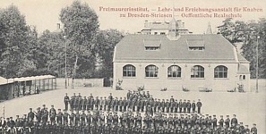1897/99 entstand an der Eisenacher Straße ein Schulneubau im Neorenaissancestil nach Entwürfen des Architekten Hermann Kickelhayn _(Foto oben links)_. Zum Komplex gehörten neben dem Schulhaus an der Dornblüthstraße und dem Internat an der Eisenacher Straße auch zwei Lehrerhäuser, Turnhalle _(Foto rechts)_, Schwimmbad und Sportanlagen. Am 29. Juni 1899 wurde diese Schule offiziell eröffnet. Das pädagogische Konzept orientierte sich an den Ideen der Freimaurer und beruhte auf einem “Familiensystem” zwischen Schülern und Lehrern, wobei die Knaben zu “tüchtigen und brauchbaren Männern fürs Leben” erzogen werden sollten. Die meisten Schüler wohnten deshalb in einem angeschlossenen Internat auf dem Schulgelände. Nach dem Verbot der Freimaurerorden 1933 wurde die Schule als Scharnhorst-Heimschule bezeichnet und noch bis 1944 als Oberrealschule weitergeführt.

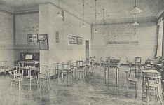Trotz einiger Bombenschäden konnte der Gebäudekomplex bereits im Mai 1945 teilweise wieder bezogen werden. Zunächst waren hier ausgebombte Familien und die geretteten Bestände der Sächsischen Landesbibliothek untergebracht. Im Anschluss zog eine Gehörlosen- und Sprachgeschädigten-Schule ein. Auch die Knaben des Kreuzchores durften im Februar 1947 einige Räume als Internat beziehen. 1947/48 wurde der ausgebrannte Gebäudeflügel an der Dornblüthstraße durch die ehemalige Staatsbauschule (später Ingenieurschule für Bauwesen)
wiederhergestellt. Für diese entstanden im ehemaligen Schlafsaal der Heimschule Hörsäle und Seminarräume. Außerdem wurde auf dem Areal der zerstörten Turnhalle ein Ergänzungsbau mit weiteren Unterrichts- und Laborräumen errichtet. Nach Verlegung der Bauingenieurschule 1951 nutzte die neu gegründete Ingenieurschule für Eisenbahnwesen den Gebäudekomplex. 1954 folgte dieser eine Internatsschule des Kreuzchores, welche 1959 zum Gymnasium Kreuzschule
erweitert wurde.

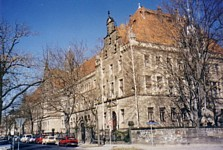Heute werden die Gebäude als Evangelisches Kreuzgymnasium genutzt und befinden sich seit 1997 in Trägerschaft des Evangelisch-Lutherischen Kirchenkreises Dresden. Außerdem hat hier auch der berühmte Kreuzchor sein Domizil. Zwischen 2006 und 2009 erfolgte eine umfassende Sanierung der Kreuzschule. Dabei entstanden auch ein moderner Verbindungsbau und eine neue Sporthalle auf dem Gelände.

Montessorischule: Das Schulhaus des in der DDR weitverbreiteten Typs “Dresden” entstand 1971 an der Glashütter Straße 10 und war bis 1990 Domizil der 58. POS. Nach deren Schließung wurde das Gebäude komplett saniert und 2005 von der Freien Montessorischule “Huckepack” übernommen. Die Schule wird von einem Trägerverein betrieben und unterrichtet Schüler der Grund- und Mittelstufe nach den Grundsätzen der Montessori-Pädagogik. Vor dem Haupteingang befindet sich eine Plastik des “kleinen Trompeters”, die noch aus DDR-Zeiten stammt. Seit 2006 gehört auch ein berufliches Gymnasium zu dieser Schule.

Private Ganztagsschule IBB: Die private Grundschule wurde 2007 vom Institut für Bildung und Beratung gegründet und hatte ihren Sitz zunächst auf der [Loschwitzer Straße](../../ost/blasewitz/strassen_blasewitz/loschwitzer_strasse/). 2013 bezog sie einen Neubau auf der Paul-Gerhardt-Straße 17. Das moderne Gebäude besitzt acht Klassenzimmer, mehrere  Fachkabinette sowie eine Sporthalle im Obergeschoss. Ein weiterer Neubau entstand 2013/14 an der Augsburger Straße für die Gymnasialstufen .

[_Weiterführende Literatur und Quellen_](../../impressum/quellenverzeichnis/)

 \[ [Home](../../index.html)\] \[ [Nord](../../nord/)\] \[ [Nordwest](../../nordwest/)\] \[ [Neustadt](../../neustadt/)\] \[ [Nordost](../../nordost/)\] \[ [West](../../west/)\] \[ [Zentrum](../../zentrum/)\] \[ [Südwest](../../sudwest/)\] \[ [Süd](../../sud/)\]
 \[ [Südost](../../sudost/)\] \[ [Ost](../../ost/)\] \[ [Register](../../Register/register.html)\] \[ [Kontakt](../../Kontakt/kontakt.html)\] \[ [Impressum](../../impressum/)\]
