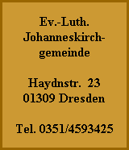
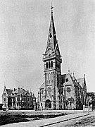
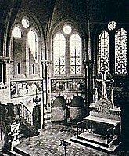
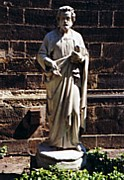
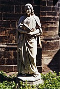
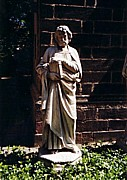
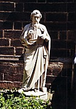

* * *

Striesen gehörte bis Mitte des 19. Jahrhunderts zunächst zur Frauenkirche, später zur
Kreuzkirchgemeinde. Um den langen und beschwerlichen Weg zur Stadt etwas zu erleichtern, fanden ab 1826 zu bestimmten Zeiten in der Striesener Dorfschule Predigten statt,
die vom Lehrer der Schule gehalten wurden. Mit zunehmendem Bevölkerungswachstum machte sich jedoch eine eigene Kirche erforderlich. Für deren Bau setzten sich vor allem die
in Striesen lebenden böhmischen Exulanten ein, zu denen viele wohlhabende Gärtnereibesitzer gehörten. Diese evangelisch-lutherische Religionsgemeinschaft war ursprünglich in Prag
beheimatet, hatte jedoch während des Dreißigjährigen Krieges ihr Land verlassen müssen und sich in Sachsen niedergelassen. Von den über 30.000 Glaubensflüchtlingen fanden bis
1730 ca. 3000 in Dresden eine neue Heimat. Hier nutzten sie bis zur Schließung 1860 die alte Johanniskirche am Pirnaischen Tor, in der sie ihre Gottesdienste auch in tschechischer Sprache abhalten durften.

Am 9. Oktober 1878, dem Tag der Grundsteinlegung, begann an der Wittenberger /
Ecke Paul-Gerhardt-Straße der Bau der Erlöserkirche, welche am 20. Juni 1880 geweiht werden konnte. Ihren Namen erhielt sie nach der Prager “Mutterkirche” der
Exulanten. Architekt des neogotischen Kirchenbaus war der Baumeister Gotthilf Ludwig Möckel, der für zahlreiche Kirchenbauten im Dresdner Raum verantwortlich zeichnete.
Für die Fassade entstanden vier Sandsteinfiguren, die die vier Evangelisten darstellten. Die Kirche mit ihrem 56 Meter hohen Turm wurde von der evangelischen Gemeinde
sowie von der böhmischen Exulantenkirche gemeinsam genutzt, wobei beide Pfarrer abwechselnd die Predigten hielten. Im Innenraum fanden über 800 Personen Platz. 1897
und 1909 wurde dieser umgestaltet und erneuert. Die ursprünglichen Bronzeglocken gingen im Ersten Weltkrieg verloren und mussten 1920 vorerst durch ein Stahlgeläut
ersetzt werden. Bereits zehn Jahre zuvor hatten sich die beiden Gemeinden zur Erlöser- Kirchgemeinde vereinigt, der nun über 40.000 Mitglieder angehörten. Diese besaß neben der Erlöserkirche auch zwei
Pfarrhäuser und ein noch heute erhaltenes Wohnhaus auf der Wartburgstraße 5. 1912 entstand in unmittelbarer
Nachbarschaft ein neues Gemeindehaus für kirchliche Veranstaltungen in kleineren Rahmen. 1933 konnten als Ersatz für das provisorische Stahlgeläut neue Bronzeglocken erworben werden.

Am 13. Februar 1945 fielen
Kirche, Gemeinde- und Pfarrhaus den Bomben zum Opfer und wurden schwer beschädigt. Trotzdem bemühten sich Striesener Christen in der Nachkriegszeit um einen Wiederaufbau. Zunächst
fanden in der Ruine Gottesdienste unter freiem Himmel statt. Staatliche Stellen verhinderten einen Ausbau der Ruine.
Trotz des Argumentes der Gemeindemitglieder, die Kirche sei wegen ihrer Entstehungsgeschichte ein lebendiges Zeugnis deutsch-böhmischer Beziehungen und der bestehenden freundschaftlichen Kontakte zu böhmischen Christen,
beschlossen die Verantwortlichen 1961 den Abbruch der Ruine. Zuvor durften die Striesener gemeinsam mit den Gemeindemitgliedern der ebenfalls abgetragenen Johannstädter Andreaskirche ein neues Gemeindehaus an der
Haydnstraße 23 beziehen. In unmittelbarer Nachbarschaft hat seit 1950 auch die evangelisch-methodistische Kirche ihr Domizil. Heute stehen auf dem früheren Kirchengrundstück Wohnhäuser.

**_Fotos:_** _Die Figuren der vier Evangelisten vom Turm der Erlöserkirche befinden sich_

_heute auf dem Striesener Friedhof_

1989 wurde vor dem Gemeindehaus Haydnstraße ein Glockendenkmal aufgestellt. Die Glocke, die die Inschrift “Ehre
sei Gott in der Höhe” trägt, stammt aus der ebenfalls zerstörten Andreaskirche am Stephanienplatz in der Johannstadt.
Bereits am 1. November 1945 waren die kriegsbedingt stark dezimierten Gemeinden beider Kirchen zur Erlöser- Andreas-Kirchgemeinde zusammengeschlossen worden. Anfang 2000 fusionierte diese mit der Trinitatiskirche und
trägt heute den Namen Johanneskirchgemeinde. Die beim Abbruch der Erlöserkirche geborgenen Evangelisten- Figuren fanden vor der Striesener Friedhofskapelle Aufstellung. Nach erfolgter Restaurierung in den 1990er Jahren
halten sie bis heute die Erinnerung an das zerstörte Gotteshaus wach.

* * *

 \[ [Home](../../../index.html)\] \[ [Nord](../../../nord/)\] \[ [Nordwest](../../../nordwest/)\] \[ [Neustadt](../../../neustadt/)\] \[ [Nordost](../../../nordost/)\] \[ [West](../../../west/)\] \[ [Zentrum](../../../zentrum/)\] \[ [Südwest](../../../sudwest/)\] \[ [Süd](../../../sud/)\] \[ [Südost](../../../sudost/)\] \[ [Ost](../../../ost/)\] \[ [Register](../../../Register/register.html)\] \[ [Kontakt](../../../Kontakt/kontakt.html)\] \[ [Impressum](../../../impressum/)\]
