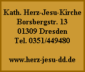
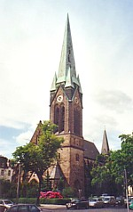
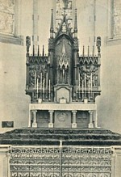

* * *

Während die evangelischen Christen Striesens bereits 1880 ihr erstes eigenes Gotteshaus beziehen konnten, musste sich die katholische Bevölkerung noch bis 1905 gedulden. Obwohl die Anzahl der Katholiken in den östlichen Vororten auf über 7000 Personen gestiegen war, mussten diese zum Gottesdienst den langen Weg zur Hofkirche nehmen. Ab 1896 fanden katholische Gottesdienste in der Kapelle der IV. Grundschule auf der Schumannstraße statt. 1903 erfolgte schließlich die Grundsteinlegung zur Herz-Jesu- Kirche an der Ecke Krenkel-/Borsbergstraße, nachdem eine wohlhabende Bürgerin 200.000 Mark gespendet hatte. Das unmittelbar an der Grenze zur Johannstadt gelegene Gebäude im neogotischen Stil wurde vom Architekten August Menken entworfen und konnte 1905 von Bischof Georg Wuschanski geweiht werden. Die Figuren an den Eingängen stammen von Leopold Armbruster.

Nach Einweihung der Kirche erfolgte schrittweise der Innenausbau, 1909 der Einbau einer Jehmlich-Orgel und 1914 das Aufhängen der Glocken. Diese fielen jedoch bereits drei Jahre später dem Rüstungswahn zum Opfer und mussten 1929 durch ein neues Geläut ersetzt werden. Heute ist nur noch eine der ursprünglich vier Glocken erhalten, da die übrigen 1942 erneut zum Einschmelzen abgegeben werden mussten. Die Innenausstattung der Kirche wurde 1912 vom westfälischen Bildhauer Anton Becker vervollständigt, der u.a. Schöpfer der Holzschnitzereien an Kanzel und Altar _(Foto)_ ist.

Die Bombennacht des Jahres 1945 überstand die Kirche relativ unbeschadet. Allerdings gingen fast alle Fenster zu Bruch. Zerstört wurde außerdem das Pfarramt auf der Huttenstraße. Die in der Nachkriegszeit auch für evangelische Gottesdienste und Konzerte genutzte Herz-Jesu-Kirche wurde bis 1955 wiederhergestellt. Dabei entstanden auch die bemerkenswerten neuen Glasfenster, die Szenen aus dem Alten und Neuen Testament zeigen und vom Dresdner Grafiker Bruno Seener stammen. Interessant ist das “Veronika-Fenster” mit einer Darstellung der Heiligen Veronika, mit dem zugleich der Stifterin der Kirche, Veronica Fischer (+ 1913), Referenz erwiesen werden soll.

1990 konnten zwei neue Glocken angeschafft werden. Die größere wird als Dreikönigsglocke bezeichnet und erinnert an das Katholikentreffen 1987 in Dresden. Eine weitere Glocke, 1986 in Apolda gegossen, zeigt drei Berliner Bären, da sie ursprünglich für den Französischen Dom in Berlin bestimmt war. Interessant sind auch die insgesamt 149 Tierfiguren aus Glas, Bronze und Stein, die sich an und in der Kirche befinden.

Nach 1990 entstand auf einem Nachbargrundstück ein neues Pfarrzentrum. Die zuvor für Gemeindezwecke genutzten, das architektonische Bild störenden, Umbauten im Seitenschiff konnten daraufhin beseitigt werden. Eine weitere katholische Einrichtung in Striesen befindet sich im ehemaligen St.-Vincentiusstift auf der Wittenberger Straße. Seit 1956 ist hier das [Kapellknabeninstitut](../../../ost/striesen/herz-jesu-kirche/kapellknabeninstitut/), Domizil des Knabenchores der Hofkirche, untergebracht.

* * *

 \[ [Home](../../../index.html)\] \[ [Nord](../../../nord/)\] \[ [Nordwest](../../../nordwest/)\] \[ [Neustadt](../../../neustadt/)\] \[ [Nordost](../../../nordost/)\] \[ [West](../../../west/)\] \[ [Zentrum](../../../zentrum/)\] \[ [Südwest](../../../sudwest/)\] \[ [Süd](../../../sud/)\] \[ [Südost](../../../sudost/)\] \[ [Ost](../../../ost/)\] \[ [Register](../../../Register/register.html)\] \[ [Kontakt](../../../Kontakt/kontakt.html)\] \[ [Impressum](../../../impressum/)\]
