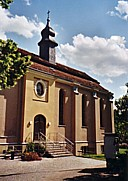

* * *

Kapellknabeninstitut wittenberger str. 88 01309 dresden tel. 0351/3100060

Neben der [Herz-Jesu-Kirche](../../../../ost/striesen/herz-jesu-kirche/) besitzt Striesen mit dem Kapellknabeninstitut noch eine weitere
bedeutende Einrichtung der katholischen Kirche. Diese geht auf die 1904 errichtete katholische Mariä-Himmelfahrts-Kirche _(Foto)_ zurück. Das Gebäude, dessen Bau von der
Familie Meißner finanziert wurde, entstand nach einem Entwurf von Julius Förster und beherbergte im Untergeschoss eine Volksküche. Baulich mit der Kirche verbunden war ein
Kinderheim, welches unter dem Namen St. Vincentiusstift bis zum Zweiten Weltkrieg bestand. Seit 1923 ist die Kapelle zugleich Pfarrkirche der eigenständigen Pfarrei Mariä Himmelfahrt.

Nach Beseitigung einiger Kriegsschäden zog hier das Kapellknabeninstitut ein. Der Knabenchor der Hofkirche war bereits 1709 gegründet worden und begleitete Messen und andere kirchliche
Veranstaltungen musikalisch. Regelmäßig gab es auch Auftritte mit der berühmten Hofkapelle. Bekannte Chorleiter
waren u. a. Johann Adolf  Hasse, Carl Maria von Weber und Richard Wagner. Nach 1918 setzte sich Karl Maria Pembaur für ein Fortbestehen des zweitältesten Dresdner Knabenchores ein. 1937 wurde der Chor zwangsweise
aufgelöst und verlor 1945 auch sein früheres Internat im Geistlichen Haus auf der Schloßstraße.

Auf Anregung des Probstes Sprentzel konnten die Kapellknaben 1948 wieder mit den Proben beginnen und zu Weihnachten
erstmals in der zerstörten Hofkirche auftreten. Da die provisorische Unterkunft in einem Wohnhaus auf
der Bayreuther Straße nicht den Anforderungen genügte, verlegte der Chor sein Domizil in das nur leicht beschädigte
Gebäude Schweriner Straße 15. Hier gab es zumindest Schlaf- und Waschräume sowie einen Übungsraum für die Chorproben. Allerdings konnten vorerst nur zehn Jungen untergebracht werden.

Nachdem Landesbischof Otto Spülbeck das ebenfalls beschädigte frühere St. Vincentiusstift wieder aufbauen lassen hatte, konnten die Kapellknaben am 1. September 1956
ihre neuen Räume auf der Wittenberger Straße 88 beziehen. Ursprünglich war hier die Einrichtung eines Knabenkonvikts für künftige Priester vorgesehen, was jedoch
von den Behörden der DDR untersagt wurde. Langjähriger Leiter des Kapellknabeninstitutes war der Musiker Konrad Wagner, der 1997 von Matthias Liebich, einem ehemaligen Chormitglied abgelöst wurde. Bis heute werden
die Gebäude als Unterkunfts- und Probenräume der Kapellknaben genutzt. Da sie im Gegensatz zum Kreuzchor keine eigene Schule besitzen, besuchen die meisten das St.-Benno-Gymnasium.

Die
Kirche Mariä Himmelfahrt dient bis heute als Gotteshaus der Striesener Katholiken. 2011/12 erfolgte eine umfassende Sanierung des Gebäudes. Der unter dem Kirchenschiff liegende Gemeindesaal wurde dabei teilweise
geöffnet und um eine Terrasse ergänzt, um so die Verbindung zum Garten herzustellen. Gleichzeitig entstand ein moderner Anbau mit einem Unterrichtssaal. Die ebenfalls erneuerte Orgel der Kirche stammt von 1905 und wurde
von der Firma Jehmlich gebaut.

* * *

 \[ [Home](../../../../index.html)\] \[ [Nord](../../../../nord/)\] \[ [Nordwest](../../../../nordwest/)\] \[ [Neustadt](../../../../neustadt/)\] \[ [Nordost](../../../../nordost/)\] \[ [West](../../../../west/)\] \[ [Zentrum](../../../../zentrum/)\] \[ [Südwest](../../../../sudwest/)\] \[ [Süd](../../../../sud/)\] \[ [Südost](../../../../sudost/)\] \[ [Ost](../../../../ost/)\] \[ [Register](../../../../Register/register.html)\] \[ [Kontakt](../../../../Kontakt/kontakt.html)\] \[ [Impressum](../../../../impressum/)\]
