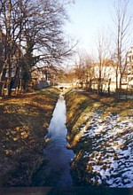
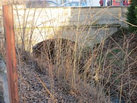

* * *

Der teils natürlich verlaufende, teils künstlich angelegte Landgraben wurde vermutlich um 1300 an
Stelle eines alten Elbarmes angelegt und diente der Entwässerung der Felder zwischen Leubnitz, Strehlen, Gruna und Striesen. Zugleich wurde er in früheren Zeiten auch als natürlicher
Verteidigungsgraben und Löschwasserreservoir genutzt. 1575 ist er als “Alter Graben” in einem Plan verzeichnet.

Die Quelle des Gewässers liegt in der Nähe von Leubnitz. Hier vereinigen sich Britschengraben und
Zauchgraben und bilden den Leubnitzbach, der von der Leubnitzer Höhe in nordöstlicher Richtung verläuft, den Ortskern von Leubnitz durchquert und schließlich an der Einmündung
Heydenreichweg / Dohnaer Straße in eine Rohrleitung mündet. Ab diesem Punkt wird er als Koitzschgraben bezeichnet. Weiter fließt er am Neubaugebiet Reicker Straße vorbei in Richtung Bahnlinie. Am früheren [Gaswerk Reick](../../../sudost/reick/gaswerk_reick/) gibt es einen weiteren ca. 300 Meter langen unterirdischen
Abschnitt, bevor der Bach, nun unter dem Namen Blasewitz-Grunaer Landgraben, die Fluren von Gruna erreicht und durch den [Rothermundpark](../../../ost/gruna/rothermundpark/) in Richtung Striesen/Blasewitz fließt.

Noch um 1880 vereinigte sich der Koitzschgraben auf Reicker Flur mit dem Prohliser Landgraben. Die Mündung der beiden
Gewässer lag in der Nähe der Bahnlinie am Areal des Reicker Gaswerks. Wenig später wurde der Abschnitt zwischen
Mügelner Straße - Seidnitzer Weg und Lohrmannstraße verfüllt und der Prohliser Landgraben entlang der heutigen Straße Moränenende in Richtung Leuben verlegt, wo er noch heute in den [Niedersedlitzer Flutgraben](../../../ost/niedersedlitz/niedersedlitzer_flutgraben/) fließt.

Der alte Landgraben verlief ursprünglich von Reick / Gruna kommend weiter durch den
Striesener Dorfkern, wo noch heute der Straßenname Am Landgraben an diese Zeit erinnert. Von dort führte er im Zuge der Eilenburger, Haydn- und Holbeinstraße über die
Flächen der heutigen Johannstadt und mündete in der Nähe der Gerichtsstraße in die Elbe. Im Zusammenhang mit der fortschreitenden Bebauung wurde der Landgraben 1860
verlegt. Heute zweigt er in Gruna von seinem früheren Verlauf in östlicher Richtung ab und fließt dann parallel zur Lauensteiner Straße zum Niederwaldplatz. In Blasewitz unterquert er die Tolkewitzer Straße _(Foto)_
und mündet zwischen Heinrich-Schütz- und Tauscherstraße in die Elbe. Die Gesamtlänge beträgt ca. 7,8 Kilometer.

Typisch für den Landgraben ist sein teils natürlicher, teils
künstlich geschaffener Verlauf. Im Oberlauf befindet sich auf Leubnitzer Flur ein dem Hochwasserschutz dienendes Rückhaltebecken, um den Ortskern von Leubnitz vor den früher
häufigen Überschwemmungen zu schützen. In Leubnitz fließt der Bach weitgehend kanalisiert in einem gemauerten Flussbett.
Der Abschnitt des Koitzschgrabens zwischen Dohnaer und Reicker Straße wurde 2012 renaturiert. In Gruna und Striesen ist
der Landgraben hingegen wieder zum Schutz der angrenzenden Siedlungen in ein künstlich geschaffenes trapezförmiges Bett
gezwungen. Die aus ökologischen Gründen ungünstige stufenartige Anlage im Mündungsbereich wurde 2011 durch eine Kaskadentreppe ersetzt.

* * *

 \[ [Nord](../../../nord/)\] \[ [Nordwest](../../../nordwest/)\] \[ [Neustadt](../../../neustadt/)\] \[ [Nordost](../../../nordost/)\]
 \[ [West](../../../west/)\] \[ [Zentrum](../../../zentrum/)\] \[ [Südwest](../../../sudwest/)\] \[ [Süd](../../../sud/)\] \[ [Südost](../../../sudost/)\] \[ [Ost](../../../ost/)\] \[ [Register](../../../Register/register.html)\] \[ [Kontakt](../../../Kontakt/kontakt.html)\] \[ [Impressum](../../../impressum/)\]
