## Alemannenstraße

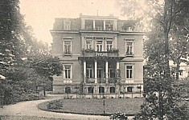Die Alemannenstraße wurde im Juli 1873 als Straße 6 angelegt und bis zur Jahrhundertwende mit Villen bebaut. Bemerkenswert sind die unter Denkmalschutz stehenden Gebäude Nr. 1, 2 _(Foto)_, 4a, 5, 6, 8 und 9. Bereits am 1. April 1873 hatte die Nachbargemeinde Blasewitz ihren Straßenabschnitt Alemannenallee genannt. In Anlehnung an diese Bezeichnung erhielt 1893 der auf Striesener Flur gelegene Abschnitt den Namen Alemannenstraße. Nach der Eingemeindung von Blasewitz wurden beide Straßenabschnitte unter dem Namen Alemannenstraße zusammengelegt. Die Namensgebung erinnert an die germanische Völkergruppe der Alemannen und wurde im Zusammenhang mit der Gründung des Deutschen Reichs 1871 gewählt. Auch einige benachbarte Straßen wie die Sachsenallee, die Frankenallee und der Barbarossaplatz erhielten ihre Namen in diesem Sinne.

Im Haus Alemannenstraße 12 besaß der Glasmaler Josef Goller (1868-1947) sein Atelier. Er war Teilhaber der Glasmalerei [Urban & Goller](../../../zentrum/friedrichstadt/strassen_friedrichstadt/friedrichstrasse/) und ab 1909 Professor an der Kunstgewerbeschule. Als Mitglied des Deutschen Werkbundes gehörte er zu den Vertretern des Jugendstils und schuf zahlreiche Glasfenstergestaltungen im Dresdner Raum. Von ihm stammen u.a. die Malereien über dem Hauptaltar der [St.-Marien-Kirche](../../../west/cotta/st__marien-kirche/) in Cotta, einige Fenster in der Loschwitzer Schule sowie in der Villa [Am Hochwald](../../../nordost/page10246/strassen_weisser_hirsch/) 1.

Zu den in Striesen ansässigen Künstlern gehörte auch der Bildhauer Oskar Aurich (1877-1968). Nach seinem Studium an der Kunstgewerbeschule war er ab 1905 als freiberuflicher Bildhauer tätig und hatte sein Atelier in der Alemannenstraße 22. 1945 ausgebombt, verlor er sein Atelier und viele seine Werke. Nach dem Zweiten Weltkrieg war er Dozent an der Hochschule für Bildende Künste. An Stelle seines zerstörten Atelierhauses befindet sich jetzt ein Wohnblock.

## Altenberger Straße

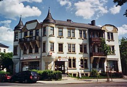Die Altenberger Straße bildete einst die Flurgrenze zwischen [Neugruna](../../../ost/gruna/neugruna/) und Blasewitz, wird heute jedoch meist zu Striesen gerechnet. Ihren Namen erhielt sie 1893 nach der Bergstadt Altenberg im Osterzgebirge. Vor der Eingemeindung 1892 wurde diese östlichste Straße Striesens mit der Nummer 17 bezeichnet. 1901 kam die auf Neugrunaer Flur gelegene Seidnitzer Straße, 1904 der zu Seidnitz gehörende Abschnitt der Blasewitzer Straße hinzu. Letztgenannter Teil hieß ursprünglich bis 1896 Blasewitzer Weg. Ein Teilabschnitt der Altenberger Straße wurde früher auch Ziegelweg genannt, da er die Verbindung von Seidnitz und Gruna zur Blasewitzer Ziegelei am Elbufer herstellte

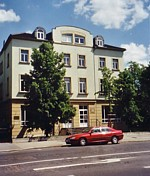Die Gebäude, meist mehrgeschossige Mietshäuser, entstanden um 1900 und weisen verschiedene architektonische Stilformen auf. Interessante Fassaden finden sich u. a. an den Häusern Altenberger Straße 3 und 6 sowie an der Häusergruppe Nr. 14-18. In einigen Gebäuden der Altenberger Straße gab es einst kleinere Geschäfte für die Versorgung der Bevölkerung. So unterhielt der amerikanische Warenhauskonzern Woolworth im Erdgeschoss des Hauses Altenberger Straße 27 Anfang der 1950er Jahre eine Filiale. Nach 1990 wurden die Räume zu Wohnzwecken umgebaut. Im Nachbarhaus Nr. 29 wurde am 23. Juni 1951 das erste HO-Selbstbedienungsgeschäft in Dresden errichtet, in dem man ohne Bezugsscheine Industriewaren erwerben konnte _(Foto)_. Unweit davon befindet sich seit einigen Jahren im früheren “Wittenberger Hof” das rustikale Lokal “Astloch” (Nr. 22). Bereits seit 1900 lädt die Familiengaststätte “Neugrunaer Casino”(Nr. 1) zur Einkehr ein. Ein moderner Wohn- und Geschäftskomplex entstand 1995 am Altenberger Platz und beherbergt als “Ladengalerie Striesen” verschiedene Geschäfte, Büros und Wohnungen. Vor dem Gebäude steht ein moderner Pyramidenbrunnen.

## Altstriesen

Der Name Altstriesen erinnert an den früheren Dorfkern des Ortes, welcher aus einem Vorwerk und mehreren Bauerngütern hervorging und sich nördlich der heutigen [Schandauer Straße](../../../ost/striesen/strassen_striesen/schandauer_strasse/) befand. Die Gebäude entstanden nach der Zerstörung 1813 neu und bewahrten noch bis 1945 ihr ländliches Aussehen. Für den Wiederaufbau fanden zum Teil Steine der ehemaligen Umfassungsmauer des Großen Gartens Verwendung, nachdem dieser für die Öffentlichkeit zugänglich gemacht worden war. Nach Aufgabe der Landwirtschaft befanden sich in den Gehöften meist kleine Handwerksbetriebe, Schankwirtschaften und Läden. Der vom [Landgraben](../../../ost/striesen/landgraben/) gespeiste frühere Dorfteich wurde Ende des 19. Jahrhunderts trockengelegt. In alten Stadtplänen ist die Platzanlage ab 1889 als Wettinplatz bzw. ab 1893 als Markgraf-Heinrich-Platz ausgewiesen. Am 21. März 1921 erfolgte die Umbenennung in Altstriesen.

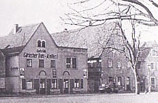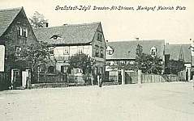

_Fotos:_ _Der Dorfkern von Altstriesen vor 1945 mit der Gaststätte “Striesener Ratskeller” _(linkes Bild)__

Nach 1880 entstanden an der Nordseite des langgestreckten Dorfplatzes mehrgeschossige Mietshäuser, deren Fassaden mit Porträts sächsischer Herrscher verziert waren. 1889, dem Jahr des 800. Jubiläums des Hauses Wettin, wurden diese “Wettinhäuser” übergeben. Hier befanden sich u.a. die Bäckerei Troschütz (Nr. 23), eine Verkaufsstelle der [Großmolkerei DREMA](../../../sud/plauen/strassen_plauen/) sowie im Eckhaus zur Markgraf-Heinrich-Straße die Schokoladenfabrik Clauß. In gleichem Zusammenhang wurde auch ein heute verschwundenes Denkmal auf dem Dorfplatz aufgestellt und dieser parkartig gestaltet. Eingriffe in die Platzgestaltung erfolgten 1944, als man hier Splitterschutzgräben und ein Löschwasserbecken für mögliche Luftangriffe anlegte. Wie fast alle Häuser Altstriesens fielen die Gebäude 1945 den Bomben zum Opfer. Einige verbliebene Bauernhäuser wurde bis auf eine Ausnahme um 1960 abgerissen. Auf dem Platz entstand ein Garagenkomplex, so dass vom ehemaligen Dorf Altstriesen heute kaum noch etwas zu erkennen ist.

Wettindenkmal: Der aus schwarzem Marmor gefertigte Obelisk wurde aus Anlass des 800. Thronjubiläums der Wettiner 1889 auf dem Striesener Dorfplatz aufgestellt, der in diesem Zusammenhang den Namen Wettinplatz erhielt. Das Denkmal trug die Inschrift “Zur Erinnerung an die 800-jährige Jubelfeier des Hauses Wettin. Die Gemeinde Striesen” und blieb auch bei späteren Umgestaltungen des Platzes erhalten. Auch die Zerstörung fast aller Gebäude des Umfeldes beim Luftangriff 1945 überstand es ohne größere Schäden, wurde jedoch in der Nachkriegszeit entfernt und ist seitdem verschollen.

## Am Landgraben

Die Straße Am Landgraben, im alten Striesener Dorfkern gelegen, erinnert an den früheren [Landgraben](../../../ost/striesen/landgraben/), der einst hier entlang floss und auch den 1876 trockengelegten Dorfteich speiste. Der Landgraben war bereits um 1860 zur heutigen Lauensteiner Straße verlegt worden, um Platz für neue Gebäude zu schaffen. Die offizielle Namensgebung erfolgte 1892. Schon 1839 hatte die Gemeinde im Haus Nr. 3 das erste Schulhaus eröffnet. Sämtliche Gebäude wurden 1945 zerstört. Im Zuge der Neubebauung nach dem Zweiten Weltkrieg wurde der Weg teilweise überbaut und besteht heute nur noch aus einem kurzen Reststück.

## [Augsburger Straße](../../../ost/striesen/strassen_striesen/augsburger_strasse/)

## Barbarossaplatz

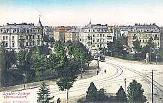Der Platz wurde in der zweiten Hälfte des 19. Jahrhunderts angelegt und 1893 in Erinnerung an den legendenumwobenen deutschen Barbarossaplatz genannt. 1890 entstand eine Straßenbahnverbindung vom Altmarkt zum Barbarossaplatz, die wenig später mit den vorhandenen Linien nach Blasewitz verbunden und 1897 elektrifiziert wurde. Der Platz entwickelte sich in der Folgezeit zu einem kleinen Verkehrsknotenpunkt _(Foto um 1910)_ und war Mittelpunkt des Neustriesener Villenviertels.

In der Nachkriegszeit erhielt der Barbarossaplatz am 1. Juli 1946 den Namen einer von den Nazis ermordeten Striesener Antifaschistin und wurde Lene-Glatzer-Platz genannt. Der Straßenbahnverkehr wurde nicht wieder aufgenommen, womit der Platz seine Verkehrsbedeutung verlor. Eine Rückbenennung in Barbarossaplatz erfolgte 1991. An Lene Glatzer erinnert jedoch bis heute die in nördlicher Richtung abzweigende frühere Barbarossastraße sowie ein Denkmal am Barbarossaplatz.

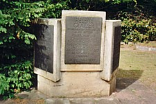

_**Foto:** Gedenkstein für die Striesener Antifaschisten Lene Glatzer, Otto Galle und Rosa Menzer._

_Die Mitteltafel ist der früheren Namensgeberin des Barbarossaplatzes gewidmet._

_**Inschrift:** Helene Glatzer - 8. Februar 1902 - 31. Januar 1945._

_Kontoristin, Funktionär der kommunistischen Kinder-, Jugend- und Frauenorganisationen in Ostsachsen. Abgeordnete der KPD im sächsischen Landtag. In Halle ermordet._

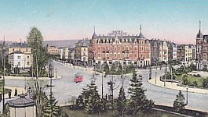Hotel Sachsenhof: Um 1900 gab es in einem der Gebäude das Hotel “Sachsenhof”(Barbarossaplatz 1). Das 1899 erbaute Haus befand sich im Eigentum der DREWAG, die nach dem Ersten Weltkrieg in den früheren Gasträumen im Erdgeschoss eine Gaswache einrichtete. Zwischen 1933 und 1945 hatte hier außerdem die “Ortsgruppe Barbarossa” der NSDAP ihren Sitz. Nach 1990 wurden diese Räumlichkeiten zeitweise vom Verein “Lebenshilfe e.V.” genutzt. Die oberen Etagen dienen seit Einstellung des Hotelbetriebes Wohnzwecken.

## Behrischstraße

Die nach 1860 als Straße 14 in Neustriesen angelegte und um 1900 mit Mietshäusern bebaute Behrischstraße verdankt ihren Namen dem früheren Dresdner Bürgermeister Burckhard Leberecht Behrisch (1682-1750), Gutsherr und Doktor der Rechtswissenschaften, der zwischen 1733 und 1750 im Amt war. 1893 erfolgte ihre offizielle Benennung. Ursprünglich erstreckte sich diese auch auf den Abschnitt nördlich der Niederwaldstraße, bevor dieser 1926 in die Jüngststraße einbezogen wurde. Im Wohnhaus Nr. 13 hatte viele Jahre der Bildhauer Bruno Fischer (1860-1932) seine Wohnung. Fischer war Meisterschüler Johannes Schillings an der Dresdner Kunstakademie und schuf zahlreiche Brunnenplastiken im sächsischen Raum sowie einige Figuren am Dresdner Rathausturm. Im Eckhaus zur Eisenacher Straße (Nr. 9) befand sich früher die Schankwirtschaft "Eisenacher Hof".

## Bergmannstraße

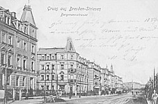Die Bergmannstraße entstand Ende des 19. Jahrhunderts als „Straße 8“ und verbindet den im Norden Neustriesens gelegenen Hüblerplatz mit dem früheren Dorfkern Altgruna. Um 1900 entstanden auch hier Wohn- und Geschäftshäuser, die teilweise 1945 den Bomben zum Opfer fielen und durch Neubauten ersetzt wurden. Ihren Namen erhielt die Straße nach dem Advokaten Ehregott Friedrich Bergmann (1710-1773), der von 1767-1773 Bürgermeister von Dresden war.

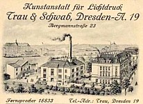Das Straßenbild der Bergmannstraße prägen im nördlichen Teil bis heute Wohnhäuser aus der Gründerzeit. Hier gab es früher auch mehrere Gaststätten wie den "Hübler-Garten" an der Ecke zum Hüblerplatz (Nr. 1) und den "Wormser Hof" (Nr. 27). Das auch zu DDR-Zeiten erhalten gebliebene Lokal bezog nach 1990 das italienische Restaurant "La Torre". Zu den gewerblichen Unternehmen, die einst an der Bergmannstraße ihren Sitz hatten, gehörte die "Kunstanstalt für Lichtdruck Trau & Schwab (Nr. 23), der Verlag von Hermann Bachstein (Nr. 33) und die Schokoladenfabrik Dr. Sperber (Nr. 46). Das Unternehmen kam 1948 zum VEB Dresdner Schokoladen- und Süßwarenindustrie.

Evangelisch-Freikirchliche Gemeinde: Neben zahlreichen Wohnhäusern fällt das Kirchengebäude Bergmannstraße 19 auf. Es
entstand 1981 als Gemeindehaus der Evangelisch-Freikirchlichen Gemeinde. Die Religionsgemeinschaft ging aus der um 1828 in England entstandenen “Erweckungsbewegung” hervor, die sich auf die Bibel und den biblischen Lebensstil konzentriert und deshalb u.a. auf einen festen Pfarrer verzichtet. In Dresden gab es ab 1906 erste von den Amtskirchen unabhängige christliche Hausversammlungen. 1937 wurden diese verboten und bildeten sich erst in der Nachkriegszeit neu. Zunächst nutzte man angemietete Räume, bevor 1980 das Grundstück an der Bergmannstraße erworben werden konnte. Eine weitere Gemeinde entstand 1993 als “Ableger” in Niedersedlitz.

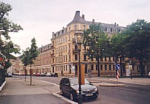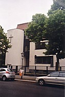

_**Fotos:**_ _Blick in die Bergmannstraße - rechts das Gemeindezentrum der Ev.-Freikirchlichen Gemeinde (Nr. 19)_

## Bertolt-Brecht-Allee

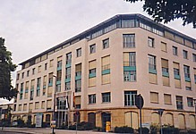Die südlich der Schandauer Straße gelegene Bertolt-Brecht-Allee wurde vor Beginn des Ersten Weltkrieges als Verlängerung der Spenerstraße angelegt und ab 1907 Carlowitzstraße genannt. Namensgeber war der sächsische Staatsmann Christoph von Carolowitz (+ 1578). An ihrem südlichen Ende lag am Schnittpunkt mit der Comeniusstraße der Carlowitzplatz. Zahlreiche Gebäude dieser Straße fielen 1945 den Bomben zum Opfer. In der Nachkriegszeit entstand zwischen Müller-Berset-Straße und Carlowitzstraße ein Betonwerk, in dem Trümmerschutt zu Ziegelsplitt zermahlen und zu Platten für den Wohnungsbau verarbeitet wurde.

Ihren heutigen Namen erhielt die Straße 1963 nach dem deutschen Dichter und Theaterregisseur Bertolt Brecht (1898-1956), der durch seine gesellschaftskritischen Werke zu den bedeutendsten Dramatikern des 20. Jahrhunderts gehört. Gleichzeitig wurde auch der Carlowitzplatz in Bertolt-Brecht-Platz umbenannt. Nach 1990 siedelten sich an der Bertolt-Brecht-Allee einige Gewerbetriebe an, wobei u.a. 1995/96 der moderne Business-Park mit dem “Haus der Wirtschaft” entstand _(Foto)_. Hinzu kamen weitere Büro- und Geschäftshäuser sowie einige Wohngebäude. Auf dem Areal der ehemaligen Zigarettenfabrik Zepter (Nr. 25), nach 1945 vom VEB Wohnraummöbel genutzt, entstanden ab 2015 ebenfalls Wohnungen.

## Bräterstraße

Die Bräterstraße wurde in den Dreißiger Jahren angelegt, als hier die Bebauung mit Wohnhäusern geplant war. Die amtliche
Namensgebung erfolgte am 12. Mai 1937. Ihren Namen verdankt sie dem Dresdner Stadtbaurat Edmund Bräter (1855-1925), der gemeinsam mit Karl Roth Schöpfer des Neuen Rathauses ist. Außerdem war Bräter als Leiter des städtischen Hochbauamtes verantwortlich für den Bau der heutigen Universitätsklinik, der Markthallen an der Weißeritzstraße und der Hauptstraße sowie der Wasserwerke Tolkewitz und Räcknitz.

Bedingt durch den Ausbruch des Zweiten Weltkrieges konnte das geplante Wohnviertel zwischen Striesen und Gruna nur in Ansätzen realisiert werden. 1945 wurde an der Bräterstraße eine Kleingartenanlage angelegt. Das heutige Vereinsheim dieser Sparte diente in den Nachkriegsjahren als Notunterkunft für ausgebombte Striesener Familien.

## Dornblüthstraße

Die Dornblüthstraße wurde als 12. Straße Neu-Striesens angelegt und 1892 nach dem früheren Dresdner Bürgermeister Marcus Dornblüth (1642–1715) benannt. Dornblüth begann seine Laufbahn als kurfürstlicher Steuerprokurator und wurde 1697 zum Bürgermeister gewählt, ein Amt, welches er bis 1715 innehatte. Die Villen und Mehrfamilienhäuser an der
Dornblüthstraße entstanden meistens Ende des 19. Jahrhunderts im Stil des Historismus. Im Haus Nr. 7 wurde 1993 die beliebte Weinstube “Gewölbe 7” eröffnet (seit 2005 Restaurant “Dornblüte”). Auf der gegenüberliegenden Straßenseite befindet sich das 1899 eröffnete [Freimaurerinstitut](../../../ost/striesen/), heute Gymnasium Kreuzschule. Weitere Lokale an der Dornblüthstraße sind das “Il Trullo”, die “Pflaume” (ehemals “Rattenloch”) und das “Dr. Schlüter” im Eckhaus zur Augsburger Straße. Zuvor wurden diese Räume von Dresdens erstem Irish Pub genutzt, vor dem Ersten Weltkrieg von der Schankwirtschaft 'Kiautschou'.

1910 errichtete der Kleinwohnungsbauverein Striesen an der Dornblüthstraße eine Wohnanlage mit 15 Häusern. Die architektonische Leitung des Bauvorhabens oblag Theodor Richter. Zu den Mitbegründern des Vereins gehörte der Dresdner Unternehmer Emil Römmler, Inhaber der bekannten Kunstdruckanstalt [Römmler & Jonas](../../../zentrum/johannstadt/strassen_johannstadt/blasewitzer_strasse/rommler___jonas/) an der Blasewitzer Straße.

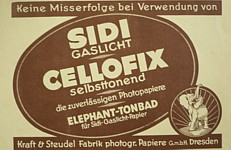Zu den gewerblich genutzten Grundstücken gehört die unter Denkmalschutz stehende Nr. 15, einst Sitz der bekannten Dresdner Firma Kraft & Steudel (Nr. 11-15). Zu den Produkten des 1906 gegründeten Unternehmens gehörten vor allem photographische Papiere, welche unter dem Markennamen "Cellufix" verkauft wurden _(Bild)_. Später befand sich hier die Dresdner Koffer- u. Taschen-Fabrik Carl Heinichen. Nr. 14 ist Sitz der Firma VacuTec Messtechnik GmbH, einem Hersteller von wissenschaftlichen Präzisionsmessgeräten. Gründer des Unternehmens (ehem. Vakutronic) war 1956 der Mikroelektronik-Pionier Werner Hartmann. Hergestellt werden u.a. Detektoren zur Messung ionisierender Strahlung für die Medizin und Umweltüberwachung.

## Eilenburger Straße

Die Eilenburger Straße entstand 1883 im Zuge der Parzellierung der Striesener Fluren und wurde zunächst als Straße G bezeichnet. Teilweise folgte diese einem alten Weg von Striesen nach Seidnitz. Sie begann ursprünglich an der Tittmannstraße und führte, vorbei am alten Dorfkern, bis zur Schandauer Straße. Nach der Eingemeindung erfolgte die Umbenennung des östlich Altstriesens gelegenen Abschnitts nach der sächsischen Kleinstadt Eilenburg, das westliche Reststück trägt seitdem den Namen Merseburger Straße. Ein weiteres Teilstück der Eilenburger Straße wurde 1922 zugunsten der Kleingartensparte “Flora” eingezogen.

Im Haus Eilenburger Straße 6 befand sich ab 1904 die Photographische Manufaktur von Richard Knoll, einem Hersteller von Kameraverschlüssen und anderer fotografischer Zubehörteile. 1928 wurde das Unternehmen von Emil Hofert übernommen und 1931 in EHO-Kamera-Fabrik GmbH umbenannt. Nach Übernahme des Betriebes durch Berthold Altmann bezog die Firma 1937 neue Räume auf der Lortzingstraße 38 ( [Altissa-Camera-Werk](../../../zentrum/johannstadt/strassen_johannstadt/))

## Eisenacher Straße

Die Eisenacher Straße im Osten von Neustriesen wurde bis zur Eingemeindung des Ortes 1892 Straße B genannt und erhielt dann ihren Namen nach der thüringischen Kleinstadt Eisenach. Bemerkenswertestes Gebäude ist das 1899 entstandene frühere [Freimaurerinstitut](../../../ost/striesen/), welches heute von der Kreuzschule genutzt wird. In unmittelbarer Nachbarschaft liegt der 1920 angelegte [Striesener Volkspark](../../../ost/striesen/strassen_striesen/seidelsche_gartnerei/hermann-seidel-park/).

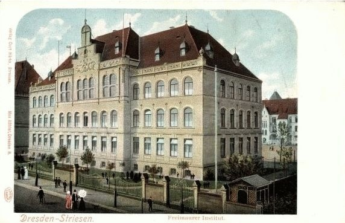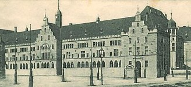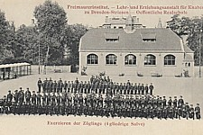

_**Fotos:**_ _Das ehemalige Freimaurerinstitut (heute Kreuzschule) an der Eisenacher / Dornblüthstraße._

_Im rechten Bild ist die Turnhalle im Innenhof zu sehen._

## Ermelstraße

Die frühere Straße 11, die vom Pohlandplatz ausgehend nach Norden führt, erhielt 1893 den Namen Ermelstraße und wurde mit den für Striesen typischen Mietshäusern in offener Bauweise bebaut. Der Straßenname erinnert an den Dresdner Bürgermeister Friedrich August Ermel (1740–1812), der ab 1787 bis 1812 die Geschicke der Stadt leitete.

Im Wohnhaus Ermelstraße 21 lebte bis zu ihrem Tod die Landschaftsmalerin und Lithographin Elisabeth Andrae (1876-1945), die ein Atelier auf der Ostbahnstraße 2 in der Nähe des Hauptbahnhofes besaß. Ihr Ölgemälde “Am Wannsee” gehört seit 1942 zum Bestand der Gemäldegalerie Neue Meister.

## Fürstenwalder Straße

Die Fürstenwalder Straße entstand Anfang der 1930er Jahre beim Bau einer neuen Wohnsiedlung und wurde am 9. Mai 1935 offiziell benannt. In Anlehnung an einige benachbarte Straßen erhielt auch sie ihren Namen nach einem Ort im Osterzgebirge, dem heute zu Altenberg gehörenden Dorf Fürstenwalde.

## Geisingstraße

Die Geisingstraße gehört zu den ältesten Striesener Straßen und geht auf einen alten Verbindungsweg zwischen Striesen und Gruna zurück. 1893 erhielt dieser Weg offiziell den Namen Geisingstraße, benannt nach dem Berg Geising bei Altenberg. Ursprünglich führte sie von Altstriesen (Markgraf-Heinrich-Platz) bis zur Beilstraße in Gruna, wurde jedoch in den 1970er Jahren teilweise überbaut.

1885 wurde an der Ecke Geising-/ Schandauer Straße der Striesener Straßenbahnhof eröffnet. 1945 fielen die meisten der früheren Bauernhäuser den Bomben zum Opfer. Erhalten blieb lediglich das Wohnhaus Geisingstraße Nr. 7, welches als letztes Gebäude noch bis in jüngste Vergangenheit an den alten Dorfkern erinnerte. 2014 begann zwischen Geising- und Haenel-Clauß-Straße auf dem Grundstück einer ehemaligen Gärtnerei der Bau der Wohnanlage „Gartenstadt Striesen“ mit ca. 300 Wohnungen. Im Haus Nr. 25 befindet sich seit 2013 eine Kita.

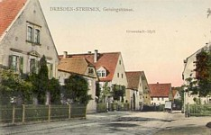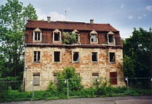

**_Fotos:_** _Blick in die Geisingstraße vor 1945,_

_im rechten Bild das letzte erhaltene Alt-Striesener Wohnhaus im Sommer 2006_

## Glasewaldtstraße

Die Glasewaldtstraße im östlichen Teil von Striesen wurde als Straße 13 angelegt und nach der Eingemeindung 1892 umbenannt. Friedrich Glasewaldt (1706-1784) war von 1771-1784 Bürgermeister von Dresden und zeitweise Besitzer des Weingutes [Glasewaldts Ruhe](../../../nord/wilschdorf/) in Wilschdorf. Die für die Entstehungszeit typische Bebauung mit mehrgeschossigen Mietshäusern blieb bis heute weitgehend erhalten. Außerdem gab es einige kleinere Gastwirtschaften, so z.B. in der Nr. 29 das Restaurant "Zur Amsel" sowie in Nr. 34 das Lokal "Sachsenwald". Im Eckhaus zur Wittenberger Straße (Nr. 42) befand sich der "Glasewald-Hof". Mehrere durch Abriss entstandene Baulücken wurden Mitte der 1990er Jahre mit modernen Wohnhäusern geschlossen.

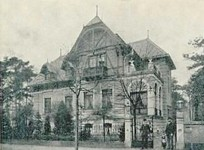Zu den bemerkenswertesten Gebäuden gehört das villenartige Landhaus Glasewaldtstraße Nr. 8 _(Foto)_, welches als eines der ersten Häuser an der Straße 1888 von Karl Emil Scherz errichtet wurde. Die Fassade ist mit verschiedenen Sinnsprüchen verziert. Bauherrin war die Hofschauspielerin Charlotte Basté (1867-1928), die hier bis kurz vor dem Ersten Weltkrieg mit ihrer Familie wohnte. Eine Erinnerungstafel wurde in den 1960er Jahren entfernt. Interessant ist auch das gegenüberliegende Wohnhaus Nr. 7, welches um 1900 dem Holzhändler Ernst Kempe gehörte und auch nach 1945 im Familienbesitz blieb. Auf dem Grundstück Glasewaldtstraße 22 besaß bis 1990 der VEB Messelektronik Dresden eine Niederlassung. Ein Anfang der 1980er Jahre für dieses Unternehmen errichteter Betonbunker diente der Messung radioaktiver Strahlung für die Dosimeter-Herstellung und wurde erst 2011 im Zusammenhang mit der Neubebauung des Grundstücks beseitigt.

## Glashütter Straße

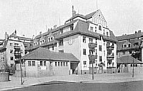Die frühere Straße K im Süden der Striesener Flur erhielt 1892 nach der Uhrmacherstadt Glashütte im Müglitztal den Namen Glashütter Straße. Neben Produktionsgebäuden der Zigarettenindustrie entstanden hier nach der Jahrhundertwende auch einige Wohnhäuser. Die Anlage zwischen Glashütter, Kipsdorfer, Dornblüth- und Junghansstraße wurde 1910/11 vom Kleinwohnungs-Bauverein Dresden als erstes Bauvorhaben der 1910 gegründeten Genossenschaft errichtet _(Foto)_. Ziel war die Schaffung preiswerten Wohnraums für die Mitglieder des Bauvereins. Als Architekt der als König-Friedrich-August-Häuser bezeichneten Gebäude konnte Theodor Richter gewonnen werden, der nach einem einheitlichen Konzept die gesamte Wohnanlage mit ihren 124 Wohnungen entwarf. Die Anlage besteht aus drei dreigeschossigen Wohnblocks, die ursprünglich an der Junghansstraße durch zwei Torhäuser miteinander verbunden waren. Heute gehören die Häuser der Wohnungsgenossenschaft "Aufbau" und wurden 1994 saniert.

Zu den gewerblichen Unternehmen, die einst ihren Sitz an der Glashütter Straße hatten, gehörten die [Zigarettenfabriken](../../../ost/striesen/striesener_zigarettenfabriken/) "Macedonia" (Mr. 66) und von Georg Anton Jasmatzi (Nr. 94), die Kunstanstalt Leutert & Schneidewind A.G. (Nr. 100) sowie das ICA-Werk der Zeiss-Ikon AG (Nr. 101a). Zwischen Glasewaldt- und Gottleubaer Straße gab es in den Dreißiger Jahren zudem eine Gleisschleife der Dresdner Straßenbahn.

Leutert & Schneidewind (Nr. 100): Das Unternehmen ging aus einer 1896 entstandenen offenen Handelsgesellschaft hervor und wurde 1908 zur Kommanditgesellschaft, 1923 zur Aktiengesellschaft umgewandelt. Als Kunstanstalt und Plakatfabrik stellte man hier unterschiedlichste Druckerzeugnisse wie Wanderkarten, Anschauungstafeln, Werbeplakate, Postkarten und ähnliche Druckerzeugnisse her. Auch in der DDR blieb der Betrieb zunächst in Privatbesitz und war größter seiner Art im Land. Später wurde er vom VEB Polypack Übernommen. Heute befindet sich auf dem Grundstück ein Einkaufszentrum.

ICA-Werk: Der Gebäudekomplex an der Glashütter Straße 101/101a entstand 1936/38 nach Plänen der Architekten Emil Högg und Georg Rüth für die Zeiss-Ikon AG. Die Firma ICA (Internationale Camera Actiengesellschaft) war 1909 durch Zusammenschluss von vier kleineren Dresdner Kamerafirmen entstanden und hatte ihren Stammsitz an der [Schandauer Straße](../../../ost/striesen/strassen_striesen/schandauer_strasse/) 74/76. Ab 1926 gehörte sie zur Zeiss-Ikon AG. Da das Unternehmen als "kriegswichtig" betrachtet wurde, bildete man das Treppenhaus des Neubaus als Hochbunker aus. Die früher vorhandenen Abprallverdachungen an Türen und Fenstern sind nicht mehr erhalten. Heute wird das Gebäude unter dem Namen "Penta-Park" von verschiedenen Gewerbemietern genutzt.

Kleingartenverein „Blumenau: Die Gartensparte wurde 1923 auf dem Gelände einer ehemaligen Kiesgrube an der Glashütter Straße angelegt. 1945 fielen fast alle Lauben dem Luftangriff zum Opfer. Das Gelände wurde in der Folgezeit als Trümmerkippe genutzt und war durch eine Feldbahn mit der Innenstadt verbunden. Erst Anfang der 1950er Jahre konnten die ersten Gärten wieder genutzt werden.

Die Gottleubaer Straße wurde 1903 nach der Stadt Bad Gottleuba benannt. Der Kurort im Osterzgebirge ist heute ein Ortsteil von Bad Gottleuba-Berggießhübel. An der Gottleubaer Straße liegt der [Striesener Friedhof](../../../ost/striesen/striesener_friedhof/).

Der Haenel-Clauß-Platz an der Einmündung der Prossener Straße in die Haenel-Clauß-Straße entstand Mitte der 1930er Jahre im Zuge der Bebauung des Areals. Am 12. Mai 1937 wurde die im Bebauungsplan als "Platz 4" verzeichnete Anlage in Anlehnung an die benachbarte Straße nach Sara Emilie Haenel-Clauß benannt.

## Haenel-Clauß-Straße

Die 1912 angelegte Haenel-Clauß-Straße, im Wohngebiet um den Hepkeplatz gelegen, erinnert an die Wohltäterin und Stifterin Sara Emilie Haenel-Clauß, die aus privaten Mitteln 1889 ein Genesungsheim für arme kranke Kinder finanzierte. Zuvor verlief in diesem Bereich ein Fußweg zwischen Gruna und Striesen, der in alten Stadtplänen als Weg Am alten Landgraben bezeichnet wurde. Ihren Namen erhielt die frühere Planstraße 7 am 31. August 1912.

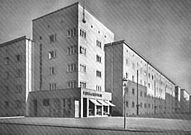Die Bebauung erfolgte zunächst nur auf einem kurzen Abschnitt an der Schandauer Straße. Erst Ende der 1920er Jahre wurde sie bis zum Falkensteinplatz auf Grunaer Flur verlängert und in diesem Zusammenhang der heutige Haenel-Clauß-Platz angelegt. Kriegszerstörungen und die später entstandenen Neubauten an der Schandauer Straße führten zur Überbauung des nördlichen Abschnitts, so dass die Haenel-Clauß-Straße heute nur noch zwischen Falkenstein- und Hanel-Clauß-Platz existiert. Die meisten Wohnhäuser entstanden zwischen 1925 und 1928 nach einem einheitlichem Konzept im Auftrag der gemeinnützigen Wohnungsbaugesellschaft GEWOBAG _(Foto um 1930)_. Architekt der im Bauhausstil gestalteten Gebäude war Erich Hempel.

## Hans-Böheim-Straße

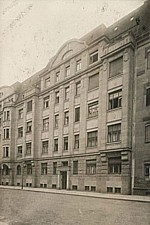Die Hans-Böheim-Straße, eine kurze Seitenstraße der Krenkelstraße, erhielt ihren Namen am 30. September 1953 nach dem auch als „Pfeifer von Niklashausen“ bekannten Volksprediger und Musikanten Hans Böheim (auch Behem), der von 1458 bis 1476 lebte. Böheim setzte sich für die soziale Gleichheit aller Menschen ein und kritisierte in seinen Predigten Eitelkeit und Gier der herrschenden Adelsklasse. 1476 wurde er als Ketzer auf dem Scheiterhaufen verbrannt. Vor dem Zweiten Weltkrieg wurde die Straße ab 1904 nach dem Dichter Theodor Storm (1817-1888) Stormstraße genannt.

Die ersten Wohnhäuser, meist mehrgeschossige Gebäude in geschlossener Bauweise, entstanden in den Jahren vor dem Ersten Weltkrieg und weisen teilweise Jugendstilformen auf. Ursprünglich führte die Straße von der Krenkel- bis zur Spenerstraße. Mit Zerstörung der meisten Gebäude und dem 1955 begonnenen Wiederaufbau rund um die Borsbergstraße wurde sie jedoch in ihrem östlichen Abschnitt fast vollständig überbaut. Im verbliebenen Straßenteil sind die Wohnhäuser Hans-Böheim-Straße 2 und 4 als Kulturdenkmäler in der Denkmalliste verzeichnet. In der Nr. 2 _(Foto)_ wohnten bis ca. 1940 mehrere jüdische Familien, bevor diese vertrieben und in sogenannte "Judenhäuser" umziehen mussten.

## Haydnstraße

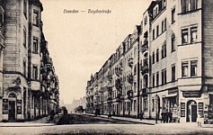Die Haydnstraße wurde Ende des 19. Jahrhunderts als Planstraße H des Striesener Bebauungsplans angelegt und verband die benachbarte Johannstadt mit dem Altstriesener Dorfkern. Ihren Namen erhielt sie 1890 nach dem österreichischen Komponisten Joseph Haydn (1732-1809), welcher vor allem durch seine Streichquartette bekannt wurde. Ältester Abschnitt ist der Straßenteil westlich der heutigen Fetscherstraße in der Johannstadt. 1903 wurde sie bis zur Striesener Tittmannstraße, 1928 bis zur Spenerstraße verlängert.

Markantestes Gebäude ist das von Hans Erlwein entworfene [Schulhaus](../../../ost/striesen/) (Nr. 49), welches zwischen 1991 und 2004 Sitz des Joseph-Haydn-Gymnasiums war und heute vom Martin-Andersen-Nexö-Gymnasium genutzt wird. Außerdem befindet sich an der Haydnstraße 23 das Gemeindehaus der Johanneskirchgemeinde mit einem Glockendenkmal, welches an die 1945 zerstörte [Erlöserkirche](../../../ost/striesen/erloserkirche/) erinnert.

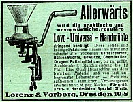Auch die meisten Wohnhäuser der Haydnstraße fielen den Bomben zum Opfer. Einige dieser Gebäude beherbergten früher kleinere Gewerbebetriebe. So gab es in der Nr. 9 die Firma W. Heiser & Co. Fabrik für Zentralheizungsanlagen. Außerdem war hier 1905 eine Zweigstelle des Königlichen Konservatoriums untergebracht. Im Eckhaus zur Tittmannstraße (Nr. 54) hatte in den Zwanziger Jahren die Firma Lorenz & Vorberg eine Niederlassung _(Bild: Werbung um 1925)_. Das Unternehmen produzierte und vertrieb unter dem Markennamen "Lovo" verschiedene Geräte für Haus, Küche und Tierzucht und gab dafür jährlich einen reich illustrierten Katalog heraus. Gaststätten gab es bis zur Zerstörung auf der Haydnstraße 10 ("Stadt Frankfurt") und im Eckhaus zur Mosenstraße (Nr. 40 - Restaurant "Zur Johannesburg"). Von den zahlreichen kleinen Läden ist die Lebensmittelverteilungsstelle des Konsumverein "Vorwärts" erwähnenswert (Nr. 60).

Zu den nach 1945 entstandenen Bauten gehören die Wohnhäuser im Johannstädter Abschnitt der Haydnstraße. Hier befindet sich das 1983 bis 1986 von Lehrlingen der Deutschen Reichsbahn erbaute Verwaltungsgebäude der Wohnungsgenossenschaft Johannstadt (WGJ). Die Genossenschaft entstand am 1. Juli 1964 durch Zusammenschluss der AWG “IG örtliche Wirtschaft” und der AWG des staatlichen und genossenschaftlichen Handels. Bis 1991 war sie unter dem Namen AWG “Fortschritt” tätig und ist mit über 8000 Mitgliedern eine der größten Wohnungsgenossenschaften Dresdens. In Ergänzung ihres Bestandes errichtete sie nach 1990 mehrere Neubauten, u.a. das sogenannte "Zukunftshaus" mit innovativem Energiekonzept nach Plänen des Architekten Jens Zander (Nr. 17). 2015 entstand für die WG ein weiteres Wohngebäude an der Haydnstraße 33-35. An diesem Eckhaus zur Krenkelstraße erinnern stilisierte Noten an den Namensgeber der Straße. Die als Metallplatten an insgesamt 44 Balkons angebrachten Tafeln zitieren verschiedene Stücke des Komponisten Joseph Haydn. Schöpfer war der brasilianische Künstler Fernando Vilela.

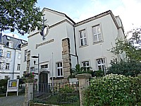Adventhaus (Nr. 16): Das nach Kriegszerstörungen 1945 wiederaufgebaute Gebäude ist eines von zwei Gemeindehäusern der Siebenten-Tags-Adventisten in Dresden, einer evangelisch-freikirchlichen Gemeinschaft. Die 1863 in der USA gegründete Kirche ist seit 1901 auch in Dresden vertreten und zählt hier ca. 300 Mitglieder. Vor 1945 diente das Haus u.a. als Schwesternheim der "Friedensauer Schwestern", einer nach dem Vorbild der Diakonissen wirkenden sozialen Fürsorgeeinrichtung. Beim Luftangriff wurde es schwer beschädigt und danach bis 1950 wiederaufgebaut. Im Obergeschoss des zweistöckigen Gebäudes befindet sich der Gemeindesaal, die übrigen Räume dienen als Wohnungen und Büros _( **Foto:** Wikipedia)_.

Nr. 27: Im Wohnhaus Haydnstraße 27 wohnte bis zu seinem Tod 1905 der Bildhauer Heinrich Epler (1846-1905). Er war Schöpfer der Plastik “Zwei Mütter” an der Bürgerwiese sowie der Sockel der Fahnenmasten am Neustädter Markt. Auch das Bronzerelief am Altar der Kreuzkirche, welches die Einführung der Reformation in Dresden thematisiert, stammt von seiner Hand. Große Teile seines künstlerischen Nachlasses gingen 1945 bei der Zerstörung seines Wohnhauses verloren. Nach dem Ersten Weltkrieg befand sich im Haus der Kunstverlag mit Verlagsbuchhandlung von Hans Friedrich Abshagen.

Sportverein "Bar Kochba": Der jüdische Sportverein entstand 1919 und hatte bis Ende der 1920er Jahre sein Vereinsheim auf dem Grundstück Haydnstraße 44. Bar Kochba war ein zu dieser Zeit häufiger Name jüdischer Vereine und erinnerte an Simon bar Kochba, den Anführer eines Aufstands gegen die römische Besatzung Judäas. Für Wettkämpfe wurde zunächst ein Platz an der Lennéstraße genutzt, die Fußballer spielten in Mickten. Am 14. Oktober 1928 konnte der Verein einen eigenen Sportplatz im Ostragehege einweihen. Fortan wurden hier sowohl Wettkämpfe mit jüdischen, aber auch mit nicht-jüdischen Vereinen ausgetragen. Als Fußballverein gehörte der Dresdner SV Bar Kochba dem Verband Mitteldeutscher Ballspielvereine an und konnte so auch an Meisterschaften teilnehmen.

Mit Machtergreifung der Nationalsozialisten wurde jüdischen Vereinen der Wettkampf mit "reinrassigen" Sportvereinen verboten. Erlaubt blieben lediglich Begegnungen auf freundschaftlicher Ebene. Nachdem bis zu den Olympischen Spielen 1936 noch eine weitgehend liberale Sportpolitik betrieben wurde, musste der Verein wenig später seinen Platz im Ostragehege aufgeben und zur ehemaligen Radrennbahn nach Reick umziehen. Mit dem Abbruch der Rennbahn 1939 endete auch die Geschichte von Bar Kochba. Das Vereinshaus in Striesen war schon vorher für eine Bebauung aufgegeben worden.

## Hepkeplatz

Der Hepkeplatz trägt ebenso wie die benachbarte [Hepkestraße](../../../ost/gruna/strassen_gruna/) den Namen des Kaufmanns Bernhard Hepke (1837- 1916), der sich auch als Stifter für das Gemeinwohl engagierte. Die offizielle Benennung erfolgte am 25. Oktober 1928. Zuvor befand sich hier eine Ziegelei mit Lehmgrube, die man später jedoch mit Asche und Hausmüll verfüllte. Teile des Grundstücks dienten danach als Kleingartensparte "Blumenau", die jedoch 1937 der fortschreitenden Bebauung weichen musste.

Die Wohnhäuser rund um den Hepkeplatz entstanden zwischen 1925 und 1928 nach Entwürfen von Erich Hempel und der Architekten Max Taut, Franz Hoffmann, Palm und Schmersahl für die Gemeinnützige Wohnungsbau A.G. Gruna. Hier wurden vorrangig kleine preiswerte Wohnungen für ärmere Familien eingerichtet. Im Haus Nr. 4 gab es um 1930 eine Lebensmittelverteilungsstelle des Konsumvereins Vorwärts. In der Nr. 8 besaß 1938 der Architekt Ernst Ufer seine Wohnung, der u.a. an der Vollendung der [Trachauer Siedlung](../../../nordwest/trachau/trachauer_siedlung/) beteiligt war.

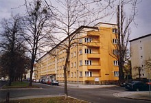

**_Foto:_** _Wohnsiedlung Hepkeplatz_

Plastik “Mutter mit Kind”: Die vom Bildhauer Ernst Hermann Grämer in den 1930er Jahren geschaffene Figur stand ursprünglich im Hugo-Bürkner-Park an der Dohnaer Straße in Strehlen, musste dort jedoch um 2005 dem Bau eines Regenrückhaltebeckens weichen. 2013 erhielt sie ihren jetzigen Standort am Hepkeplatz. Zuvor hatte auf diesem Sockel seit den 1950er Jahren die ursprünglich aus Niedersedlitz stammenden Plastik „Kniender Frauenakt“ von Hugo Otto Poertzel gestanden. Da der Niedersedlitzer Heimatverein die Rückführung dieser Plastik durchgesetzt hatte, kehrte diese 2012 an ihren früheren Standort an der Niedersedlitzer Bahnhofstraße zurück.

## Heubnerstraße

Die Heubnerstraße entstand in den Jahren vor dem Ersten Weltkrieg im neu errichteten Wohnviertel rund um den heutigen Stresemannplatz. Otto Leonhard Heubner (1812-1893) gehörte 1849 der provisorischen Regierung an und wurde wegen seiner Teilnahme am Dresdner Maiaufstand zum Tode verurteilt, später jedoch begnadigt. Als Landtagsabgeordneter und Stadtrat setzte er sich für Reformen im Schulwesen ein und war einer der Mitbegründer der deutschen Turnbewegung. Seit 1906 steht die Straße im Adressbuch.

Der Hüblerplatz verdankt seinen Namen ebenso wie die benachbarte [Hüblerstraße](../../../ost/blasewitz/strassen_blasewitz/) dem früheren Dresdner Bürgermeister Balthasar Hübler (1788-1866), der von 1832 bis 1848 im Amt war. 1892 wurde er zunächst Ahornplatz benannt, erhielt jedoch bereits ein Jahr später seinen heutigen Namen. Im Haus Hüblerplatz 2 hatte um 1903 die Kunstanstalt "Merkur" - Officine für feinsten Chromodruck ihren Sitz. Nach dem Ersten Weltkrieg betrieb hier der Unternehmer Feiertag bis 1932 eine Fabrik zur Herstellung photographischer Apparate. Zudem gab es auf dem Grundstück mit der Firma "Evaminondas" eine der zahlreichen kleinen Striesener Zigarettenfabriken.

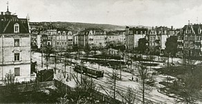

_**Foto:** Der Hüblerplatz kurz vor dem Ersten Weltkrieg_

## Huttenstraße

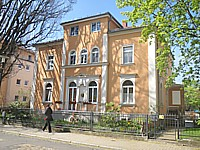Die Huttenstraße entstand im Zusammenhang mit dem Aufbau Neustriesens. Der seit 1892 verwendete Name erinnert an den Publizisten und Dichter Ulrich von Hutten (1488-1523), welcher durch seine Epigramme und Streitschriften gegen die Papstkirche bekannt wurde. Als westlichste Straße dieses Viertels wurde sie ab 1873 bis zur Eingemeindung Straße 1 genannt und bildete gleichzeitig die Flurgrenze zur Johannstadt. In älteren Stadtplänen aus der Zeit um 1860 ist auch der Name Fürstenstraße verzeichnet, wohl weil hier ein alter kurfürstlicher Jagdweg verlief.

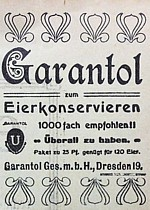Hier befand sich auch die erste Gaststätte dieses Wohnviertels, welche 1893 den Namen “Zur Deutschen Eiche” erhielt. Das Gebäude an der Huttenstraße 1 war 1863 als “Bergels Ruh” erbaut und nach 1871 als Gasthof “Kaisergarten” bezeichnet worden. Ein weiteres Lokal mit dem Namen "Union Restaurant" gab es bis 1945 in der Nr. 7. Im Haus Nr. 6 lebte ab 1869 bis zu seinem Tod der sächsische Historiker und Demokrat Carl Eduard Vehse (1802-1870), Verfasser einer mehrbändigen Weltgeschichte und zahlreicher kritischer Schriften zur sächsischen Geschichte.

Neben Wohnhäusern gab es hier so wie in vielen Grundstücken der Johannstadt und im westlichen Striesen kleine Gewerbebetriebe. So hatte auf der Huttenstraße 13 vor dem Ersten Weltkrieg die Firma Garantol ihren Sitz, die einen patentierten Apparat zum Konservieren von Eiern anbot _(Werbung von 1914)_. Ca. 1920 verlegte der Betrieb seinen Sitz nach Gommern (heute Stadtteil von Heidenau) und nach 1945 ins badische Grötzingen. Die Gewerberäume auf der Huttenstraße nutzte später bis 1945 die Herwa Metallwarenfabrik. 1945 fiel das Haus wie fast alle Wohnhäuser an der Huttenstraße den Bomben zum Opfer. Zu den wenigen erhalten Bauten der Vorkriegszeit gehört die unter Denkmalschutz stehende Villa Huttenstraße 10 _(Foto oben rechts)_.

## Jacobistraße

Die frühere Straße 9 in Neustriesen erhielt 1903 ihren heutigen Namen Jacobistraße. Namensgeber war der frühere Dresdner Bürgermeister Johann Georg Ferdinand Jacobi (1769-1848), der ab 1806 dem Stadtrat angehörte und 1823 zum Bürgermeister bestimmt wurde. 1836 schied er als letzter regierender Bürgermeister der Stadt aus seinem Amt aus und wurde von einem nach demokratischen Regeln gewählten Amtsnachfolger abgelöst.

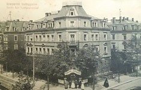Das Straßenbild der Jacobistraße prägen bis heute mehrgeschossige Stadtvillen, welche meist um die Jahrhundertwende entstanden. Früher gab es hier mehrere Gaststätten, so im Eckhaus zur Eisenacher Straße (Nr. 9) das Restaurant "Louisengarten". Nach 1945 erhielt das Lokal den Namen "Gust'l-Eck" und existierte bis ca. 1990. Eine weitere Gaststätte mit Namen "Liebiggarten" gab es von 1894 bis ca. 1918 in der Nr. 18 an der Einmündung der Augsburger Straße _(Foto)_. Die danach von einer Lederhandlung genutzten Räume wurden 1945 mit dem Gebäude zerstört. 2008 entstand an seiner Stelle ein modernes Mehrfamilienhaus. Dritte gastronomische Einrichtung der Jacobistraße war der 1895 eröffnete "Jacobihof" in der Nr. 26. Hier befand sich von 1912 bis 1921 zudem das Kino "Sanssouci-Lichtspiele" mit ca. 150 Plätzen. So wie einige andere Gebäude steht auch dieses Haus unter Denkmalschutz. Mehrere Baulücken wurden nach 1990 mit Neubauten geschlossen.

Zu den wenigen gewerblichen Einrichtungen der Jacobistraße gehörte die nach der Jahrhundertwende gegründete Cigaretten-Fabrik Prée & Co. im Hintergebäude des Grundstücks Jacobistraße 8. 1918 teilte sich das kleine Unternehmen die Räume mit zwei weiteren Betrieben der Tabakbranche, der Cigaretten-Fabrik Jean Fotiou und der Maschinen-Zigaretten-Fabrik von Paul Spiegel. Letztmals sind diese Kleinunternehmen im Adressbuch von 1923 nachweisbar und gingen vermutlich in der Inflationszeit in Konkurs.

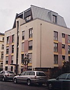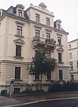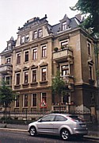

**_Fotos:_** _Neue, alte und sanierte Wohnhäuser prägen das Straßenbild der Jacobistraße_

## Karl-Roth-Straße

Die in den Dreißiger Jahren als Planstraße N angelegte und am 25. Oktober 1935 benannte Karl-Roth-Straße verdankt ihren Namen dem Darmstädter Architekten Karl Roth (1875-1932), der gemeinsam mit Stadtbaurat Edmund Bräter den Architektenwettbewerb zum Bau des Neuen Dresdner Rathauses gewann. Beide schufen 1905/10 das Rathaus am Dr.-Külz-Ring und wurden später mit Straßen in Striesen geehrt.

## Keglerstraße

Die Keglerstraße im Striesener Wohngebiet nördlich des Hepkeplatzes erhielt ihren Namen am 12. Mai 1937 nach dem Kaufmann und Stifter Hermann Ferdinand Kegler (1838-1870), der der Stadt 132.000 Mark für verschiedene Verschönerungsarbeiten gestiftet hatte. Angelegt wurde sie im Zusammenhang mit der Bebauung zwischen Haenel-Clauß- und Bergmannstraße als Planstraße 7c.

Die heute nicht mehr vorhandene Köchlystraße erhielt ihren Namen am 25. Juli 1929 nach dem Altphilologen Hermann Köchly (1815-1876), der ab 1840 Lehrer an der Kreuzschule war. 1849 gehörte er der Zweiten Kammer des Sächsischen Landtags an, musste jedoch wegen seiner Beteiligung am Dresdner Maiaufstand wenig später fliehen. Ab 1851 wirkte er als Professor an den Universitäten Zürich und Heidelberg. Die kleine Straße verband einst in Höhe der Geisingstraße die Schandauer mit der Glashütter Straße. Nach vollständiger Zerstörung der Bebauung wurde sie im Zusammenhang mit der Errichtung des Neubaukomplexes südlich der Schandauer Straße um 1970 eingezogen und überbaut.

## Krenkelstraße

Die Krenkelstraße entstand nach 1900 im Zusammenhang mit dem Ausbau der Wohnsiedlung rund um den Walderseeplatz
(heute Stresemannplatz). Ihren Namen erhielt sie nach dem Dresdner Privatgelehrten und Stifter Peter Maximilian Krenkel (1839-1901).

Bis heute sind hier zahlreiche Villen aus der Entstehungszeit erhalten geblieben. Sehenswert sind u. a. die Häuser Nr. 7 und
Nr. 15 mit interessanten Treppenhausgestaltungen im Jugendstil. Die Krenkelstraße gehört zu den am besten erhaltenen
Alt-Striesener Straßenzügen und wurde in den letzten Jahren rekonstruiert. Im Eckhaus Nr. 12 (ehem. “Krenkelhof”) gibt es seit 2005 die ungarische Spazialitätengaststätte “Kakas”.

## Kyffhäuserstraße

Die Kyffhäuserstraße wurde als nördlichste West-Ost-Verbindung Neustriesens an der Ortsgrenze zu Blasewitz angelegt und
erhielt zunächst die Bezeichnung Straße A. Wie überall in diesem Gebiet war auch hier die offene Bebauung vorgeschrieben,
was zur Entstehung einer Reihe architektonisch interessanter Villen und Mehrfamilienhäuser führte. 1892 erhielt diese Straße
den Namen Kyffhäuserstraße, der ebenso wie die Bezeichnungen einiger Nachbarstraßen an wichtige Schauplätze und Ereignisse der deutschen Geschichte erinnern sollte.

Nach 1945 wurde die Kyffhäuserstraße nach einem Striesener Arbeiterfunktionär Otto-Galle-Straße genannt, erhielt jedoch
1991 ihren ursprünglichen Namen zurück. Otto Galle, der auf der Kyffhäuserstraße eine Schuhmacherwerkstatt besaß, war
nach 1933 im Widerstandskampf aktiv und kam  später in einem Konzentrationslager ums Leben. Interessant ist die
historische Ladenausstattung der um 1915 gegründeten Barbarossa-Apotheke, eine der wenigen erhaltenen alten Dresdner Apotheken.

“Kaiser Barbarossa”:
An der Ecke Kyffhäuser-/Barbarossastraße (heute Lene-Glatzer-Straße) entstand 1895 das Ballhaus “Kaiser Barbarossa”, welches neben dem “Sächsischen Prinzen” zu den beliebten Striesener Vergnügungsstätten gehörte.
1925 wurde das Lokal geschlossen und als Zigarettenfabrik genutzt. Nach wechselnder gewerblicher Nutzung, zuletzt als Lagerhaus, steht der Gebäudekomplex heute in ruinösem Zustand leer.

APOGEPHA-Arzneimittelwerk: Das Unternehmen wurde 1882 vom Dresdner Apotheker Carl Stephan im Gebäude der heutigen Kronen-Apotheke auf der Antonstraße gegründet. Hier betrieb Stephan zunächst ein Laboratorium, welches er später mit dem Labor der Kronenapotheke vereinigte und unter dem Namen C. Stephan - Fabrik pharmazeutischer Präparate fortführte. Diese Kooperationsgemeinschaft von Forschung, Produktion und Verkauf hatte bis 1913 Bestand.

1919 verlegte der Betrieb seinen Firmensitz nach Striesen, wo sich die Firma auf der Kyffhäuserstraße 27 ansiedelte. Aufsichtsratschef der neu gebildeten Aktiengesellschaft war der bekannte Dresdner Unternehmer Ottomar Heinsius von Mayenburg, Erfinder der “Chlorodont”-Zahncreme. 1931 übernahm die Sächsische Apothekergenossenschaft den seit 1927 zu Mayenburgs Leo-Werken gehörenden Betrieb und führte ihn unter dem Namen APOGEPHA (Apotheker-Genossenschaft für Herstellung und Vertrieb pharmazeutischer Präparate C. Stephan) weiter. 1933 musste das junge Unternehmen jedoch bereits Insolvenz anmelden und wurde im Anschluss vom bisherigen Betriebsleiter Dr. Johannes Starke und dem Leipziger Kaufmann Max Biering übernommen. Beim Luftangriff 1945 kam es zu schweren Schäden an den Produktionsgebäuden, die jedoch bald wieder behoben werden konnten.

Auch nach 1945 blieb die Firma zunächst in Privatbesitz, musste jedoch 1961 eine staatliche Beteiligung aufnehmen und wurde 1972 in einen VEB umgewandelt. Zwischen 1983 und 1990 gehörte sie als Betriebsteil zum Sächsischen Serumwerk. Das 1991 als erstes Pharmaunternehmen der DDR reprivatisierte Unternehmen stellte fortan verschiedene Arzneimittel, speziell für den urologischen Bereich, her, die auch exportiert wurden. Moderne Produktionstätten entstanden 1996 in Dresden-Lockwitz. 2018 wurden diese jedoch wieder aufgegeben, so dass sich die Firma heute auf die Entwicklung und den Vertrieb von Medikamenten konzentriert.

Nr. 30:
In diesem Haus lebte vor dem Ersten Weltkrieg der Dichter und Redakteur Franz Diederich (1865-1928). Diederich
hatte ursprünglich an der Erarbeitung des “Brockhaus”-Lexikons mitgearbeitet, war jedoch wegen seiner SPD-Mitgliedschaft
entlassen worden. Als Schriftsteller, Lyriker und Journalist verfasste er zahlreiche Artikel für verschiedene Arbeiterzeitungen.
1903 kam er nach Dresden und lebte hier zeitweise in Striesen und in Hellerau. Zu seinen Werken gehören mehrere Gedichtbände, Essays und Anthologien zu politischen und kulturhistorischen Themen.

## Laubestraße

Die Laubestraße wurde nach 1900 angelegt und in der Folgezeit mit Wohnhäusern bebaut. Zu den wichtigen Industriebetrieben, die sich hier nach dem Ersten Weltkrieg ansiedelten, gehörte die [Zigarettenfirma Lande](../../../ost/striesen/striesener_zigarettenfabriken/). 1932 übernahm die Orientalische Tabak- und Zigarettenfabrik “Yramos” das Gebäude, welches 1945 zerstört wurde. An der Laubestraße erinnern fünf Stolpersteine an das jüdische Ehepaar Max und Bertha Steinhart und ihre drei Kinder. Die Familie besaß an der Wittenberger Straße ein Kaufhaus für Haushalt- und Spielwaren und wurde während der Nazizeit deportiert. Max Steinhart kam 1944 im Konzentrationslager Auschwitz ums Leben, seine Frau und die Tochter starben im Rigaer Ghetto.

## Lene-Glatzer-Straße

Die Lene-Glatzer-Straße wurde Ende des 19. Jahrhunderts angelegt und verbindet die Platzanlagen des Barbarossaplatzes
mit dem Friedensplatz in Blasewitz. Nach dem legendären deutschen Kaiser erhielt sie 1892 den Namen Barbarossastraße. Die als “militaristisch” betrachtete Straßenbezeichnung wurde
1945 aufgehoben und die Straße nach einer antifaschistischen Widerstandskämpferin in Lene-Glatzer-Straße umbenannt. Auch der angrenzende, mittlerweile rückbenannte,
Barbarossaplatz erhielt diesen Namen. Lene Glatzer (1902-1935) war ab 1921 Mitglied der KPD und gehörte ab 1926 dem
Sächsischen Landtag an. Am 31. Januar 1935 wurde sie beim Versuch, illegale Schriften zu schmuggeln, von der Gestapo verhaftet und wenige Tage später tot in ihrer Zelle aufgefunden.

In die Lene-Glatzer-Straße ist heute auch der auf Blasewitzer Flur liegende Teil der früheren Preußen-Allee einbezogen. Bis
zur Eingemeindung von Blasewitz 1921 wurde dieser Abschnitt Sachsen-Allee genannt. Im Wohnhaus Nr. 4 lebte zeitweise
der Komponist Reinhold Becker. Von den zahlreichen Villenbauten der Straße ist vor allem die Nr. 23 bemerkenswert, die 1874 erbaut wurde und zu den qualitätvollsten Neorenaissancebauten in Striesen/Blasewitz gehört.

## Löscherstraße

Die heutige Löscherstraße wurde nach 1860 als Straße 3 angelegt und nach der Eingemeindung des Ortes umbenannt. Ihren
Namen verdankt sie dem Theologen Valentin Löscher (1674-1749), der 1709 vom Rat der Stadt Dresden zum Superintendenten berufen wurde. Während seiner Amtszeit entstanden so bedeutende Kirchenbauten wie die Dreikönigs-, die
Matthäus- und die Frauenkirche.

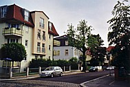

**_Foto:_** _Blick in die Löscherstraße_

An der Kreuzung Löscherstraße / Teutoburger Straße befindet sich ein historischer Weichbildstein, welcher einst der Markierung der städtischen Flurgrenze diente. Der Stein aus dem Jahr 1729 trägt neben dem Stadtwappen die Nr. 7 und
gehörte seit 1911 zum Bestand des Stadtmuseums. 1993 wurde er in der Nähe seines ursprünglichen Standortes wieder aufgestellt.

## Mansfelder Straße

Die vor dem Ersten Weltkrieg angelegte Planstraße N1 erhielt auf Beschluss des Stadtrates vom 5. Juni 1912 zunächst den Namen Arnstaedtstraße. Namensgeber war der Bankier und königlich-sächsische Kommerzienrat Georg Wilhelm Arnstaedt (1844-1911), der viele Jahre Direktor der Dresdner Bank war. Zudem engagierte er sich auf sozialem Gebiet und war Initiator mehrerer gemeinnütziger Stiftungen. Ursprünglich erstreckte sich die Straße nur zwischen Stresemannplatz und Bertolt-Brecht-Allee, wurde jedoch in den 1930er Jahren bis zur Bergmannstraße verlängert. Allerdings kam es nicht zu einer durchgängigen Verkehrsführung, so dass die Arnstaedtstraße bis 2015 durch ein Gärtnereigelände unterbrochen war und aus zwei Abschnitten bestand.

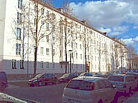1935 erfolgte die erste Umbenennung der Straße in Hugo-Göpfert-Straße. Grund war vermutlich die jüdische Abstammung Georg Wilhelm Arnstaedts, die so aus dem öffentlichen Bewusstsein getilgt werden sollte. Hugo Göpfert (1865-1932) war Architekt und besaß bis zu seinem Tod ein Architekturbüro auf der Prager Straße 52. Zu seinen Schöpfungen gehörten u.a. das zeitweise von ihm selbst geleitete Prinzeß-Theater an der Prager Straße, verschiedene Wohngebäude sowie ein von ihm gestiftetes Erholungsheim in Grillenburg. Zudem war er Initiator der Hugo-Göpfert-Stiftung, die bis zum Zweiten Weltkrieg jährlich einen gleichnamigen Preis zugunsten junger Studenten der Kunstakademie vergab. Sein Grab befindet sich im [Urnenhain Tolkewitz](../../../ost/tolkewitz/johannisfriedhof/).

Mit Beschluss vom 30. September 1953 wurde die Straße erneut umbenannt und erhielt nun ihren bis heute gültigen Namen Mansfelder Straße nach der Stadt Mansfeld in Sachsen-Anhalt. Nach Stillegung der Gärtnerei an der Geisingstraße entstand auf deren Areal ab 2015 die "Gartenstadt Striesen" mit zahlreichen neuen Wohnhäusern. In diesem Zusammenhang wurden die beiden Teilstücke der Mansfelder Straße miteinander verbunden.

Von den einst vorhandenen bürgerlichen Wohnbauten der Straße ist nach den Zerstörungen 1945 nichts erhalten geblieben. Zu den früheren Bewohnern gehörte Clara Salbach (1861-1944), die kurz nach dem Ersten Weltkrieg in die Arnstaedtstraße 11 verzog. Salbach gehörte von 1889 bis zu ihrem Bühnenabschied 1932 als Hofschauspielerin dem Ensemble des Dresdner Hoftheaters an und wirkte 1920 auch in einem der ersten historischen Spielfilme über das Leben August des Starken mit ("Der galante König"). Unweit davon wohnte in den 1920er Jahren in der Nr. 23 der Privatwissenschaftler Dr. Ferdinand Gaudenz von Papen (1876-1942). Papen war ein bekannter Saharaforscher und Asienreisender und rief in den 1930er Jahren das "Asiologische Museum" im Zwinger, ein Teil des Völkerkundemuseums, ins Leben.

## Merseburger Straße

Die Merseburger Straße an der Westseite des alten Dorfkernes gehört zu den ältesten Striesener Straßen und bildete den
Ausgang vom Dorfkern in Richtung Stadt. In diesem Bereich wird der ursprüngliche Standort des Vorwerkes vermutet, welches 1310 erstmals erwähnt wurde. Später gehörte es als sogenanntes Allodialgut der Familie Große. Die kleinen
Bauernhäuser dienten vor 1945 meist Wohn- und Gewerbezwecken und fielen den Bomben zum Opfer. 2003 wurde im Wohnhaus Nr. 1 die jüdisch-orthodoxe Chabad-Lubawitsch-Synagoge eröffnet. Seit 2008 hat die Glaubensgemeinschaft
ihren Sitz auf der Tiergartenstraße 82.

## Mosenstraße

Die Mosenstraße wurde Ende des 19. Jahrhunderts angelegt und nach dem Lyriker, Dramatiker und Erzähler Julius Mosen (1803-1867) benannt.

## Müller-Berset-Straße

Die Müller-Berset-Straße im Westteil Striesens verdankt ihren Namen der Wohltäterin Marie Berset, geborene Müller (1815-1898), welche Ende des 19. Jahrhunderts eine Erziehungsanstalt stiftete.

## Niederwaldstraße

Die Niederwaldstraße in Verlängerung der heutigen Kyffhäuserstraße wurde im ersten Striesener Bebauungsplan von 1860 als Straße A ausgewiesen und bis zur Jahrhundertwende mit Villen bebaut. Der Name entstand 1892 in Anlehnung an das Niederwalddenkmal, welches an die Einigungskriege und die Gründung des Deutschen Reiches 1870/71 erinnert. Hier sind noch zahlreiche Gebäude unterschiedlicher Stilrichtungen erhalten, die heute unter Denkmalschutz stehen. Zu diesen gehören die 1887 an der Ecke zur Altenberger Straße erbaute “Villa Detroit”, die “Turmvilla” am Niederwaldplatz sowie das auch als “Löwenkopf-Palais” bezeichnete Mietshaus Niederwaldstraße 37. Im Haus Nr. 10 befand sich bis 1990 die bekannte Striesener Weinstube “Rebstock”. Im Wohnhaus Nr. 7 lebte viele Jahre der Bildhauer Martin Engelke, der u.a. die Plastik der “Gustel von Blasewitz” am Blasewitzer Rathaus schuf.

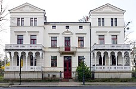Villa Detroit (Niederwaldplatz 1): Die im Stil eines amerikanischen Landhauses gestaltete Villa bildet den südlichen Abschluss des Niederwaldplatzes und entstand 1887 für den Dresdner Tischlermeister Johann Daniel Lambrecht, der das Grundstück ein Jahr zuvor von der Weimarischen Bank erworben hatte. Bauherr des von Beginn an als hochherrschaftliches Mietshaus konzipierten Gebäudes war der Ökonom Adolf Oskar Schäfer. In schneller Folge wechselten die Besitzer, bevor 1894 der Berliner Opernsänger Charles Robertson (eigentlich Robert Luderer) die Villa erwarb und umbauen ließ. Dabei entstanden die für das Haus typischen hellen Holzveranden und -balkone im Stil des mittleren Westens der USA. Mit der äußeren Gestaltung wollte er seine Zuneigung zu Amerika zum Ausdruck bringen und nannte das Haus nach seiner Geburtsstadt fortan Villa Detroit. Das villenartige Mietshaus ist bis heute fast unverändert erhalten und steht unter Denkmalschutz. Eine umfassende Sanierung erfolgte 2012.

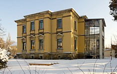Nr. 2: Die Villa entstand um 1888 als Wohnhaus des Kunst- und Handelsgärtners Emil Gerhard Liebig, der hier seine Gärtnerei betrieb. Zum Grundstück, das sich ursprünglich bis zur Pohlandstraße erstreckte, gehörten deshalb auch zwei Nebengebäude, mehrere Gewächshäuser und ein Heizhaus. Da Striesen sich jedoch nach der Eingemeindung immer mehr zum beliebten Wohnvorort entwickelte, entschloss man sich 1898 zur Parzellierung des Areals, um Platz für weitere Wohnhäuser zu schaffen. U.a. entstand in diesem Zusammenhang 1901 die Tzschimmerstraße.

Ab 1894 wohnte in diesem Haus der Regierungsrat Paul Koettig (1856-1933). Koettig war viele Jahre Chef der Dresdner Kriminalpolizei und später Polizeipräsident von Dresden. 1903 führte er als erster in Deutschland Fingerabdrücke zur Identifizierung von Straftätern ein. 1934 sind im Adressbuch "Köttigs Erben" als Eigentümer des Hauses verzeichnet, die die Villa an verschiedene Bewohner vermietet hatten.

Das einstige Gärtnerwohnhaus wird heute als Kindertagesstätte genutzt und wurde 2009 saniert _( **Foto:** Wikipedia / Adomix)_. In Erinnerung an die einstige Nutzung erfolgte die Neugestaltung des Gartens mit für die Gründerzeit typischen Staudenpflanzen, Fliederbüschen und Rhododendren. Im hinteren Teil erinnert ein kleines Kiefernwäldchen an das einstige Blasewitzer Tännicht.

## Paul-Gerhardt-Straße

Die Paul-Gerhardt-Straße entstand im Zuge des Ausbaus der Villenviertel von Neustriesen als Straße Nr. 2. Ebenso wie bei
den Nachbarstraßen sollte mit der 1892 eingeführten Namensgebung an einen bedeutenden Vertreter des Protestantismus
erinnert werden. Paul Gerhardt (1607-1676) war als Prediger ein eifriger Vertreter der lutherischen Lehre und wurde als Verfasser und Sänger zahlreicher Kirchenlieder bekannt.

Markantestes Gebäude der Straße war bis zur Zerstörung 1945 die [Erlöserkirche](../../../ost/striesen/erloserkirche/) an der Ecke zur Wittenberger Straße. Im
Wohnhaus Nr. 18 befand sich vor 1945 die Gaststätte “Kommunschank”, in der sich am 27. Januar 1881 der Männer-
Gesangsverein zu Striesen gründete. Dieser Chor vereinigte sich 1946 mit weiteren Gesangsvereinen aus Striesen, Blasewitz
und Neugruna und besteht bis heute als Männerchor Striesen e.V. 2006 entstand auf der Paul-Gerhard-Straße 21 die Kindertagesstätte “Gänseblümchen” nach einem Entwurf des Architekten Ulf Zimmermann, der für seinen Entwurf 2008 den
Erlweinpreis der Stadt Dresden erhielt. Am 1. Juni 2007 wurde das moderne Gebäude eröffnet und bietet Platz für ca. 75 Mädchen und Jungen.

## Pohlandstraße

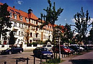Pohlandstraße und Pohlandplatz verdanken ihren Namen dem früheren Dresdner
Bürgermeister Carl Christian Pohland, der von 1814 bis 1832 im Amt war. Auch diese Straße war bereits im ersten Bebauungsplan von 1860 als Straße 10 ausgewiesen. Der als Grünfläche gestaltete dreieckige Pohlandplatz _(Foto)_
bildet bis heute einen wichtigen Verkehrsknotenpunkt an der Schandauer Straße.

Die Gebäude entstanden Ende des 19. / Anfang des 20. Jahrhunderts in typischen Striesener
Bauformen und beherbergten in den Hinterhöfen teilweise kleinere Gewerbebetriebe. So gehörte das 1906 vom Architekten P. Hahn errichtete landhausartige Gebäude Pohlandstraße 19 einst dem Besitzer der
Schuhfabrik Mücklisch, welche im hinteren Teil des Grundstücks Nr. 17 ihre Produktionsräume hatte. Nach erfolgter Sanierung 1993 wurde im Haus eine kleine Kunstgalerie eingerichtet. Außerdem hat hier die Bundesknappschaft ihren
Dresdner Sitz. Gegenüber befindet sich seit einigen Jahren die Gaststätte “Striesener Kanzlei” (Nr. 18).

## Prinzengäßchen

Das Prinzengäßchen in unmittelbarer Nähe des Dorfkernes Altstriesen erhielt seinen Namen nach der beliebten Gaststätte [“Zum Sächsischen Prinzen”](../../../ost/striesen/strassen_striesen/schandauer_strasse/), die 1756 in einem Striesener Bauerngehöft entstanden war. Hier tagte früher auch der
Gemeinderat des Dorfes. Nach einem Umbau 1889 entwickelte sich das 1945 zerstörte Lokal zu einem beliebten Versammlungs- und Tanzlokal. In der Nachkriegszeit wurde die Straße überbaut und ist heute nicht mehr benannt.

## Rosa-Menzer-Straße

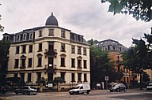
Die heutige Rosa-Menzer-Straße gehört zu den ältesten Striesener Straßen und trug vor 1945 den Namen Markgraf- Heinrich-Straße. Hier befanden sich bis zur Zerstörung einige
Gehöfte des Striesener Dorfkerns, von denen jedoch keines erhalten geblieben ist. Nach 1945 wurde die Straße nach der jüdischen Antifaschisten Rosa Menzer benannt. Rosa
Menzer (1886-1942) gehörte der KPD an und wurde 1942 ein Opfer des Nationalsozialismus. Ihre Wohnung auf der Markgraf- Heinrich-Straße war während der Nazizeit ein Treffpunkt Striesener Antifaschisten.

## Rudolf-Mauersberger-Straße

Die heutige Rudolf-Mauersberger-Straße wurde nach 1900 als Zeschaustraße angelegt und bis zum Beginn des Ersten
Weltkrieges mit Wohnhäusern bebaut. Mit der Benennung sollte an den früheren sächsischen Außenminister Heinrich Anton
von Zeschau (1789-1870) erinnert werden, der im 19. Jh. viele Jahre dem Kabinett von Könneritz angehörte. In den 70er Jahren erhielt
die Straße ihren heutigen Namen nach dem Kreuzkantor Rudolf Mauersberger (1889-1971). Mauersberger wurde 1930 zum Leiter des berühmten Knabenchores bestimmt und übte dieses Amt bis zu seinem Tode aus. Großen Anteil
hatte er am Wiederaufbau des musikalischen Lebens in den Jahren nach dem Zweiten Weltkrieg und wurde dafür mehrfach geehrt (ab 1950 Ehrenbürger Dresdens).

## [Schandauer Straße](../../../ost/striesen/strassen_striesen/schandauer_strasse/)

## Schellerhauer Weg

Die im Zuge der Neubebauung des Geländes des früheren Heizkraftwerkes an der Zinnwalder Straße angelegte
Erschließungsstraße erhielt im Oktober 2008 den Namen Schellerhauer Weg. Namensgeber ist der kleine Erholungsort Schellerhau im Osterzgebirge. Bis 2009 entstanden hier mehrere Einfamilien- und Reihenhäuser.

## Sickingenstraße

Die Sickingenstraße in der Nähe des Hüblerplatzes wurde mit dem Ausbau Neustriesens angelegt und bis zum Ersten Weltkrieg mit Villen bebaut. Im Haus Nr. 5 wohnte
ab 1915 die Familie Kowarzik. Sohn Victor, der hier seine Jugend verbrachte, wurde später unter dem Namen Victor de Kowa als Filmschauspieler bekannt und war nach 1945 auch als
Regisseur tätig. Interessante Jugendstilmalereien lassen sich im Eingangsbereich der Mietsvilla Sickingenstraße 3 finden.

## Spenerstraße

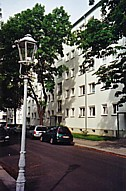Die Spenerstraße wurde gemäß dem Striesener Bebauungsplan von 1860 als 5. Straße angelegt und
nach der Eingemeindung des Stadtteils 1892 umbenannt. Ihren Namen verdankt sie dem evangelischen Theologen Philipp Jacob Spener (1635-1705). Als Wissenschaftler befasste er sich mit Genealogie
und Wappenkunde und erwarb sich als Begründer der wissenschaftlichen Heraldik große Verdienste.

Um 1880 befand sich auf dem Grundstück Spenerstraße 12 die Schmiedewerkstatt Heinrich Moritz
Mädlers. Als Wagenbauer und Hufschmied war Mädler ab 1884 für das Beschlagen der Pferde der Dresdner Straßenbahn verantwortlich. An ihn erinnern bis heute einige historische Kanaldeckel mit der
Aufschrift “H. Mädler, Dresden-Strießen” auf der Spener- und der Regerstraße.

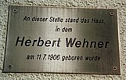 Im Wohnhaus Spenerstraße 13 wurde 1906 der Politiker Herbert
Wehner geboren. Wehner schloss sich in den Zwanziger Jahren der KPD an, wechselte jedoch nach 1945 zur SPD. Als späterer Fraktionsvorsitzender der Partei und Minister in der Regierung
Willy Brandts gehörte er zu den einflussreichsten Politikern der Nachkriegszeit. Wehner Geburtshaus fiel 1945 den Bomben zum Opfer und wurde in den 60er Jahren durch einen
Wohnblock ersetzt. Hier wurde 1999 eine Gedenktafel für den 1990 verstorbenen Politiker angebracht _(Foto rechts)_. Unweit davon erinnert ein von Peter Bergmann geschaffenes Denkmal an ihn.

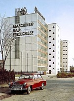
Versorgungskontor für Maschinenbauerzeugnisse: Architektonisch bemerkenswert ist das
Lagerhaus des ehemaligen Versorgungskontors für Maschinenbauerzeugnisse an der Spenerstraße 35. Der achtgeschossige Industriebau entstand zwischen 1962 und 1964 nach Plänen von Lothar
Schendel und Herbert Schwenke. Gestalterisch orientiert er sich am sogenannten “internationalen Stil” und stellt dadurch ein wichtiges Zeugnis der DDR-Industriearchitektur dieser Zeit dar. Das
Haus wurde in Stahlskelettbauweise mit speziell verstärkten Stahlbetondecken errichtet, um eine hohe Belastbarkeit der Decken zu ermöglichen. Die Fassade ist mit Giebelplatten aus Sichtbeton
gestaltet und durch eingesetzte Stahlfensterbänder horizontal gegliedert, um eine bessere Wirkung der Gesamtfassade zu erreichen. An der Südseite des Gebäudes befinden sich zwei risalitartige
Treppenhäuser, welche zugleich auch Verwaltungs- und Sozialräume aufnahmen.

**_Foto:_** _Das Lagerhaus um 1965 (Wikipedia / Richard Peter)_

## Spittastraße

Die Spittastraße wurde im Zusammenhang mit dem Ausbau Neustriesens angelegt und später nach dem Theologen Carl
Johann Philipp Spitta benannt. Spitta war auch als Dichter tätig und verfasste zahlreiche evangelische Kirchenlieder.

## Stresemannplatz

Der Stresemannplatz wurde 1905 als Mittelpunkt eines aus acht Straßen bestehenden sternförmigen Straßennetzes angelegt
und erhielt zunächst den Namen Walderseeplatz. Mit dieser Namensgebung sollte des preußischen Generals Alfred Graf von Waldersee (1832-1904) gedacht werden, der bis 1891 Generalstabschef Wilhelm II. war. Die Gebäude um den Platz
entstanden 1905 bis 1910 und weisen zum Teil Schmuckformen im Jugendstil auf.

In der Nachkriegszeit erhielt der Platz den Namen des Schriftsteller Johannes R. Becher (1891-1958). Becher gilt als einer
der wichtigsten Vertreter des sozialistischen Realismus in der Literatur und schuf u. a. den Text der früheren DDR-Nationalhymne. Nach 1990 wurde der Johannes-R.-Becher- Platz erneut umbenannt und trägt heute die Bezeichnung
Stresemannplatz. Gustav Stresemann (1878-1929), studierter Nationalökonom, lebte ab 1901 in Dresden und war hier in verschiedenen Funktionen in Industrieverbänden tätig. 1920 wurde er zum Reichskanzler gewählt und erhielt für seine
Verdienste um eine friedliche Nachkriegsordnung in Europa 1926 den Friedensnobelpreis.

## Teutoburgstraße

Mit Errichtung des ersten Wohnhauses an der heutigen Teutoburgstraße (Nr. 2) begann 1856 die Wandlung Striesens vom Bauerndorf zum repräsentativen Dresdner Wohnvorort. Ursprünglich wurde dieses Gebiet abseits des Ortskerns “auf dem Sande” genannt, bevor sich der Name Neustriesen durchsetzte. Die neuen Straßen wurden zunächst nach amerikanischem Vorbild mit Ziffern und Buchstaben bezeichnet, bevor sich später Straßennamen durchsetzten. Dabei wurden bevorzugt geographische Namen aus der deutschen Geschichte gewählt. In diesem Zusammenhang erhielt die frühere Straße A 1892 den Namen Teutoburgstraße. Das nach seinem Erbauer Karl Friedrich Adam “Adams Ruh” genannte erste Wohnhaus (Teutoburgstraße 4) wurde 1945 zerstört.

Nr. 14: In diesem Haus lebte bis 1934 der Schriftsteller und Journalist Helmut Weiß (1913-2000). Weiß, Sohn eines aus Galizien eingewanderten Textilwarenhändlers, trat schon als Jugendlicher der KPD bei. In den 1920er Jahren verfasste er verschiedene Artikel für linke Zeitschriften und wurde dabei u.a. von Max Zimmering, Ludwig Renn und F. C. Weiskopf gefördert. Gemeinsam mit Hans und Lea Grundig gründete Weiß die Agitpropgruppe "Linkskurve". 1934 siedelte er nach Charkow in die UdSSR über, wurde 1937 im Rahmen einer stalinistischen Säuberungsaktion zu 10 Jahren Haft verurteilt und lebte danach als Musiklehrer in der Sowjetunion.

## Tittmannstraße

Die Tittmannstraße wurde als Straße 4 des Stadtteils Neustriesen angelegt und bis zur Jahrhundertwende mit repräsentativen
Wohnhäusern bebaut. Leider fiel ein Großteil der Gebäude 1945 dem Luftangriff zum Opfer. Ihren Namen erhielt sie 1893
nach dem früheren Superintendenten der Kreuzkirche Carl Christian Tittmann (1744-1820), der auch als Schriftsteller tätig war und verschiedene historische Werke verfasste.

Nr. 8:
Im Wohnhaus Tittmannstraße 8 wohnte bis zur Zerstörung 1945 der Dresdner Kunstwissenschaftler Fritz Löffler, der vor allem durch sein Buch “Das alte Dresden” bekannt wurde. Mit den Wohngebäuden verbrannte beim Luftangriff auch
seine bedeutende Kunstsammlung mit Werken zahlreicher zeitgenössischer Künstler.

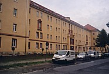Nr. 18-20: Das Gebäude entstand 1955 als Wohnheim für die in der nahegelegenen Medizinischen Akademie beschäftigten Krankenschwestern. Im Inneren befanden sich
ursprünglich 145 Wohneinheiten, welche über einen durchgehenden Verbindungsflur zwischen den drei Treppenaufgänge zu erreichen waren. Hinzu kamen mehrere
Aufenthaltsräume sowie Gemeinschaftsküchen und -bäder.  Die Fassade und die Foyers und Treppenhäusern wurden mit Relieftafeln und plastischem Schmuck ausgestaltet, welcher
Bezug auf die Nutzung des Hauses durch Krankenschwestern nahm. Nach Schließung des Schwesternwohnheimes erwarb 2006 eine Immobiliengesellschaft das Gebäude und ließ es
unter Beachtung denkmalpflegerischer Auflagen 2008/09 zu Eigentumswohnungen umbauen.

Nr. 21:
Das Gebäude wurde 1869 als Schulhaus des Ortes erbaut und ab 1875 als Gemeindeamt genutzt. Hier waren u.a. das Standesamt, das Einwohneramt, die Steuer- und Schulgeldeinnahme sowie eine Polizeidienststelle untergebracht.
Zwischen 1876 und 1882 diente es zugleich als Post- und Telegraphenamt sowie ab 1877 als Zweigstelle der Sparkasse. Mit
der Eingemeindung des Ortes übernahm 1892 die Stadt Dresden das Gebäude und nutzte es bis zur Zerstörung 1945 als Stadtteilrathaus.

## Tzschimmerstraße

Die Tzschimmerstraße, im östlichen Teil Striesens gelegen, verdankt ihren Namen dem früheren Dresdner Bürgermeister Gabriel Tzschimmer (1629-1694). Neben seiner Tätigkeit im Rat war Tzschimmer auch als Chronist tätig und verfasste eine Reihe historischer Darstellungen zur Geschichte seiner Heimatstadt. Die Gebäude entstanden meist im Zeitraum zwischen 1900 und dem Beginn des Ersten Weltkrieges. Im Wohnhaus Nr. 19 verbrachte zwischen 1904 und 1910 die Malerin Elfriede Lohse-Wächtler ihre Kindheit. 1911 verzog die Familie auf die benachbarte Voglerstraße.

## Voglerstraße

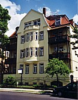
Die Voglerstraße im Osten von Striesen, ursprünglich als 15. Straße angelegt, wurde 1892 nach dem früheren Dresdner Bürgermeister Christoph Heinrich Vogler benannt. Vogler gehörte zwischen 1693
und 1744 dem Stadtrat an und war mehrfach amtierender Bürgermeister. 1746 verstarb er in seiner Heimatstadt. Die meisten Gebäude wurden Ende des 19. Jahrhunderts als Mietshäuser in offener
Bauweise errichtet. Zu den architektonisch interessantesten Bauten gehört Nr. 12 mit zahlreichen Stilelementen und plastischem Schmuck der Renaissancezeit. Einige Baulücken wurden nach 1990 mit modernen Stadtvillen geschlossen.

Im Haus Voglerstraße 15 _(Foto)_ wohnte ab 1911 bis 1914 die Malerin Elfriede Lohse-Wächtler (1899-1940), die in den Zwanziger Jahren der Künstlergruppe um Otto Dix und Conrad Felixmüller angehörte. Die gesundheitlich angeschlagene Künstlerin kehrte 1931 in ihr Elternhaus in Striesen zurück und verbrachte ihre letzten Lebensjahre in der Psychatrischen Klinik Arnsdorf. 1940 wurde sie in der Anstalt Pirna-Sonnenstein Opfer des Euthanasieprogramms der Nazis. Seit 2001 erinnert eine Gedenktafel am Wohnhaus an sie. 2012 kam ein Stolperstein vor dem Gebäude dazu.

## Wartburgstraße

1892 erhielt auch die Wartburgstraße, zuvor als Straße E in den Stadtplänen ausgewiesen, ihren heutigen Namen, wobei die historisch bedeutende Wartburg bei Eisenach Pate stand. Bereits
1874 war hier ein neues Striesener Schulhaus entstanden. Das Gebäude (Nr. 23) an der Ecke zur Tittmannstraße diente später als Kinderbewahranstalt, ab 1907 als Gemeindeamt und
Sitz der Ortssparkasse. Hier wurde am 1. Juni 1892 auch der Eingemeindungsvertrag zwischen Dresden und der Gemeinde Striesen unterzeichnet. Nach 1945 nutzte der VEB Technische Gebäudeausrüstungen das Haus. 2008/09 erfolgte eine
umfassende Sanierung und der Umbau zum Wohnhaus.

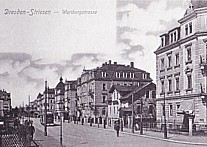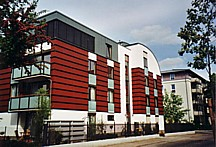

**_Fotos:_** _Blick in dieWartburgstraße um 1910 und im Jahr 2006_

## Wittenberger Straße

Die frühere Striesener Straße D erhielt 1892 den Namen Wittenberger Straße, mit dem an die frühere Wirkungsstätte Martin
Luthers erinnert werden sollte. Auch die benachbarte Wartburgstraße und die Wormser Straße stehen mit dem Reformator in Verbindung. Bereits 1878 war an der Wittenberger Straße die [Erlöserkirche](../../../ost/striesen/erloserkirche/) entstanden, die jedoch 1945 den Bomben zum Opfer fiel. Eine weitere wichtige kirchliche Einrichtungen ist mit dem [Kapellknabeninstitut](../../../ost/striesen/herz-jesu-kirche/kapellknabeninstitut/), Unterkunft des Knabenchores der
Hofkirche, in den Räumen des früheren Vinzentiusstiftes untergebracht (Nr. 88).

Trotz einiger kriegsbedingter Baulücken bietet die Wittenberger Straße bis heute ein
weitgehend intaktes Straßenbild der Gründerzeit. Viele der in offener Bauweise errichteten Mehrfamilienhäuser stehen unter Denkmalschutz und wurde nach 1990
saniert. Beliebte Gaststätten sind das Schankhaus “1900” im Stil der Gründerzeit (Nr. 76), das französische Feinschmeckerrestaurant “La Fourchette” (Nr. 87) und die in
einer früheren Kantine 1991 entstandene Kneipe “Max” (Nr. 49). 2010 wurde diese von neuen Betreibern übernommen und unter dem Namen “Sophie M.” nach der
französischen Filmschauspielerin Sophie Marceau weitergefühtz. Heute befindet sich hier das Restaurant “Vincent”.

Bereits vor 1945 gab sich im Eckhaus zur Pohlandstraße das Arbeiterlokal  “Pohlandgarten”, in dessen Räumen nach 1945
eine Verkaufsstelle eingerichtet wurde. Eine der interessantesten Innenraumgestaltungen Striesens findet sich im Treppenhaus
des Mietshauses Wittenberger Straße 62. Derartige aufwendige Wand- und Deckengemälde gab es früher in vielen Striesener Wohnhäusern. Diese sollten den Wohlstand ihrer Bauherren und Bewohner verdeutlichen.

## Wormser Straße

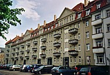
Die Wormser Straße entstand im 19. Jahrhundert und erhielt 1892 den Namen der Stadt Worms, die eng mit der Person Martin Luthers verbunden ist. Bis 1813 befanden sich im
Gebiet Wormser / Huttenstraße vier Windmühlen, die 1813 durch französische Soldaten niedergebrannt wurden. Im Zuge des Ausbaus der Johannstadt und der benachbarten
Wohnviertel Striesens wurden auch hier Mehrfamilienhäuser in offener Bauweise errichtet. Im westlichen Abschnitt folgten in den 1920er und 1930er Jahren mehrgeschossige Wohnblocks _(Foto)_
. Bereits 1910-12 hatte der Dresdner Spar- und Bauverein zwischen Wormser und Holbeinstraße die “Rudolf-Schilling-Häuser” errichtet. Im Innenhof der
kleinen Wohnanlage gab es neben Kinderspielplätzen und Grünflächen auch eine eigene Wäscherei sowie gemeinsame Brause- und Wannenbäder für die Mieter, damals noch ein Novum in Dresden.

Am 1. April 1904 bezog das 1898 gegründete [Säuglingsheim](../../../zentrum/johannstadt/strassen_johannstadt/) Dresden-Johannstadt neue Räume auf der Wormser Straße 4.
Die vom Kinderarzt Arthur Schloßmann gegründete Einrichtung war erste Säuglingsklinik der Welt und setzte neue Maßstäbe
auf dem Gebiet der Neugeborenenmedizin. 1907 übernahm die Stadt Dresden die Klinik, die 1945 zerstört wurde. Einige
Straßen weiter befand sich bis zur Zerstörung die Teefabrik Willi Schlüter (Nr. 30), in der 1942/45 der bekannte jüdische Sprachwissenschaftler Victor Klemperer als Zwangsarbeiter tätig war.

## Zinnwalder Straße

Die Zinnwalder Straße befindet sich im Osten von Striesen und verbindet Lauensteiner und Altenberger Straße. Benannt
wurde sie nach dem kleinen Erholungsort Zinnwald am Kamm des Osterzgebirges. Auf dem Gelände eines nach 1990 stillgelegten Heizkraftwerkes wurde 2007 mit dem  Bau einer Wohnsiedlung begonnen. Hier entstanden sowohl Einzel- als
auch Doppel- und Reihenhäuser.

[Striesen auf OpenStreetMap](https://www.openstreetmap.org/search?query=Dresden+Striesen)

* * *

 \[ [Home](../../../index.html)\] \[ [Nord](../../../nord/)\] \[ [Nordwest](../../../nordwest/)\] \[ [Neustadt](../../../neustadt/)\] \[ [Nordost](../../../nordost/)\] \[ [West](../../../west/)\] \[ [Zentrum](../../../zentrum/)\] \[ [Südwest](../../../sudwest/)\] \[ [Süd](../../../sud/)\] \[ [Südost](../../../sudost/)\] \[ [Ost](../../../ost/)\] \[ [Register](../../../Register/register.html)\] \[ [Kontakt](../../../Kontakt/kontakt.html)\] \[ [Impressum](../../../impressum/)\]
