* * *

[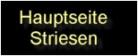](../../../../ost/striesen/)

* * *

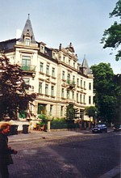Die Augsburger Straße wurde gemäß dem Striesener Bebauungsplan 1860 als Straße C angelegt und erhielt 1893 den Namen der Stadt Augsburg in Bayern. 1905 kam noch der kurzer Abschnitt bis zur Fiedlerstraße auf Johannstädter Flur hinzu. Neben Wohnhäusern und Villen befanden sich hier zahlreiche kleine Geschäfte und Restaurants. Bekannt waren auch die Regina-Lichtspiele auf der Augsburger Straße 12, die 1945 durch Bomben zerstört wurden. Zu den beliebtesten Lokalen gehört das 1903 eröffnete “Rübezahl” im Haus Nr. 49 _(Foto)_. Aus ideologischen Gründen musste die im altdeutschen Stil ausgestattete Gastwirtschaft in der Nachkriegszeit den Namen “Augsburger Hof” annehmen. Zu den Stammgästen gehörte später u. a. Manfred Krug. Seit Anfang 2010 wird das Restaurant als Feinschmeckerlokal “Spizz” weitergeführt.

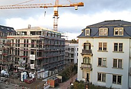Auch das Eckhaus zur Blasewitzer Straße (Augsburger Str. 2) beherbergte einst eine Gastwirtschaft, die nach ihrem Inhaber “Knapes Restaurant” genannt wurde. Nach 1945 zog hier ein Blumenladen ein, nach 1990 ein chinesisches Restaurant. Später wurde die gastronomische Tradition dieser Straße u. a. vom Irish Pub “Old Slyne Head” (Nr. 85) fortgesetzt, welches im Oktober 1993 als erstes irisches Lokal in Dresden eröffnet und nach einer kleinen Insel in der Irischen See benannt wurde. Bereits vor dem Ersten Weltkrieg gab in diesen Räumen im Eckhaus zur Dornblüthstraße (Nr. 85) ein Lokal mit Namen "Kiautschou". Der ungewöhnliche Name bezog sich auf ein 1898 vom Deutschen Reich gepachtetes Kolonialgebiet in China. In den letzten Jahren wurden auf der Augsburger Straße einige Baulücken geschlossen, u.a. durch ein modernes Wohnhaus mit Penthouse- und Eigentumswohnungen.

**_Foto:_** _Richtfest für Nr. 81 am 6. Dezember 2013_

Gebäude:

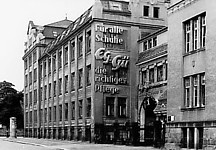“Eg-Gü”-Schuhcremefabrik (Nr. 1): Das Unternehmen wurde von dem aus Meerane stammenden Egbert Günther als kleiner Hinterhofbetrieb gegründet und hatte seinen Sitz ursprünglich auf der [Pfotenhauerstraße](../../../../zentrum/johannstadt/strassen_johannstadt/pfotenhauerstrasse/). Zunächst bestand die Produktionspalette aus Bohnerwachs, bevor sich Günther 1915 auch der Herstellung von Schuh- und Lederpflegemitteln widmete. 1919 stellte der Betrieb erstmals Schuhcreme in Tuben her und machte die Firma damit zum Branchenführer in Deutschland. Die zeitweise bis auf 500 Personen gewachsene Mitarbeiterzahl und der zunehmende Export in mehrere europäische Staaten erforderte eine Ausweitung der Produktionsanlagen, weshalb der Betrieb in den 1920 Jahren zur Augsburger Straße 1 (Ecke Fiedlerstraße) verlegt wurden _(Foto)_. Privat bewohnte Günther eine noch heute erhaltene Villa auf der [Wägnerstraße](../../../../ost/blasewitz/strassen_blasewitz/) 8.

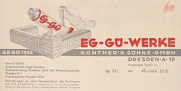

Die neuen Fabrikgebäude beherbergten bis zum Einzug Günthers eine Schuhfabrik. Besitzer waren die jüdischen Brüder Eduard, Richard und Albert Hammer, die hier unter dem Markennamen “Hammer-Schuhe” hochwertige Fußbekleidung herstellten. Eine Verkaufsniederlassung unterhielt die Firma bis zur Zwangsarisierung 1938 auf der Prager Straße. Richard Hammer war zudem königlich-siamesischer Konsul und gehörte um 1912 zu den reichsten Bewohnern der Stadt. Bis zum Abbruch der Fabrikgebäude erinnerte noch das Firmenwappen am Giebel des Gebäudes an das Familienunternehmen.

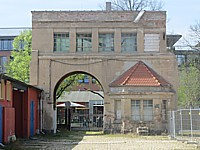1945 trafen Bomben auch die Produktionsgebäude der Firma “Eg-Gü” und vernichteten diese zu 90 Prozent. Trotzdem gelang es den Söhnen des Gründers, die Herstellung von Schuh- und Lederpflegemitteln wieder aufzunehmen und an den alten Ruf anzuknüpfen. 1972 wurde der Betrieb enteignet und zum VEB Dresdner Schuhpflegemittel. Nach dreijähriger Treuhandverwaltung erfolgte 1993 die Reprivatisierung. Heute werden über 70 verschiedene Produkte hergestellt, wobei die Exportquote inzwischen wieder bei ca. 50 Prozent liegt. 2007 wurde die Produktion in Dresden eingestellt und nach Lichtenau bei Chemnitz verlegt. 2012 erfolgte ein weitgehender Abriss der baufälligen Gebäude an der Augsburger Straße _(Foto)_. An ihrer Stelle ist künftig ein modernes Laborgebäude für das Uniklinikum geplant.

Korelle-Werk (Nr. 3): Das Unternehmen wurde 1921 von Franz Kochmann als "Fabrik photographischer Apparate" auf der Blasewitzer Straße 64/66 gegründet und stellte zunächst einfache Platten-Klappkameras her. Drei Jahre später kamen die Spiegelreflexkamera "Enolde" und die Rollfilmkamera "Korelle" hinzu. Der wirtschaftliche Erfolg ermöglichte Kochmann, sein Werk 1927 in größere Räume auf der Trinitatisstraße 42/44, wenig später zur Augsburger Straße 3 zu verlegen. 1929 begann die Produktion von fotografischem Zubehör. Zwei Jahre später brachte Kochmann seine neue Rollfilmkamera "Korelle 4 x 6,5 cm" auf den Markt und spezialisierte sich auf den Bau von Kleinbildkameras, bevor auf der Leipziger Messe 1935 die moderne Spiegelreflexkamera "Korelle 6 x 6" mit Bildzählwerk, wechselbarem Objektiv und klappbarem Lichtschacht vorgestellt wurde. Unter den Markennamen "Reflex-Korelle I", "Reflex-Korelle II" und "Reflex-Korelle Ia" gehörten die Kameras zu den Spitzenerzeugnissen der Dresdner Fotoindustrie in jener Zeit.

Da Franz Kochmann Jude war, musste er 1938 emigrieren und sein Unternehmen zwangsweise an neue Inhaber verkaufen. Unter dem neuen Firmennamen "Korelle-Werk G. H. Brandtmann" fertigten die ca. 80 Angestellten auch weiterhin Kleinbildkameras, nach 1940 zunehmend Rüstungsgüter an. Im Hintergebäude befand sich die Druckerei "Curt von Hahn". 1945 wurde das Werk vollständig zerstört und nach Kriegsende als Rüstungsbetrieb von der sowjetischen Besatzungsmacht beschlagnahmt. 1946 folgte die Enteignung des Betriebes, zwei Jahre später die Eingliederung in den VEB WEFO.

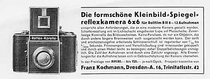

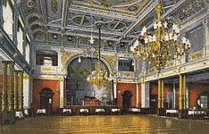Hammers Hotel: Das zum Zeitpunkt seiner Eröffnung 1895 größte Striesener Konzert- und Ballhaus war Hammers Hotel an der Augsburger Straße 7. Inhaber war Moritz Beckert. Im Saal des Hauses fanden regelmäßig Tanzveranstaltungen und Theateraufführungen statt. 1904 wurden hier erstmals in Dresden Filme gezeigt. 1913 erhielt Beckert die Konzession für die Einrichtung eines Varietétheaters ("Flora-Theater"). Aber auch Parteien, Gewerkschaften und Vereine nutzten dieses Lokal als Versammlungsort. 1928 sprach hier der KPD-Führer Ernst Thälmann vor Tausenden Dresdner Arbeitern. Nach 1933 übernahm die NSDAP das Gebäude für Propaganda- und Kulturveranstaltungen. 1945 wurde Hammers Hotel beim Luftangriff zerstört.

Regina-Lichtspiele (Nr. 12): In diesem Gebäude in der Nähe der Löscherstraße befand sich ab 1911 ein Kino. Zunächst wurde es unter dem Namen Apollo-Lichtspiel-Theater eröffnet, bevor der Name wenig später in "Regina-Lichtspiele" wechselte. Inhaber war zunächst Max Menzel, später die Firma Friese & Loll. Ursprünglich standen nur 188 Plätze zur Verfügung, bevor man diese Zahl nach einem Umbau auf ca. 360 erweiterte. Mehrfach wechselten die Betreiber und Pächter, die jeweils in ihrem Sinne passende Umbauten vornahmen. Eine größere Renovierung des Saales erfolgte 1926. 1945 wurde das Gebäude zerstört.

Nr. 28/30: Das im Hinterhof des Grundstücks befindliche Gebäude war um 1930 Firmensitz der Max Blechschmidt KG. Das 1912 in Neustadt/Holstein gegründete Unternehmen produzierte Korken und anderen Kellereibedarf und war auch als Vertriebsfirma für Flaschenverschlüsse und Kellereimaschinen anderer Hersteller tätig. Im Vorderhaus gab es um 1910 Wiesingers Badeanstalt, die "mit Russischen und Kastendampfbädern" um ihre Kunden warb. Das Hintergebäude wurde zu dieser Zeit durch die Maschinen- und Zahnräderfabrik "Astra" und die Maschinenfabrik "Summus Compagnie" G.m.b.H. genutzt. 1920 befand sich dort die Photographische Manufaktur von Richard Knoll.

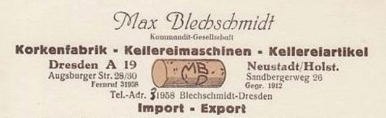

Augsburger Hof (Nr. 33): Im 1945 zerstörten Eckhaus zur Spenerstraße befand sich um 1900 das Lokal "Zum Augsburger Hof", eine von zahlreichen kleineren Eckkneipen der Straße. Weitere gab es u.a. im Haus Nr. 49 ("Zum Rübezahl"), an der Ecke zur Tzschimmerstraße (Nr. 62 - "Striesener Casino") und im Eckhaus an der Dornblüthstraße (Nr. 85 - "Kiautschou"). Nach dem Ersten Weltkrieg bezog der "Edwesp Edellikör-, Wein- und Spirituosen-Grosso-Vertrieb" von Rudolf Schwarz die früheren Restaurationsräume. Der Name "Augsburger Hof" lebte dann nach dem Zweiten Weltkrieg wieder auf und wurde vom früheren "Rübezahl" auf der Augsburger Straße 49 übernommen.

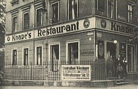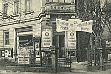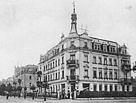

_**Fotos:**_ _Alt-Striesener Gaststätten an der Augsburger Straße: links "Knapes Restaurant" (Nr. 2), in der Mitte "Zum Rübezahl" (Nr. 49), rechts das "Striesener Casino" (Nr. 62)_

Evangelisch-methodistische Zionskirche: Das Gebäude an der Ecke zur Jacobistraße (Augsburger Straße 59) ist das Gotteshaus der evangelisch-methodistischen Zionskirche. Die im 18. Jahrhundert in England von John Wesley gegründete Erweckungsbewegung widmet sich besonders einer geordneten Lebensweise und der Beseitigung sozialer Missstände. Die Striesener Gemeinde ist älteste der vier methodistischen Dresdner Gemeinden und entstand 1872. Zunächst versammelte man sich in einer Striesener Wohnung, bevor wenig später ein Gebäude im Stadtzentrum an der Neuen Gasse erworben werden konnte. Diese Kirche fiel 1945 den Bomben zum Opfer. 1950 errichtete man auf den Fundamenten eines zerstörten Wohnhauses an der Augsburger Straße 59 das neue Gemeindehaus. Die Plänen dafür stammten von Karl August Alicke. Der verputzte Bau wird durch einen Dachreiter mit Glocke verziert und weist so auf seine kirchliche Funktion in. 1971 erfolgte nach Plänen des Architekten Biermann eine Neugestaltung des Innenraumes mit seinen sechs Rundbogenfenstern. Ein moderner Ergänzungsbau entstand 2013. Im Inneren befinden sich Büro- und Veranstaltungssräume sowie der Kirchsaal mit 150 Plätzen. Die Orgel der Firma Jehmlich stammt von 1950 und besitzt neun Register. Der freikirchlichen Gemeinde, die in heutiger Form 1968 durch die Fusion der Evangelischen Gemeinschaft und der Bischöflichen Methodistenkirche entstand, gehören ca. 230 Mitglieder an.

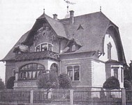Nr. 71 (Villa “Sansibar”): Das Gebäude entstand 1895 als Wohnhaus für den Kunst- und Handelsgärtner Hermann Seidel, Inhaber der bekannten
[Gärtnerei Seidel](../../../../ost/striesen/strassen_striesen/seidelsche_gartnerei/). Wegen der damals abseitigen Lage des Grundstücks nannte er sein Haus nach der gleichnamigen Insel an der ostafrikanischen Küste “Villa Sansibar” _(Foto)_. Kurz nach der Fertigstellung verstarb Hermann Seidel am 28. April 1896, so dass nun seine Witwe Minna allein in der Villa lebte. Bereits 1893 hatten Seidels Söhne den Sitz des Gartenbaubetriebs von Striesen nach Laubegast verlegt. Nach dem Tod von Minna Seidel (+ 1917) ging das frühere Gärtnereigrundstück 1921 in den Besitz der Stadt über, die unter Einbeziehung der zahlreichen Rhododendren den [Hermann-Seidel-Park](../../../../ost/striesen/strassen_striesen/seidelsche_gartnerei/hermann-seidel-park/) anlegte. Die Villa selbst wurde Domizil einer Städtischen Säuglingskrippe mit Kinderheim.

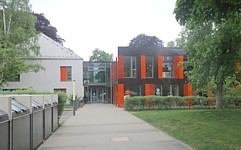1945 brannte die Villa aus. Das verbliebene Erdgeschoss erhielt um 1950 ein Notdach, so dass hier wieder ein bis 2008 bestehender Kindergarten Einzug halten konnte. Nach dem Abbruch des Gebäudes entstand auf dem Grundstück bis 2011 die moderne Kita “Gäste der Buche” mit ca. 135 Plätzen. Die Pläne stammen vom Architektenbüro Hänel/ Furkert/ Koenitz _(Foto)_.

* * *

 \[ [Home](../../../../index.html)\] \[ [Nord](../../../../nord/)\] \[ [Nordwest](../../../../nordwest/)\] \[ [Neustadt](../../../../neustadt/)\] \[ [Nordost](../../../../nordost/)\] \[ [West](../../../../west/)\] \[ [Zentrum](../../../../zentrum/)\] \[ [Südwest](../../../../sudwest/)\] \[ [Süd](../../../../sud/)\] \[ [Südost](../../../../sudost/)\] \[ [Ost](../../../../ost/)\] \[ [Register](../../../../Register/register.html)\] \[ [Kontakt](../../../../Kontakt/kontakt.html)\] \[ [Impressum](../../../../impressum/)\]
