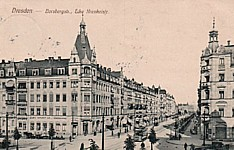
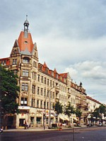
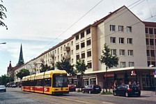
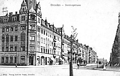
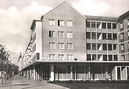
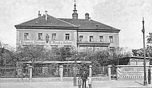
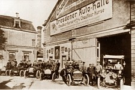

* * *

* * *

Die Borsbergstraße war ursprünglich Teil eines alten Verbindungsweges von der Residenz zur [Pillnitzer Fähre](../../../../nordost/pillnitz/), der seine Verlängerung in der heutigen [Schandauer Straße](../../../../ost/striesen/strassen_striesen/schandauer_strasse/) fand. In Dresden beginnend, verlief er durch die heutige Pirnaische Vorstadt, am Großen Garten vorbei und dann weiter über Striesen und Tolkewitz bis zur Fährstelle. 1768 wurde dieser Weg auf Striesener Flur verlegt und führte seitdem am Dorfkern südlich vorbei. Amtlich wurde er als "Dresden - Laubegast - Pillnitzer Chaussee" bezeichnet.

Nachdem ab 1874 in der [Johannstadt](../../../../zentrum/johannstadt/) neue Wohnviertel angelegt wurden, siedelten sich hier zahlreiche Gärtnereien an. Außerdem gab es in diesem Abschnitt die Dampf-Bierbrauerei Striesen, die Ziegelei Friedrichs und eine Chemische Fabrik. Mit fortschreitender Ausdehnung der Großstadt mussten die Gärtnereien Ende des 19. Jahrhunderts repräsentativen Gründerzeitbauten weichen. In diesem Zusammenhang erfolgte 1884 nach mehrjährigen Vorplanungen ein Ausbau der seit 1873 als "Straße J" bezeichneten Chaussee und das Verlegen von Straßenbahngleisen. Am 31. Mai 1884 fuhr hier die erste Pferdebahnlinie der "Tramways Company of Germany Ltd.". 1897 wurde diese Strecke auf elektrischen Betrieb umgestellt. 1905 errichtete die katholische Gemeinde ein Gotteshaus an der Borsbergstraße 13, welches den Namen [Herz-Jesu-Kirche](../../../../ost/striesen/herz-jesu-kirche/) erhielt. Die Straße trug zu diesem Zeitpunkt bereits ihren heutigen Namen nach dem oberhalb von Pillnitz gelegenen Borsberg. Andere Pläne, wie z.B. der Bau eines Zirkusgebäudes für den dänischen Zirkusunternehmer Wulff, blieben unrealisiert. 1903-04 erfolgte nochmals ein grundhafter Ausbau der Straße, verbunden mit einem Brückenneubau über den [Landgraben](../../../../ost/striesen/landgraben/).

Während die oberen Etagen der Gebäude meist Wohnzwecken vorbehalten waren, befanden sich in den unteren Stockwerken meist kleine Läden und Gastwirtschaften, aber auch Rechtsanwaltsbüros und Arztpraxen. Außerdem gab es einige kleinere Gewerbebetriebe sowie im ehemaligen Straßenbahnhof an der Geisingstraße eine Autowerkstatt. Als eines der letzten Häuser entstand kurz vor Ende des Zweiten Weltkrieges an der Einmündung zur Carlowitzstraße (Bertolt-Brecht-Allee) ein Neubau der Stadtsparkasse.1945 fielen die meisten Gebäude den Bomben zum Opfer.

Erhalten blieben einige Wohn- und Geschäftshäuser in der Nähe des [Fetscherplatzes](../../../../Zentrum/Johannstadt/Strassen-Johannstadt/Fetscherplatz/fetscherplatz.html), die in den letzten Jahren teilweise saniert wurden und oft interessante Architekturformen aufweisen _(Foto)_. In einem solchen Haus (Nr. 14) besaß der jüdische Arzt Dr. Willy Katz (1878-1947) seine Praxis. Als einziger Arzt in Dresden durfte er während der Nazizeit Juden medizinisch behandeln und versuchte mit persönlichem Einsatz, den verfolgten Menschen zumindest eine Grundversorgung zu sichern. Katz leitete nach 1945 eine der ersten Gemeinschaftspraxen Dresdens und verstarb 1947. Sein Grab befindet sich im Tolkewitzer [Urnenhain](../../../../ost/tolkewitz/johannisfriedhof/). Die erhaltene Praxiseinrichtung wurde zusammen mit dem Nachlass 1990 an das Washingtoner Holocoust-Museum übergeben.

Unweit der Arztpraxis lebte bis zu ihrem Tod 1977 die durch ihre Tierdarstellungen bekannte Malerin und Bildhauerin Etha Richter (Nr. 11). Borsbergstraße 12 war bis 1904 die Wohnadresse des bekannten Glasmalers Josef Goller, künstlerischer Leiter der Anstalt für Glasmalerei [Urban & Goller](../../../../zentrum/friedrichstadt/strassen_friedrichstadt/friedrichstrasse/) mit Sitz auf der Friedrichstraße. Bemerkenswert sind auch die Mietshäuser Nr. 19 - 21 mit reizvollen Schmuckelementen im Jugendstil.

Auf den Flächen zerstörter Wohngebäude begann am 13. April 1956 der Aufbau der Johannstadt und der westlichen Teile Striesens. Erstmals in Dresden wurden hier Häuser in industrieller Großplattenbauweise errichtet, die wegen ihrer architektonischen Gestaltung heute unter Denkmalschutz stehen. Diese Bauweise war zuvor vom VEB Bau Dresden selbst entwickelt worden, wobei die Vorfertigung unmittelbar auf der Baustelle erfolgte. Die Planungen für die Gebäude (Borsbergstraße 14-32 und 19-33) stammten vom Dresdner Architekten Wolfgang Hänsch, der später auch am Wiederaufbau der Semperoper beteiligt war. In den Erdgeschosszonen wurden Geschäfte und Gaststätten eingerichtet, darunter das beliebte "Café Borsberg". Vor dem Café fand eine Bronzeskulptur der Bildhauerin Magdalena Kreßner mit Darstellung eines Balletttänzer-Paares Aufstellung. Östlich der Müller-Berset-Straße war ursprünglich ein Großkino als Ersatz für den zerstörten "Gloria-Palast" an der Schandauer Straße vorgesehen. An dieser Stelle entstand um 1980 ein Studentenwohnheim. Nach 1990 erfolgte eine Rekonstruktion der Gebäude _(Foto)_.

Einzelne Gebäude:

Gärtnereien: In der Mitte des 19. Jahrhunderts siedelten sich auf Striesener Flur zahlreiche Gartenbaubetriebe an, die hier vor allem für Zierpflanzen ideale Bodenbedingungen vorfanden. 1887 gab es entlang der Borsberg- und Schandauer Straße insgesamt 21 Gärtnereien. Größte war die des Landschaftsgärtners [Hermann Seidel](../../../../ost/striesen/strassen_striesen/seidelsche_gartnerei/), der als Züchter von Azaleen und winterharten Rhododendren international bekannt wurde. Mit zunehmender Bebauung verlegte er sein Unternehmen 1865 nach Laubegast. Die gegenüberliegenden Gärtnereien von Friedrich Karl und August Julius Schäme mussten nach der Jahrhundertwende dem Bau der Herz-Jesu-Kirche weichen. Zu den bekannten Gartenbauunternehmen gehörte auch die 1882 gegründete [Baumschule Porscharsky](../../../../ost/laubegast/strassen_laubegast/osterreicher_strasse/baumschule_poscharsky/), die später ebenfalls nach Laubegast umzog.

Borsbergschänke (Nr. 19): Das Eckhaus an der Einmündung der Krenkelstraße _(im Bild links)_ entstand als eines der ersten Gebäude in diesem Straßenabschnitt auf dem Areal der früheren Gärtnerei Simmgen und wurde 1901 fertiggestellt. Eigentümer war der Baumeister Carl Friedrich August Noske. Die Erdgeschossräume wurden an das Gastronomenpaar Gottlieb und Pauline Karpe vermietet, die hier die "Porsbergschänke" eröffneten. Nach dem frühen Tod Gottlieb Karpes übernahm 1904 der Wirt Franz Sülze das Lokal und änderte den Namen in die heute übliche Schreibweise. Bereits 1907 wurde die Schankwirtschaft jedoch geschlossen und die Räume von der Rosenapotheke übernommen.

Rosenapotheke: Die Rosenapotheke wurde am 1. Dezember 1907 in den Räumen des früheren Lokals "Borsbergschänke" eröffnet. Inhaber war der Apotheker Franz Sengewitz, der sie bis 1939 betrieb. Nach ihm übernahm der Pharmazierat Tauber, 1941 der Apotheker Johannes Reppe die Leitung. Das Haus gehörte zu den wenigen Gebäuden der Borsbergstraße, welches die Bombenangriffe ohne größere Schäden überstand. 1954 wurde die Rosen-Apotheke unter staatliche Verwaltung gestellt und 1991 wieder privatisiert.

Cafe Borsberg: Nachdem fast alle Lokale an der Borsbergstraße und in ihrer Umgebung den Bomben zum Opfer gefallen waren, entschloss man sich im Rahmen des Wiederaufbaus, in einem der Neubauten wieder eine Gaststätte einzurichten. Diese entstand in einem Anbau am Wohnhaus Borsbergstraße 29c und wurde am 1. September 1959 als "Café Borsberg" eröffnet. Der Name war im Rahmen eines Preisausschreibens der "Sächsischen Zeitung" gewählt worden. Betreiber war die volkseigene DDR-Handelsorganisation HO. Das Café besaß 100 Innenplätze sowie eine Veranda mit weiteren ca. 60 Plätzen. Eine Novität waren die versenkbaren Fensterscheiben, so dass der Gastraum im Sommer nach außen hin geöffnet werden könnte. Angeboten wurden vorrangig kleinere Gerichte, Konditoreiwaren, Kaffeespezialitäten und Eis. Trotz einer umfassenden Rekonstruktion in den 1980er Jahren schloss das Café nach 1990. Die Räume werden seitdem von einem Drogeriemarkt genutzt.

Brauerei Striesen: Bereits in der Mitte des 19. Jahrhunderts entstand in Striesen die kleine Brauerei Kaiser, die vermutlich aus dem früheren Reiheschank hervorging und deshalb auch das Schankrecht besaß. Um 1870 erwarb der bayrische Braumeister Sebastian Riepl das Areal zwischen Tittmann- und Spenerstraße, um hier eine Brauerei nach bayrischem Vorbild zu einzurichten. Am 4. April 1870 erhielt Riepl eine "Conzession zum Ausschank von selbstgebrautem Biere für seine Person und Besitzzeit". Allerdings gelang es weder ihm noch seinem Nachfolger, die Brauerei zu wirtschaftlichem Erfolg zu führen. 1877 ersteigerten Riepls Witwe und deren Sohn Emil Johann Leonhard Riepl die Bauten aus einer Zwangsversteigerung, ließen diese abreißen und durch einen modernen Neubau ersetzen. Zum Komplex der "Dampf-Bierbrauerei Striesen", der in den Folgejahren noch mehrfach erweitert wurde, gehörten neben dem Brauhaus mehrere Nebengebäude, eine Schankwirtschaft mit Gesellschaftszimmer, Billardsalon und Kegelbahn, Ställe und ein Wohnhaus. 1878 ließ Riepl auf dem Eckgrundstück zur heutigen Tittmannstraße ein neues villenartiges Wohnhaus errichten.

Mit Beginn des Ersten Weltkriegs geriet die Brauerei Striesen in wirtschaftliche Schwierigkeiten und stellte ihren Betrieb 1915 (andere Quellen nennen 1919) ein. Ab 1920 befand sich in den Räumen die Dresdner Methancentrale sowie eine Fabrik zur Herstellung ätherischer Öle. Inhaber war Franz Löbel, der sein Unternehmen bis zur völligen Zerstörung 1945 fortführte. Heute befindet sich auf dem Areal der ehemaligen Brauerei ein Einkaufszentrum. An die früheren Besitzer Riepl erinnert noch das erhaltene Familiengrab auf dem Friedhof an der Gottleubaer Straße.

Striesener Gesellschaftshaus (Nr. 30): Das Gebäude wurde 1902 auf dem Areal der ehemaligen Kunst- und Handelsgärtnerei Weißbach an der Ecke zur Müller-Berset-Straße errichtet. Bauherr war der Baumeister Bruno Zeisig, der das brachliegende Gelände kurz zuvor erworben hatte. Ein Jahr später entschied sich Zeisig, die zuvor von einem Grünwarenhändler genutzten Räume im Erdgeschoss in eine Gastwirtschaft umzuwandeln. Ab 1906 wurde diese unter dem Namen "Striesener Gesellschaftshaus" von wechselnden Pächtern geführt. 1945 fiel das Gebäude dem Luftangriff zum Opfer. An seiner Stelle befand sich später ein Betonwerk, bevor das Areal mit einem Studentenwohnheim bebaut wurde.

Straßenbahnhof Striesen (Nr. 39: Kurz nach Inbetriebnahme der Pferdebahn erwarb die Betreibergesellschaft der Bahn ein Grundstück an der Ecke zur Geisingstraße, um hier ein Depot für Pferde und Wagen einzurichten. Innerhalb kurzer Zeit entstanden zwei Hallen und verschiedene Nebengebäude, ein Verwaltungs- und Wohngebäude sowie eine Hufschmiede. In jeder Halle gab es vier Abstellgleise, die über eine Schiebebühne bzw. Drehscheibe erreichbar waren. Am 16. September 1885 wurde der neue Straßenbahnhof eingeweiht und bot Platz für ca. 100 Pferde und 50 Mitarbeiter.

Mit Aufnahme des elektrischen Betriebes wurde der Straßenbahnhof nicht mehr benötigt. Ein geplanter Umbau der Gebäude wurde zugunsten des neuen Straßenbahndepots in Tolkewitz aufgegeben. Stattdessen vermietete man die Hallen 1901 an eine Baufirma und ein Fuhrunternehmen. Lediglich das Wohnhaus blieb auch weiterhin im Besitz der Dresdner Straßenbahngesellschaft, die hier Dienstwohnungen für ihre Angestellten unterhielt. 1904 bezog der Automobilhändler Woldemar von Satine den früheren Pferdebahnhof und verkaufte hier Autos der Marke Mars. Zwei Jahre später kam eine "Chauffeurschule" hinzu, deren Besitzer nach dem Rückzug des Autohändlers auch dessen Geschäft übernahm. Einige Nebenräume wurden von verschiedenen kleineren Firmen genutzt. Das frühere Wohnhaus bezog 1913 die Naumannsche Zuckerwarenfabrik.

Nachdem fast alle ansässigen Firmen in der wirtschaftlich schwierigen Nachkriegszeit aufgeben mussten, standen die Hallen leer. 1932 übernahm der Unternehmer Leonhard Kreß das Areal für seine "Dresdner Auto-Halle" _(Foto)_ und verkaufte hier Fahrzeuge der Marken "Hanomag" und "Volkswagen". 1945 fielen Wohnhaus und eine der beiden Hallen den Bomben zum Opfer.
Kreß baute seine Werkstatt in den erhalten gebliebenen Räumen zunächst wieder auf. Später ging diese in Volkseigentum über und wurde Teil des VEB Kraftwagenreparaturwerk, welches hier vor allem Karosseriereparaturen an LKW durchführte. Nach 1990 erfolgte der Umbau zum Renault-Autohaus mit angeschlossener Reparaturwerkstatt.

Nr. 44: Das heute nur noch in Teilen erhaltene Gebäude gehört zu den ältesten Bauten der Borsbergstraße. Bauherr war der Striesener Gemeinderat Carl Kleber, der sich das villenartige Gebäude um 1870 als Wohnhaus errichten ließ. Später befanden sich hier bis 1945 Mietwohnungen und eine Kinderarztpraxis. 1945 zerstörten Bomebn Dach und Obergeschoss, so dass heute nur noch das Erdgeschoss erhalten ist. Dieses wurde nach 1945 mit einem Notdach versehen. Auf dem Grundstück siedelte sich nun eine private Autoreparaturwerkstatt an. Heute dient das Grundstück als Domizil eines Reifenhandels. Erhalten sind auch noch die baulichen Reste der früheren Tankstelle an der Ecke zur Geisingstraße, bis 1945 im Besitz der Deutsch-Amerikanischen Petroleum-Gesellschaft (Nr. 48).

Ausführliche Informationen zur Borsbergstraße (externe Seite)

* * *

 \[ [Home](../../../../index.html)\] \[ [Nord](../../../../nord/)\] \[ [Nordwest](../../../../nordwest/)\] \[ [Neustadt](../../../../neustadt/)\] \[ [Nordost](../../../../nordost/)\] \[ [West](../../../../west/)\] \[ [Zentrum](../../../../zentrum/)\] \[ [Südwest](../../../../sudwest/)\] \[ [Süd](../../../../sud/)\] \[ [Südost](../../../../sudost/)\] \[ [Ost](../../../../ost/)\] \[ [Register](../../../../Register/register.html)\] \[ [Kontakt](../../../../Kontakt/kontakt.html)\] \[ [Impressum](../../../../impressum/)\]
