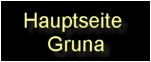
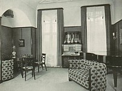
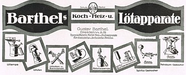
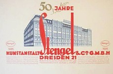
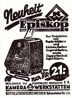

* * *

Die frühere Straße 17 im Osten von Striesen erhielt 1892 den Namen der kleinen Stadt Bärenstein im Osterzgebirge. Zunächst nur zwischen Schandauer und Zinnwalder Straße benannt, erfolgte im Oktober 1928 die Verlängerung bis zum Frauensteiner Platz. Gleichzeitig erhielt auch ein Straßenabschnitt in Seidnitz diesen Namen. Grund waren Planungen, die Bärensteiner Straße bis zur Bahnlinie zu verlängern, um so eine direkte Verbindung nach Reick zu schaffen. Da dieser Bau jedoch nicht zustande kam, erfolgte nach 1970 die Umbenennung der abgetrennten Straßenabschnitte in Rauenstein- und Gohrischstraße.

Um 1900 entstanden an der Bärensteiner Straße Mehrfamilienhäuser in offener Bauweise. Hinzu kamen mehrere Gastwirtschaften wie der "Bärensteiner Hof" (Nr. 6), die "Hasenschänke" (Nr. 13) und die Schankwirtschaft Vogel (Nr. 18). Außerdem gab es einige Industriebetriebe wie das 1904 gegründete Fotopapier-Werk [MIMOSA](../../../../ost/gruna/strassen_gruna/) und die Werkstätten für deutschen Hausrat Theophil Müller (Nr. 5). Auf der Bärensteiner Straße 16 hatte bis 1990 der VEB Herrenmode Dresden seinen Sitz. 2010 wurde auf dem Grundstück Nr. 33 ein modernes Mehrzweck-Funktionsgebäude für die Schüler des Hans-Erlwein- Gymnasiums und Dresdner Sportvereine errichtet.

Werkstätten für deutschen Hausrat: Das 1902 von Theophil Müller gegründete Unternehmen an der Bärensteiner Straße 5 gehörte zu Beginn des Zwanzigsten Jahrhunderts zu den führenden Anbietern moderner Wohnraumgestaltung. Zuvor hatte Müllers Vater Julius in den Räumen eine Akkordzitherfabrik betrieben, die sein Teilhaber jedoch in die Johannstadt verlegte. Theophil Müller ließ die Produkte seiner Firma, vor allem Möbel, Spielwaren und Wohnassesoires, von führenden Designern seiner Zeit künstlerisch gestalten und gehörte zu den Wegbereitern sachlich-alltagstauglicher Kleinmöbel von hoher handwerklicher und künstlerischer Qualität. U.a. arbeiteten Gertrud Kleinhempel, Margarete Junge, Edmund Schuchardt und Erich Kleinhempel für das Unternehmen. _( **Foto:** Musik- und Damenzimmer nach einem Entwurf von Paul Keller, 1915)._

1907 war Theophil Müller Gründungsmitglied des Deutschen Werkbundes. Zahlreiche Erzeugnisse der Werkstätten wurden auf nationalen Kunstgewerbeausstellungen ausgezeichnet. Die Fertigung erfolgte in den Striesener Betriebsräumen, der Vertrieb über Warenbücher des Werkbundes und des Dürerbundes sowie über ein Geschäftslokal auf der Sidonienstraße 6 in der Innenstadt. Weitere Niederlassungen besaß die Firma in Berlin und Hamburg.

Hasenschänke (Nr. 13): Stadtbekannt war vor 1989 die Striesener Gaststätte "Hasenschänke", deren Geschichte bis ins 19. Jahrhundert zurückreichte. Für das einst hier gelegene Jagdrevier war an gleicher Stelle eine kleine Rast- und Jagdhütte entstanden, die 1900 durch ein Wohnhaus ersetzt wurde. Nach umfassender Renovierung wurde die im Erdgeschoss befindliche Gaststätte 1977 als "Hasenschänke" wiedereröffnet und bot in rustikalem Ambiente vor allem Wildgerichte an. Nach 1990 geschlossen, befand sich in den Räumen später kurzzeitig ein Erotikclub, bevor 1993 das griechische Restaurant "Zeus" eröffnet wurde.

Nr. 16/18: Seit 2013 steht die Einfriedung des Grundstücks aus Beton-Formsteinen unter Denkmalschutz. Diese Bauteile waren bis 1989 häufig als gestalterisches Element an Gebäuden, Grundstücksumfriedungen und Wandverkleidungen zu finden. Entwickelt wurden sie 1958 in der Dresdner Produktionsgenossenschaft "Kunst am Bau" unter Mitwirkung der Künstler Friedrich Kracht und Karl-Heinz Adler. Das System besteht aus zwölf Grundformen mit ca. 600 x 600 mm Abmessung, welche als Betongußteile in verschiedenen Kombinationen zusammengesetzt werden konnten und so eine abwechslungsreiche Gestaltung ermöglichten. Die Striesener Formsteinwand gehört heute zu den wenigen noch original erhaltenen in Dresden.

Firma Gustav Barthel (Nr. 23): Das Unternehmen wurde vor dem Ersten Weltkrieg von Gustav Barthel als Spezialfabrik für Löt- Heiz- und Kochapparate gegründet und hatte seinen Sitz an der Ecke zur Zinnwalder Straße. Hergestellt wurden verschiedene Gas- und Elektrogeräte wie Lötkolben, Heizöfen, Brenner und Gas- und Spirituskocher. Ein Zweigwerk gab es in Niedereinsiedel in der Tschechoslowakei. Niederlassungen besaß die Firma zudem in Berlin, Hamburg, Düsseldorf und Barcelona. Logo des Betriebes waren ein ovales Schild mit gekreuzten Schwertern und den Initialen des Firmengründers G. B.

Nach dem Zweiten Weltkrieg wurde das Unternehmen verstaatlicht und in den VEB Lötgeräte Dresden umgewandelt. Volker Kreß, ein Nachkomme des Gründers verließ den Betrieb 1962 und wurde evangelischer Pfarrer. Von 1994 bis 2004 war er evangelischer Landesbischof von Sachsen. Die Produktion des VEB Lötgeräte wurde nach der Wende eingestellt.

Kunstanstalt Stengel & Co (Nr. 29): Die Buchdruckerei und -binderei wurde 1885 gegründet und spezialisierte sich später auf die Herstellung von Ansichtskarten. Bekannt wurde der Betrieb vor allem durch seine zahlreichen Postkartenserien mit Ortsansichten, Gruß- und Sammelkarten und gehörte vor dem Ersten Weltkrieg zu den größten Exporteuren von Ansichtskarten in Deutschland. Täglich verließen bis zu 6.000 Karten das Striesener Werk, welche sowohl im Lichtdruck- als auch im Offsetverfahren hergestellt wurden. Außerdem gehörten bedruckte Kartonagen, Faltschachteln und andere Verpackungsmaterialien zum Produktionsprogramm. 1944 fielen Teile des Betriebes einem Luftangriff zum Opfer. 1948 gingen die verbliebenen Rechte an die Dresdener Verlagsgesellschaft mbH über, die um 1950 den Betrieb endgültig einstellte.

Firma Guthe & Thorsch (Nr. 30): In den 1920er Jahren befand sich auf diesem Grundstück die Firma Guthe & Thorsch, einer von zahlreichen Dresdner Kameraherstellern. Das von Paul Guthe und Benno Thorsch gegründete Unternehmen hatte seinen Sitz aus Platzgründen nach dem Ersten Weltkrieg aus der Pirnaischen Vorstadt zur Bärensteiner Straße 30 verlegt. 1938 kaufte der Amerikaner Charles Adolf Noble das Unternehmen, verlegte den Firmensitz nach Niedersedlitz und führte den Betrieb dort unter dem Namen [Kamera-Werkstätten Dresden-Niedersedlitz](../../../../ost/niedersedlitz/strassen_niedersedlitz/) weiter. Das noch erhaltene Gebäude an der Bärensteiner Straße wird heute vom Druckhaus Dresden genutzt. Von 1994 bis 2004 befand sich hier mit dem Lichtdruck-Werkstatt-Museum eine der letzten noch produzierenden Lichtdruckereien Europas.

Nr. 38-46 / 48-56: Die aus je fünf Häusern bestehenden beiden Wohnzeilen wurden zwischen 1924 und 1928 von Paul Beck und Max Oertel als östlicher Abschluss der [Grunaer Gartenheimsiedlung](../../../../ost/gruna/) gebaut. Bauherr war der Spar- und Bauverein Dresden-Gruna. Sie stehen, ebenso wie die gesamte Siedlung, seit 1969 unter Denkmalschutz.

* * *

 \[ [Home](../../../../index.html)\] \[ [Nord](../../../../nord/)\] \[ [Nordwest](../../../../nordwest/)\] \[ [Neustadt](../../../../neustadt/)\] \[ [Nordost](../../../../nordost/)\] \[ [West](../../../../west/)\] \[ [Zentrum](../../../../zentrum/)\] \[ [Südwest](../../../../sudwest/)\] \[ [Süd](../../../../sud/)\] \[ [Südost](../../../../sudost/)\] \[ [Ost](../../../../ost/)\] \[ [Register](../../../../Register/register.html)\] \[ [Kontakt](../../../../Kontakt/kontakt.html)\] \[ [Impressum](../../../../impressum/)\]
