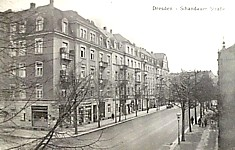
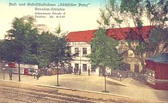
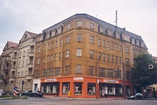
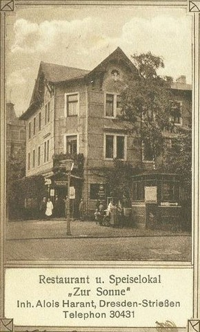
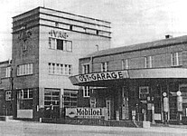
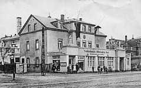
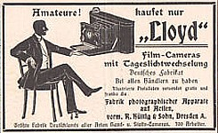
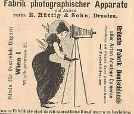

Die heutige Schandauer Straße geht auf einen alten Fahrweg zurück, der von der Dresdner Innenstadt durch Felder und Wiesen nach Pillnitz führte und dabei auch den alten Dorfkern von Striesen berührte. Erst 1765-68 erhielt er seinen heutigen Verlauf. Grund waren die engen und oft schmutzigen Straßen im Ort, die von den Wettinern auf ihren Reisen zum Pillnitzer Schloss gemieden werden sollten. Bis heute ist diese Straßenverlegung in einem “Knick” im Straßenverlauf erkennbar.

Im 19. Jahrhundert erfolgte der Ausbau dieser Straße, an der nach 1880 zahlreiche Gewerbebetriebe, aber auch Wohnhäuser entstanden. 1884 fuhr zum ersten Mal eine Pferdestraßenbahn nach Striesen. Zum Unterstellen der Pferde entstand an der Ecke Geisinger Straße ein Straßenbahnhof mit Hallen und Stallgebäude. 1901 wurde die Straßenbahnlinie elektrifiziert, wodurch dieser Straßenbahnhof überflüssig wurde. Die Gebäude wurden nun in eine Reparaturwerkstatt für Automobile umgewandelt, deren Nachfolger heute ein Kfz-Handel ist.

Bis 1945 gehörte die Schandauer Straße zu den wichtigsten Geschäftsstraßen im Dresdner Osten. Bekannte Läden waren die Wettin-Apotheke (Nr. 1), das Sporthaus Metzler (Nr. 15) sowie die große Schuhhandlung Schmidt im Haus Nr. 23. Im östlichen Teil um den Pohlandplatz dominierten hingegen Gewerbebetriebe, darunter die Striesener Kamerafabriken [Ernemann](../../../../ost/striesen/strassen_striesen/schandauer_strasse/ernemann-werke/) und [Ihagee](../../../../ost/striesen/strassen_striesen/schandauer_strasse/ihagee/), die Zigarettenfabrik [Jasmatzi](../../../../ost/striesen/striesener_zigarettenfabriken/), die Wäscherei Märksch sowie die bereits 1783 gegründete Druckerei C. C. Meinhold & Söhne. Zahlreiche Gebäude fielen 1945 den Bomben zum Opfer und wurden in den 1960er Jahren durch neue Wohnblocks ersetzt. Weitere Baulücken konnten erst nach 1990 geschlossen werden. 2010 entstand an der Ecke Schandauer / Bärensteiner Straße ein modernes Einkaufszentrum.

Einzelne Gebäude:

Gasthof “Zum Sächsischen Prinzen”: Dieses älteste Striesener Wirtshaus wurde Mitte des 18. Jahrhunderts vom Dresdner Hofuhrmacher Johann Gottfried Naumann gegründet, der zuvor eines der Striesener Bauergüter erworben hatte. Am 2. April 1756 erhielt er die Ausschankrechte für das erste feste Wirtshaus im Ort. Parallel dazu gab es auch in Striesen bis 1876 den Reiheschank, bei dem jeder Bauer nach einem festen Rhythmus selbstgebrautes Bier verkaufen durfte. Die kleine Dorfschänke Naumanns wurde zunächst als Petermanns Schankgut bezeichnet und war ab 1839 Versammlungsort des Striesener Gemeinderates.

1889 wurde die schlichte Schankwirtschaft an der Schandauer Straße 11 um einen Ballsaal erweitert und erhielt nun den Namen “Zum Sächsischen Prinzen”. Bis zum Ersten Weltkrieg blieb dieser Gasthof bedeutendes Tanz- und Vergnügungslokal der Striesener Bevölkerung und war zugleich wichtiger Versammlungsort der Arbeiterbewegung. Nach dem Ersten Weltkrieg gerieten die Besitzer in wirtschaftliche Schwierigkeiten und mussten den Ballsaal 1926 schließen. In den Räumen entstand nun das Kino “Gloria-Palast-Lichtspiele”, wobei der bekannte Kino-Architekt Martin Pietzsch die Pläne für den Umbau lieferte. 1945 fiel der Gebäudekomplex dem Luftangriff zum Opfer. An seiner Stelle steht heute ein Einkaufsmarkt.

Kaufhaus Bergmannstraße (ehem. Nr. 22 f, heute Bergmannstraße 52a): Das Gebäude an der Ecke zur Bergmannstraße entstand um 1900 als Wohn- und Geschäftshaus. Im Erdgeschoss befand sich eine Gastwirtschaft, welche zunächst den Namen "Konzertlokal Sachsenklause" trug. Später wechselte der Name nach dem Betreiber in "Hirschschänke". Um 1910 übernahm der Gastwirt Franz Sülze gemeinsam mit seiner Frau Emma das Lokal. Beide hatten zuvor bereits in der "Borsbergschänke" [(Borsbergstraße 19)](../../Ost/Striesen/Strassen_Striesen/Borsbergstrasse/Borsbergstraße.html) gastronomische Erfahrungen sammeln können.

1945 brannte das Gebäude aus, wurde aber in der Nachkriegszeit wieder aufgebaut und danach als Kaufhaus genutzt _(Foto)_. Zunächst trug es den Namen Kaufhaus Kittel, nach der Verstaatlichung und Eingliederung in den Verband volkseigener Kaufhäuser den Namen "Magnet". Nach 1990 nutzte der Polstermöbelhandel "Pogri" das Gebäude. 2014 begann der Umbau zum Wohnhaus.

Weitere Gaststätten: Neben dem "Sächsischen Prinzen" und der "Hirschschänke" gab es auf der Schandauer Straße vor 1945 weitere Gastwirtschaften, von denen einige auch später noch existierten. Zerstört wurden die Häuser Nr. 32 mit dem Lokal "Zur Perle" sowie der "Reichsadler" (Nr. 33). Im Eckhaus zur Behrischstraße (Nr. 45), ehemals "Zur Sonne" genannt _(Foto vor 1945)_, entstand nach 1990 eine Videothek. Die frühere Gaststätte "Erholung" (Nr. 73) wurde bereits in den 1920er Jahren zum Volkshaus Ost umgebaut und ist heute Sitz des Programmkinos Ost. Unweit davon gab es im Gebäude Nr. 69 früher den "Altenberger Hof" und im Eckhaus zur Ludwig-Hartmann-Straße (Schandauer Straße 87) das Hotel "Zum Goldenen Löwen".

Ostgaragen GmbH (Nr. 26): Das Unternehmen wurde im April 1922 unter dem Namen Dresdner Garagen-Aktiengesellschaft als Reparaturwerkstatt für Kraftwagen, Tankstelle, Ersatzteilhandel und zur Vermietung von überdachten Stellplätzen gegründet. Ab 1929 befand sich hier die Abstellhalle für die Busse der Dresdner Verkehrsbetriebe sowie ein "Lkw-Bahnhof" zum Abstellen von Lastwagen. 1940 erwarb die Kraftverkehr Sachsen AG das Areal und bildete die Ostgaragen Schandauer Straße GmbH _(Foto)_. Während des Zweiten Weltkriegs wurden einige der Hallen für die Munitionsherstellung genutzt, wobei auch Kriegsgefangene zum Einsatz kamen.

Nach Beseitigung der Kriegsschäden dienten die Ostgaragen als Werkstatt und Abstellhalle der Lkw des 1952 gegründeten VEB Güterkraftverkehr. Hauptsächlich waren hier Lkw, Anhänger und Spezialfahrzeuge stationiert. Da der Bestand des Unternehmens im Laufe der Zeit auf über 1000 Fahrzeuge anstieg, wurden weitere Abstellplätze in verschiedenen Stadtteilen, so an der Hennigsdorfer, der Münchner und der Hamburger Straße eingerichtet. Ab 1971 gehörte die Firma zum Kombinat VEB Kraftverkehr. Ab 1983 gab es zudem den Autohof Tiergartenstraße, heute Busdepot der DVB. Nach 1990 wurde der Betriebsteil Schandauer Straße aufgelöst und die Hallen an verschiedene Betriebe vermietet. 2016 erfolgte der Abriss zugunsten eines neuen Wohngebietes.

Kulturhaus des VEB Pentacon: Das Gebäude an der Schandauer Straße 64 war vor 1945 Firmensitz der Bleicherei und Färberei Neubert. Nach dem Zweiten Weltkrieg übernahmen die [Dresdner Kamerawerke](../../../../ost/striesen/strassen_striesen/schandauer_strasse/ernemann-werke/) (ab 1964 VEB Pentacon) das Haus und richteten hier das Kulturhaus des Betriebes. ein. U.a. gab es Räume für verschiedene Arbeitsgruppen des Unternehmens, in denen die Betriebsangehörigen ihre Freizeit verbringen konnten. So besaß das Haus eine Kegelbahn, eine Bibliothek und verschiedene Klub- und Veranstaltungsräume. Im Dachgeschoss befand sich seit den 1980er Jahren ein Betriebsfilmstudio für Amateurfilmer, die u.a. Lehr- und Werbefilme sowie kurze Dokumentarfilme produzierten. Nach der Schließung des Unternehmens übernahm die Stadt Dresden das Kulturhaus und führte es ab 1993 als Medienkulturzentrum weiter. Heute hat hier u.a. der regionale TV-Sender “Dresden Fernsehen” seinen Sitz.

Programmkino Ost: Das Gebäude an der Schandauer Straße 73 _(Foto)_ entstand 1897 als Gaststätte "Erholung" mit angeschlossenem Ballsaal. Bereits zwischen 1906 und 1908 gab es dort gelegentliche Kinoaufführungen. Nach dem Ersten Weltkrieg diente das Lokal unter dem Namen "Volkshaus Ost" als Treffpunkt der Striesener Sozialdemokraten. Bis zum Machtantritt der Nazis fanden hier regelmäßige Versammlungen und Bildungsveranstaltungen statt. Am 3. September 1926 erhielt der damalige Besitzer des Hauses Hermann Rüdiger die Erlaubnis, auch Filme aufzuführen. Den neuen “Ost-Lichtspielen” war jedoch nur eine kurze Blütezeit vergönnt, so dass das Kino schon zwei Jahre später wieder schloss.

1936 wurde im früheren Saal erneut ein Kino eingerichtet und am 15. August mit dem Film “Kohlhiesels Töchter” eröffnet. Nach 1945 diente das nun “Filmbühne Ost” genannte Haus als “Versuchskino” zum Testen moderner Kinotechnik wie dem Zwei- Kanal-Lichtton und dem Vier-Kanal-Magnetton-Verfahren, welches 1964 seine DDR-Premiere hatte. 1969 erhielt das Filmtheater eine vollautomatische Vorführmaschine. Eine Besonderheit des "Tagesfilmtheaters Ost" war, das man hier täglich bis zu sieben Vorstellungen, speziell für Schichtarbeiter, erleben konnte.1990 entstand das “Programmkino Ost”, welches vor allem Filme jenseits des Mainstreams zeigt. Betreiber war zunächst ab 1991 die Nickelodeon GmbH, ab 1998 eine eigene Betreibergesellschaft.

2008 begann der Umbau des Filmtheaters, wofür das alte Hauptgebäude, zuletzt als "Altenberger Hof" gastronomisch genutzt, zugunsten eines modernen Neubaus abgerissen wurde. Der nach Plänen des Dresdner Architektenbüros “Code Unique” entworfene Bau beherbergt vier zusätzliche Kinosäle mit insgesamt 324 Plätzen und wurde im April 2009 eröffnet. Die neuen Säle tragen die Namen ehemaliger Dresdner Filmtheater und erinnern somit zugleich an ein Stück Kinogeschichte der Stadt.

## [Programmkino Ost](http://www.programmkino-ost.de)

Firma Hüttig & Sohn Kamerawerk: Das Unternehmen wurde 1862 in Berlin von Franz Richard Hüttig als Werkstatt zum Nachbau von englischen und französischen Kameras gegründet und siedelte 1887 nach Dresden um. Zunächst befanden sich die Produktionsräume auf der Chemnitzer Straße in Plauen. Nach dem Einstieg von Hüttigs Sohn Carl Richard verlegte die Firma ihren Sitz auf die Elisenstraße in die Johannstadt und firmierte nun als “Kunsttischlerei photographischer Apparate Richard Hüttig & Sohn”.

Der wirtschaftliche Erfolg des Unternehmens ermöglichte 1896/97 den Umzug nach Striesen (Schandauer Straße 76). Wenig später änderte sich die Rechtsform zur Aktiengesellschaft, welche unter dem Namen “Hüttig AG” zu den größten deutschen Kameraherstellern gehörte. 1906 beschäftigte das Unternehmen über 800 Mitarbeiter. Die zunehmende Konkurrenz bereitete jedoch auch der Hüttig AG Probleme, denen man 1909 durch eine Fusion begegnete. In diesem Jahr entstand die Internationale Camerafabriken Aktiengesellschaft (ICA A.G.), zu der neben Hüttig auch die [Firma Wünsche](../../../../sudost/reick/strassen_reick/) mit Sitz in Dresden-Reick, die Firma Dr. Rudolf Krügener aus Frankfurt/Main und das 1901 von Carl Zeiss Jena übernommene Palmos Kamerawerk gehörten.

Mit dem Zusammenschluss wuchs die Mitarbeiterzahl auf über 1.000 an. Hergestellt wurden neben über 250 verschiedenen Kameramodellen auch Kinogeräte, Filmprojektoren und
Vergrößerungsapparate. Ab 1920 arbeitete man in Verkauf und Reklame mit dem ebenfalls in Dresden ansässigen Hersteller von Fotopapier und Chemikalien [Mimosa A.G.](../../../../ost/striesen/strassen_striesen/) zusammmen. Wirtschaftliche Gründe führten 1925 zur Bildung einer Interessengemeinschaft mit der Optischen Anstalt C. P. Goertz in Berlin sowie der Contessa-Nettel A.-G. Stuttgart, welche am 1. Oktober 1926 zur Gründung der [Zeiss Ikon AG](../../../../ost/striesen/strassen_striesen/schandauer_strasse/ernemann-werke/) führten.

Das Gebäude an der Schandauer Straße 76 diente auch nach der Fusion der ICA A. G. der Kameraproduktion. Ein Erweiterungsbau entstand Mitte der 1930er Jahre an der Glashütter Straße. Nach 1945 nutzte es zeitweise eine Tabakfirma, bevor der Bau an die Dresdner Kamerawerke (ab 1964 Pentacon) zurück gegeben wurde. Nach der Schließung des Unternehmens stand das Haus einige Jahre leer und wurde 1994 zugunsten eines nie realisierten Wohnparks abgerissen.

* * *

 \[ [Home](../../../../index.html)\] \[ [Nord](../../../../nord/)\] \[ [Nordwest](../../../../nordwest/)\] \[ [Neustadt](../../../../neustadt/)\] \[ [Nordost](../../../../nordost/)\] \[ [West](../../../../west/)\] \[ [Zentrum](../../../../zentrum/)\] \[ [Südwest](../../../../sudwest/)\] \[ [Süd](../../../../sud/)\] \[ [Südost](../../../../sudost/)\] \[ [Ost](../../../../ost/)\] \[ [Register](../../../../Register/register.html)\] \[ [Kontakt](../../../../Kontakt/kontakt.html)\] \[ [Impressum](../../../../impressum/)\]
