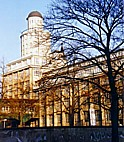
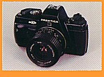
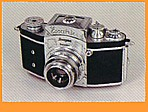
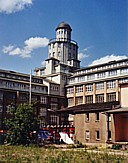

* * *

* * *

Die Ernemann-Kamerawerke gehen auf den Unternehmer Heinrich Ernemann zurück, der aus einfachen Verhältnissen stammte und in Dresden zunächst ein Posamenten-, Strumpf- und Weißwarengeschäft besaß. Da der gelernte Schlosser sich schon früh mit technischen Dingen beschäftigte, tat er sich mit einem befreundeten Handwerker, dem Tischlermeister Matthias, zusammen und gründete am 16. November 1889 auf der Güterbahnhofstraße 10 sein erstes Unternehmen zum Bau von Fotoapparaten (“Dresdener photographische Apparate-Fabrik Ernemann & Matthias”). Auch nach der Trennung von seinem Kompagnon 1891 führte
Heinrich Ernemann seine Firma mit Erfolg weiter und verlegte sie zunächst in die Pirnaische Straße, später auf die Kaulbachstraße 13. 1896 konnte er das Grundstück Schandauer Straße 48 erwerben und ließ hier ein modernes Produktionsgebäude errichten _(Fotos um 1924)_. Drei Jahre später wandelte Heinrich Ernemann den Betrieb in eine “Aktiengesellschaft für Camera-Fabrikation” um.

Der in mehreren Bauabschnitten entstandene Neubau wurde von Professor Emil Högg und Richard Müller entworfen und war einer der ersten künstlerisch gestalteten Stahlbetonbauten Europas. 1907 erfolgte eine Erweiterung an der Glashütter/ Junghansstraße. Für dieses Eckgebäude schuf der Künstler Hans Unger ein Glasmosaik, welches die “Göttin des Lichts” darstellte und zum ersten Markenzeichen der Firma wurde. Ernemanns Unternehmen stieg schon bald zum bedeutendsten Betrieb der Branche auf und sorgte immer wieder mit Neuentwicklungen für Aufsehen. So konnte die Firma 1903 die erste Amateur-Schmalfilmkamera (“Ernemann-Kino”) der Welt vorstellen, später auch die erste Spiegelreflexkamera. Neben Fotoapparaten wurden auch Kinomaschinen (“Imperator”) hergestellt, die schnell zum Exportschlager wurden. Auch der bis heute verwendete Begriff “Kino” geht auf Heinrich Ernemann zurück. Durch ständige Weiterentwicklung der Geräte erwarben Ernemanns Mitarbeiter zahlreiche Patente.

Als neues Wahrzeichen der Firma entstand 1922/23 der markante 48 Meter hohe Ernemann-Turm, der später auch als Firmensignet verwendet wurde. Ursprünglich sollte in diesem Turm ein Observatorium eingerichtet werden, was jedoch nicht zustande kam. 1926 vereinigten sich die Ernemann-Kamerawerke A. G. mit verschiedenen anderen deutschen Herstellern, u. a. der [ICA-AG Richard Hüttigs](../../../../../ost/striesen/strassen_striesen/schandauer_strasse/), zur Zeiss-Ikon AG mit Stammsitz in Dresden. Auch dem neuen Unternehmen gelang es, den Weltruf von Ernemann-Kameras zu wahren und die Tradition Striesens als Standort der Fotoindustrie fortzusetzen. Nach dem Tod Heinrich Ernemanns übernahm 1928 dessen Sohn Alexander die Leitung der Firma.

Das Striesener Stammhaus der früheren Ernemann-Werke blieb auch nach der Fusion bedeutende Produktionsstätte der Zeiss-Ikon AG. Erfolgreichstes Modell war in den Dreißiger Jahren die neu entwickelte Kleinbildkamera “Contax”.
Außerdem wurden weiterhin Kinoprojektoren und Schmalfilmkameras gebaut sowie an der Entwicklung der neuen Fernsehtechnik gearbeitet. 1937 entstand an der Glashütter Straße ein weiteres Fertigungsgebäude. Außerdem besaß die Firma mehrere Zweigstellen in Dresden und Umgebung:

**_Betriebsteil_**

**_Anschrift_**

Alpha-Werk

Bienertstraße 1, Dresden-Plauen

Beta-Werk

Victoriastraße 3, Dresden-Altstadt

Gamma-Werk

Altenberger Str. 48, Dresden-Striesen

Delta-Werk

Blasewitzer Str. 73, Dresden-Striesen

Kappa-Werk

Sachsenwerkstr. 53, Dresden-Niedersedlitz

Lambda-Werk

Bismarckstr. 21, Heidenau

My-Werk

Kipsdorfer Str. 93, Dresden-Striesen

Während des Zweiten Weltkrieges wurde die Produktion auf die Bedürfnisse der Rüstung umgestellt und fertigte nun Bombenzielgeräte und ähnliche optische Einrichtungen an. Dabei kamen zahlreiche Zwangsarbeiter zum Einsatz, die oft unter unmenschlichen Bedingungen leben und arbeiten mussten. 1945 wurde auch das Striesener Werk vom Bomben getroffen, brannte dadurch teilweise aus, konnte jedoch bereits 1946 wieder eröffnet werden. In den ersten Monaten bestand die Produktion vorwiegend aus dringend benötigten Gebrauchsgütern wie Töpfen und Tiegeln, Feuerzeugen und elektrischen Wärmegeräten, bevor man sich ab 1947 wieder der Kameraproduktion widmete.

Während die Aktionäre der Zeiss Ikon AG den Firmensitz nach Stuttgart verlegten, kam das Dresdner Werk 1948 in Volkseigentum. Erschwert wurde der Neubeginn durch Reparationsforderungen der Sowjetunion, die einen Großteil der technischen Anlagen demontierten. Trotz dieser Probleme gelang es den Angestellten schon bald, wieder an die Vorkriegserfolge anzuknüpfen. Interessante Neuheiten waren eine 1950 vorgestellte neue Kleinbild-Spiegelreflexkamera sowie die Fotoapparate der Marken Contax S, Practica und Exacta, die in zahlreiche Länder exportiert wurden. Am 1. Januar 1959 wurden die Dresdner Kamerahersteller Zeiss Ikon (VEB Kinowerke Dresden), [Kamerawerke Niedersedlitz](../../../../../ost/niedersedlitz/strassen_niedersedlitz/) (ehem. Noble), [Altissa](../../../../../zentrum/johannstadt/strassen_johannstadt/), Aspecta und Welta unter dem Namen VEB Kamera- und Kinowerke Dresden zu einem Großbetrieb zusammengeschlossen, welcher ab 1964 als VEB Pentacon firmierte. Die Bezeichnung stammt von dem in modernen Kameras eingebauten Prisma (Pentagonalprisma) und einem bereits vor 1945 verwendeten Markenzeichen (Contax) der Zeiss Ikon AG. 1968/70 gliederte man auch die bis dahin unter Treuhandverwaltung stehende [Ihagee AG](../../../../../ost/striesen/strassen_striesen/schandauer_strasse/ihagee/) in das Kombinat ein. Weitere Unternehmen, u.a. der VEB Kamerafabrik Freital und das [Certo-Kamerawerk](../../../../../ost/dobritz/strassen_dobritz/pirnaer_landstrasse/) kamen 1980 hinzu. Ab 1985 gehörte Pentacon zum Kombinat Carl Zeiss Jena. Die beiden Fotos zeigen Erzeugnisse der Striesener Kamerafabriken von 1936 und 1989.

Bis 1989 blieb Pentacon einer der größten Kamerahersteller des RGW und produzierte hauptsächlich Spiegelreflex-Kameras, aber auch Sucherkameras, Diaprojektoren und ähnliche fotografische Apparate. Trotz ständiger Weiterentwicklungen und der Einführung moderner Produktionslinien geriet das Werk durch die zunehmende fernöstliche Konkurrenz unter Druck. Nach 1990 waren die hier hergestellten Kameras trotz ihrer hohen Qualität auf dem Weltmarkt nicht mehr konkurrenzfähig, woraufhin das Unternehmen 1991 von der Treuhandanstalt liquidiert wurde. Zuvor hatte man den Betrieb noch im Juni 1990 aus dem Kombinat Carl Zeiss Jena ausgegliedert und in eine GmbH umgewandelt. Die endgültige Produktionseinstellung erfolgte im Januar 1991, die formale Auflösung der Pentacon Dresden GmbH am 30. Juni 1991.

Nur wenige der zuletzt ca. 5700 Mitarbeiter konnten von einem der Nachfolgebetriebe bzw. von einer Beschäftigungsgesellschaft übernommen werden. Das frühere Stammhaus mit dem Ernemann-Turm wurde 1994-1997 umfassend saniert und umgebaut. Heute haben hier die [Technischen Sammlungen](../../../../../ost/striesen/strassen_striesen/schandauer_strasse/ernemann-werke/technische_sammlungen/) Dresden ihr Domizil. In der Ausstellung sind auch viele frühere Spitzenprodukte der Dresdner Kameraindustrie zu sehen. Der Markenname Pentacon wird heute von einem 1997 gegründeten Unternehmen genutzt, welches sich auf die Herstellung moderner Scannerapparate für Museen und Archive spezialisiert.

* * *

 \[ [Home](../../../../../index.html)\] \[ [Nord](../../../../../nord/)\] \[ [Nordwest](../../../../../nordwest/)\] \[ [Neustadt](../../../../../neustadt/)\]
 \[ [Nordost](../../../../../nordost/)\] \[ [West](../../../../../west/)\] \[ [Zentrum](../../../../../zentrum/)\] \[ [Südwest](../../../../../sudwest/)\]
 \[ [Süd](../../../../../sud/)\] \[ [Südost](../../../../../sudost/)\] \[ [Ost](../../../../../ost/)\] \[ [Register](../../../../../Register/register.html)\] \[ [Kontakt](../../../../../Kontakt/kontakt.html)\] \[ [Impressum](../../../../../impressum/)\]
