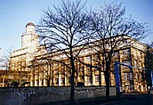

**Öffnungszeiten Aussichtsturm:**

**Di.-Fr.   9-17 Uhr**

**Sa.-So. 10-18 Uhr**

* * *

Die Technischen Sammlungen gehen auf das frühere Technische Museum Dresden zurück, welches sein Domizil ursprünglich in einem Wohnhaus auf der Königstraße hatte. Nachdem die dortigen Räume für andere Zwecke
benötigt wurden, zog das Museum zunächst in eine Villa nach Blasewitz um. Allerdings ermöglichten die beengten Räumlichkeiten auf der Reinhold-Becker-Straße nur die Ausstellung eines kleinen Teils der Sammlung. Aus
diesem Grund beschloss die Stadt Dresden nach der Wende die Verlegung des Museums in das frühere Pentacon-Gebäude in Striesen.

Nach umfassenden Sanierungs- und Umbauarbeiten konnte das Museum 1993 in die früheren
Räume der Kamerafabrik Ernemanns ziehen. In diesem Zusammenhang erhielt das nun deutlich vergrößerte Museum den Namen Technische Sammlungen der Stadt Dresden. Im Mittelpunkt der Ausstellung stehen technische Geräte aus
der Produktion bekannter Dresdner Unternehmen. So sind u. a. zahlreiche Kameras und Fotoapparate aus Striesener Betrieben zu sehen, darunter auch die berühmten Kinoapparate Ernemanns. Hinzu kommen Schreibmaschinen,
Nähmaschinen, Rechenapparate und Bürotechnik, die an die einst bedeutende feinmechanische Industrie Dresdens erinnern. Ein weiterer Anziehungspunkt ist die umfangreiche Sammlung historischer Musikautomaten und
Grammophone. Außerdem verwalten die Technischen Sammlungen den Nachlass des DEFA-Trickfilmstudios, welches von 1955 bis zur Liquidation 1990 in Gorbitz über 1800 Puppen- und Zeichentrickfilme produzierte.

Seit Mai
2003 befindet sich in den Räumen auch die zuvor im Stadtmuseum untergebrachte Ausstellung historischer Feuerwehrgeräte. Attraktionen der Sammlung sind zwei historische Spritzenwagen von 1759 und 1914. Hinzu kommen
Modelle von Feuerwehrfahrzeugen, Ausrüstungsteile, alte Feuermelder und zahlreiche Dokumente zur Thematik. Auf dem Außengelände können Kinder ihre Fähigkeiten bei Eimerketten und auf Feuerrutschen unter Beweis stellen.

Im Obergeschoss des auch architektonisch interessanten Industriebaus befindet sich ein kleines Café. Vom Turm, der 1923 als Wahrzeichen des Ernemann-Baus entstand und der ursprünglich ein Observatorium aufnehmen sollte,
bietet sich ein schöner Blick über den Osten der Stadt.

**_Foto:_** _Die Technischen Sammlungen mit dem Ernemann-Turm an der Junghansstraße_

* * *

 \[ [Home](../../../../../../index.html)\] \[ [Nord](../../../../../../nord/)\] \[ [Nordwest](../../../../../../nordwest/)\] \[ [Neustadt](../../../../../../neustadt/)\]
 \[ [Nordost](../../../../../../nordost/)\] \[ [West](../../../../../../west/)\] \[ [Zentrum](../../../../../../zentrum/)\] \[ [Südwest](../../../../../../sudwest/)\]
 \[ [Süd](../../../../../../sud/)\] \[ [Südost](../../../../../../sudost/)\] \[ [Ost](../../../../../../ost/)\] \[ [Register](../../../../../../Register/register.html)\] \[ [Kontakt](../../../../../../Kontakt/kontakt.html)\] \[ [Impressum](../../../../../../impressum/)\]
