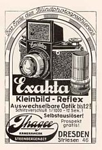
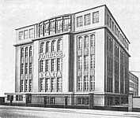
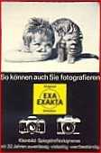

Die Firma Ihagee wurde vom holländischen Konstrukteur Johan Steenbergen gegründet, der
seit 1908 bei Ernemann in dessen [Kamerawerk](../../../../../ost/striesen/strassen_striesen/schandauer_strasse/ernemann-werke/) tätig war. 1912 verließ Steenbergen die
Firma und baute sich ein eigenes Unternehmen auf. Der erster Sitz dieses Betriebes befand sich in den Räumen einer früheren Tischlerei auf der Marcolinistraße 8 in der Friedrichstadt.
Ein Jahr später erhielt die Firma den Namen “Industrie- und Handelsgesellschaft mbH - Fabrik von photographischen Apparaten und Bedarfsartikeln”, wobei sich schnell die
Kurzbezeichnung Ihagee durchsetzte. Nach mehreren Standortwechseln siedelte sich das Unternehmen 1924 in unmittelbarer Nachbarschaft zu anderen bedeutenden
Kameraherstellern in einem Neubau auf der Schandauer Straße 24 in Striesen an. Ein Zweigbetrieb befand sich auf der Augsburger Straße. 1929 wurde das Betriebsareal um einen weiteren Neubau ergänzt.

Zu den Entwicklungen der Ihagee gehörte neben den seit 1920 hergestellten Modellen “Leica” und “Paff-Reflex” die
erste Kleinbild-Spiegelreflexkamera der Welt mit perforiertem Film, die 1936 unter dem Namen “Kine Exakta” auf der
Leipziger Messe vorgestellt wurde. Erfinder war der seit 1926 bei der Ihagee als Werkmeister beschäftigte Karl
Nüchterlein, an den seit 2006 eine Gedenktafel an der Blasewitzer Straße 42 erinnert. Nüchterlein hatte vor seiner
Tätigkeit als Kamerabauer beim renommierten Nähmaschinenhersteller Seidel & Naumann gelernt und bereits 1933 den Prototyp der “Exakta” vorgestellt.

1942 wurde das Unternehmen als “Feindvermögen” von den Nazis beschlagnahmt und
als treuhänderisch verwaltete Aktiengesellschaft in die Rüstungsindustrie eingegliedert. Der mit einer Jüdin verheiratete Johan Steenbergen verließ Dresden und wanderte in die
USA aus. Bis zum Kriegsende stellte die Ihagee Kamerawerk AG im Auftrag der Wehrmacht vorrangig Navigationsgeräte her. Nach 1945 verlegte die Firma ihren Sitz in
das Delta-Werk der Zeiss Ikon AG auf der Blasewitzer Straße, da das Stammhaus auf der Schandauer Straße völlig zerstört worden war. Mit Hilfe mühsam aus den Trümmern
geborgener Maschinen nahm man 1946 die Produktion der legendären Kine Exakta wieder auf.

Da die Firma als niederländischer Besitz nicht unter die Enteignungsverfügungen fiel, blieb die Ihagee
zunächst als privatwirtschaftliches Unternehmen bestehen. In den 50er Jahren wurde der mittlerweile unter staatlicher Treuhandverwaltung stehende Betrieb mit anderen Dresdner Herstellern
zusammengeschlossen und gehörte ab 1968 zum Kombinat VEB PENTACON. In Frankfurt/Main gründeten ehemalige Ihagee-Aktionäre 1959 eine neue “Ihagee West”, welche sich später einen
langwierigen Rechtsstreit mit dem DDR-Betrieb um Namens- und Patentrechte lieferte und 1976 liquidiert wurde.

1970 musste die formal weiterbestehende Ihagee Kamerawerk AG i. V. in Dresden ihre
Produktionsstätten und das Personal per Nutzungsvereinbarung an das Kombinat PENTACON übergeben, womit die Geschichte der Firma endete. Fortan wurden in dem Betrieb verschiedene Teile für den
Kamerabau gefertigt. 1990 musste das Werk per Treuhandbeschluss seine Produktion einstellen und wurde daraufhin abgewickelt. Die Gebäude wurden Mitte der 90er Jahre zugunsten eines neuen Bürokomplexes abgetragen.

**_Bekannte Dresdner Kamerahersteller vor 1945_**

Ernemann-Werke A.G. (ab 1926 Zeiss-Icon AG)

Schandauer Straße 48 / Junghansstraße / Glashütter Straße

Ihagee Kamerawerk Steenbergen & Co.

Schandauer Straße 24 / Augsburger Straße

Kamerawerkstätten Charles A. Noble (ab 1938)

(ehemals Guthe & Thorsch)

Bismarckstraße 56

Korelle-Werk (bis 1938 Franz Kochmann)

Trinitatisstraße 42/44 / Augsburger Straße 3

Altissa-Camera-Werk (bis 1940 EHO-Kamera-Fabrik GmbH)

Eilenburger Straße 6 / Lortzingstraße 38

Certo-Kamerawerk

Pirnaer Straße 11 (Pirnaer Landstraße)

Balda Kamerawerk (ab 1951 VEB Belca-Werk)

Wilischstraße 1

Zeh-Camera-Fabrik

Deubener Straße 33

Mentor-Kamerafabrik (bis 1921 Goltz & Breutmann OHG)

Pillnitzer Straße 49

Richard Hüttig AG (ab 1909 Ica AG)

Schandauer Straße 76

Emil Wünsche AG (ab 1909 Ica AG)

Dresden-Reick

Müller & Wetzig

Dürerstraße 100 / Nicolaistraße 15

* * *

 \[ [Home](../../../../../index.html)\] \[ [Nord](../../../../../nord/)\] \[ [Nordwest](../../../../../nordwest/)\] \[ [Neustadt](../../../../../neustadt/)\]
 \[ [Nordost](../../../../../nordost/)\] \[ [West](../../../../../west/)\] \[ [Zentrum](../../../../../zentrum/)\] \[ [Südwest](../../../../../sudwest/)\]
 \[ [Süd](../../../../../sud/)\] \[ [Südost](../../../../../sudost/)\] \[ [Ost](../../../../../ost/)\] \[ [Register](../../../../../Register/register.html)\] \[ [Kontakt](../../../../../Kontakt/kontakt.html)\] \[ [Impressum](../../../../../impressum/)\]
