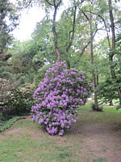
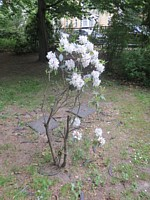

* * *

* * *

* * *

Die Geschichte der Gärtnerei Seidel begann in Böhmen, woher die Familie ursprünglich stammte. Während des Dreißigjährigen Krieges flohen die Vorfahren Hermann Seidels aus Glaubensgründen nach Sachsen und ließen sich zunächst in Radeberg nieder. Christoph Seydel (1670-1747) übte hier zeitweise das Amt des Bürgermeisters aus und gründete 1717 das Augustusbad.

Sein Enkel Johann Heinrich Seidel (1744-1815) war ab 1779 in Dresden als königlicher Hofgärtner tätig und galt als sehr gebildet. Regelmäßig korrespondierte er u.a. mit Goethe, der ihn auch in seinem Haus besuchte. Vier seiner fünf Söhne ergriffen ebenfalls den Beruf eines Gärtners. Carl August wurde wie sein Vater Hofgärtner, Traugott Leberecht (1775-1858) und Jacob Friedrich (1789-1860) gründeten 1813 an der Kleinen Plauenschen Gasse eine Gärtnerei, die bereits wenige Jahre später in die Pirnaische Vorstadt verlegt wurde. Nachdem Traugott Leberecht nach Wien übergesiedelt war, übernahm sein Bruder die Dresdner Gärtnerei allein. Vorrangig widmete er sich der Zucht von Azaleen und Kamelien, die bald zu einem Markenzeichen der Gärtnerei werden sollten.

Nachdem der Platz in der Stadt nicht mehr ausreichte, verlegte Traugott Jacob Herrmann Seidel (1833-1896), der den väterlichen Betrieb 1860 übernommen hatte, das Unternehmen fünf Jahre später nach Striesen. Hier erwarb er ein von der heutigen Eisenacher, Augsburger, Pohland- und Ermelstraße begrenztes Grundstück, was zuvor für die Anlage eines Friedhofes vorgesehen war. Zu diesem Zeitpunkt galt auch er bereits als international anerkannter Gartenbauexperte. In Striesen begründete er seine weltberühmte Zucht von Azaleen, Rhododendren und Kamelien. Weitere Gärtnereien folgten ihm, so dass Striesen zu einem Zentrum des Gartenbaus im deutschsprachigen Raum wurde. Zeitweise existierten über 50 Betriebe im Ort. Erst mit fortschreitender Bebauung wurden diese in die weiter östlich gelegenen Vororte, vor allem nach Tolkewitz und Laubegast verdrängt.

Zu Seidels größten Verdiensten gehörte die Zucht winterharter Rhododendronsträucher, für die er in einem Striesener Wäldchen ideale Bedingungen vorfand. Diese 1877 angelegte Zuchtgärtnerei war Grundstein für den heutigen [Hermann-Seidel-Park](../../../../ost/striesen/strassen_striesen/seidelsche_gartnerei/hermann-seidel-park/) an der Grenze zwischen Striesen und Blasewitz _(Fotos)_. Sein 1895 errichtetes Wohnhaus [Villa “Sansibar”](../../../../ost/striesen/strassen_striesen/augsburger_strasse/) fiel 1945 den Bomben zum Opfer, diente nach Teilausbau noch bis 2008 als Kindergarten und wurde dann durch einen modernen Neubau ersetzt.

1891 erwarben seine beiden Söhne Rudolf (1861-1918) und Heinrich (1864-1934) ein großes Areal in Laubegast und richteten hier zwischen Tauernstraße, Steirischer Straße und Salzburger Straße ihre neue Gärtnerei ein. Hier blieb sie bis 1946 in Privatbesitz, wurde später in das VEG Tolkewitz eingegliedert und nach 1990 zugunsten eines Wohnparkes beseitigt. Erhalten blieb lediglich das frühere Wohnhaus an der Salzburger Straße. Nachkommen betreiben heute noch einen Gartenbaubetrieb in Grüngräbchen bei Kamenz. Neben dem von ihm gestifteten Striesener Volkspark engagierte sich Herrmann Seidel auch für den Bau einer Kirche in seinem Heimatort, die 1880 an der Wittenberger Straße eingeweiht wurde. 1885 gründete er die “Gärtnervereinigung von Sachsen” und war 1887 Initiator der ersten Internationalen Gartenbauausstellung in Dresden.

* * *

 \[ [Nord](../../../../nord/)\] \[ [Nordwest](../../../../nordwest/)\] \[ [Neustadt](../../../../neustadt/)\] \[ [Nordost](../../../../nordost/)\] \[ [West](../../../../west/)\] \[ [Zentrum](../../../../zentrum/)\] \[ [Südwest](../../../../sudwest/)\]
 \[ [Süd](../../../../sud/)\] \[ [Südost](../../../../sudost/)\] \[ [Ost](../../../../ost/)\] \[ [Register](../../../../Register/register.html)\] \[ [Kontakt](../../../../Kontakt/kontakt.html)\] \[ [Impressum](../../../../impressum/)\]
