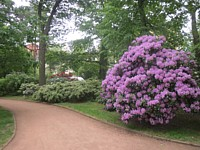
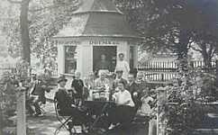
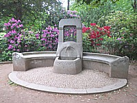

* * *

* * *

* * *

Der an der Ortsgrenze zwischen Striesen und Blasewitz gelegene Hermann-Seidel-Park geht auf die frühere [Seidelsche Gärtnerei](../../../../../ost/striesen/strassen_striesen/seidelsche_gartnerei/) zurück. Traugott Jacob Herrmann Seidel entstammte einer bekannten Gärtnerfamilie und hatte den väterlichen Betrieb 1865 nach Striesen verlegt und hier seine weltberühmte Rhododendrenzucht aufgebaut. 1877 erwarb er ein Grundstück an der Augsburger Straße, welches zuvor für die Anlage des Striesener Friedhofs vorgesehen war. Seidel pflanzte hier die von ihm gezüchteten winterharten Rhododendronsträucher an, für die er an diesem Standort ideale Bedingungen vorfand. Nachdem die zunehmende Bebauung dem Unternehmen Grenzen gesetzt hatte, verlegten seine Söhne die Gärtnerei nach Laubegast. Aus Dank überließ Seidel seinem ehemaligen Heimatort das Gelände zur Anlage eines Volksparkes. Zuvor hatte er sich hier 1895 die [Villa “Sansibar”](../../../../../ost/striesen/strassen_striesen/augsburger_strasse/) errichten lassen, die nach seinem Tod noch bis 1917 Wohnsitz seiner Witwe Minna blieb.

Erst 1921 gelang es der Stadt Dresden, die vorhandenen Grünflächen mit Rhododendronsträuchern zu einem öffentlichen Park umzugestalten. Nun wurden weitere seltene Gehölze gepflanzt sowie neue Wege und Ruheplätze angelegt. Außerdem entstanden Spiel- und Sportplätze sowie eine Rodelbahn. Zu Ehren seines Stifters erhielt dieser Striesener Volkspark den Namen Hermann-Seidel-Park. In den ersten Jahren mussten Nutzer des Parkes an den Eingängen sogar einen kleinen Obulus entrichten, der zur Pflege der Anlage genutzt wurde. Im Park befand sich vor dem Zweiten Weltkrieg auch ein Trinkpavillon der Dresdner Molkerei Pfund, die hier ihre Milchprodukte an die Spaziergänger verkaufte _(Foto)_. Leider verwilderte der Park in den Jahren nach dem Zweiten Weltkrieg und konnte erst in den letzten Jahren wieder hergerichtet werden.

 Interessant ist auch der Märchenbrunnen _(Foto)_. Dieser wurde 1903 von Bruno Hietzig, Besitzer der Granitwerke Kunath in Demitz-Thumitz, für die Deutsche Städtebauausstellung gestiftet und hatte seinen ursprünglichen Standort an der Lingnerallee. Die Entwürfe stammen vom Architektenbüro Schilling & Gräbner, wobei vermutlich Hietzigs Gattin Paula beteiligt war. Beim Bau des Hygienemuseums wurde er 1930 nach Striesen versetzt. Der kleine Granitbrunnen zeigt ein Motiv aus dem Märchen “Brüderchen und Schwesterchen” und wurde wie auch der gesamte Park nach 1990 restauriert.

* * *

 \[ [Nord](../../../../../nord/)\] \[ [Nordwest](../../../../../nordwest/)\] \[ [Neustadt](../../../../../neustadt/)\] \[ [Nordost](../../../../../nordost/)\] \[ [West](../../../../../west/)\] \[ [Zentrum](../../../../../zentrum/)\] \[ [Südwest](../../../../../sudwest/)\]
 \[ [Süd](../../../../../sud/)\] \[ [Südost](../../../../../sudost/)\] \[ [Ost](../../../../../ost/)\] \[ [Register](../../../../../Register/register.html)\]
 \[ [Kontakt](../../../../../Kontakt/kontakt.html)\] \[ [Impressum](../../../../../impressum/)\]
