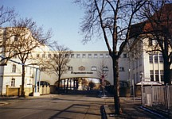
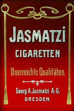

* * *

In der zweiten Hälfte des 19. Jh. entwickelte sich Dresden zu einer Hochburg der deutschen Zigarettenindustrie. Vor allem jüdische Fabrikanten, unter ihnen viele aus Rußland geflüchtete Pogromopfer, hatten
die Technologie mit nach Sachsen gebracht und versuchten sich hier als Hersteller der in Mode gekommenen Tabakware. 1862 gründete der aus St. Petersburg stammende Baron von Huppmann die Zigarettenfabrik “Laferme” als
erste in Deutschland. Ehemalige Mitarbeiter besaßen später eigene Unternehmen. Um die Jahrhundertwende war Dresden zum Hauptumschlagplatz für Tabak und zum Zentrum der Zigarettenherstellung in Deutschland geworden. Fast
25 % der Bevölkerung verdienten ihren Lebensunterhalt in einer der 60 Tabakfabriken der Stadt bzw. waren im Handel oder der Zuliefererindustrie tätig. Obwohl das markanteste Zeugnis dieser Zeit mit der Yenidse in der
Friedrichstadt steht, war der Stadtteil Striesen das eigentliche Zentrum der Branche. Neben den großen Firmen “Jasmatzi & Söhne” und “Lande” entstanden auch zahlreiche klein- und mittelständische Unternehmen wie
“Kosmos”, “Union”, “Patras” und “Macedonia”.

In Folge der Weltwirtschaftskrise gerieten auch viele Zigarettenhersteller in Schwierigkeiten und mussten Konkurs
anmelden. Andere schlossen sich zusammen oder wurden von den großen Konzernen aufgekauft. Auch während des Zweiten Weltkrieges blieb Striesen wichtige Produktionsstätte für Tabakwaren. Beim Luftangriff 1945 wurden viele
Unternehmen schwer beschädigt bzw. völlig zerstört. Trotzdem konnte die Produktion schon bald wieder aufgenommen
werden, was auch im Interesse der Versorgung der sowjetischen Besatzer und ihrer Soldaten lag. Die enteigneten Unternehmen “Jasmatzi”, “Macedonia”, “Greiling” und “Kosmos” schlossen sich 1959 zum VEB Vereinigte Dresdner
Zigarettenfabriken zusammen. Dieser Betrieb wurde 1990 von der Philip Morris GmbH übernommen und trägt seit 1998 den Namen f6 Cigarettenfabrik Dresden GmbH (Foto).

**_Bekannte Striesener Zigarettenfabriken vor 1945_**

Jasmatzi & Söhne

Blasewitzer Str. / Schandauer Str. 68 / Glashütter Str. 94

Lande

Laubestraße / Junghansstraße 5

Yramos

Laubestraße 24

Kosmos

Fürstenstraße

Union

Wittenberger Straße 114

Patras

Schandauer Straße 13

Macedonia

Glashütter Straße 66

Firma Jasmatzi:

Die Firma wurde 1880 von Georg Jasmatzi als kleines Handwerksunternehmen gegründet. Der aus
Griechenland stammende Unternehmer war seit 1868 als Werksmeister in der Firma “Laferme” beschäftigt, machte sich dann jedoch selbstständig. Zunächst verkaufte er in einem kleinen Laden auf der
Waisenhausstraße selbsthergestellte Zigarren, die reißenden Absatz fanden.1889 ermöglichte ihm sein geschäftlicher Erfolg den Erwerb eines Grundstückes an der Blasewitzer Straße. 1900 folgte ein
weiteres Produktionsgebäude an der Schandauer Straße 68.

Gemeinsam mit einem zehn Jahre später eingeweihten Ergänzungsbau an der Glashütter Straße war die Firma “Jasmatzi
& Söhne” bedeutendstes Striesener Tabakunternehmen. Hergestellt wurden Zigaretten der Marken “Cheops”, “Sphinx”
und “Ramses”, die in alle Welt exportiert wurden. Jasmatzi galt als Vorzeigeunternehmer und war zugleich griechischer
Konsul in Sachsen. Nachdem das Familienunternehmen 1901 in eine Aktiengesellschaft umgewandelt worden war,
verließ Georg Jasmatzi bereits ein Jahr später die Firma und gründete wieder einen eigenen Betrieb zur Herstellung von
Zigarettenmaschinen. Ab 1911 stellte er auch selbst wieder Tabakwaren her. 1924 wurde die Firma in den Reemtsma-Konzern eingegliedert.

Das nach 1945 verstaatlichte Unternehmen gehörte ab 1959 als Werk I zu den Vereinigten Dresdner Zigarettenfabriken.
Im früheren Hauptgebäude der Firma Jasmatzi entstand der Sitz dieses Unternehmens. Heute werden die Gebäude von der f6 Cigarettenfabrik Dresden GmbH, einer Tochterfirma des Philip Morris Konzerns, genutzt.

Firma Lande:

Das Unternehmen wurde vom jüdischen Zigarettenproduzenten Wilhelm Lande in Halberstadt gegründet und war ab
1900 auf der Laubestraße in Striesen ansässig. 1932 entstand ein moderner Neubau an der Junghansstraße, in dem zur
Blütezeit über 600 Arbeiter beschäftigt waren. Mit Machtantritt der Nazis geriet Lande unter Druck und wurde wegen
seiner Herkunft boykottiert. Um weiteren Repressionen zu entgehen, verkaufte Wilhelm Lande seine Firma und emigrierte in die USA. Auch unter Regie des neuen Besitzers wurde der werbewirksame Firmenname beibehalten. Nach
dem Zweiten Weltkrieg kam das Unternehmen in Staatsbesitz und gehörte ab 1959 zum VEB Vereinigte Zigarettenfabriken Dresden.

Firma Yramos:

Die Zigarettenfabrik
der Familie Lewin wurde 1890 gegründet und zog 1919 nach Dresden um. Zunächst befanden sich die Produktionsräume auf einem Grundstück an der Freiberger Straße. Nachdem Wilhelm Lande seine
Produktionsstätte in der Laubestraße 24 aufgegeben und zur Junghansstraße umgezogen war, übernahmen die jüdischen Fabrikanten Julius und Hermann Lewin die Gebäude und zogen hier 1932 mit ihrer Orientalischen Tabak- und
Zigarettenfabrik “Yramos” ein. Als eines der wenigen Unternehmen der Branche war diese Firma unabhängig von einem
großen Konzern und beschäftigte ca. 200 Angestellte. Auch dieses Unternehmen wurde nach 1933 in seiner Arbeit
behindert. Die Besitzer gaben jedoch nicht auf und stellten auch weiterhin jüdische Arbeitskräfte ein, was zu zusätzlichen
Repressionen durch die Machthaber führte. 1937 mussten die Lewins nach einer Polizeiaktion ihr Werk verkaufen, wobei der Kaufpreis vom Staat beschlagnahmt wurde. Während Sohn Hermann Lewin in die USA emigrieren konnte,
wurden Vater Julius und dessen Frau nach Theresienstadt deportiert.

Die Striesener Fabrik wurde nun von der Zigarettenfirma Greiling übernommen, welche die Produktion bis zum Ende des
Zweiten Weltkriegs fortsetzte. Nach 1945 kam auch dieses Unternehmen als Zweigbetrieb zum VEB Vereinigte Dresdner Zigarettenfabriken. 1990 wurde der Standort aufgegeben.

* * *

 \[ [Nord](../../../../nord/)\] \[ [Nordwest](../../../../nordwest/)\] \[ [Neustadt](../../../../neustadt/)\] \[ [Nordost](../../../../nordost/)\] \[ [West](../../../../west/)\] \[ [Zentrum](../../../../zentrum/)\] \[ [Südwest](../../../../sudwest/)\]
 \[ [Süd](../../../../sud/)\] \[ [Südost](../../../../sudost/)\] \[ [Ost](../../../../ost/)\] \[ [Register](../../../../Register/register.html)\] \[ [Kontakt](../../../../Kontakt/kontakt.html)\] \[ [Impressum](../../../../impressum/)\]
