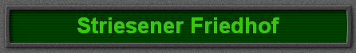
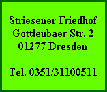
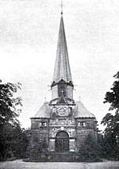
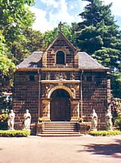

* * *

* * *

* * *

Der Striesener Friedhof wurde im Zuge des weiteren Ausbaus der Vorstadt nach 1880 an der Gottleubaer Straße angelegt und am 17. Juli 1883 eröffnet. Zuvor mussten die Verstorbenen zum Trinitatisfriedhof in der Johannstadt verbracht werden. Ursprünglich war für die Anlage das Grundstück des heutigen Hermann-Seidel-Parkes vorgesehen, welches jedoch 1877 vom Gärtnereibesitzer für seine Rhododendrenzucht erworben wurde. Anwohner hatten durch den Bau eines Friedhofes an dieser Stelle negative Folgen für die weitere Entwicklung des Ortes befürchtet. Der Striesener Friedhof, der sich zu seiner Entstehungszeit noch weit außerhalb der Bebauung befand, nahm ursprünglich eine Fläche von ca. 3,5 Hektar ein. Um 1900 erfolgte eine erste Erweiterung, in den 1950er Jahren eine zweite auf nun über 5,6 Hektar. Bemerkenswert ist die naturnahe und parkartige Gestaltung des Areals.

Für den Friedhof entstand nach Plänen des Architekten Gotthilf Ludwig Möckel, der auch für die 1880 geweihte Erlöserkirche verantwortlich zeichnete, eine Friedhofskapelle mit einem heute nicht mehr vorhandenen hohen Turm. Hinzu kam ein in gleichem Stil gestaltetes Wohnhaus für den Friedhofsmeister, ein Verwaltungsgebäude und eine Leichenhalle. Die Ausmalung der Kapelle übernahm der Maler Max Helas. Das 1945 schwer beschädigte Gebäude wurde in der Nachkriegszeit ohne den markanten Dachreiter wiederaufgebaut _(Foto rechts)_. Dabei fanden am Eingang vier Plastiken aus der zerstörten [Erlöserkirche](../../../ost/striesen/erloserkirche/) Aufstellung.

Auf dem Striesener Friedhof befinden sich eine Reihe künstlerisch wertvoller Grabdenkmale der Entstehungszeit, die meist für die Grabstellen wohlhabender Striesener Unternehmer geschaffen wurden. Die Plastiken wurden teilweise von bekannten Bildhauern geschaffen, unter ihnen Heinrich Rudolph Hölbe (1848-1926), der das Giebelrelief des Albertinums schuf auch seine eigene Grabplastik für den Friedhof gestaltete. Zu den prominenten Dresdnern, die hier beerdigt wurden, gehören der Gärtnereibesitzer Hermann Seidel (1833-1896), der frühere königliche Hoffotograf F. Zeibig (+ 1902), der Kunstmaler Max Helas (1875-1949) und sein Sohn Helmar (1914-1981), der Dirigent Rolf Kleinert (+ 1975), der Kunstsammler Friedrich Pappermann (1909-1995) und der Schauspieler Joachim Zschocke (1928-2003). An das "Lutherjahr" 1883 erinnert eine anlässlich des 400. Geburtstages Martin Luthers am 15. Oktober 1883 gepflanzte Lutherlinde mit Gedenktafel.

* * *

 \[ [Nord](../../../nord/)\] \[ [Nordwest](../../../nordwest/)\] \[ [Neustadt](../../../neustadt/)\] \[ [Nordost](../../../nordost/)\]
 \[ [West](../../../west/)\] \[ [Zentrum](../../../zentrum/)\] \[ [Südwest](../../../sudwest/)\] \[ [Süd](../../../sud/)\] \[ [Südost](../../../sudost/)\] \[ [Ost](../../../ost/)\] \[ [Register](../../../Register/register.html)\] \[ [Kontakt](../../../Kontakt/kontakt.html)\] \[ [Impressum](../../../impressum/)\]
