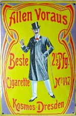
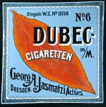
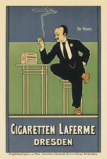
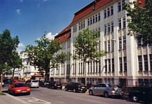
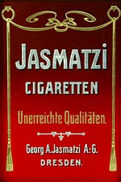
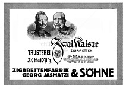
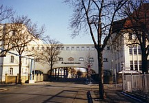
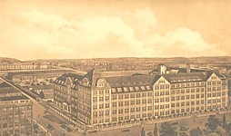
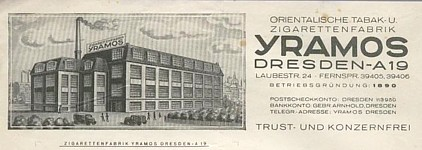

* * *

* * *

In der zweiten Hälfte des 19. Jahrhunderts entwickelte sich Dresden zu einer Hochburg der deutschen Zigarettenindustrie. Vor allem jüdische Fabrikanten, unter ihnen viele aus Rußland geflüchtete Pogromopfer, hatten die Technologie mit nach Sachsen gebracht und versuchten sich hier als Hersteller der in Mode gekommenen Tabakwaren. 1862 gründete der aus St. Petersburg stammende Baron Josef von Huppmann auf der Ostraallee die erste deutsche Zigarettenfabrik "Compagnie Laferme". Der Rohtabak wurde dabei über Triest und Wien nach Dresden verbracht und hier von deutschen und russischen Arbeitern verarbeitet. Wenig später richteten auch griechische und türkische Händler Niederlassungen in Dresden ein. Ehemalige Mitarbeiter Huppmanns besaßen später eigene Unternehmen, so dass die Zahl der bestehenden Firmen bis 1880 auf 21, bis 1900 sogar auf über 40 anwuchs. Dazu trug nicht nur der wirtschaftliche Aufschwung nach dem deutsch-französischen Krieg, sondern auch die zunehmende Popularität des Rauchens in der Bevölkerung bei.

Um die Jahrhundertwende war Dresden zum Hauptumschlagplatz für Tabak und zum Zentrum der Zigarettenherstellung in Deutschland geworden. Fast 25 % der Bevölkerung verdienten ihren Lebensunterhalt in einer der 60 Tabakfabriken der Stadt bzw. waren im Handel oder der Zuliefererindustrie tätig. Obwohl das markanteste Zeugnis dieser Zeit mit der [Yenidze](../../../zentrum/friedrichstadt/strassen_friedrichstadt/weisseritzstrasse/yenidze/) in der Friedrichstadt steht, waren der Stadtteil Striesen und die benachbarte Johannstadt das eigentliche Zentrum der Branche. Neben den großen Firmen “Jasmatzi & Söhne” und “Lande” existierten auch zahlreiche klein- und mittelständische Unternehmen wie “Kosmos”, “Union”, “Patras” und “Macedonia”.

In Folge der Weltwirtschaftskrise gerieten auch viele Zigarettenhersteller in Schwierigkeiten und mussten Konkurs anmelden. Andere schlossen sich zusammen oder wurden von den großen Konzernen aufgekauft. Bis zum Ende des Zweiten Weltkrieges blieb Striesen wichtige Produktionsstätte für Tabakwaren. Beim Luftangriff 1945 wurden viele Unternehmen schwer beschädigt bzw. völlig zerstört. Auch brachen die bisherigen Rohstoffmärkte in der Türkei, Griechenland und Bulgarien zusammen. Trotzdem konnte die Produktion schon bald wieder aufgenommen werden, was auch im Interesse der Versorgung der sowjetischen Besatzer und ihrer Soldaten lag. Die enteigneten Unternehmen “Jasmatzi”, “Macedonia”, “Greiling” und “Kosmos” schlossen sich 1948 zur Vereinigung Volkseigener Betriebe (VVB) Tabakindustrie zusammen und gehörten ab 1959 zum VEB Vereinigte Dresdner Zigarettenfabriken mit Sitz auf der Glashütter Straße _(Foto)_. Neben der Herstellung von Fertigtabak und Filterzigaretten widmete sich das Werk auch der Erforschung neuer Produktions- und Anbaumethoden sowie der Züchtung neuer Tabaksorten. Kleinere Zweigbetriebe schlossen in den 1960er Jahren bzw. wurden als Betriebsteile zu Lagerräumen umgewandelt.

Am 1. Juli 1990 wurden die Dresdner Zigarettenfabriken von der Philip Morris GmbH übernommen und tragen seit 1998 den Namen f6 Cigarettenfabrik Dresden GmbH. Dieser geht auf die zu DDR-Zeiten beliebte und bis heute zu den umsatzstärksten Marken gehörende “F 6” zurück.

**_Auswahl von Zigarettenfabriken vor 1945_**

Kunze

Blasewitzer Straße 10

Jasmatzi & Söhne

Blasewitzer Str. 17 / Schandauer Str. 68 / Glashütter Str. 94

Monopol

Blasewitzer Straße 68

[**Delta**](../../../zentrum/johannstadt/strassen_johannstadt/blasewitzer_strasse/)

Blasewitzer Straße 41

Zepter (Hanns Krausche & Co. KG)

Carlowitzstraße 25

Delphi (Alfred Hartmann)

Dürerstraße 5

[**Kosmos (H. F. Wolf)**](../../../zentrum/johannstadt/strassen_johannstadt/)

Fürstenstraße 70 (Fetscherstraße)

Tuma

Fürstenstraße 72

Persia (Gebr. Stade)

Gerokstraße 5

Macedonia

Glashütter Straße 66

Cigaretten-Fabrik Prée & Co.

Jacobistraße 8

Maschinen-Zigaretten-Fabrik Paul Spiegel

Jacobistraße 8

Lande

Laubestraße / Junghansstraße 5

Yramos

Laubestraße 24

Thessalia (Julius Horwitz Nachf.)

Nicolaistraße 12

Arkadia (Schukalla & Ullmann)

Pfotenhauerstraße 36

Brendler ("Italia")

Pfotenhauerstraße 48

Batschari

Pillnitzer Straße 65

Xanthi (A. Schulmann)

Reißigerstraße 47

Brussiga

Sachsenallee 6

Süd-West (Anna Leupold)

Striesener Str. 43

Kios Zigaretten & Tabak-Import Fabrik (E. R. Böhme)

Trinitatisstraße 28

Patras (Venzke Klähn)

Wintergartenstraße 76 / Schandauer Straße 13

Union

Wittenberger Straße 114

Firma Jasmatzi:

Die Firma wurde 1880 von Georg Anton Jasmatzi als kleines Handwerksunternehmen gegründet. Der aus Griechenland stammende Unternehmer war seit 1868 als Werksmeister in der Firma "Compagnie Laferme" von Joseph von Hupmann beschäftigt, machte sich dann jedoch selbständig. Zunächst verkaufte er in einem kleinen Laden auf der Waisenhausstraße selbst hergestellte Zigarren, die reißenden Absatz fanden. 1889 ermöglichte ihm sein geschäftlicher Erfolg den Erwerb eines Grundstückes an der Blasewitzer Straße 17. 1900 folgten weitere Produktionsgebäude an der Schandauer Straße 68 und der Glashütter Straße 94. Die Planungen stammten vom Dresdner Architektenbüro Rose & Röhle. Ein Verbindungsgang über die Straße verbindet das Haus mit einem 1912 von Lossow & Kühne errichteten Erweiterungsbau.

In der Folgezeit entwickelte sich die Firma zum bedeutendsten Striesener Tabakunternehmen. Hergestellt und in alle Welt exportiert wurden Zigaretten der Marken "Cheops", "Sphinx" und "Ramses". Jasmatzi galt als Vorzeigeunternehmer und war zugleich griechischer Konsul in Sachsen. Nachdem das Familienunternehmen 1901 in eine Aktiengesellschaft umgewandelt worden war, verließ er bereits ein Jahr später die Firma und gründete 1907 wieder einen eigenen Betrieb zur Herstellung von Zigarettenmaschinen ("Georg Jasmatzi & Söhne"). Grund für die Trennung waren geschäftliche Differenzen zwischen dem als Vorstand eingesetzten Firmengründer und der mehrheitlich beteiligten American Tobacco Comp. mit Sitz in New York. Ab 1911 stellte er auch selbst wieder Tabakwaren her.

1915 kam die Jasmatzi AG in den Besitz der Deutschen Bank und erwarb zahlreiche weitere Tabakhersteller. Zu diesen gehörten u.a. die Dresdner Josetti Cigarettenfabrik, die Tabak- und Cigarettenfabrik Sulima, die Delta Cigarettenfabrik sowie die Firma Constantin in Hannover. 1925 schloss man einen Vertrag mit dem Reemtsma-Konzern ab, der wenig später Teile der Markenrechte übernahm und die Jasmatzi AG 1935 endgültig als Zweigwerk in den Konzern eingliederte.

Während der Nazizeit befand sich im Produktionsgebäude Schandauer Straße 68 ein Ende 1944 eingerichtetes KZ-Außenlager. Die Gefangenen mussten in den zuvor für die Zigarettenproduktion genutzten Räumen Geschosskerne für das Rüstungsunternehmen Bernsdorf & Co. anfertigen. Insgesamt waren ca. 500 Personen im "Metallwerk Striesen" beschäftigt, von denen bis zum Kriegsende über 80 starben. Seit 2002 erinnert eine Gedenktafel an dieses Lager.

Das nach 1945 enteignete und verstaatlichte Unternehmen gehörte ab 1959 als Werk I zum VEB Vereinigte Dresdner Zigarettenfabriken. Im früheren Hauptgebäude der Firma Jasmatzi entstand der Sitz dieses Unternehmens. Nach 1990 wurden die Gebäude von der f6 Cigarettenfabrik Dresden GmbH, einer Tochterfirma des Philip Morris Konzerns, genutzt _(Foto)_. 2019 erfolgte die Produktionseinstellung, womit die klassische Zigarettenherstellung in Dresden zu Ende ging. Künftig ist möglicherweise die Produktion von E-Zigaretten geplant. Die Gebäude an der Schandauer Straße wurden verkauft und zu einer Wohnanlage umgebaut.

Firma Lande:

Das Unternehmen wurde 1897 vom jüdischen Zigarettenproduzenten Wilhelm Lande in Halberstadt gegründet und war zunächst in einem Hinterhaus der Zöllnerstraße, ab 1913 auf der Laubestraße in Striesen ansässig. Zunächst noch ausschließlich in Handarbeit gefertigt, ermöglichte ab 1906 der Erwerb moderner Tabakschneide- und Zigarettenmaschinen eine Produktionssteigerung auf bis zu 72.000 Zigaretten am Tag.

1932 erwarb Lande die Gebäude der früheren Zigarettenmaschinenfabrik United Cigarette Machine Company auf der Junghansstraße 5 _(Bild)_, in dem zur Blütezeit über 600 Arbeiter beschäftigt waren. Mit Machtantritt der Nazis geriet der Inhaber unter Druck und wurde wegen seiner Herkunft boykottiert. Um weiteren Repressionen zu entgehen, verkaufte Wilhelm Lande seine Firma und emigrierte in die USA. Auch unter Regie des neuen Besitzers wurde der werbewirksame Firmenname, jetzt als Lande GmbH beibehalten. 1942 übernahm der NSSK-Führer Geißinger den Betrieb, dessen finanzielle Angelegenheiten jedoch vom Reemtsma-Konzern geregelt wurden. Nach der Zerstörung Dresdens lagerte man die Produktion in eine Wilsdruffer Möbelfabrik aus.

Nach dem Zweiten Weltkrieg wurde der Betrieb von der Sowjetischen Militäradministration zu Reparationsleistungen herangezogen und produzierte zeitweise ausschließlich für den Bedarf der Roten Armee. Mit dem Volksentscheid von 1946 wurde Geissinger enteignet und sein Betrieb zum VEB Macedonia. Ab 1959 gehörte er als Werk II zum VEB Vereinigte Zigarettenfabriken Dresden.

Firma Yramos:

Die Zigarettenfabrik der Familie Lewin wurde 1890 gegründet und zog 1919 nach Dresden um. Zunächst befanden sich die Produktionsräume auf einem Grundstück an der Freiberger Straße. Nachdem Wilhelm Lande seine Produktionsstätte in der Laubestraße 24 aufgegeben und zur Junghansstraße umgezogen war, übernahmen die jüdischen Fabrikanten Julius und Hermann Lewin die Gebäude und zogen hier 1932 mit ihrer Orientalischen Tabak- und Zigarettenfabrik “Yramos” ein. Als eines der wenigen Unternehmen der Branche war diese Firma unabhängig von einem großen Konzern und beschäftigte ca. 200 Angestellte. Auch dieses Unternehmen wurde nach 1933 in seiner Arbeitbehindert. Die Besitzer gaben jedoch nicht auf und stellten auch weiterhin jüdische Arbeitskräfte ein, was zu zusätzlichen Repressionen durch die Machthaber führte. 1937 mussten die Lewins nach einer Polizeiaktion ihr Werk verkaufen, wobei der Kaufpreis vom Staat beschlagnahmt wurde. Während Sohn Hermann Lewin in die USA emigrieren konnte, wurden Vater Julius und dessen Frau nach Theresienstadt deportiert.

Die Striesener Fabrik wurde nun von der [Zigarettenfirma Greiling](../../../zentrum/sudvorstadt/strassen_sudvorstadt/zwickauer_strasse/) übernommen, welche die Produktion bis zum Ende des Zweiten Weltkriegs fortsetzte. Nach 1945 kam auch dieses Unternehmen als Zweigbetrieb zum VEB Vereinigte Dresdner Zigarettenfabriken. 1990 wurde der Standort aufgegeben.

* * *

 \[ [Home](../../../index.html)\] \[ [Nord](../../../nord/)\] \[ [Nordwest](../../../nordwest/)\] \[ [Neustadt](../../../neustadt/)\] \[ [Nordost](../../../nordost/)\] \[ [West](../../../west/)\] \[ [Zentrum](../../../zentrum/)\] \[ [Südwest](../../../sudwest/)\] \[ [Süd](../../../sud/)\] \[ [Südost](../../../sudost/)\] \[ [Ost](../../../ost/)\] \[ [Register](../../../Register/register.html)\] \[ [Kontakt](../../../Kontakt/kontakt.html)\] \[ [Impressum](../../../impressum/)\]
