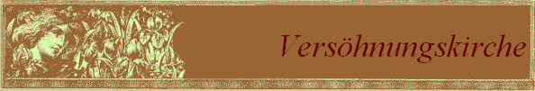
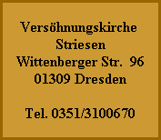
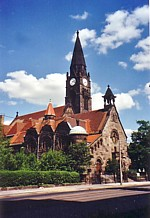
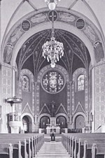
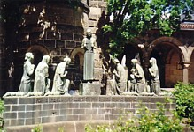

* * *

* * *

* * *

* * *

* * *

* * *

**Öffnungszeiten für Besichtigungen:**

**Mittwoch 17-19 Uhr**

Die Versöhnungskirche an der Schandauer Straße entstand 1905/09 als zweites evangelisches Gotteshaus in Striesen, nachdem die bisher genutzte [Erlöserkirche](../../../ost/striesen/erloserkirche/) zu klein für die gewachsene Gemeinde geworden war. Die Pläne für den architektonisch interessanten Bau lieferten die Architekten Gustav Rumpel und Arthur Krutzsch. Beide waren Sieger eines Wettbewerbes, an dem sich zahlreiche Architekten und Professoren der Dresdner Kunstakademie beteiligt hatten. Die Grundsteinlegung erfolgte am 14. September 1905, die endgültige Fertigstellung am 20. Juni 1909.

Der Kirchenbau wurde im neoromanischen Stil unter Einbeziehung von Jugendstilelementen gestaltet. Erstmals in Dresden wurden Kirche und Gemeindehaus zu einem einheitlichen Bau verbunden. Dieses konnte bereits 1907 eingeweiht werden, während bis zur Fertigstellung der Kirche noch zwei weitere Jahre vergingen. Die Innenausstattung der Gebäude stammt von Max Helas und Otto Gußmann Altar und Kanzel wurden von Georg Wrba bzw. Karl Groß geschaffen und waren wegen ihrer modernen Gestaltung heftig umstritten. Drei bemerkenswerte Glasfenster schuf der Dresdner Glasmaler Paul Rößler. 1908 konnte in der Versöhnungskirche das erste Gußstahlgeläut in Sachsen geweiht werden. Die Glocken überstanden beide Weltkriege und läuten bis heute im Turm, der bis zur Spitze 62 Meter misst. Am Treppenturm befindet sich eine Plastik Martin Luthers, Kopie des Lutherdenkmals vom Neumarkt.

Nach dem Ersten Weltkrieg entstand in Striesen der Wunsch nach einer Ehrung der gefallenen Soldaten des Stadtteils. Im Gegensatz zu vielen anderen Orten entschied man sich jedoch nicht zur Aufstellung eines Kriegerdenkmals, sondern ließ stattdessen einen Brunnen im Innenhof des Kreuzganges anfertigen. Die Brunnenfigur stellt “Christus als Tröster der Mühseligen und Beladenen” dar und wurde vom Bildhauer Selmar Werner geschaffen. Am 19. 8. 1928 konnte der durch den Sächsischen Kunstfonds finanzierte Denkmalsbrunnen eingeweiht werden.

**_Foto:_** _Der Gedenkbrunnen im Innenhof der Versöhnungskirche_

Die 1945 unzerstörte Kirche war bereits im Mai wieder Veranstaltungsort für Orgel- und Chorkonzerte zugunsten des
Wiederaufbaus. Initiator war der Landeskirchenmusikdirektor Alfred Stier, der auch auswärtige Künstler für Auftritte
in Striesen gewinnen konnte. 1948 wurde die Tradition vom späteren Kreuzkantor Martin Flämig fortgeführt, der in diesem Jahr zum neuen Kantor der Versöhnungskirche berufen wurde. Seinem Engagement ist die Gründung der
Dresdner Kirchenmusikschule zu verdanken. Heute finden neben kirchlichen Veranstaltungen auch gelegentliche Ausstellungen und Lesungen statt. 1983 wurde mit der Restaurierung des unter Denkmalschutz stehenden Baues
begonnen. 2004/06 konnten schließlich auch die in den 50er Jahren teilweise übermalten Wandbilder im Gemeindehaus originalgetreu wiederhergestellt werden. Seit 2006 bildet die Versöhnungskirche mit der [Heilig-Geist-Kirche](../../../ost/blasewitz/heilig-geist-kirche/) in Blasewitz und der Tolkewitzer [Bethlehemkirche](../../../ost/tolkewitz/bethlehemkirche/) eine gemeinsame Kirchgemeinde.

* * *

 \[ [Home](../../../index.html)\] \[ [Nord](../../../nord/)\] \[ [Nordwest](../../../nordwest/)\] \[ [Neustadt](../../../neustadt/)\] \[ [Nordost](../../../nordost/)\] \[ [West](../../../west/)\] \[ [Zentrum](../../../zentrum/)\] \[ [Südwest](../../../sudwest/)\] \[ [Süd](../../../sud/)\] \[ [Südost](../../../sudost/)\] \[ [Ost](../../../ost/)\] \[ [Register](../../../Register/register.html)\] \[ [Kontakt](../../../Kontakt/kontakt.html)\] \[ [Impressum](../../../impressum/)\]
