* * *

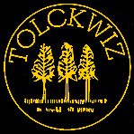

**Gemeindesiegel von Tolkewitz**

* * *

**Schulen in Tolkewitz:**

[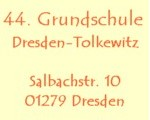](http://www.sn.schule.de/~gs44dd)

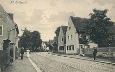Das vermutlich im 11. Jahrhundert gegründete slawische Fischerdorf Tolkewitz wurde 1349 im Lehnsbuch Friedrich des Strengen erstmals als Tolkenwicz urkundlich erwähnt und gehörte zu diesem Zeitpunkt den Adelsfamilien Nurenberg und von Kürbitz. Das frühere Gassendorf östlich des [Niedersedlitzer Flutgrabens](../../ost/niedersedlitz/niedersedlitzer_flutgraben/) ist slawischen Ursprungs und verdankt seinen Namen wohl dem Ortsgründer (“Leute des Tolkan”). 1396 kam der Ort an das Kloster Altzella. Die Zinsen des Vorwerkes Dürrhof wurden 1398 von dessen Besitzer, dem Dresdner Bürgermeister Lorenz Busmann, der Kreuzkapelle übereignet. Durch diese Entwicklung geriet Tolkewitz in enge Bindung zu Dresden und gehörte nach der Reformation zu den Dresdner Ratsdörfern. 1561 ist in den Dorfrügen erstmals eine Elbquerung (Fähre) erwähnt, Vorgängerin der 1808 eingerichteten Fährverbindung nach Wachwitz (bis 1957).

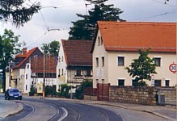Da die sandigen Böden und die häufigen Überschwemmungen der Elbe nur eingeschränkte Landwirtschaft ermöglichten, betrieben die Bewohner neben der Elbfischerei seit dem 16. Jahrhundert die Zwirn- und Garnherstellung im Heimgewerbe. Tolkewitz und das benachbarte Laubegast blieben bis ins 19. Jahrhundert Hochburgen der Garnfabrikation im sächsischen Raum. Zu den bekanntesten Einwohnern des Ortes gehörte der ebenfalls als Zwirnhändler tätige Christian Gärtner (1705-1782), der sich nebenbei mit Astronomie befasste und selbst Fernrohre herstellte. Befreundet war er mit dem Prohliser Bauernastronomen Johann Georg Palitzsch, der 1745 in Tolkewitz erstmals den Sternenhimmel durch ein Fernrohr betrachten konnte. 1688 und 1765 wurde Tolkewitz bei Dorfbränden schwer beschädigt. 1802 fand auf den Fluren ein großes Heerlager der sächsischen Armee mit über 30.000 Soldaten statt.

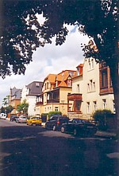Anfang des 19. Jahrhunderts entdeckten Dresdner Bürger die landschaftlich reizvolle Lage des Ortes und erwarben hier Grundstücke zur Bebauung mit Landhäusern. Bedeutendster dieser “Lustgärten” war der des sächsischen Kabinettsministers von Loeben, der 1800 entstand, jedoch bereits 1813 den Kampfhandlungen französischer Soldaten zum Opfer fiel. Hier weilte u.a. der bedeutende deutsche Dichter Johann Gottfried Herder. Am 24. August 1873 wurde ein Großteil des Dorfes durch einen verheerenden Großbrand vernichtet, so dass heute nur noch wenige Gehöfte erhalten sind. Nach dem Brand, bei dem über 100 Einwohner ihr Obdach verloren, entstanden an Stelle der abgebrannten Güter neue Wohngebäude. Lediglich drei Bauern verlegten ihren Betrieb ins damalige Tännicht. Aus einem dieser Güter ging 1893 die Baumschule Paul Hauber an der Kipsdorfer Straße hervor, die bis 1989 zum VEG Saatzucht-Baumschulen gehörte. Das Foto zeigt die kurz nach 1900 entstandenen Häuser der Theodorstraße.

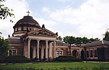Ab 1880 wurde ein Großteil der vorhandenen Freiflächen bebaut. Lediglich ein Streifen zu beiden Seiten des Flutgrabens blieb ausgespart, so dass Tolkewitz bis heute in einen älteren und einen neueren Teil zweigeteilt ist. 1881 wurde der  [Johannisfriedhof](../../ost/tolkewitz/johannisfriedhof/) _(Foto)_ angelegt, auf dem 1908/11 das Dresdner Krematorium entstand. 15 Jahre später folgte der Bau des Tolkewitzer Wasserwerkes auf den Elbwiesen am Tännicht. Zum Aufschwung des Ortes trug auch der 1899 eingerichtete Straßenbahnanschluss mit dem in Neutolkewitz gelegenen größten Dresdner [Straßenbahnhof](../../ost/tolkewitz/strassen_tolkewitz/wehlener_strasse/) bei. Zu den Fahrgästen der Bahn gehörten die zahlreichen Besucher des über die Stadtgrenzen hinaus bekannten Tolkewitzer Vergnügungslokals [“Donaths Neue Welt”](../../ost/tolkewitz/strassen_tolkewitz/alttolkewitz/donaths_neue_welt/) an Stelle des alten Dorfgasthofes.

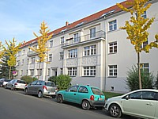Nach 1900 entstanden vor allem im westlichen Ortsteil Neutolkewitz zahlreiche neue Straßen und Wohnviertel, die schrittweise auch die zuvor von Striesen nach hier verlagerten Gärtnereien verdrängten. Nachdem sich die Einwohnerzahl des Ortes bis 1910 fast verdreifacht hatte, wurde Tolkewitz am 1. Juli 1912 nach Dresden eingemeindet. Nach dem Ersten Weltkrieg begannen verschiedene Wohnungsbaugenossenschaften mit der Errichtung weiterer Siedlungen an der Marienberger Straße sowie zwischen Nagel-, Lewicki- und Toeplerstraße ( _**Foto:** Lewickistraße 20-28_). Ein geplanter [Kirchenbau](../../ost/tolkewitz/bethlehemkirche/) konnte jedoch erst 1951 realisiert werden und gehört zu den ersten Kirchenneubauten der DDR.

Das 1945 teilweise von Kriegszerstörungen betroffene Tolkewitz blieb auch nach dem Zweiten Weltkrieg als Wohn- und Gewerbestandort von Bedeutung, wobei kleinere Handwerksbetriebe bis heute überwiegen. Zwischen 1961 und 1970 entstanden an der Marienberger und Altenberger Straße ausgedehnte Neubauviertel mit über 2000 Wohnungen.Nach 1990 folgten weitere Wohngebäude an verschiedenen Einzelstandorten. Gleichzeitig wurden zahlreiche Plattenbauten, u.a. an der Dittersdorfer und Löwenhainer Straße sowie dem Johnsbacher Weg abgerissen.

Gemeindeamt:

Nachdem sich die Diensträume des Gemeindevorstandes zunächst in den Wohnhäusern der jeweiligen Amtsinhaber befanden, wurde 1873 im Haus des wohlhabenden Unternehmers Otto Jank (Alttolkewitz 14) das erste Gemeindeamt eingerichtet. 1902 verlegte man dieses nach Neutolkewitz zur Marienberger Straße 71. Neben den Diensträumen gab es hier auch eine Arrestzelle für kleinere Vergehen.

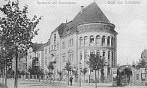1905 wurde an der Einmündung der Toeplerstraße / Ecke Marienberger Straße 86 ein repräsentativer Neubau errichtet. Nach Fertigstellung des wegen seiner halbrunden Fassade auch als “Oper” bezeichneten Hauses _(Foto)_ bezog die Gemeindeverwaltung hier ihr neues Domizil. Zugleich hatten in dem Gebäude die örtliche Polizeidienststelle, die Sparkasse und das Postamt des Dorfes ihren Sitz. Bis zur Eingemeindung von Tolkewitz 1912 blieb dieses Rathaus in Betrieb, wurde später noch als Verwaltungsgebäude genutzt und dient heute Wohnzwecken.

Schulen in Tolkewitz:

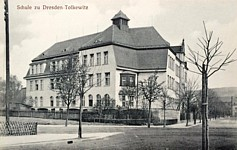44\. Grundschule: Tolkewitz erhielt erst relativ spät, nämlich 1902 sein erstes eigenes Schulhaus. Zuvor besuchten die Kinder des Dorfes die Schulen von Leuben und Laubegast. Bereits 1896 hatte der Gemeinderat den Neubau einer eigenen Schule gefordert. Das erforderliche Grundstück an der Schulstraße (heute Salbachstraße) stellte Gemeindevorstand August Hähnichen zur Verfügung. Die Einweihung erfolgte am 2. Oktober 1902. 1907 wurde auf dem Grundstück noch eine Turnhalle errichtet.

Nachdem diese Schule bereits nach wenigen Jahren zu klein geworden war, entschloss man sich 1912 zu einer Erweiterung und Modernisierung. Die Leitung der Arbeiten oblag dem Dresdner Stadtbaurat Hans Erlwein. Ostern 1913 konnte das Schulhaus wieder eröffnet werden und wurde nach der Eingemeindung des Ortes als 44. Volksschule bezeichnet. In den 1920er und 1930er Jahren war hier der Oberlausitzer Heimatdichter Oskar Schwär (1890-1968) als Lehrer tätig. Schwär verfasste verschiedene Mundartdichtungen und volkskundliche Werke und liegt auf dem Tolkewitzer Friedhof begraben.

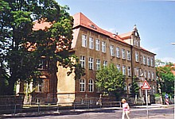Zu einer kriegsbedingten Unterbrechung des Schulbetriebes kam es zwischen 1943 und 1945, als das Haus als Wehrmachtslazarett und Sammelstelle des Winterhilfswerks, nach Kriegsende noch kurzzeitig als Kaserne der Roten Armee diente. In dieser Zeit besuchten die Kinder die 64. Volksschule im benachbarten Laubegast. Als man im Herbst 1945 die Tolkewitzer Schule wieder ihrer Bestimmung übergab, wechselte die Bezeichnung in 44. Grundschule. 1958 wurde aus dieser die 44. Polytechnische Oberschule. Von 1984 bis 1990 trug sie nach dem Regisseur Konrad Wolf (1925-1982) diesen Beinamen. Seit 1992 wird das Gebäude wieder von der 44. Grundschule genutzt.

Neubauschulen: Zwei weitere moderne Schulbauten entstanden in den 1960er Jahren im Zuge des Neubaugebietes Marienberger Straße. Diese zuletzt als 57. Grundschule und 98. Mittelschule bezeichneten Bildungseinrichtungen an der Hausdorfer Straße und am Berthelsdorfer Weg schlossen im Sommer 2008. Das Schulhaus an der Hausdorfer Straße wurde danach von der Freien Evangelischen Schule übernommen und 2014 durch einen modernen Neubau ersetzt.

Wasserwerk Tolkewitz:

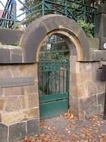Das Tolkewitzer Wasserwerk wurde Ende des 19. Jahrhunderts zur Verbesserung der Wasserversorgung der wachsenden Großstadt angelegt. 1891 erwarb der Rat der Stadt Dresden aus dem Besitz des Tolkewitzer Gemeindevorstands August Hähnichen einen Teil der Elbwiesen an einem alten Elbarm. Zunächst wurde das hochwassergefährdete Gelände aufgeschüttet, bevor 1896 mit dem Bau des Werkes begonnen werden konnte. Dabei kamen vor allem italienische Bauarbeiter zum Einsatz. Die Einweihung des von Baurat Bernhard Salbach entworfenen Gebäudes erfolgte zwei Jahre später am 16. August 1898.

Für das neue Wasserwerk mussten insgesamt 30 Brunnen in den Sand- und Kiesboden gebohrt werden, um das Grundwasser nutzen zu können. Zwei neun Kilometer lange Druckrohrleitungen leiteten das Trinkwasser in die beiden zeitgleich angelegten Hochbehälter in [Räcknitz](../../sud/racknitz/volkspark_racknitz/). Die zum Antrieb der Maschinen des Wasserwerkes notwendige Kohle gelangte auf dem Wasserweg nach Tolkewitz, wurde dort am Elbufer in eine Kohlebahn umgeladen und dann direkt auf das Werksgelände transportiert. Neben dem Maschinenhaus und einigen Nebengebäuden erhielt das Werk auch ein stilistisch angeglichenes Wohngebäude an der Wehlener Straße. Hier verbrachte der DSC-Fußballer Heinz Hartmann als Sohn eines Wasserwerksbeamten seine Kindheit.

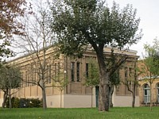Bereits 1901 erforderte der zunehmende Wasserbedarf der wachsenden Großstadt eine Erweiterung des Werkes um fünf zusätzliche Schachtbrunnen und eine dritte Pumpmaschine. Damit erhielt das Tolkewitzer Wasserwerk eine Kapazität von bis zu 40.000 m³ pro Tag. 1913 fogte die Errichtung einer neuen Filterhalle _(Foto rechts)_, 1922-25 der Bau einer Entsäuerungsanlage mittels Kalkwasserfiltern. Zudem wurde die Anlage bis 1936 weiter modernisiert, vor allem um die Qualität des Trinkwassers zu erhöhen.

Das 1945 beschädigte Werk ging nach Beseitigung der Kriegsschäden bald wieder in Betrieb und wurde zwischen 1964 und 1968 um eine neue Vorreinigungsanlage erweitert, die das veraltete Absetzbecken ersetzte. Ab 1971 erfolgte der Einbau neuer Hauptförderpumpen sowie eine Erneuerung der elektrischen Anlagen. 1992 wurde zunächst die Förderung von Trinkwasser, am 13. Februar 1995 der Betrieb des gesamten Wasserwerkes zunächst eingestellt. In dreijähriger Bauzeit ließ die DREWAG als Eigentümer die technischen Anlagen komplett erneuern und an die gewachsenen Anforderungen anpassen, so dass das Wasserwerk am 24. März 2000 seinen Betrieb wieder aufnahm. Die in diesem Zusammenhang rekonstruierten Gebäude blieben äußerlich jedoch weitgehend im Ursprungszustand erhalten und stehen unter Denkmalschutz.

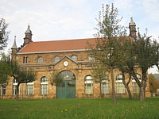

**_Foto:_** _Das Wasserwerk Tolkewitz an der Wehlener Straße_

Kleingartensparte “Elbgrund”:

Die Kleingartenanlage “Elbgrund” wurde 1930 am Rande des Niedersedlitzer Flutgrabens angelegt. Das Gelände war wegen der Überschwemmungsgefahr für eine Bebauung ungeeignet und konnte deshalb nur als Gartenland ausgewiesen werden. Nach 1945 fuhr hier die Dresdner Trümmerbahn zur Kiesgrube nach Dobritz, in der nicht verwendbarer Schutt aus der zerstörten Stadt abgekippt wurde. Auch Teile des Flutgrabens wurden dabei verfüllt,wobei man die dadurch gewonnene Fläche in den 1950er Jahren ebenfalls mit Gärten belegte. 1957 wurden die Bahngleise entfernt. An die Zeit der Enttrümmerung erinnert bis heute der “Trümmerbahnweg” im Spartengelände sowie der aus Teilen des Abbruchmaterials angelegte Musikpavillon. Steine fanden auch für den Bau von Fundamenten und Begrenzungsmauern Verwendung.

[_Weiterführende Literatur und Quellen_](../../impressum/quellenverzeichnis/)

 \[ [Home](../../index.html)\] \[ [Nord](../../nord/)\] \[ [Nordwest](../../nordwest/)\] \[ [Neustadt](../../neustadt/)\] \[ [Nordost](../../nordost/)\] \[ [West](../../west/)\] \[ [Zentrum](../../zentrum/)\] \[ [Südwest](../../sudwest/)\] \[ [Süd](../../sud/)\]
 \[ [Südost](../../sudost/)\] \[ [Ost](../../ost/)\] \[ [Register](../../Register/register.html)\] \[ [Kontakt](../../Kontakt/kontakt.html)\] \[ [Impressum](../../impressum/)\]
