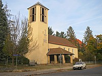
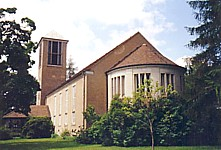

* * *

Bethlehemkirche dresden-tolkewitz  pfarramt: marienberger str. 65 01279 dresden  tel. 0351/2516539

## [Zur Homepage der Kirchgemeinde](http://www.kirchgemeinde-dresden-blasewitz.de)

Nachdem Tolkewitz jahrhundertelang zur Parochie der Leubener Himmelfahrtskirche
gehört hatte, kamen in den Jahren nach dem Ersten Weltkrieg Pläne auf, eine eigene Kirche zu errichten. Bereits ab 1913 fanden in der Schule an der Salbachstraße bzw.
in der Kapelle des Johannisfriedhofes regelmäßig Gottesdienste statt. Nachdem die Nazis 1938 die Nutzung öffentlicher Gebäude für kirchliche Zwecke verboten hatte,
versammelte man sich in einem provisorischen Betsaal. Diesen hatte der Besitzer der Baumschule Hauber in einem ausgebauten Stallgebäude seines Alttolkewitzer Gutes
zur Verfügung gestellt. Kurz darauf erwarb die Gemeinde ein Grundstück an der Marienberger Straße, um hier ein eigenes Gotteshaus zu errichten. Kriegsbedingt konnten die Pläne jedoch zunächst nicht realisiert werden.

Erst am 17. Dezember 1950 erfolgte an der Salbachstraße/ Ecke Kipsdorfer Straße die Grundsteinlegung für die geplante Kirche. Das Gebäude wurde vom Architekten Wolfgang Rauda entworfen und war erster evangelischer
Kirchenneubau in der DDR. Für den Bau wurde u. a. Abbruchmaterial aus einem zerbombten Grundstück an der Nagelstraße verwendet. Tolkewitzer Firmen übernahmen verschiedene Bauleistungen und beteiligten sich an der
Finanzierung des Vorhabens. Weitere Mittel stammten aus Spenden von lutherischen Kirchen aus dem Ausland, insbesondere aus den USA. Noch heute erinnert der Name Bethlehemkirche an diesen schwierigen Beginn der
kirchlichen Arbeit. Finanzielle Probleme verhinderten zunächst den Bau eines zusätzlich vorgesehenen Pfarr- und Gemeindehauses, der erst 2001 realisiert werden konnte.

Die Einweihung der Bethlehemkirche fand ein Jahr nach Baubeginn am 16. Dezember
1951 statt. Zunächst nur provisorisch ausgestaltet, erfolgte wenig später der Einbau der Kirchenbänke, 1955 die Weihe einer Jehmlich-Orgel. 1956 schuf der Dresdner
Künstler Bernhard Weiß ein schlichtes Kruzifix aus Eichenholz. Im Jahr 1965 erhielt das Gebäude schließlich noch seinen Turm, in dem vier in Apolda gegossene
Bronzeglocken läuten. An der Außenwand befindet sich neben Krippe und Kreuz der Stern von Bethlehem, dem die Kirche ihren Namen verdankt. 2003 begann die
umfassende Sanierung des Gebäudes. Seit 2006 bildet die Bethlehemkirche mit der [Versöhnungskirche](../../../ost/striesen/versohnungskirche/) Striesen und der [Heilig-Geist-Kirche](../../../ost/blasewitz/heilig-geist-kirche/) in Blasewitz eine gemeinsame Kirchgemeinde, der derzeit ca. 6000 Mitglieder angehören.

* * *

 \[ [Home](../../../index.html)\] \[ [Nord](../../../nord/)\] \[ [Nordwest](../../../nordwest/)\] \[ [Neustadt](../../../neustadt/)\] \[ [Nordost](../../../nordost/)\] \[ [West](../../../west/)\] \[ [Zentrum](../../../zentrum/)\] \[ [Südwest](../../../sudwest/)\] \[ [Süd](../../../sud/)\] \[ [Südost](../../../sudost/)\] \[ [Ost](../../../ost/)\] \[ [Register](../../../Register/register.html)\] \[ [Kontakt](../../../Kontakt/kontakt.html)\] \[ [Impressum](../../../impressum/)\]
