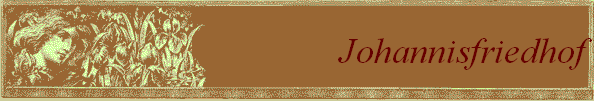

* * *

* * *

* * *

* * *

* * *

[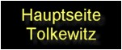](../../../ost/tolkewitz/)

* * *

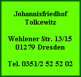

* * *

* * *

**Bedeutende Grabmale:**

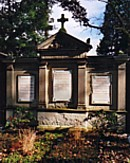

_Friedrich W. Pfotenhauer_

_(Oberbürgermeister)_

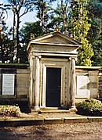

_Arthur W. Königsheim (Gründer des Blasewitzer Waldparks)_

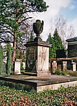

_Hermann Ilgen_

_(Apotheker und Stifter)_

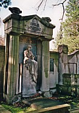

_Carl Eschebach (Unternehmer)_

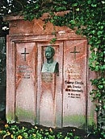

_Johannes Christian Eberle (Präsident des Sächsischen Sparkassen- und Giroverbandes)_

_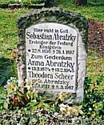_

_Sebastian Abratzky (“Bezwinger” der_

_Festung Königstein)_

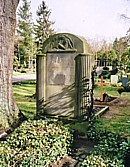

_Cornelius Gurlitt (Kunsthistoriker)_

_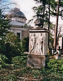_

_Richard Adolf Jaenicke (Mitbegründer der Wandererwerke Chemnitz)_

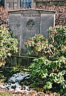

_Bernhard Blüher (Oberbürgermeister)_

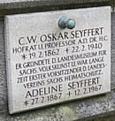

_Oskar Seyffert (Gründer des Volkskunstmuseums)_

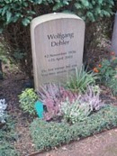

_Wolfgang Dehler (Schauspieler)_

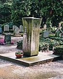

_Gedenkstätte für die Opfer des Kapp-Putsches 1920_

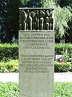

_Gedenkstätte für Zwangsarbeiter_

_der KZ-Außenlager Schwarzheide und Flossenbürg_

Johannisfriedhof:

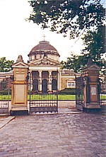Der Tolkewitzer Johannisfriedhof wurde als gemeinsamer Begräbnisplatz der evangelischen Kreuzkirch-, Frauenkirch- und Johanniskirchgemeinde außerhalb des damaligen städtischen Territoriums angelegt. Da die innerstädtischen Friedhöfe längst zu klein geworden waren,entschied man sich für ein Gelände im Tännicht, einem ausgedehnten Kiefernwaldgebiet auf Tolkewitzer Flur, welches bei Bedarf auch Erweiterungsmöglichkeiten bot. Trotz des Einspruchs des Tolkewitzer Gemeinderates und einiger Anwohner wurde 1875 mit den Arbeiten begonnen. Am 16. Mai 1881 wurde der neue Friedhof durch Superintendent Gustav Moritz Franz offiziell eingeweiht. Wenig später fand am 17. Juli 1881 die erste Beisetzung statt. Dieses Grab des mit nur 27 Jahren verstorbenen Schriftsetzers Theodor Dietze ist bis heute erhalten geblieben.

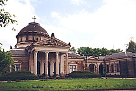Die im Mittelpunkt der Friedhofsanlage stehende repräsentative Kapelle _(Foto)_ entwarf Paul Wallot. Beim Bau entschied er sich für die damals moderne Neorenaissanceform nach dem Vorbild italienischer Friedhöfe. Das Gebäude besteht aus einer zentralen kuppelgekrönten Trauerhalle; an den Seiten schließen sich die Parentations- und zwei Leichenhallen an. Das erst 1894 fertiggestellte und auch im Inneren künstlerisch gestaltete Gebäude wurde 1978/98 rekonstruiert. Im Umfeld befinden sich zahlreiche künstlerisch bedeutsame Grabdenkmale des 19. und frühen 20. Jahrhunderts, die teilweise von bekannten Bildhauern stammen und den Wohlstand des Dresdner Bürgertums dieser Zeit verdeutlichen. Gewandelte Auffassungen in der Friedhofskultur dokumentiert hingegen die 1909 angelegt und naturnah gestaltete “Waldabteilung” des Johannesfriedhofs.

Da der Tolkewitzer Friedhof neben dem Heidefriedhof mit ca. 24,6 Hektar größter und bedeutendster in Dresden ist, haben hier zahlreiche bekannte Persönlichkeiten des öffentlichen Lebens ihre letzte Ruhe gefunden, darunter der letzte demokratisch gewählte sächsische Ministerpräsident Walter Schieck (Amtszeit 1930-33) und die Dresdner Oberbürgermeister Friedrich Wilhelm Pfotenhauer (1812-1877), Otto Beutler (1853-1926) und Bernhard Blüher (1864-1938). Hinzu kommen Gemeinschaftsgrabstätten und Ehrenmale für die Opfer politischer Ereignisse. So fanden in Tolkewitz die im Zusammenhang mit dem Kapp-Putsch am 19. März 1920 ums Leben gekommenen Arbeiter ihre letzte Ruhestätte, ebenso wie die Opfer des Polizeieinsatzes im [“Keglerheim”](../../../zentrum/friedrichstadt/strassen_friedrichstadt/friedrichstrasse/) am 25. Januar 1933.

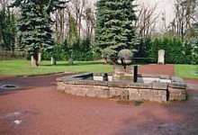Ein Ehrenhain würdigt die zwischen 1943 und 1945 von den Nazis hingerichteten 396 Widerstandskämpfer und 68 verstorbene KZ-Häftlinge. Auch 3.500 Opfer des Luftangriffs wurden auf dem Johannisfriedhof beigesetzt, die letzten im Jahr 2010 _( **Foto:** Ehrenhain)_. 1999 wurde eine weitere Gedenkstätte für 213 ehemalige Zwangsarbeiter der KZ-Außenlager Schwarzheide und Flossenbürg eingeweiht. Tafeln in acht Sprachen nennen die Namen der Opfer und mahnen an das Geschehen während der Zeit des Nationalsozialismus. Die Häftlinge aus verschiedenen Ländern waren bis zum Kriegsende in Dresdner Rüstungsbetrieben als Zwangsarbeiter eingesetzt und starben an Krankheiten und Entkräftung. Eine weitere Gedenkanlage erinnert seit 2003 an die 1940/41 in der Euthanasieanstalt Pirna-Sonnenstein getöteten psychisch Kranken.

1998 kam eine Gedenkstätte für die Opfer stalinistischer Strafjustiz hinzu, nachdem Unterlagen ergeben hatten, das ein Teil der zwischen 1952 und 1956 im [Landgericht](../../../zentrum/sudvorstadt/strassen_sudvorstadt/munchner_platz/landgericht/) am Münchner Platz von sowjetischen und DDR-Gerichten zum Tode verurteilten 23 Regimegegner hier anonym begraben worden war. Zur Gedenkstätte gehören auch die Gräber von Erna Dorn, die wegen ihrer Beteiligung am 17. Juni 1953 hingerichtet wurde, sowie der wegen Hochverrats verurteilten ehemaligen Sekretärin Otto Grotewohls, Elli Barczatis.

Krematorium und Urnenhain:

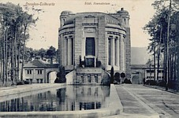1908 erwarb der Rat der Stadt Dresden ein ca. drei Hektar großes Waldstück unmittelbar neben dem Johannisfriedhof zum Bau eines städtischen Krematoriums _(Foto)_, nachdem 1906 die Verbrennung von Leichen allgemein gesetzlich erlaubt worden war. Allerdings hatte es bereits 1874 die erste Feuerbestattung in Dresden gegeben. Die Tote war eine Engländerin, die die in ihrem Heimatland verbotene Bestattungsform per Testament festgelegt hatte. Zuvor hatte der Unternehmer Friedrich Siemens einen Regenerationsofen zur Leichenverbrennung entwickelt, der in leicht veränderter Form später in den meisten Krematorien zum Einsatz kam. Für diese Art derBestattung setzte sich der von Medizinalrat Friedrich Küchenmeister gegründete Dresdner Verein “Die Urne - Verein für facultative Leichenverbrennung” ein. 1876 fand in Dresden der erste Europäische Kongreß der Freunde der Feuerbestattung statt.

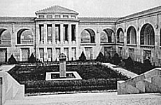Das Tolkewitzer Krematorium entstand 1909/11 unter Leitung des Stadtbaurates Hans Erlwein nach Entwürfen von Fritz Schumacher und gehört zu den bedeutendsten Monumentalbauten dieser Zeit in Dresden. Äußerlich orientiert sich das Bauwerk an Vorbildern wie dem Theodorichgrab in Ravenna und symbolisiert durch ein vorgelagertes Wasserbecken Ruhe und Vergänglichkeit im Rückblick auf ein vollendetes Leben. Unmittelbar an das Gebäude grenzt ein Urnenhof in Form eines mittelalterlichen Kreuzganges an _(Foto rechts)_. Hier befinden sich auch die geschickt in die Fassade einbezogenen turmartigen beiden Schornsteine der im Untergeschoss des Krematoriums untergebrachten Verbrennungsöfen. Die im Jugendstil gestaltete Einsegnungshalle wurde von Georg Wrba mit plastischem Schmuck versehen und von Otto Gußmann mit Glas- und Deckenmalereien künstlerisch ausgestaltet. Lebensgroße Pfeilerplastiken stellen die menschlichen Lebensalter dar. Außerdem sind Symbole der Feuerbestattung wie der Feuervogel Phönix (über dem Hauptportal) und die Figur des Schlafes (am Eingang) zu sehen. Die erste Verbrennung im Tokewitzer Krematorium erfolgte am 22. Mai 1911.

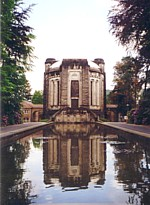Auf dem umliegenden Gelände wurde nach Plänen Schumachers und des Architekten Willy Meyer ein Urnenhain angelegt, der ausschließlich der Beisetzung von Eingeäscherten vorbehalten war. Die Anlage stellt ein interessantes Zeugnis der Friedhofskultur des 20. Jahrhunderts dar und steht ebenso wie das Krematorium unter Denkmalschutz. Hier ruhen u.a. der Zirkusdirektor Hans Stosch-Sarrasani, der bekannte deutsche Militärflieger Max Immelmann, der Schöpfer des “Blauen Wunders” Claus Köpcke sowie die TH-Professoren Fritz Foerster, Richard Mollier und Heinrich Barkhausen. 1943 wurden auch die sterblichen Überreste Richard Plöhns, eines engen Freundes von Karl May, von Radebeul aus überführt. Klara May, welche vor ihrer Hochzeit mit dem Abenteuerschriftsteller mit Richard Plöhn verheiratet gewesen war, hatte die Urne zuvor wegen Plöhns jüdischer Herkunft auf Drängen der Nazis aus der Familiengruft Plöhn-May entfernen und in Tolkewitz erneut beisetzen lassen. Seit 2007 erinnert an Plöhn eine Gedenktafel.

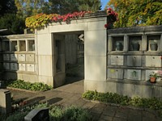1918 erwarb die Stadt Dresden weitere Flächen, um den Urnenhain erweitern zu können. 1924 entstanden eine Terrassenanlage mit Wasserbecken und ein Rosengarten um so eine würdige Ruhestätte zu schaffen. Fast zeitgleich legte Stadtbaurat Paul Wolf 1925 das Kolumbarium als Beisetzungsort für die Urnen an _(Foto rechts)_. Bekannteste hier beigesetzte Persönlichkeit ist der Maler und Kunstprofessor Oskar Seyffert, der 1897 das Museum für Sächsische Volkskunst gegründet hatte. 1926 wurde das Krematoriumsgebäude um eine Urnenhalle erweitert. Bereits acht Jahre zuvor war ein unterirdischer Leichenkeller entstanden. 1928 folgte als letzte größere Maßnahme die Anlage des sogenannten "Neuen Parks".

Den Zweiten Weltkrieg überstanden Friedhof und Krematorium ohne größere Schäden. Am 21. Januar 1946 ging das Krematorium wieder in Betrieb. Umbauten und Modernisierungen erfolgten 1952 mit dem Anbau einer Kühlhalle und 1969 durch Anbau der Osthalle, welche das historische Erscheinungsbild des Gebäudes jedoch stark beeinträchtigten. Nach Stilllegung der Leichenverbrennungsanlage 1995 wurden diese Anbauten deshalb wieder beseitigt. Heute dient das seit 1985 unter Denkmalschutz stehende Gebäude als Verabschiedungshalle für die Hinterbliebenen. 2003 begann in unmittelbarer Nachbarschaft der Bau eines neuen Krematoriums, welches modernsten Umweltstandards genügt. Dieses ging im Februar 2005 in Betrieb und ermöglicht bis zu 10.000 Einäscherungen im Jahr.

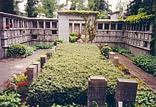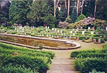

**_Fotos:_** _Urnenhain mit Kolumbarium (links) und Terrassen-Grabanlage (rechts)_

**Gräber bekannter Persönlichkeiten (Auswahl):**

**_Grabstätte_**

**_Todesjahr_**

**_Standort\*_**

Friedrich Wilhelm Pfotenhauer, Dresdner Oberbürgermeister

(bis 1888 Grab auf dem Trinitatisfriedhof)

1877

1 B (W)

Heinrich Moritz Neubert, Bürgermeister, Ehrenbürger von Dresden

1881

1 C

Arthur Willibald Königsheim, Gründer des Blasewitzer Waldparks

1886

1 B (W)

Oskar Richter und Ehefrau Hulda, Unternehmer, Stifter der Blasewitzer Kirche

1888

Dr. Phil. Constantin Frantz, Diplomat und Publizist

1891

Bernhard Salbach, Stadtbaurat, Erbauer des Tolkewitzer Wasserwerkes

1894

1 F (W)

Sebastian Abratzky, “Bezwinger” der Festung Königstein

1897

3 C

Theodor Heinrich Bäumer, Bildhauer

1898

1 G (W)

Franz Curti, Zahnarzt und Komponist

1898

aufgelöst

Julius Reichardt, Verleger, Gründer der “Dresdner Nachrichten”

1898

3 F (W)

Max Georg Poscharsky, Architekt

1899

3 E

Otto Staudinger, Schmetterlingskundler und Insektenhändler

1900

Friedrich Preller d. J., Maler, Professor an der Kunstakademie

1901

1 G

Ludwig Julius Caro, Teilnehmer der I. Deutschen-Südsee-Expedition (starb am 31. März 1901 auf der Insel St. Matthias und wurde vermutlich Opfer von Kannibalen)

1901

Ewald Bellingrath, Ingenieur, Begründer der Kettenschiffahrt auf der Elbe

1903

3 A

Oswald Rudolf von Carlowitz, General, Adjutant des sächs. Königs

1903

1 B (W)

Eugen Dieterich, Unternehmer, Gründer der Chemischen Fabrik Helfenberg

1904

2 F

Anton und Adolf Schwarz, Bildhauer

1905/13

1 C

Heinrich Epler, Bildhauer, Professor an der Kunstakademie

1905

2 C

Carl Eschebach, Unternehmer, Gründer der Eschebach-Werke

1905

3 G

Friedrich August Koch, Gründer der Porzellanfabrik Kahla

1905

1 H (W)

Maximilian von Messmacher, Kaiserlich-Russischer Staatsrat, Architekt

1906

1 D

Leonidas Lewicki, Professor für Physik an der TH und Sohn Ernst, Mozartforscher

1907/37

2 G

Grete Beier, letzte in Sachsen hingerichtete Mörderin

1908

4 G

Heinrich Gotthold Münchmeyer, Verleger (gest. 1892, 1908 umgebettet)

1908

Hermann Klette, Architekt und Erbauer der neuen Augustusbrücke

1909

Ludwig Hartmann, Musikkritiker, Schriftsteller und Komponist

1910

3 G

Karl Alexander von Waldeck und Pyrmont, ehem. mit Fresko

1910

Claus Köpcke, Bauingenieur,  Konstrukteur des Blauen Wunders

1911

(U)

Hermann Theodor Haesselbarth, Kirchenrat, Superintendent in Freiberg

1911

4 G (W)

Heinrich Vogel, Schokoladenfabrikant (Hartwig & Vogel)

1911

3 G

Felix Schweighofer, Schauspieler (Gruft von Paul Wallot und Robert Diez))

1912

3 E (W)

August Toepler, Professor an der TH Dresden und Sohn Max, Physiker

1912/60

4 E

Richard Ludwig Schneider, Professor, Direktor der Dresdner Musikschule

1913

4 E

Robert Ludwig Sputh, Fabrikant, Erfinder des Bierdeckels

1913

(U)

Felix Draeseke, Komponist

1913

(U)

David Popper, Cellist

1913

(U)

Max Bertram, Gartenarchitekt

1914

5 L (W)

Robert Wuttke, Professor an der TH Dresden

1914

1 E

Robert Spies, Maler und Bildhauer (Relieftafel von Sascha Schneider)

1914

(U)

Gotthardt Kuehl, Maler

1915

(U)

Alexander Constantin Graf Vitzthum von Eckstedt, General der Infanterie

1916

2 H

Walter Hempel, Professor für Chemie

1916

4 H (W)

Max Immelmann, Jagdflieger (“Adler von Lille”), abgestürzt in Flandern

(Grabplastik von Peter Pöppelmann)

1916

(U)

Ernst von Meyer, Professor an der TH Dresden

1916

4 D (W)

Karl August Lingner, Odol-Fabrikant (seit 1921 im Mausoleum am Lingnerschloss)

1916

Richard Adolf Jaenicke, Mitbegründer der Wandererwerke in Chemnitz

1917

2 H

Hermann Bley, Architekt

1918

1 A (W)

Karl Victor Böhmert, Gründer des Vereins “Volkswohl”

1918

3 E

Christian Otto Mohr, Professor für Bau- und Ingenieurwesen an der TH

seit 1985 Gedenkstätte für bedeutende Bauingenieure

1918

2 F

Gustav Neuring, sächs. Kriegsminister

1919

(U)

Georg Treu, Archäologe, Direktor der Skulpturensammlung

1921

2 A

Max Bewer, Schriftsteller, Verfasser des “Laubegastliedes”

1921

(U)

Georg A. Jasmatzi, Unternehmer, Begründer der Dresdner Zigarettenindustrie

1922

5 G (W)

Woldemar von Seidlitz, Kunsthistoriker

1922

3 A

Hugo Jüngst, Königlicher Musikdirektor

1923

2 G

Generalleutnant Müller, sächs. Landeskommandant

1925

Gustav Otto Beutler, Dresdner Oberbürgermeister

1926

4 F (W)

Otto Gussmann, Maler, Rektor der Dresdner Kunstakademie

1926

(U)

Julius Schultz, Königlicher Hofdekorationsmaler

1927

4 J (W)

Emil Wägner, Baumeister in Blasewitz

1927

2 H (W)

Hugo Zietz, Zigarettenfabrikant “Yenidze”

1927

aufgelöst

Heinrich Ernemann, Kamerafabrikant (“Ernemann-Werke”)

1928

2 H

Charlotte Basté, Schauspielerin, Ehrenmitglied des Sächs. Staatstheaters

1928

3 C (W)

Marie Hankel, Lyrikerin und Förderin der Kunstsprache Esperanto

1929

(U)

Louis Sponsel, Kunsthistoriker, Direktor des  Kupferstich-Kabinetts

1930

(U)

Fritz Foerster, Chemiker und Rektor der TH

1931

(U/K)

Richard Baldauf, Bergingenieur und Mineraloge

1931

2 H

Theodor Schäfer, Schriftsteller und Heimatkundler

1932

Hugo Göpfert, Architekt und Stifter

1932

(U)

Karl Woermann, Direktor der Gemäldegalerie

1933

Oskar Drude, Direktor des Botanischen Gartens

1933

4 J

Paul Koettig, Polizeipräsident, Begründer der Daktyloskopie in Deutschland

1933

Georg Rudolph Schilling, Architekt (Schilling & Gräbner)

1933

1 C

Hans Stosch-Sarrasani, Zirkusdirektor

1934

(U)

Richard Mollier, Physiker, Professor an der TH

1935

(U)

Marcella Sembrich, Opernsängerin

1935

Eva Plaschke-von der Osten, Kammersängerin

1936

3 H

Otto Paul Richter, Kreuzkantor

1936

5 K

Erich Wulffen, Jurist und Schriftsteller

1936

Johannes Christian Eberle, Präsident des Sächs. Sparkassen- und Giroverbandes

1937

5 H (W)

Bernhard Blüher, Dresdner Oberbürgermeister

1938

3 J

Cornelius Gurlitt, Kunsthistoriker und Denkmalpfleger

1938

3 F

Ferdinand Dorsch, Maler, Mitglied der Künstlergruppe “Elbier”

1938

3 D (W)

Genja Jonas, Porträtfotografin (Grabstelle 1968 aufgelöst)

1938

U

Karl Maria Pembaur, Komponist und Dirigent der Dresdner Liedertafel

1939

4 J

Alexander Graumüller, Automobilingenieur und Rennfahrer

1939

(U)

Hermann Ilgen, Apotheker und Stifter (Illgen-Kampfbahn)

1940

3 J

Oskar Seyffert, Professor an der Kunstakademie, Gründer des Volkskunstmuseums

1940

(U/K)

Eugen von Grosschopff, Psychotherapeut

1941

Curt Krantz, Direktor des Dresdner Konservatoriums

1942

5 G (W)

Paul August Müller-Rhein, leitender Art am Diakonissenkrankenhaus, Kunstsammler

1942

(U)

Richard Plöhn, Fabrikant, Freund Karl Mays (+ 1901, 1943 überführt)

1943

(U)

Paul Wiecke, Schauspieler (Urne 1952 nach Dresden überführt)

1944

2 F

Clara Salbach, Schauspielerin am Hoftheater

1944

U

Karl Emil Scherz, Architekt

1945

2 A (W)

Robert Luther, Professor für Photochemie an der TH

1945

5 K

Fritz Julius Alexander Schettler, Herausgeber der “Dresdner Nachrichten”

1946

1 E (W)

Walter Schieck, sächs. Ministerpräsident

1946

3 G

Hans Löscher, Schriftsteller

1946

4 D

Karl Söhle, Musikkritiker und Schriftsteller

1947

Willy Katz, letzter jüdischer Arzt in Dresden

1947

Erich Max Müller, Professor für Elektrochemie an der TH

1948

2 E

Walter Adam, erster Pfarrer der Bethlehemkirche Tolkewitz

1951

2 D

Hubert Georg Ermisch, Denkmalpfleger Leiter der Zwingerbauhütte

1951

4 H

Ernst Georg August Graf Wilding v. Königsbrück, Kgl.-Sächs. Kammerherr und Oberzeremonienmeister

1952

2 F

Margarete Siems, Sängerin, Ehrenmitglied des Staatstheaters

1952

2 H

Otto Ernst Richter, Elfenbeinbildhauer

1953

(U)

Heinrich Barkhausen, Physiker, Professor an der TH

1956

(U/K)

Ferdinand Zunker, Professor an der TH

1956

3 C

Arno Starck. Kapellmeister und Komponist

1960

5 G

Arno Kiesling, Architekt und Kunstmaler

1963

5 H

Arno Hofmann, Schauspieler

1966

5 H

Eberhard Hempel, Professor für Kunstgeschichte

1967

4 H

Oskar Schwär, Oberlausitzer Heimatdichter

1968

Gustav  Fritzsche, Professor an der Musikhochschule

1969

5 H

Fritz Schaarschmidt, Professor an der TH

1970

5 H

Etha Richter, Tiermalerin, -bildhauerin und Dozentin

1977

Manfred Huebner, Kammersänger

1978

5 H

Erich Schneider, Domkantor der Frauenkirche

1979

Hans-Ullrich Sandig, Professor für geodätische Astronomie an der TU

1979

Werner Hempel, Bildhauer

1980

3 J

Willibald Lichtenheldt, Professor für Getriebelehre an der TU

1980

3 J

Wilhelm Rudolph, Maler und Grafiker, Ehrenbürger Dresdens

1982

2 C

Friedrich Ehlert, Kabarettist (“Gustav und Erich”)

1984

Gerhard Schill, Oberbürgermeister von Dresden

1986

(U)

Werner Wurst, Fotograf und Buchautor

1986

Lotte Meyer, Schauspielerin

1991

Christian Pötzsch, Kammersänger, Intendant der Landesbühnen Sachsen

2001

Heinz Knobloch, Schriftsteller

2003

1 B

Erich Ponto, Schauspieler (+ 1957, 2007 nach Tolkewitz umgebettet)

2007

\\* Alle Grabstellen wurden - soweit mir bekannt - mit ihrem Standort aufgeführt. Die Lage der einzelnen Gräberfelder kann einem bei der Friedhofsverwaltung erhältlichen Faltblatt entnommen werden. Die mit (W) bezeichneten Gräber sind Wandgräber an der Friedhofsmauer, die mit (U) bezeichneten befinden sich im Urnenhain bzw. im Kolumbarium (U/K).

* * *

 \[ [Home](../../../index.html)\] \[ [Nord](../../../nord/)\] \[ [Nordwest](../../../nordwest/)\] \[ [Neustadt](../../../neustadt/)\] \[ [Nordost](../../../nordost/)\] \[ [West](../../../west/)\] \[ [Zentrum](../../../zentrum/)\] \[ [Südwest](../../../sudwest/)\] \[ [Süd](../../../sud/)\] \[ [Südost](../../../sudost/)\] \[ [Ost](../../../ost/)\] \[ [Register](../../../Register/register.html)\] \[ [Kontakt](../../../Kontakt/kontakt.html)\] \[ [Impressum](../../../impressum/)\]
