## [Alttolkewitz](../../../ost/tolkewitz/strassen_tolkewitz/alttolkewitz/)

## Ankerstraße

Die Ankerstraße im westlichen Teil des Ortes entstand im Zusammenhang mit der Bebauung von Neutolkewitz. Der 1903 erstmals nachweisbare Name erinnert an die ehemals hier befindliche Gastwirtschaft “Zum Anker” an der Wehlener Straße 26.

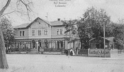

**_Foto:_** _historische Ansicht der Tolkewitzer Gastwirtschaft “Zum Anker”_

## Bellingrathstraße

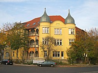Die Bellingrathstraße, eine kurze Verbindungsstraße zwischen Wehlener und Marienberger Straße, erhielt ihren heutigen Namen erst nach der Eingemeindung von Tolkewitz 1912. Zuvor wurde sie Laubegaster Straße genannt. Ewald Bellingrath (1838-1903) war Begründer der Kettenschiffahrt auf der Oberelbe und wurde 1901 für seine zahlreichen technischen Entwicklungen zum Ehrendoktor der Technischen Hochschule ernannt. 1883 hatte er in Übigau die erste deutsche Schiffbauversuchsanstalt gegründet. Sein Grab befindet sich auf dem nahe gelegenen [Johannisfriedhof](../../../ost/tolkewitz/johannisfriedhof/).

Das Areal an der Bellingrathstraße befand sich Ende des 19. Jahrhunderts im Besitz der Sächsischen Grund- und Hypothekenbank, die 1898 die ersten Erschließungsarbeiten veranlasste. 1902 beschloss der Tolkewitzer Gemeinderat, die neu angelegte Straße nach dem Nachbarort Laubegaster Straße zu nennen. In dieser Zeit entstanden hier repräsentative Wohnhäuser. Im Haus Bellingrathstraße 2 war ab 1905 für einige Jahre das erste Tolkewitzer Postamt untergebracht. Das repräsentative Eckgebäude (Nr. 1) beherbergte seit 1901 die Gaststätte “Sachsen-Hof”.

## Bockemühlstraße

Die Bockemühlstraße wurde erst nach 1990 in der Nähe des Tolkewitzer Straßenbahnhofes angelegt und erhielt 2001 den Namen des Verkehrsexperten und Technikers Alfred Bockemühl (1896-1992). Bockemühl entwickelte in den 20er Jahren die legendären Hecht-Straßenbahnwagen und war nach 1945 einige Jahre Direktor der Dresdner Verkehrsbetriebe.

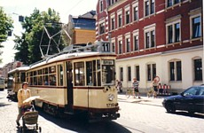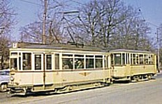

**_Fotos:_** _der von Bockemühl entwickelte Hechtwagen_

## Crottendorfer Straße

Die Crottendorfer Straße entstand nach 1990 beim Bau einer Wohnanlage zwischen Kipsdorfer Straße und Marienberger Straße. Ihren Namen erhielt sie am 2. November 1995 nach der Gemeinde Crottendorf im Erzgebirge.

## Donathstraße

Die zum größten Teil auf Laubegaster Flur verlaufende Donathstraße trug ab 1886 bis zur Eingemeindung des Ortes den Namen Seidnitzer Straße. Lediglich der kurze Tolkewitzer Abschnitt wurde bereits 1882 Donathstraße genannt. Der Name erinnert an die Brüder Carl Christian Rinaldo (1823-1897) und Christian Hermann Donath (1833-1909). Beide kauften 1872 den alten Tolkewitzer Gasthof und bauten diesen zum Vergnügungslokal [Donaths Neue Welt](../../../ost/tolkewitz/strassen_tolkewitz/alttolkewitz/donaths_neue_welt/) aus. Hermann Donath war außerdem als Fotograf tätig und erwarb später die [Kelterei Lockwitzgrund](../../../sudost/lockwitz/strassen_lockwitz/kelterei_lockwitzgrund/).

Auf Anregung des Tolkewitzer Gemeinderates sollte bereits 1904 auch der Laubegaster Teil an der Österreicher Straße in Donathstraße umbenannt werden. Dieses Ersuchen wurde von der Nachbargemeinde Laubegast jedoch abgelehnt. Erst nach der Eingemeindung beider Orte 1912 bzw. 1921 konnte schließlich eine einheitliche Benennung umgesetzt werden. Diese erfolgte auf Beschluss des Dresdner Stadtrates am 19. Februar 1926.

Neben Wohnhäusern befanden sich an der Donathstraße bereits vor dem Ersten Weltkrieg auch einige gewerbliche Unternehmen. So hatte im Haus Seidnitzer Straße 1 die Firma Sachsonia ihren Sitz. Gründer des metallverarbeitenden Betriebs war Reinhard Mörbitz, der die 1877 von seinem Vater an der Österreicher Straße gegründete Firma übernommen und erweitert hatte. Auf dem Nachbargrundstück (Nr. 3) gab es ab 1908 die Werkstatt von Max Baldeweg zur Herstellung von Kamerateilen, aus der später die Balda-Kamerawerke mit Sitz auf der Wilischstraße hervorgingen.

## Kipsdorfer Straße

Die über Tolkewitzer und Striesener Flur führende Straße geht auf einen alten Verbindungsweg zwischen beiden Orten zurück, welcher einst als Schwarzer Weg bezeichnet wurde. In der zweiten Hälfte des 19. Jahrhunderts siedelten sich hier mehrere Landschaftsgärtnereien an. Im Zuge der Bebauung der Fluren wurde auch dieser Weg ausgebaut und erhielt den Namen Bismarckstraße. Wenig später entstanden die ersten Wohnhäuser _(Foto)_.

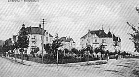

Um Verwechslungen mit gleichnamigen Straßen in anderen Stadtteilen zu vermeiden, wechselte die Namensgebung nach der Eingemeindung von Tolkewitz in Zeunerstraße. Mit dieser sollte der als Professor für Mechanik am Polytechnikum tätige Techniker Gustav Zeuner (1828-1907) geehrt werden. Da es jedoch bereits im neuen “Hochschulviertel” in der Südvorstadt eine Zeunerstraße gab, entschloss man sich in den Dreißiger Jahren zu einer erneuten Umbenennung in Kipsdorfer Straße. Der kleine Ort im Osterzgebirge ist beliebter Kur- und Erholungsort und Endpunkt der Weißeritztalbahn.

## Knappestraße

Die Mitte der Zwanziger Jahre im Zusammenhang mit dem Bau einer genossenschaftlichen Wohnsiedlung angelegte Knappestraße verdankt ihren Namen Carl Joseph Knappe (1847-1922). Knappe war ein Förderer des gewerblichen Genossenschaftswesens und gilt als Vorreiter der modernen Wohnungsgenossenschaften.

## Lewickistraße

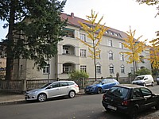Die Lewickistraße wurde in den Jahren vor dem Ersten Weltkrieg im Zusammenhang mit dem Bau einiger neuer Wohnhäuser östlich der Marienberger Straße angelegt. Ursprünglich Nordstraße genannt, erhielt sie ihren heutigen Namen nach dem Maschinenbau-Professor Leonidas Lewicki (1840-1907), der an der Technischen Hochschule unterrichtete. Sein Sohn Ernst Lewicki (1863-1937) wurde als Mozartforscher bekannt.

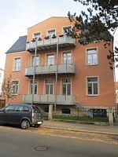Noch kurz vor Ausbruch des Ersten Weltkrieges entstand an der Lewickistraße 11-21 eine Reihenhausanlage, welche jedoch nicht mehr fertig gestellt werden konnte. 1927-1930 errichtete die Wohnungsbaugenossenschaft für Handwerk, Handel und Gewerbe in Dresden und Umgebung e.G.m.b.H. ein größeres Wohngebiet mit Mehrfamilienhäusern. An die Gründer dieser Genossenschaft, Baurat Martin William Axt und Architekt Otto Reinhardt erinnern bis heute Plastiken an den Hofeingängen an der Ecke Theodorstraße. 1945 wurde die Wohnanlage durch Bomben erheblich beschädigt, konnte jedoch bis 1957 wieder aufgebaut werden.

Hutfabrik (Nr. 41): Das Unternehmen entstand 1938, als Wilhelm Wethekam das Gebäude einer früheren Christbaum-Schmuckfabrik erwarb, um hier eine Uniformmützenfabrik einzurichten. Nach dem Zweiten Weltkrieg widmete sich der Betrieb der Fertigung ziviler Kopfbedeckungen und wurde 1949 in den VEB Vereinigte Dresdner Hutfabriken eingeliedert, welcher bis 1990 mehrere Betriebsteile in der Dresdner Umgebung besaß. Hauptsächlich wurden hier Damenhüte für den Export ins
westliche Ausland hergestellt. 1990 ging das Unternehmen in Insolvenz und musste schließen. 2009 wurden die Bauten der früheren Hutfabrik zu modernen Loftwohnungen umgebaut _(Bild rechts)_.

## [Marienberger Straße](../../../ost/seidnitz/strassen_seidnitz/)

## Nagelstraße

Ebenso wie ihre Nebenstraßen wurde auch die Nagelstraße während der Erschließung der Flächen östlich der Marienberger Straße kurz vor dem Ersten Weltkrieg angelegt. Ursprünglich wurde sie als Südstraße, später als Fabrikstraße bezeichnet. Bei der Umbenennung in den Zwanziger Jahren knüpfte man an eine nach der Eingemeindung von Tolkewitz entstandene Tradition an, neue Straßen nach verdienstvollen Professoren der TH zu benennen. Christian August Nagel (1821-1893) war als Professor für Geodäsie tätig und leitete einige Jahre den Mathematisch-Physikalischen Salon. An sein Wirken als Vermessungstechniker erinnert die [“Nagelsche Säule”](../../../sudwest/gompitz/unkersdorf/) im Ortskern von Unkersdorf. Zwischen 1927 und 1930 entstand an der Nagelstraße eine in den letzten Jahren sanierte genossenschaftliche Wohnanlage. Weitere Wohnblocks wurden zwischen 1960 und 1963 in Richtung Knappestraße erbaut.

## Rittershausstraße

Die Rittershausstraße, eine kleine Nebenstraße der Wehlener Straße in der Nähe des Straßenbahnhofes, erhielt ihren Namen nach dem Elektrotechniker Trajan Rittershaus (1843-1899), der zu den Lehrkräften der Technischen Hochschule gehörte.

## Salbachstraße

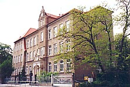Die Salbachstraße, bis 1912 Schulstraße genannt, verdankt ihren Namen dem Ingenieur und Dresdner Stadtbaurat Bernhard Salbach (1833-1894), der als eine seiner letzten Arbeiten die Entwürfe für das Tolkewitzer [Wasserwerk](../../../ost/tolkewitz/) schuf. Salbach selbst erlebte die Eröffnung des Werkes 1898 jedoch nicht mehr, sein Grab befindet sich auf dem Johannisfriedhof.

Zu den markanten Gebäuden der Salbachstraße gehört neben der 1951 eingeweihten [Bethlehemkirche](../../../ost/tolkewitz/bethlehemkirche/) das Tolkewitzer [Schulhaus](../../../ost/tolkewitz/), welches heute von der 44. Grundschule genutzt wird _(Foto)_.

## Schaufußstraße

Die Schaufußstraße wurde Ende des 19. Jahrhunderts im Zusammenhang mit der Bebauung dieses Gebietes mit Wohnhäusern angelegt. Hier verläuft die Flurgrenze zwischen den Stadtteilen [Neugruna](../../../ost/gruna/neugruna/) und Tolkewitz. Ursprünglich wurde das Stadtviertel, welches sich einst im Besitz von Seidnitzer Bauern befand, Neuseidnitz genannt. Im Eckhaus zur Wehlener Straße befand sich viele Jahre die Gaststätte “Wehlener Hof”. 1990 wurde in deren Räumen die nach einem Film benannte Szenekneipe “Cholera” eingerichtet, die zu den ersten ihrer Art in Dresden gehörte, mittlerweile jedoch wieder geschlossen hat.

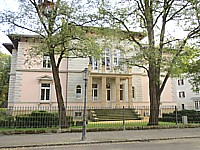Museum Ludwig Salvator (Nr. 19): Das naturkundliche Museum wurde am 29. Juni 1879 von Ludwig Wilhelm Schaufuß gegründet. Der Insektenforscher hatte sich durch den Verkauf von Tierpräparaten und naturkundlichen Lehrmitteln ein großes Vermögen erarbeitet und dieses in eine umfangreiche Sammlung von Insekten, ausgestopften Vögeln, Amphibien, Skeletten u.a. investiert. Um diese Sammlung auch der Öffentlichkeit präsentieren zu können, ließ sich Schaufuß von 1877-79 durch den Architekten Ernst Giese ein repräsentatives Ausstellungsgebäude im Stil der Florentiner Renaissance errichten. Benannt wurde das Entomologische Museum nach Ludwig Salvator, Erzherzog von Österreich und Prinz der Toskana, der sich ebenfalls intensiv mit naturkundlichen Fragen befasste.

Insgesamt umfasste die Sammlung ca. 60-80.000 Objekte, darunter über 50.000 Insekten, 2000 Vogelpräparate und ca. 400 in Spiritus eingelegte Amphibien. Hinzu kamen zahlreiche Gemälde. Allerdings geriet Schaufuß schon bald in wirtschaftliche Schwierigkeiten, wozu auch die abseitige Lage des Museums beitrug. 1884 übergab er die Sammlung sowie sein Naturaliengeschäft an seinen Sohn Camillo und verzog nach Meißen. Wenig später schloss das Museum seine Pforten und wurde1887 ebenfalls nach Meißen verlegt. Da sich die finanzielle Lage jedoch nicht wesentlich verbesserte, entschloss sich Camillo Schaufuß, die Exponate an die Universitäten von Berlin, Leipzig und Freiberg zu übergeben, wo sie bis heute zum Sammlungsbestand gehören. Das Gebäude des früheren Museum wurde später als Wohnhaus genutzt und nach 1990 saniert. Heute haben hier verschiedene Firmen ihre Büros.

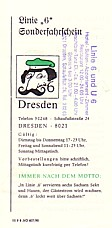Maygarten:  Die Gaststätte “Maygarten” auf der Schaufußstraße 24, besser bekannt als “Linie 6”, gehörte zu den originellsten Dresdner Lokalen und wurde 1977 in einem um 1900 errichteten Wohnhaus eröffnet. Inhaber war viele Jahre der Dresdner Gastronom Karl-Heinz Bellmann, Ehemann der bekannten DDR-Unterhaltungskünstlerin Dorit Gäbler. Neben den häufigen Auftritten von Prominenten unterschiedlichster Berufe trug vor allem die originelle Ausstattung der Gaststätte im Straßenbahn-Stil zur Popularität bei.

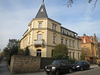In den Gasträumen befand sich neben Haltestellenschildern, Sitzbänken und anderem Straßenbahnzubehör auch eine Sammlung von Schaffnermützen aus aller Welt. Im Garten fand ein Straßenbahntriebwagen von 1898 Aufstellung. Der Keller des Hauses war im U-Bahn-Stil als Kellerbar “U 6” gestaltet. Im Januar 2003 schloss die “Linie 6” ihre Pforten. Das Inventar sowie die historische Straßenbahn wurden 2005 verkauft und sind seit Mai 2008 in der Gaststätte “Anno 1900” am Neumarkt in der Dresdner Innenstadt zu sehen. Das Gebäude in Tolkewitz dient heute Wohnzwecken.

## Schlömilchstraße

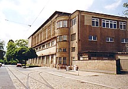Die ursprünglich wegen ihrer Nähe zum Tännicht Waldstraße genannte Straße erhielt nach der Eingemeindung des Ortes den Namen Schlömilchstraße. Oskar Schlömilch (1823-1901) war als Professor für Höhere Mathematik an der Technischen Hochschule tätig. 1897 gründete der Gastwirt Hermann Bobe auf der Schlömilchstraße sein Restaurant, welches später unter dem Namen “Waldfrieden” zum Besuch einlud. Ab 1919 gab es an der Schlömilch- und Wehlener Straße die Gärtnerei Schleinitz. Heute wird die Straße von den unter Denkmalschutz stehenden Gebäuden des Straßenbahnhofes _(Foto)_ geprägt.

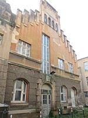Volksbad (Nr. 4): Das Gebäude des späteren Volksbades entstand um 1900 als Kraftwerk mit Maschinenhalle zur autarken Versorgung des Betriebshofes der Straßenbahn. Nach dem Ersten Weltkrieg wurde diese Art der Energieversorgung aufgegeben und 1928 im Gebäude ein Reinigungsbad für die Angestellten des Straßenbahnhofs eingerichtet. Später durften auch die Anwohner die nun als "Volksbad Tolkewitz" bezeichnete Einrichtung nutzen. Außerdem diente das Haus als Hauptlager für die Straßenbahnwerkstatt. Die Büroräume wurden ab 1980 von der Einkaufsabteilung der Dresdner Verkehrsbetriebe genutzt. Im Keller gab es einen Schießstand der Betriebsgruppe der "Gesellschaft für Sport und Technik". Mit Aufgabe des Straßenbahnhofes zogen 2003 die letzten Nutzer aus. Das leerstehende und zunehmend verfallene Gebäude soll künftig zu Wohnzwecken ausgebaut werden. Die Übergabe ist für 2017 geplant.

## Schulze-Delitzsch-Straße

Die in den Zwanziger Jahren angelegte Schultze-Delitzsch-Straße erinnert an den Politiker Hermann Schultze-Delitzsch (1808-1883). Schulze-Delitzsch war im 19. Jahrhundert im Staatsdienst tätig und gehörte 1848 der Nationalversammlung an. Ein Jahr später rief er in Delitzsch eine Schuhmachergenossenschaft ins Leben und war damit Begründer des deutschen Genossenschaftswesens. Auf seine Initiative entstanden in Sachsen die ersten genossenschaftlichen Zusammenschlüsse von Kleinunternehmen und Handwerksbetrieben. Außerdem gilt er durch die von ihm initiierten Spar- und Konsumvereine als “Vater” der Sparkassen.

Auch die Ende der Zwanziger Jahre zu beiden Seiten der Schulze-Delitzsch-Straße entstandenen Wohnhäuser gehen auf eine nach seinen Grundsätzen tätige gemeinnützige Genossenschaft zurück. In zwei Bauabschnitten errichtete die Wohnungsbau- Genossenschaft für Handwerk, Handel und Gewerbe e.G.m.b.H. zwischen 1927 und 1930 mehrgeschossige Wohnblocks in Anklängen an den Bauhausstil.

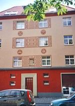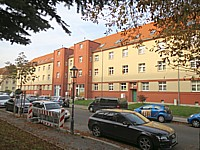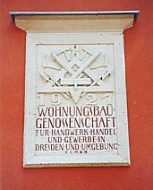

**_Fotos:_** _Wohnanlage an der Schulze-Delitzsch-Straße_

## Theodorstraße

Die Ende des 19. Jahrhunderts in Neutolkewitz angelegte Theodorstraße verdankt ihren Namen dem früheren Tolkewitzer Ziegeleibesitzer Theodor Zschimmer, der hier ein Grundstück besaß. Im Haus Nr. 2 befand sich einst die 1901 von Michael Sturm eröffnete Gastwirtschaft “Lindenhof”. Unweit davon besaßen einst die Balda-Kamerawerke ihre Produktionshallen. Die Südseite der Theodorstraße wird von einer um 1930 entstandenen genossenschftlichen Wohnanlage eingenommen.

## Toeplerstraße

Die Toeplerstraße wurde um 1900 als östlicher Abschluss der Wohnsiedlung an der Marienberger Straße angelegt. Bis zur Eingemeindung von Tolkewitz hieß diese Straße Albertstraße. Der heutige Name erinnert an den Physiker August Josef Ignaz Toepler (1836-1912), der zwischen 1876 und 1900 an der Technischen Hochschule als Professor für Experimentalphysik lehrte und mit seinen Vorlesungen zum Weltruf dieser Einrichtung beitrug. Sein Grab befindet sich auf dem Tolkewitzer Johannisfriedhof.

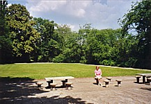In den Zwanziger Jahren entstanden an der Toeplerstraße genossenschaftliche Wohnbauten.
An die Gründer der hier tätigen Wohnungsbaugenossenschaft für Handwerk, Handel und Gewerbe in Dresden und Umgebung e.G.m.b.H. erinnern zwei Plastiken an der Ecke Toepler-/Theodorstraße und am gegenüberliegenden Hofeingang zur Lewickistraße. Kurz nach Vollendung der Bauten entstand auf der gegenüberliegenden Straßenseite der Toeplerpark (Volkspark Tolkewitz) mit Sport- und Spielplätzen _(Foto)_. Weitere Flächen werden von Kleingärten und dem angrenzenden [Niedersedlitzer Flutgraben](../../../ost/niedersedlitz/niedersedlitzer_flutgraben/) eingenommen.

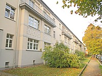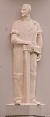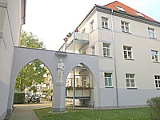

**_Fotos:_** _Wohnanlage an der Toeplerstraße_

## [Wehlener Straße](../../../ost/tolkewitz/strassen_tolkewitz/wehlener_strasse/)

## Wilischstraße

Die ursprünglich nach dem benachbarten Ort Dobritzer Straße genannt Straße wurde Ende des 19. Jahrhunderts angelegt und nach der Eingemeindung von Tolkewitz in Wilischstraße umbenannt. Ihren Namen verdankt sie dem 476 Meter hohen Berg Wilisch (= Wolfsberg), einem erloschenen Vulkan in der Nähe von Kreischa. 1963 wurde an der Wilischstraße ein kleines Neubaugebiet mit insgesamt ca. 520 Wohnungen angelegt.

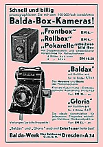Balda-Kamerawerk: Bereits 1908 gründete der Mechaniker Max Baldeweg auf der Donathstraße 3 in Laubegast seine Firma zur Herstellung von Zubehörteilen für die Dresdner Kameraindustrie. Noch vor dem Ersten Weltkrieg verlegte er den Sitz zur Wilischstraße 1, wo der Betrieb unter dem Warenzeichen “Balda” zunächst Kameraverschlüsse, Selbstauslöser und Messgeräte, ab 1925 auch komplette Kameras produzierte. Mit Modellen wie der “Balda-Boxkamera”, der “Baldina” und der
“Super-Baldina” entwickelte sich das Unternehmen zu einem der bekanntesten Dresdner Kamerahersteller und beschäftigte 1938 ca. 570 Mitarbeiter. Während des Zweiten Weltkrieges wurden hier Höhenmesser und Variometer für die deutsche Luftwaffe hergestellt, bevor die Bomben den Betrieb 1945 weitgehend zerstörten.

Nachdem ein Wiederaufbau des Betriebes durch die Inhaber Max Baldeweg und Direktor Willibald Lauterbach als unmöglich erschien, verließen diese 1946 Dresden und gründeten im westfälischen Bünden ein neues Werk. Der Dresdner Betrieb nahm als VEB die Produktion in eingeschränktem Maß wieder auf, wechselte 1951 seinen Namen in Belca-Werk und ging 1956 im VEB Kamera-Werke Niedersedlitz auf.

[Tolkewitz auf OpenStreetMap](https://www.openstreetmap.org/search?query=Dresden+Tolkewitz)

* * *

 \[ [Home](../../../index.html)\] \[ [Nord](../../../nord/)\] \[ [Nordwest](../../../nordwest/)\] \[ [Neustadt](../../../neustadt/)\] \[ [Nordost](../../../nordost/)\] \[ [West](../../../west/)\] \[ [Zentrum](../../../zentrum/)\] \[ [Südwest](../../../sudwest/)\] \[ [Süd](../../../sud/)\] \[ [Südost](../../../sudost/)\] \[ [Ost](../../../ost/)\] \[ [Register](../../../Register/register.html)\] \[ [Kontakt](../../../Kontakt/kontakt.html)\] \[ [Impressum](../../../impressum/)\]
