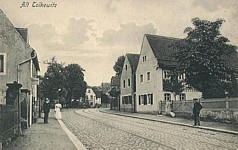
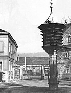

* * *

* * *

Die Straße Alttolkewitz, eigentlich eine Verlängerung der Wehlener Straße, bildet den
Kern des früheren Gassendorfes und wurde deshalb bis zur Eingemeindung des Ortes Hauptstraße genannt. Zu beiden Seiten standen einst die Gehöfte und Häusleranwesen des Dorfes. Größtes Tolkewitzer Gut war ursprünglich der Hof Alttolkewitz Nr. 5, der vermutlich mit dem Nachbargut Nr. 7 eine Einheit bildete und sich zeitweise im Besitz
des Grafen Hoym befunden haben soll. In einem weiteren Bauerngut (Nr. 19) wohnte im 18. Jahrhundert der als “Bauernastronom” bekannt gewordene Zwirnhändler Christian Gärtner.

Am 24. August 1873 fielen die meisten Gehöfte von Alttolkewitz einem verheerenden Großbrand zum Opfer. Zu den wiederaufgebauten und erhaltenen Gebäuden gehören die Nr. 15, 16, 18 und 23 sowie die beiden Bauerngüter Alttolkewitz Nr. 21 und 22 _(Foto)_. In diesem Gebiet befand sich auch der alte Dorfgasthof, aus dem Ende des 19. Jahrhunderts das beliebte Tanz- und Vergnügungslokal [“Donaths Neue Welt”](../../../../ost/tolkewitz/strassen_tolkewitz/alttolkewitz/donaths_neue_welt/) hervorging. In der Villa des Unternehmers Otto Jank (Alttolkewitz 14) war zwischen 1873 und 1902 das erste Tolkewitzer [Gemeindeamt](../../../../ost/tolkewitz/) untergebracht. Heute werden die meisten Gebäude als Wohnhäuser bzw. zu gewerblichen Zwecken genutzt.

Einzelne Gebäude:

Nr. 7: Die Bauten entstanden in ihrer heutigen Form nach dem Dorfbrand 1873 und wurden noch bis zum Ersten Weltkrieg landwirtschaftlich genutzt. Später erwarb der Dresdner Rechtsanwalt und Papierwarenhändler Kaiser das
Anwesen und wandelte es zum Sommerwohnsitz um. 1938 erfolgte ein Verkauf des Gutes, welches nun mehrfach seine Besitzer wechselte. Nach 1990 wurde der unter Denkmalschutz stehende Bauernhof saniert und 1993/94 zum Hotel “Alttolkewitzer Hof” umgebaut _(im Bild links)_.

Nitzsches Weinstuben (Nr. 9): Dieses ehemalige Bauerngut beherbergte um 1900 die kleine Schankwirtschaft “Nitsches
Weinstuben”, eines von mehreren kleinen Lokalen im alten Dorfkern. Seit 1968 hat in diesem Haus der renommierte Dresdner Ansichtskartenverlag [A. & R. Adam](../../../../ost/tolkewitz/strassen_tolkewitz/alttolkewitz/adam-ansichtskartenverlag/) seinen Firmensitz.

Nr. 10: Das Haus gehörte vor 1945 dem Tongrubenbesitzer Zschimmer, der die reichen Tonvorkommen der Umgebung zur Herstellung verschiedener Keramikprodukte nutzte. 1909 richtete hier der "Alte Tierschutzverein" ein Pferdeheim ein. 1936 wurde das Gebäude umgebaut und aufgestockt. Heute dient es als Unterrichtsstätte der privaten Hotel- und Gaststättenfachschule HOGA.

Nr. 15 (ehem. Nr. 13): Das Gebäude entstand im Kern wahrscheinlich um 1650 und soll zeitweise als Stallgebäude des Grafen Hoym, Finanzminister August des Starken und Ehemann der Gräfin Cosel, genutzt worden sein. 1873 wurde es wie die meisten Alttolkewitzer Gehöfte beim Dorfbrand schwer beschädigt, blieb jedoch in seiner Grundsubstanz erhalten. Ursprünglich war es Teil eines Dreiseitenhofes, zu welchem auch das vor einigen Jahren abgerissene Nachbarhaus (ehem. Nr. 15) gehörte. Hier befand sich früher die Kolonialwarenhandlung Böhme. Die verbliebenen Teile des unter Denkmalschutz stehenden Gutes konnten nach 1990 saniert werden und beherbergen heute eine private Zimmervermietung _(Foto)_.

Nr. 16:  Das unter Denkmalschutz stehende Wohnhaus _(Foto)_ entstand nach dem Dorfbrand von 1873 durch Umbau des früheren Stallgebäudes. Vom Vorgängerbau ist noch ein Kellereingang und ein Brunnen erhalten. Eine originelle
Besonderheit ist ein aus Ziegeln gemauerter kleiner Uhrturm im Hof, in dem früher zwei Glocken läuteten.

Nr. 19: Das heute nicht mehr vorhandenen Gehöft Nr. 19 besaß im 18. Jahrhundert der “Bauernastronom” Christian Gärtner (1705-1782). Der hauptberuflich im Zwirnhandel tätige Gärtner befasste sich seit seiner Jugend mit Astronomie und stellte auch selbst Fernrohre und andere astronomische Geräte her. Er war eng mit Johann Georg Palitzsch befreundet, der hier 1746 erstmals durch ein Fernrohr den Sternenhimmel beobachten konnte. 1994 wurden die letzten verbliebenen Gebäude dieses Anwesens abgerissen.

Augustushof (Nr. 22): Bemerkenswert ist der gut erhaltene Bauernhof Alttolkewitz Nr. 22, welcher bereits 1628 erwähnt wurde. Das zu den größeren Tolkewitzer Bauerngütern gehörende Anwesen befand sich ab 1705 im Besitz der Familie Hähnichen, an die noch die Initialien A. H. (August Hähnichen) über dem Eingang und verschiedene Schrifttafeln an den Gebäuden erinnern. Karl August Hähnichen (1842-1917) übte 25 Jahre lang das Amt eines Gemeindevorstandes aus und war zugleich Mitglied des Schulvorstandes und mehrerer Tolkewitzer Vereine. Auf ihn geht der Name “Augustushof” für dieses Anwesen zurück.

_Inschriften an der Scheune des Augustushofes_

Sein heutiges Aussehen erhielt das Gut durch mehrere Umbauten zwischen 1828 und 1893. Wesentliche Teile stammen aus der Wiederaufbauphase nach dem Dorfbrand von 1873. Interessant ist das im Hof des Dreiseithofes befindliche historische Taubenhaus _(Foto)_, eines der letzten seiner Art im Dresdner Raum. Noch bis nach 1990 bewohnten Nachkommen der Familie Hähnichen den seit 1958 nur noch zu Wohnzwecken genutzten Bauernhof. 1999 erfolgte eine umfassende Sanierung des unter Denkmalschutz stehenden Gebäudekomplexes.

“Werners” (Nr. 29): Das Gebäude der früheren Dorfschmiede befand sich Ende des 19. Jahrhunderts im Besitz von Karl Werner, der 1896 die Konzession zum Bier- und Branntweinausschank erhielt und in diesem Haus eine kleine Gaststätte einrichtete. Sein Sohn Max gründete 1919 das Tolkewitzer Sport- und Keglerheim mit Kegelbahn, welches zugleich Vereinslokal des "Kegelclubs Sonnenstrahl" war. Nach Karl Werners Tod wurde die Schankwirtschaft noch bis nach dem Zweiten Weltkrieg von dessen Tochter weitergeführt und um 1950 geschlossen.

* * *

 \[ [Home](../../../../index.html)\] \[ [Nord](../../../../nord/)\] \[ [Nordwest](../../../../nordwest/)\] \[ [Neustadt](../../../../neustadt/)\] \[ [Nordost](../../../../nordost/)\] \[ [West](../../../../west/)\] \[ [Zentrum](../../../../zentrum/)\] \[ [Südwest](../../../../sudwest/)\] \[ [Süd](../../../../sud/)\] \[ [Südost](../../../../sudost/)\] \[ [Ost](../../../../ost/)\] \[ [Register](../../../../Register/register.html)\] \[ [Kontakt](../../../../Kontakt/kontakt.html)\] \[ [Impressum](../../../../impressum/)\]
