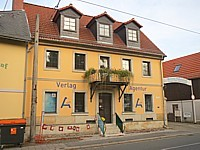

* * *

* * *

Der Verlag A. & R. Adam wurde am 1. Juli 1912 von den Brüdern Arno und Rudolf
Adam als Adam´s Kunstverlag gegründet und gehört bis heute zu den bedeutendsten Ansichtskartenverlagen in Sachsen. Erster Firmensitz war das Wohnhaus Am See 18, in
welchem sich die Geschäfts- und Verkaufsräume befanden. 1919 verlegten die Inhaber ihren Verlag zur Annenstraße 26 und benannten ihn in A. & R. Adam um. Neben dem
Groß- und Einzelhandel mit Papierwaren stand von Anfang an die Herstellung von Post- und Ansichtskarten im Mittelpunkt. Obwohl der Bau einer eigenen Druckerei nicht
zustande kam, erwarb sich die Firma schon bald einen guten Ruf und konnte expandieren. 1926 wurde der Verlag von
Philipp Krebs durch Rudolf Adam übernommen. Die Luftangriffe vom 13. Februar 1945 zerstörten auch das Gebäude
an der Annenstraße, wobei das wertvolle Archiv mit historischen Fotografien teilweise verbrannte. Die Dank ihrer
Auslagerung in die Privatwohnung in Reick erhaltenen Teile gehören seit 1996 zum Bestand der Deutschen Fotothek.

In der Nachkriegszeit gelang es der Familie, ihr Unternehmen trotz schwieriger Bedingungen fortzuführen, zunächst in
gemieteten Räumen in Reick, ab 1952 in einem der wenigen unzerstörten Häuser auf der Kleinen Meißner Gasse 3 in
der Nähe des Neustädter Marktes. Leider fiel dieses Haus 1968 der Umgestaltung des Stadtviertels zum Opfer, so dass auch der Verlag A. & R. Adam zu einem erneuten Umzug gezwungen war. Seit 1968 befindet sich das
Familienunternehmen, welches auch zu DDR-Zeiten nie verstaatlicht wurde, in Alttolkewitz Nr. 9 _(Foto oben)_. Neben
Postkarten und Kalendern, meist mit Motiven aus der Dresdner Umgebung, werden heute auch Prospekte, Programmhefte und ähnliche Druckerzeugnisse hergestellt. Bemerkenswert ist das Bildarchiv, welches mittlerweile auf
fast 20.000 verschiedene Motive angewachsen ist und ein wichtiges Zeugnis der Stadtgeschichte darstellt. Seit 1989 befindet sich das Unternehmen im Besitz von Hans-Jörg Kluge.

**_Fotos:_** _Zwei Postkarten aus dem Verlagsprogramm von A. & R. Adam - links das Schauspielhaus,_

_rechts eine historische Ansicht des Striezelmarktes auf dem Altmarkt._

* * *

 \[ [Home](../../../../../index.html)\] \[ [Nord](../../../../../nord/)\] \[ [Nordwest](../../../../../nordwest/)\] \[ [Neustadt](../../../../../neustadt/)\]
 \[ [Nordost](../../../../../nordost/)\] \[ [West](../../../../../west/)\] \[ [Zentrum](../../../../../zentrum/)\] \[ [Südwest](../../../../../sudwest/)\]
 \[ [Süd](../../../../../sud/)\] \[ [Südost](../../../../../sudost/)\] \[ [Ost](../../../../../ost/)\] \[ [Register](../../../../../Register/register.html)\] \[ [Kontakt](../../../../../Kontakt/kontakt.html)\] \[ [Impressum](../../../../../impressum/)\]
