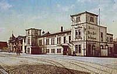
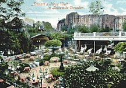
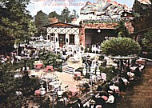
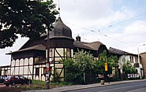

* * *

Das beliebte Tolkewitzer Vergnügungsetablissement “Donaths Neue Welt” entstand aus dem einstigen Dorfgasthof und wurde 1873 unter seinem neuen Namen eröffnet. Besitzer waren die beiden Brüder Hermann und Rinaldo Donath, die sich auch als Fotografen einen guten Ruf erwarben. Rinaldo Donath hatte zuvor bereits als Gastwirt des Blasewitzer “Goethegartens” gastronomische Erfahrungen sammeln können. 1893 übernahm Emil Böbber “Donaths Neue Welt. Später führte der Gastwirt Karl Wattig den Betrieb weiter. 1902 entstand ein großzügiges neues Gaststättengebäude im altdeutschen Fachwerkstil _(Foto)_.

Zu “Donaths Neue Welt” gehörte neben den rustikal gestalteten Gasträumen und dem Saal ein großer Gästegarten mit verschiedenen Attraktionen, die den Gasthof weit über Dresdens Grenzen hinaus bekannt machten. So ließen die Besitzer aus Holz und Pappmaché eine Alpenkulisse erbauen, die mit Hilfe von Lampen illuminiert werden konnte, um so das “Alpenglühen” zu imitieren. Außerdem gab es eine künstliche Ruine mit Märchengrotte, einen Konzertplatz für regelmäßige Blaskonzerte, Spielgeräte, einen kleinen Tierpark und ähnliches. 1933 feierten die Besitzer mit einem großen Festumzug und dem Pflanzen einer “Donath-Eiche” das 60-jährige Bestehen ihrer Gastwirtschaft. Bis in die Nachkriegszeit fanden im Ballsaal _(Bild rechts)_ regelmäßig Bälle und andere Vergnügungen statt.

**_Fotos:_** _Blick in den Garten von “Donaths Neue Welt” mit Musikpavillon und Alpenpanorama_

In den Jahren nach 1945 war der Tolkewitzer Gasthof nochmals Schauplatz für verschiedene Kultur- und Sportveranstaltungen. Da die Spielstätten der Innenstadt sämtlich zerstört waren, traten hier Künstler der Staatsoper und der Dresdner Theater auf. Hinzu kamen Betriebsfeste, aber auch Veranstaltungen der evangelischen Bethlehem-Gemeinde und einiger Sportvereine. 1956 endete der Gastronomiebetrieb. Das Gebäude wurde fortan als Lager der GHG Haushaltwaren genutzt _(Foto im Frühjahr 2004)_.

Nach 1990 scheiterten Pläne, das Anwesen zu verkaufen und für eine neue Nutzung umzubauen. Am 20. August 2004 fiel der historische Gasthof einem Großbrand zum Opfer. Erhalten blieb lediglich ein Teil des Vordergebäudes, welches 2010 zugunsten eines modernen Büro- und Geschäftshauses abgerissen wurde. Im ehemaligen Gästegarten steht heute ein Lebensmittelmarkt.

* * *

 \[ [Home](../../../../../index.html)\] \[ [Nord](../../../../../nord/)\] \[ [Nordwest](../../../../../nordwest/)\] \[ [Neustadt](../../../../../neustadt/)\]
 \[ [Nordost](../../../../../nordost/)\] \[ [West](../../../../../west/)\] \[ [Zentrum](../../../../../zentrum/)\] \[ [Südwest](../../../../../sudwest/)\]
 \[ [Süd](../../../../../sud/)\] \[ [Südost](../../../../../sudost/)\] \[ [Ost](../../../../../ost/)\] \[ [Register](../../../../../Register/register.html)\] \[ [Kontakt](../../../../../Kontakt/kontakt.html)\] \[ [Impressum](../../../../../impressum/)\]
