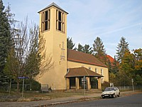

* * *

[Bethlehemkirche  dresden-tolkewitz  pfarramt: marienberger str. 65 01279 dresden  tel. 0351/2516539](http://www.bethlehemkirche-dresden.de)

Nachdem Tolkewitz jahrhundertelang zur Parochie der Leubener Himmelfahrtskirche
gehört hatte, kamen in den Jahren nach dem Ersten Weltkrieg Pläne auf, ein eigenes Gotteshaus zu errichten. Diese konnten jedoch zunächst nicht realisiert werden.
Stattdessen versammelte man sich ab 1938 in einem provisorischen Betsaal in einem ausgebauten Stallgebäude eines Alttolkewitzer Bauerngutes. Noch heute erinnert der
Name Bethlehemkirche an diesen schwierigen Beginn der kirchlichen Arbeit.

Erst im Dezember 1950 erfolgte an der Salbachstraße/ Ecke Kipsdorfer Straße die Grundsteinlegung für eine eigene
Kirche. Das Gebäude wurde vom Architekten Wolfgang Rauda entworfen und war erster evangelischer Kirchenneubau in der DDR. Für den Bau wurde u. a. Abbruchmaterial aus einem zerbombten Grundstück an der Nagelstraße
verwendet. Tolkewitzer Firmen übernahmen verschiedene Bauleistungen und beteiligten sich an der Finanzierung des
Vorhabens. Weitere Mittel stammten aus Spenden von lutherischen Kirchen aus dem Ausland, insbesondere aus den USA.

Die Einweihung der Bethlehemkirche fand ein Jahr nach Baubeginn im Dezember 1951 statt. Zunächst nur provisorisch
ausgestaltet, erfolgte wenig später der Einbau der Kirchenbänke, 1955 die Weihe einer Jehmlich-Orgel. 1956 schuf der
Dresdner Künstler Bernhard Weiß ein schlichtes Kruzifix aus Eichenholz. Im Jahr 1965 erhielt das Gebäude schließlich
noch seinen Turm, in dem vier in Apolda gegossene Bronzeglocken läuten. An der Außenwand befindet sich neben Krippe und Kreuz der Stern von Bethlehem, dem die Kirche ihren Namen verdankt. 2003 begann die umfassende
Sanierung des Gebäudes. Seit 2006 bildet die Bethlehemkirche mit der Versöhnungskirche Striesen und der Heilig-Geist-Kirche in Blasewitz eine gemeinsame Kirchgemeinde, der derzeit ca. 6000 Mitglieder angehören.

* * *

 \[ [Home](../../../../index.html)\] \[ [Nord](../../../../nord/)\] \[ [Nordwest](../../../../nordwest/)\] \[ [Neustadt](../../../../neustadt/)\] \[ [Nordost](../../../../nordost/)\] \[ [West](../../../../west/)\] \[ [Zentrum](../../../../zentrum/)\] \[ [Südwest](../../../../sudwest/)\] \[ [Süd](../../../../sud/)\] \[ [Südost](../../../../sudost/)\] \[ [Ost](../../../../ost/)\] \[ [Register](../../../../Register/register.html)\] \[ [Kontakt](../../../../Kontakt/kontakt.html)\] \[ [Impressum](../../../../impressum/)\]
