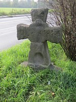
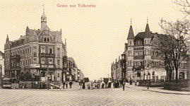
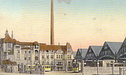
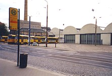
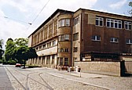
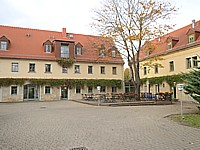
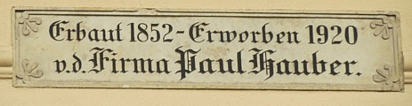
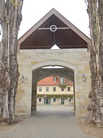

* * *

Die Wehlener Straße ist Teil der wichtigen in Richtung Osten führenden Verbindungsstraße zwischen dem Stadtzentrum und Kleinzschachwitz. Ihren Namen, den sie nur auf Tolkewitzer Flur trägt, erhielt sie nach der kleinen Stadt Wehlen in der Sächsischen Schweiz. Vor der Eingemeindung wurde sie Dresdner Straße genannt. Ältestes Zeugnis ist ein mittelalterliches Sühnekreuz in der Nähe der Brücke des [Niedersedlitzer Flutgrabens](../../../../ost/niedersedlitz/niedersedlitzer_flutgraben/) _(Foto)_.

Noch um 1880 führte die Straße zwischen der Ortsgrenze zu Neugruna und dem Tolkewitzer Dorfkern weitgehend durch bewaldetes Gebiet. Erst nach Anlage des [Johannisfriedhofes](../../../../ost/tolkewitz/johannisfriedhof/), dem Bau des Straßenbahnhofes und des Tolkewitzer [Wasserwerkes](../../../../ost/tolkewitz/) entstanden hier Wohn- und Geschäftshäuser, Blumengeschäfte und Steinmetzwerkstätten, die für den Bedarf des Friedhofes produzierten. Hinzu kamen ausgedehnte Flächen für die ortsansässigen Gärtnereien. Bekannteste Unternehmen dieser Branche waren neben der Baumschule Hauber die um 1919 gegründete Gärtnerei Schleinitz sowie die Gärtnerei von Ludwig Richard Richter. Diese befand sich ursprünglich am Pohlandplatz und wurde erst 1900 ins Tännicht verlegt. Der Volksmund nannte den Betrieb wegen seiner abseitigen Lage vom Ort “Sansibar”. Der Abschnitt zwischen Wasserwerk und Alttolkewitz blieb hingegen bis heute unbebaut, da die Flächen als Überschwemmungsgebiet der Elbe in Hochwasserzeiten dienen.

**_Foto:_** _Historische Ansicht der Wehlener Straße / Ecke Bellingrathstraße._

_Im linken Eckhaus befand sich früher das Hotel Sachsen-Hof._

Einzelne Gebäude:

Gasthof “Zum Anker”: Das kleine Lokal entstand um 1880 auf der Wehlener Straße 26 und gehörte mit seinem Gästegarten zu den beliebtesten Lokalen im Ortsteil Neutolkewitz.

Nr. 27: Die Ende des 19. Jahrhunderts entstandene sogenannte “Richtersche Villa” wurde nach 1945 als Sowjetische Kommandantur genutzt.

Nr. 28 (Bäckerei Gradel): Das traditionsreiche Familienunternehmen wurde 1919 von Max Gradel auf der Striesener Straße 27/29 gegründet und bestand aus einer Konditorei mit angeschlossenem Café sowie einem zugehörigen Lieferservice. 1945 fiel das Gebäude den Bomben zum Opfer, so dass Gradel seinen Betrieb 1949 zur Wehlener Straße 28 nach Tolkewitz verlegen musste. Hier wird die Firma als älteste ununterbrochen in Familienbesitz befindliche Konditorei Dresdens bis heute fortgeführt.

Straßenbahnhof Tolkewitz: Nachdem Tolkewitz und Laubegast bereits 1893 Straßenbahnanschluss erhalten hatten, entstand ab 1896 auf dem Gelände eines früheren Bauerngutes der Tolkewitzer Straßenbahnhof. In diesem Jahr erwarb die Dresdner Straßenbahn-Gesellschaft vom Bauern Palitzsch 100.000 m² Ackerland und ließ hier zwei Abstellhallen errichten. 1899 konnte die Anlage in Betrieb genommen werden. 1901 folgte an der Schlömilchstraße ein eigenes Kraftwerk zur Stromversorgung des Betriebshofes. Hinzu kamen ein Verwaltungsgebäude und verschiedene Nebenanlagen.

Nach seiner Erweiterung zwischen 1924 und 1927 um zwei zusätzliche Hallen und die Inbetriebnahme der Hauptwerkstatt an der Kipsdorfer Straße war der Tolkewitzer Straßenbahnhof größter Betriebshof der Stadt. In den Räumen des stillgelegten Kraftwerkes richtete man 1928 ein Volksbad für die Angestellten ein. 1945 führten Bombenabwürfe zu erheblichen Schäden an den Gebäuden. Trotzdem gelang schon 1947 die Wiederinbetriebnahme des Straßenbahnhofes. Ab 1969 war der Betriebshof Hauptwerkstatt der Dresdner Verkehrsbetriebe und für die Wartung eines Großteils der Straßenbahnfahrzeuge zuständig. Größeren Schaden richtete 1986 ein Brand in den unter Denkmalschutz stehenden Hallen an. In den Jahren nach 1990 wurden Teile der Betriebswerkstätten nach Trachenberge und Gorbitz verlegt und der Straßenbahnhof am 3. September 2007 komplett geschlossen. Künftig ist hier der Neubau eines Gymnasiums und einer Oberschule geplant. Dafür wurden die ehemaligen Hallen 2016 zum Großteil abgerissen, weitere Gebäude bleiben aus Gründen des Denkmalschutzes erhalten. Die Fertigstellung ist für 2017 vorgesehen.

**_Fotos:_** _Der Straßenbahnhof Tolkewitz um 1910 (links) und 2004 (Mitte/rechts)_

Gutshof Hauber (Nr. 62): Die Gebäude des Gutshofes Hauber entstanden um 1850 und waren ab 1920 Betriebsteil der bekannten Tolkewitzer Baumschule Hauber. Inhaber war der aus Stuttgart stammende Gärtnermeister Paul Hauber (1867-1930), der zuvor als Obergärtner in der Baumschule Mietzsch in Niedersedlitz beschäftigt war. 1893 gründete Hauber mit finanzieller Unterstützung des wohlhabenden Bankiers Arthur Pekrun eine Baumschule für Form- und Spalierobst. Das Unternehmen an der Kipsdorfer Straße entwickelte sich in den Folgejahren zu einem der bedeutendsten Gärtnereibetriebe im Dresdner Raum und züchtete neben Obstbäumen auch Rosen, Koniferen und andere Ziergehölze.

 Der wirtschaftliche Erfolg ermöglichte Paul Hauber 1896 den Bau einer Villa in Tolkewitz. 1911 erwarb er zwei Pavillons der I. Internationalen Hygieneausstellung und ließ diese auf sein Betriebsgelände umsetzen, wo sie als Kontor und Packschuppen genutzt wurden. Nach dem Ersten Weltkrieg kam der Gutshof Wehlener Straße 62 dazu. Der mit zahlreichen internationalen Preisen ausgezeichnete Gartenbaubetrieb blieb noch bis 1952 in Privatbesitz, wurde dann jedoch verstaatlicht und bis 1989 vom VEG Saatzucht-Baumschulen genutzt. Die Gebäude des Gutshofes dienten nun als kirchliches Heim, später als Wohnhaus. 1995/97 wurde der Gutshof Hauber zu einem Hotel mit öffentlicher Gaststätte umgebaut.

* * *

 \[ [Home](../../../../index.html)\] \[ [Nord](../../../../nord/)\] \[ [Nordwest](../../../../nordwest/)\] \[ [Neustadt](../../../../neustadt/)\] \[ [Nordost](../../../../nordost/)\] \[ [West](../../../../west/)\] \[ [Zentrum](../../../../zentrum/)\] \[ [Südwest](../../../../sudwest/)\] \[ [Süd](../../../../sud/)\] \[ [Südost](../../../../sudost/)\] \[ [Ost](../../../../ost/)\] \[ [Register](../../../../Register/register.html)\] \[ [Kontakt](../../../../Kontakt/kontakt.html)\] \[ [Impressum](../../../../impressum/)\]
