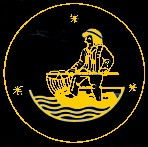
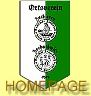
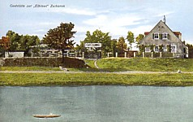
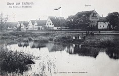

* * *

**Gemeindesiegel von Zschieren**

* * *

* * *

**Vereine in Zschieren:**

Die Region um Zschieren war bereits in der Bronzezeit besiedelt, wie Funde aus dem 12. Jahrhundert v. Chr. bezeugen. Der heutige Ort entstand vermutlich als slawische Fischersiedlung und wurde 1242 erstmals als Schirin urkundlich erwähnt. Der Name bedeutet im altsorbischen “Senknetz” und weist auf die Bedeutung des Fischfangs für die Bewohner hin. Im Mittelalter gehörten zu Zschieren, welches sich größtenteils im Besitz einer gleichnamigen Adelsfamilie befand, die beiden Ortsteile Groß- und Klein-Zschieren. Erst 1619 ist der im nördlichen Teil der Dorfflur gelegene Weiler Trieske erstmals bezeugt.

Ab 1615 unterstand Zschieren den Herrschaften Pillnitz, Graupa und Schönfeld. Zu den größten Herausforderungen für die Bewohner des Dorfes gehörten die häufigen Elbehochfluten, die die Zschierener Flur regelmäßig überschwemmten und verheerende Schäden anrichteten. Große Hochwasser sind u.a. 1784 und 1830 verbürgt. Auch ein Dorfbrand im Jahr 1719 zerstörte zwölf Bauernhöfe des Ortes. Neben Elbfischerei und Landwirtschaft wurde zeitweise auch etwas Weinbau betrieben, der jedoch nach dem Siebenjährigen Krieg zum Erliegen kam. Außerdem gab es seit 1672 eine Ziegelei im Ort, die im 19. Jahrhundert modernisiert und erweitert und erst nach dem Zweiten Weltkrieg stillgelegt wurde.

Kirchlich gehörten Groß- und Klein-Zschieren ab 1546 zur Dohnaer Kirche, ab 1897 zur Parochie der neugebildeten [Kirchgemeinde Kleinzschachwitz](../../ost/kleinzschachwitz/stephanuskirche/). Wegen seiner abseitigen Lage blieb der Ort bis in die jüngere Vergangenheit von größeren Ansiedlungen verschont. Erst nach dem Ersten Weltkrieg entstanden einige neue Wohnviertel an den Flurgrenzen zu Kleinzschachwitz, Meußlitz und Heidenau. Seit dem 1. Juli 1950 ist Zschieren ein Stadtteil von Dresden. Als Naherholungsziel sind heute das um 1930 angelegte [Strandbad Wostra](../../ost/zschieren/freibad_wostra/), das benachbarte FKK-Bad und ein angegliederter Campingplatz von Bedeutung. Auch das [Kurhaus Kleinzschachwitz](../../ost/kleinzschachwitz/strassen_kleinzschachwitz/kurhaus_kleinzschachwitz/) am Anfang der Wilhelm-Weitling-Straße steht trotz seines Namens eigentlich auf Zschierener Flur.

Trieske:

Als Trieske wird eine kleine weilerartige Siedlung im Norden Zschierens bezeichnet, die erstmals 1619 im Dohnaer Kirchenbuch erwähnt ist. Vermutlich entstand dieser Ortsteil abseits der vorhandenen Bebauung, um hier vor den häufigen Überflutungen besser geschützt zu sein. Im 18. Jahrhundert war für diese Siedlung umgangssprachlich der Spottname “Weibertausch” in Gebrauch, womit an den wechselseitigen Ehebruch einiger Bewohner erinnert werden sollte. Der kleine Ort, in einigen Dokumenten aus dem 19. Jahrhundert als “Beidörfchen Trieschke” bezeichnet, bestand ursprünglich aus vier Gehöften sowie einer Ziegelei. Deren ehemaliges Hauptgebäude dient heute als Kindergarten.

Schulen in Zschieren:

Da Zschieren bis in die zweite Hälfte des 19. Jahrhunderts keine eigene Schule besaß, besuchten die Kinder die Schulen
der beiden benachbarten Dörfer Mügeln (heute Stadtteil von Heidenau) und Zschachwitz. Erst 1886 errichtete man an
der Wilhelm-Weitling-Straße 66 ein eigenes Schulhaus. Das Gebäude besaß nur vier Klassenzimmer sowie ein kleines
Nebengebäude, welches später ebenfalls als Unterrichtsraum genutzt wurde. 1923 wurde dem Bau ein zusätzliches Stockwerk aufgesetzt. Nach der Eingemeindung Zschierens schloss das Schulhaus wenig später seine Pforten.

[_Weiterführende Literatur und Quellen_](../../impressum/quellenverzeichnis/)

 \[ [Home](../../index.html)\] \[ [Nord](../../nord/)\] \[ [Nordwest](../../nordwest/)\] \[ [Neustadt](../../neustadt/)\] \[ [Nordost](../../nordost/)\] \[ [West](../../west/)\] \[ [Zentrum](../../zentrum/)\] \[ [Südwest](../../sudwest/)\] \[ [Süd](../../sud/)\]
 \[ [Südost](../../sudost/)\] \[ [Ost](../../ost/)\] \[ [Register](../../Register/register.html)\] \[ [Kontakt](../../Kontakt/kontakt.html)\] \[ [Impressum](../../impressum/)\]
