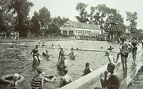

* * *

* * *

* * *

Die Geschichte des Freibades Wostra begann im Jahr 1929, als die kurz zuvor gegründete “Wochenend- und Strandbadgesellschaft” (WOSTRA) Pläne zur Errichtung einer Wochenendhaussiedlung mit 200 Bungalows vorlegte. Außerdem sollten verschiedene Sport- und Freizeitanlagen, darunter ein Schwimmbecken mit Umkleidekabinen sowie ein Bootshafen am Elbufer entstehen. Die zuständigen Behörden der Amtshauptmannschaft Pirna lehnten dieses Vorhaben jedoch zunächst ab. Auch der Landesverein Sächsischer Heimatschutz stellte sich gegen die Pläne, da man eine dauerhafte Beschädigung der Elblandschaft in der Nähe der Pillnitzer Elbinsel befürchtete.

Die Strandbadgesellschaft entschloss sich daraufhin, das Projekt zu überarbeiten und auf privatem Gelände dennoch zu realisieren. 1930 entstand auf dem Grundstück der früheren Ziegelei Neubert eine Laubensiedlung mit ca. 50 Gebäuden sowie ein kleines
Schwimmbecken. Ein ehemaliger Ziegelschuppen der bereits 1901 geschlossenen Ziegelei wurde zur Gaststätte “Wostra-Klause” umgebaut. Außerdem errichtete man Umkleidekabinen, Toilettenanlagen sowie einen hölzernen Sprungturm. Am 4. Juni 1932 fand die offizielle Einweihungsfeier des Bades statt _(Foto)_. Als Betreiber fungierte zunächst die “Badbetriebsgesellschaft e.G.m.b.H. Zschieren”, ab 1938 ein privater Pächter.

Nach dem Zweiten Weltkrieg übernahm die Gemeinde Zschieren das Gelände und richtete im früheren Wohnhaus des Ziegeleibesitzers ein Kinder- und Jugendheim ein. Außerdem konnte das Badgelände erneuert und der alte durch einen neuen Sprungturm ersetzt werden. Mit der Eingemeindung Zschierens im Jahr 1950 kam auch das Freibad Wostra in den Besitz der Stadt Dresden. 1969 entstand hier der erste Campingplatz in Dresden und wurde am 21. Juni eröffnet.

Nach einem Beschluss des Rates begann 1976 eine deutliche Erweiterung und Modernisierung der gesamten Anlage. Der bestehende Campingplatz wurde auf 8.000 m² erweitert. Gleichzeitig ging die neue Badgaststätte “Wostra-Klause” in Betrieb, so dass die alte Klause 1984 abgerissen werden konnte. Aus einer stillgelegte Kiesgrube unmittelbar am Freibad wurde 1982 ein weiteres Naturbad, welches seit 1985 den FKK-Freunden zur Verfügung steht.

Mangelnde Werterhaltung und fehlende finanzielle Mittel führten in den 1990er Jahren zu Schließungsplänen seitens des Sportstätten- und Bäderbetriebes. Beim Hochwasser im August 2002 wurde das gesamte Gelände der Wostra überflutet und dabei schwer in Mitleidenschaft gezogen. Um ein endgültiges Aus für das Freibad zu verhindern, gründete sich 2003 ein Förderverein, welcher sich unter dem Slogan “Rettet die Wostra” für einen Erhalt des Bades einsetzt. 2005 entschloss sich die Stadt Dresden für eine komplette Rekonstruktion des Freibades. Neben kommunalen Geldern kamen dabei vor allem Fluthilfemittel zum Einsatz.

* * *

 \[ [Nord](../../../nord/)\] \[ [Nordwest](../../../nordwest/)\] \[ [Neustadt](../../../neustadt/)\] \[ [Nordost](../../../nordost/)\]
 \[ [West](../../../west/)\] \[ [Zentrum](../../../zentrum/)\] \[ [Südwest](../../../sudwest/)\] \[ [Süd](../../../sud/)\] \[ [Südost](../../../sudost/)\] \[ [Ost](../../../ost/)\] \[ [Register](../../../Register/register.html)\] \[ [Kontakt](../../../Kontakt/kontakt.html)\] \[ [Impressum](../../../impressum/)\]
