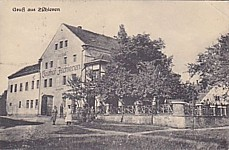

Die Straße Am Mittelwald entstand 1935 und erhielt ihren Namen nach einer Flurbezeichnung. Am 3. Mai 1935 wurde sie dem öffentlichen Verkehr übergeben.

## An der Huhle

Die Straße An der Huhle entstand nach dem Ersten Weltkrieg im Zusammenhang mit dem Bau einer kleinen Wohnsiedlung und wurde am 2. November 1932 Straße der Heimat benannt. Bereits wenige Monate später erfolgte am 23. August 1933 die Umbenennung in An der Huhle. Der Straßenname ist von einer historischen Flurbezeichnung abgeleitet. Als „Huhlen“ wurden früher in gewissen Größen abgegrenzte Felder bezeichnet. 1835 sind in einer Flurkarte „die Huhlenfelder“ erwähnt. Auch die benachbarten Straßen Am Zaukenfeld und Hüfnerweg erinnern an die frühere landwirtschaftliche Nutzung des Areals. Als Hüfner wurden früher Kleinbauern mit geringem Grundbesitz (Hufe = altes Flächenmaß) bezeichnet.

## An der Ölmühle

Der Straßenname An der Ölmühle erinnert an die einst hier befindliche Ölmühle. Die mit Motorkraft betriebene Mühle gehörte bis zu ihrer Schließung 1985 zum VEB Margarinewerk Dresden. 2010 wurde sie saniert und zum Wohnhaus umgebaut.

## An der Wostra

Der kleine Weg An der Wostra verbindet die Wilhelm-Weitling-Straße mit dem Elbufer und führt am früheren Gelände der Ziegelei Neubert entlang. 1930 wurde hier durch die “Wochenend- und Strandbadgesellschaft” (WOSTRA) eine Laubenkolonie mit Freibad errichtet. Aus dieser ging das bis heute beliebte [Strandbad Wostra](../../../ost/zschieren/freibad_wostra/) mit angeschlossenem Campingplatz hervor. Die Straßenbezeichnung An der Wostra wurde jedoch erst nach 2000 eingeführt.

Die kleine Straße An der Schanze wurde Anfang 1935 benannt. Die Namensgebung erfolgte vermutlich nach einer hier gelegenen militärischen Befestigungsanlage.

## Borsbergblick

Die Straße Borsbergblick wurde Anfang der 1930er Jahre beim Bau einer neuen Wohnsiedlung angelegt und erhielt auf Beschluss des Zschachwitzer Gemeinderates am 2. November 1932 zunächst den Namen Straße der Freiheit. Bereits im August 1933 wird sie jedoch in Borsbergblick umbenannt. Namensgeber ist der oberhalb von Pillnitz und Oberpoyritz gelegene [Borsberg](../../../nordost/schonfeld-weissig/borsberg/).

## Gärtnereistraße

Die Gärtnereistraße ist erstmals im Jahr 1938 im Adressbuch aufgeführt. Sie zweigt als Sackgasse von der Kurgartenstraße ab und erhielt ihren Namen nach den früheren Gärtnereien im Ort. Bereits ab 1911 war eine Straße in Zschieren Gartenstraße benannt worden, wohl mit gleichem Bezug.

## Inselblick

Sowohl die Straßenbezeichnung Inselblick als auch die benachbarte Straße Zur Elbinsel weisen auf die zwischen Zschieren und Pillnitz gelegene [Pillnitzer Elbinsel](../../../nordost/pillnitz/pillnitzer_elbinsel/) hin. Die noch im 18. Jahrhundert vom Hof genutzte Insel ist heute Vogelschutzgebiet und darf deshalb nicht betreten werden.

Angelegt wurde die Straße um 1930 und zunächst An der Albertstraße genannt, da sie von der damaligen Albertstraße (heute Fanny-Lewald-Straße) abzweigt. Ab 1935 findet sich der Straßenname Am Plan in den Adressbüchern. Da es jedoch bereits in Lockwitz eine Straße diesen Namens gab, erfolgte im Zuge der Eingemeindung von Zschieren am 30. September 1953 die Umbenennung in Inselblick.

## Käthe-Kollwitz-Straße

Die Käthe-Kollwitz-Straße wurde um 1908 im Zusammenhang mit der Bebauung der Fluren zwischen Kleinzschachwitz und Zschieren angelegt und nach dem 1902 verstorbenen sächsischen König zunächst Georgstraße genannt. Nach 1945 erhielt sie den Namen der Malerin Käthe Kollwitz (1867-1945), die durch ihre Anti-Kriegs-Darstellungen international bekannt wurde. Käthe Kollwitz verbrachte ihre letzten Lebensmonate auf Einladung der Wettiner in Moritzburg, wo noch heute eine Gedenkstätte an sie erinnert.

Die Krippener Straße bildet die Verlängerung des Gondelwegs im benachbarten Meußlitz und wurde zunächst auch auf Zschierener Flur so genannt. Um 1900 erfolgte die Umbenennung als Christian Friedrichstraße (in dieser Schreibweise) nach dem Privatmann, der die Straße angelegt hatte. Zu den Bewohnern gehörte 1904/05 für einige Monate der Schriftsteller Robert Kraft, der als Autor utopischer Abenteuerromane zu seiner Zeit ähnlich populär wie Karl May war.

1945 wurde die Christian-Friedrich-Straße in Rudolf-Breitscheid-Straße umbenannt. Namensgeber war der 1944 im KZ Buchenwald ums Leben gekommene sozialdemokratische Arbeiterführer Rudolf Breitscheid (1874-1944). Da es jedoch bereits in Dobritz eine Breitscheidstraße gab, wurde die in Zschieren gelegene Straße mit Beschluss vom 30. September 1953 in Krippener Straße umbenannt. Krippen, heute ein Ortsteil von Bad Schandau, ist ein Urlaubsort in der Sächsischen Schweiz.

## Kurgartenstraße

Auch die Kurgartenstraße entstand um 1900 bei der Erschließung des zuvor landwirtschaftlich genutzten Areals zwischen Kleinzschachwitz und Zschieren. Der Name erinnert an Bestrebungen vom Ende des 19. Jahrhunderts, Kleinzschachwitz zu einem Kurort zu entwickeln. Ursprünglich wurde sie Curgartenstraße genannt. Später wechselte man zur heute gebräuchlichen Schreibweise. In unmittelbarer Nähe befindet sich das eigentlich auf Zschierener Flur gelegene [Kurhaus Kleinzschachwitz](../../../ost/kleinzschachwitz/strassen_kleinzschachwitz/kurhaus_kleinzschachwitz/).

## Therese-Malten-Straße

Die Therese-Malten-Straße erhielt ihren Namen 1901 nach der Opernsängerin Therese Malten (eigentlich Therese Müller). Mit
Umbenennung der früheren Schönefelder Straße wollte die Gemeinde der auch als Wohltäterin beliebten Kammersängerin schon
zu Lebzeiten ein bleibendes Denkmal setzen. Die 1853 in Ostpreußen geborene Künstlerin debütierte mit 20 Jahren an der
Dresdner Hofoper und wurde vor allem als Wagner- Interpretin berühmt. Auf  persönliche Einladung Richard Wagners trat sie
1882 auch im Bayreuther Feststpielhaus auf. In Dresden war die Sopranistin nicht zuletzt wegen ihres extravaganten Lebensstil
ein gefeierter Star. Ab 1893 lebte sie bis zu ihrem Tod 1930 in der unweit der Therese-Malten-Straße gelegenen Villa Carolastraße (heute Wilhelm-Weitling- Straße) 3. Ihr Grab befindet sich auf dem Trinitatisfriedhof.

## Trieskestraße

Die Trieskestraße erinnert an das frühere Zschierener “Beidörfchen” [Trieske](../../../ost/zschieren/), welches nur aus vier Gehöften bestand und im
Volksmund als “Weibertausch” bezeichnet wurde. Die Gebäude lagen zum Schutz vor Hochwasser auf leichten Erhebungen. Im
19\. Jahrhundert entstand in diesem Teil Zschierens eine noch bis nach 1945 betriebene Ziegelei. Heute befinden sich hier Wohnhäuser sowie der Zschierener Kindergarten.

## Wilhelm-Weitling-Straße

Die heutige Wilhelm-Weitling-Straße wurde im 19. Jahrhundert angelegt und hieß früher Carolastraße. Ihren jetzigen Namen
erhielt sie nach dem vormarxistischen Theoretiker Wilhelm Weitling (1808-1871). Weitling gehörte zu den führenden Köpfen des “Bundes der Gerechten” (später “Bund der Kommunisten”) und wanderte 1849 in die USA aus.

Ende des 19. Jahrhunderts begann von Kleinzschachwitz aus die Bebauung der Wilhelm-Weitling-Straße mit Villen und Wohnhäusern. Noch bis in die jüngere Vergangenheit existierten im Süden mehrere Kies- und Lehmgruben. Aus deren
Restlöchern entstanden die beiden Zschierener Freibäder der [Wostra](../../../ost/zschieren/freibad_wostra/).

Villa Malten:
Markantestes Gebäude an der Wilhelm-Weitling-Straße ist neben dem Kurhaus Kleinzschachwitz in der Nähe der Pillnitzer Elbfähre die Villa Malten (Nr. 3). Dieses Haus ließ sich 1893 die Kammersängerin Therese Malten (1853-1930)
errichten, an die auch die unweit gelegene Therese-Malten-Straße erinnert. Die von Bruno Müller entworfene und  im
Neorenaissancestil ausgestattete Villa besaß eine moderne Schwerkraftheizung, zahlreiche Wohn- und Schlafräume sowie ein von
unten beleuchtetes Marmorbad. Zum Grundstück gehört auch ein heute nur noch teilweise erhaltener Park mit Remise und
Gästehaus. 1997 wurde die Villa durch einen spanischen Kunsthändler erworben und weitgehend wieder in den Originalzustand versetzt. Heute beherbergt das Haus eine Pension.

Villa Franziska:
Das Grundstück Wilhelm-Weitling-Straße 4 wurde um 1860 mit zwei Landhäuser bebaut, welche damals von
wohlhabenden Dresdner Bürgern als Sommersitz genutzt wurden. 1894 erwarb der ungarische Graf Ratnotfais das Areal und ließ
sich hier eine repräsentative Villa errichten. Der Graf galt als großer Verehrer der Opernsängerin Therese Malten und wählte
deshalb das gegenüber ihrer Wohnung liegende Grundstück als Wohnsitz. Unter Einbeziehung der beiden bereits vorhandenen
Gebäude erhielt es eine parkartige Gestaltung, die in ihren Grundzügen bis heute noch erhalten ist. Im Inneren besitzt die Villa eine
bemerkenswerte Ausstattung mit Holztäfelungen, Bleiglasfenstern und einem großen textilen Wandbild im Treppenhaus. Dieses
zeigt eine Szene aus der Wagner-Oper “Tristan und Isolde” und erinnert an den ersten Besitzer des Hauses. 2002-04 erfolgte eine umfassende Sanierung des Baudenkmals.

## Zschierener Elbstraße

Die Elbstraße - seit 1999 offiziell Zschierener Elbstraße genannt - bildet die Hauptstraße
der am Elbufer gelegenen Siedlung Klein-Zschieren. Der von sorbischen Siedlern gegründete Ort war einst Wohnplatz von Elbfischern und -schiffern und wurde häufig von
Hochwasser heimgesucht. Um 1880 entstand hier der Gasthof Zschieren mit Gartenterrasse und Saal.

Gasthof Zschieren: Die Schankwirtschaft am Elbufer _(Foto)_ entstand um 1880 und
befindet sich seit 1927 im Besitz der Familie Franke. Neben dem Gastraum besitzt das Haus auch einen kleinen Saal sowie eine Veranda und einen Biergarten. Das Lokal entwickelte sich nicht zuletzt wegen der früher
regelmäßig durchgeführten Jahrmärkte zu einer beliebten Ausflugsgaststätte. Während des Zweiten Weltkrieges befand sich in
den Räumen ein Kriegsgefangenenlager sowie die Werkstatt einer Uhrenfirma. Die jüngste Erneuerung des Gebäudes erfolgte nach Beseitigung der Hochwasserschäden 2004/05.

## Zur Ziegelwiese

Der Straßenname Zur Ziegelwiese erinnert an die einstigen Ziegelwiesen der Zschierener Ziegelei, die hier ihre Rohware vor dem
Brennvorgang zur Trocknung lagerte. Noch bis nach 1945 wurde auf Zschierener Flur Lehm für die Produktion einer Ziegelei abgebaut und verarbeitet.

[Zschieren auf OpenStreetMap](https://www.openstreetmap.org/search?query=Dresden+Zschieren)

* * *

 \[ [Home](../../../index.html)\] \[ [Nord](../../../nord/)\] \[ [Nordwest](../../../nordwest/)\] \[ [Neustadt](../../../neustadt/)\] \[ [Nordost](../../../nordost/)\] \[ [West](../../../west/)\] \[ [Zentrum](../../../zentrum/)\] \[ [Südwest](../../../sudwest/)\] \[ [Süd](../../../sud/)\] \[ [Südost](../../../sudost/)\] \[ [Ost](../../../ost/)\] \[ [Register](../../../Register/register.html)\] \[ [Kontakt](../../../Kontakt/kontakt.html)\] \[ [Impressum](../../../impressum/)\]
