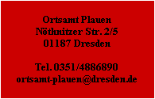

* * *

Die südlichen Stadtteile Dresdens nehmen das Gebiet zwischen dem [Plauenschen Grund](../sud/plauen/plauenscher_grund/), dem Kaitzbachtal und der Ortsgrenze von Leubnitz-Neuostra ein. Während sich die
wachsende Großstadt seit Mitte des 19. Jh. vor allem nach Norden ausdehnte, blieben die südlich des Stadtkerns gelegenen Gebiete noch bis 1900 überwiegend landwirtschaftlich
genutzt. Lediglich einige kleinere Dörfer slawischen Ursprungs existierten in diesem Bereich. Grund war die hohe Bodenqualität, so dass die Bauern ihre Felder nur ungern und zu
entsprechend hohen Preisen an die Baugesellschaften verkauften. Bis heute blieben in diesem Teil der Stadt zahlreiche Dorfkerne erhalten, die nach dem Ersten Weltkrieg um Kleinhaussiedlungen erweitert wurden.
Lediglich Plauen entwickelte sich bereits ab 1860 zu einer wohlhabenden Dresdner Vorstadt mit ausgedehnten Villenvierteln
und bedeutenden gewerblichen Unternehmungen. 1903 kam dieser Ort zu Dresden, welches sich bereits ein Jahr zuvor die
Dörfer Zschertnitz und Räcknitz einverleibt hate. Die übrigen Orte konnten ihre Selbstständigkeit noch bis 1921 bewahren, Gittersee sogar bis nach dem Zweiten Weltkrieg.

Im Süden der Stadt befindet sich auch einer der ältesten nachgewiesenen Siedelplätze der Stadt. Die sogenannte [“Heidenschanze”](../sud/coschutz/heidenschanze/)
auf Coschützer Flur war bereits in der Bronzezeit bewohnt und wurde von den nachfolgenden Slawen zu einer Burganlage ausgebaut. Auch in Mockritz und Kaitz wurden Überreste frühgeschichtlicher Siedlungen gefunden.
Wichtigster Erwerbszweig war bis in jüngere Vergangenheit der Ackerbau. Das Tal des [Kaitzbaches](../sud/kaitz/kaitzbachtal/) war bereits im Mittelalter
Standort einiger Mühlen. Im 19. Jh. entstanden in Plauen, Mockritz und Zschertnitz Ziegeleien, die die umfangreichen
Lehmvorkommen nutzten. Außerdem wurde örtlich Bergbau betrieben, der in Gittersee erst nach 1990 endgültig eingestellt wurde.

* * *

 \[ [Nord](../nord/)\] \[ [Nordwest](../nordwest/)\] \[ [Neustadt](../neustadt/)\] \[ [Nordost](../nordost/)\] \[ [West](../west/)\] \[ [Zentrum](../zentrum/)\] \[ [Südwest](../sudwest/)\] \[ [Süd](../sud/)\] \[ [Südost](../sudost/)\] \[ [Ost](../ost/)\] \[ [Register](../register/)\] \[ [Kontakt](../kontakt/)\] \[ [Impressum](../impressum/)\]
