* * *

**Gemeindesiegel von Coschütz**

* * *

Das Gebiet des heutigen Stadtteils Coschütz war bereits in der Bronzezeit besiedelt, wie zahlreiche Funde an der [Heidenschanze](../../sud/coschutz/heidenschanze/) beweisen. Die jahrhundertelang genutzte frühgeschichtliche Wehranlage gehört zu den ältesten nachgewiesenen Siedlungsplätzen im Dresdner Raum und ist trotz teilweiser Zerstörung durch den Steinbruchbetrieb ein bedeutendes Kulturdenkmal. Das Dorf Coschütz wurde in einer Urkunde vom 7. März 1267 erstmals als Coswicz genannt und entstand wie die meisten Dörfer im südlichen Stadtgebiet als slawischer Rundweiler. Der Name ist wahrscheinlich von einem Ortsgründer Kos abgeleitet. Andere Sprachkundler vermuten die Herkunft vom slawischen Wort für “Winkel, Ecke” (nach der geografischen Lage) bzw. für Korb (nach hier lebenden Korbflechtern). Auch das slawische Wort “Grodistje” für “Schanze” wird mit Coschütz in Verbindung gebracht. Im Laufe der Zeit wechselte der Ortsname über Koschwicz (1315), Kussewicz (1408), Koschitz (1479) und Kuschwicz (1529) bis zum heute gebräuchlichen Coschütz (1712).

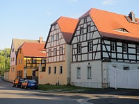Bereits 1285 sorgten die Bauern des Ortes für Aufsehen, da sie Acker- und Weideland der Meißner Bischöfe ohne deren Zustimmung in ihren Besitz gebracht hatten. 1315 unterstand das Dorf mit einem zugehörigen Vorwerk dem Dresdner Maternihospital. Neben der Landwirtschaft war auch der Obst- und Weinbau von Bedeutung, der am Collmberg (Spittelberg), am Frankenberg und am Lachenberg betrieben wurde. Einzelne Güter befanden sich zeitweise im Besitz verschiedener Adelsfamilien sowie des Dresdner Ratsherrengeschlechts Busmann, was zu einer starken Zersplitterung der insgesamt 15 Hufen großen Flur führte. 1580 erwarb Kurfürst August den gesamten Ort und unterstellte ihm dem kurfürstlichen Amt Dresden. Lediglich kleinere Flächen blieben bis zur Ablösung der Grundherrschaft im 19. Jahrhundert dem Hospitalamt St. Materni sowie den Rittergütern Zauckerode und Krummenhennersdorf unterstellt. Bis heute sind in [Altcoschütz](../../sud/coschutz/strassen_coschutz/altcoschutz/) noch zahlreiche Gehöfte des 18. und 19. Jahrhunderts erhalten geblieben, so dass der Coschützer zu den schönsten Dorfkernen Dresdens zählt _(Foto)_.

Während des Dreißigjährigen Krieges mussten viele Orte, auch wenn sie nicht direkt von Einquartierungen oder Kampfhandlungen betroffen waren, erhebliche Kontributionen leisten. Für Coschütz und Birkigt ist nachweisbar, das das ärmere Birkigt sich von seinem Nachbarn eine größere Summe zur Bezahlung dieser Abgaben leihen musste. Da eine Rückzahlung nicht möglich war, wurden die Birkigter Sumpfwiesen an Coschütz verpfändet. Im Siebenjährigen Krieg litt das Dorf unter Einquartierungen preußischer und österreichischer Truppen. Glück hatten die Bewohner hingegen nach der Schlacht bei Dresden 1813, da man rechtzeitig den Zugang zum Ort über die Weißeritzbrücke im Plauenschen Grund abgebrochen hatte, was Coschütz vor Plünderungen bewahrte.

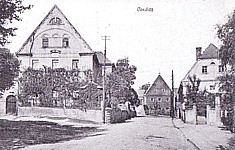Im 18. Jahrhundert wurden auf Coschützer Flur Steinkohlevorkommen entdeckt, die 1788 erstmals kartographisch erfasst wurden. Im Zuge der wachsenden Industrialisierung entstanden ab 1790 am [Collmberg](../../sud/coschutz/collmberg/) zwei Kohlenschächte, denen 1836 das herrschaftliche Claus´sche Kohlenwerk folgte. Bereits 1767 war in einer zum Weißeritztal führenden Schlucht erfolglos nach Kupfererz gesucht worden. Das Huthauses dieses Bergwerkes blieb als [“Coselvilla”](../../sud/coschutz/strassen_coschutz/) noch bis nach 1970 erhalten. Das 1794 im Plauenschen Grund entstandene [Eisenhammerwerk](../../sud/plauen/plauenscher_grund/eisenhammerwerk/) führte zur Entstehung des Ortsteils [Neu-Coschütz](../../sud/coschutz/neucoschutz/),welcher sich zu einer Arbeitergemeinde mit ca. 1400 Einwohnern entwickelte und 1896 nach Potschappel eingemeindet wurde. Aus der ehemaligen Coschützer [Pulvermühle](../../sud/plauen/plauenscher_grund/) ging 1830 die königliche Garnisonsmühle hervor, deren Siloturm bis heute ein Wahrzeichen des Plauenschen Grundes geblieben ist. Im 19. Jahrhundert wurden auf Coschützer Flur einige Steinbrüche zum Abbau des Syenodioritgesteins aufgeschlossen, die die wirtschaftliche Struktur des Ortes weiter veränderten. Dem Steinbruchbetrieb fielen auch Teile des frühgeschichtlichen Burgwalls Heidenschanze zum Opfer. Hinzu kamen zwei Ziegeleien im Osten der Ortsflur.

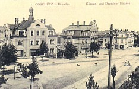Am 20. April 1829 wurden große Teile des Dorfkerns bei einem Großbrand zerstört, den nur fünf Höfe überstanden. Ursache des Feuers soll der Überlieferung nach ein Schuss des Hegereiters auf einen Marder gewesen sein, der auf einem strohgedeckten Scheunendach Zuflucht gefunden hatte. Die schon bald wieder aufgebauten Gehöfte erhielten nun ihr heutiges Aussehen _(Foto oben rechts um 1900)._ In der zweiten Hälfte des 19. Jahrhunderts wuchs Coschütz über seine früheren Grenzen hinaus. Neue Wohngebäude entstanden u. a. an der [Karlsruher Straße](../../sud/gittersee/strassen_gittersee/karlsruher_strasse/), der Windbergstraße _(Foto links)_ und der Saarstraße. 1898/99 erhielt die Gemeinde einen Wasserhochbehälter, 1900 ein eigenes Elektrizitätswerk. Der 1901 geplante Bau einer “gleislosen Bahn” von Plauen über Coschütz und Gittersee nach Potschappel, wie er zwei Jahre später in [Klotzsche](../../nord/klotzsche/haidebahn/) realisiert wurde, scheiterte jedoch ebenso, wie eine Straßenbahnlinie von Dresden über Coschütz und Birkigt.

1897 schied Coschütz aus der Kreuzkirch-Parochie aus und bildete, zunächst gemeinsam mit Gittersee, eine eigene [Kirchgemeinde](../../sud/coschutz/kirchgemeinde_coschutz/), für die 1900 ein Pfarrhaus mit Betsaal an der heutigen Windbergstraße errichtet wurde. Zwischen 1924 und 1928 baute der Deutsche Siedlerbund eine Reihenhaussiedlung am Achtbeeteweg. Bereits am 1. April 1921 war Coschütz gemeinsam mit zahlreichen weiteren Orten nach Dresden eingemeindet worden. 1927 erhielt der Ort durch die Verlängerung der Plauener Strecke den langersehnten Anschluss an das Dresdner Straßenbahnnetz.

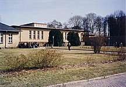Zu den bedeutenden Bauvorhaben, die noch vor dem Zweiten Weltkrieg begonnen wurden, gehört das Coschützer Wasserwerk. Kriegsbedingt konnte dieses Werk jedoch erst 1947 vollendet werden und versorgt heute einen Großteil der Dresdner Bevölkerung mit Trinkwasser aus dem Erzgebirge _(Foto)_. In seiner Nachbarschaft wurde eine kleine Wohnsiedlung für die Angestellten des Werkes errichtet. Heute ist der Stadtteil Standort der 1973/81 entstandenen größten Dresdner Brauerei und weiterer Gewerbebetriebe, die sich bevorzugt in einem nach 1990 erschlossenen Gewerbepark östlich der Karlsruher Straße ansiedelten. Zuvor war auf dem früheren Bergbauareal der Bau eines Reinstsiliziumwerkes für die DDR-Mikroelektronik geplant, was jedoch nach heftigen Protesten der Bevölkerung wegen der damit verbundenen Umweltgefahren Ende 1990 aufgegeben wurde. Am 27. Oktober 2000 erfolgte am Rande der Coschützer Flur der Anstich für den zweiten neuen Autobahntunnel der A 17, der den Ort zwischen [Plauenschem Grund](../../sud/plauen/plauenscher_grund/) und [Kaitzbachtal](../../sud/kaitz/kaitzbachtal/) unterquert.

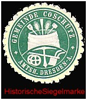

Rathaus Coschütz:

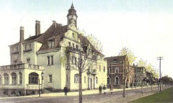Das Coschützer Rathaus entstand 1902/03 an der Körnerstraße (heute Windbergstraße) für die mittlerweile auf über 2.300 Einwohner angewachsene Gemeinde. Zuvor hatte es einen Wettbewerb gegeben, wobei man die Bauplanung dem dabei zweitplatzierten Dresdner Architekten Schleinitz übertrug. Die Ausführung übernahm der Coschützer Baumeister Seiffert. Bereits am 4. März 1903 konnte das Richtfest gefeiert werden. Die feierliche Einweihung des Rathauses erfolgte im Beisein zahlreicher Ehrengäste am 13. September 1903.

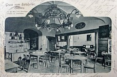Im Erdgeschoss des im Jugendstil gestalteten Neubaus waren die Polizeiwache und der Ratskeller _(Foto)_ untergebracht, während sich im ersten Stock der Sitzungssaal, Versammlungs- und Büroräume sowie die Wohnung des Gemeindevorstandes befanden. Zum Restaurant gehörten auch ein Billardzimmer sowie zwei Vereinsräume. Außerdem gab es hier früher einen Tanzsaal, der unter dem Namen “Demos” bekannt war. 1936 pachtete der Gastwirt Emil Max Rahm den Coschützer Ratskeller und bewirtschaftete ihn bis 1949. Rahm war zuvor Oberkellner im Basteihotel in der Sächsischen Schweiz und “Entdecker” eines noch heute als “Rahm-Hanke” bekannten Kletterpfades unterhalb des Basteifelsens. Von der künstlerisch bemerkenswerten Innenausstattung des Lokals sind heute nur wenige Reste erhalten.

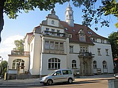Über dem Haupteingang des Rathauses erinnert das 1903 eingeführte Gemeindewappen des Ortes an die früher wichtigsten Wirtschaftszweige Landwirtschaft, Brauwesen und Steinbruchbetrieb. Nach der Eingemeindung von Coschütz übernahm die Stadt Dresden das Gebäude, welches bis 1990 als Zweigstelle der Polikilinik Süd, heute als Ärztehaus genutzt wird. In den Räumen des früheren Ratskellers war ab 1955 bis nach 1990 ein Klub der Volkssolidarität untergebracht. Seit 2002 befindet sich hier eine private Kindertagesstätte.

Schulen in Coschütz:

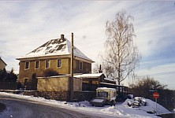Die erste Schule des Ortes existierte bereits im 18. Jahrhundert und befand sich im Hirtenhaus am Dorfplatz. Das Gebäude war klein und dunkel und besaß nur eine Schulstube von ca. 10 x 6 Ellen sowie einen Wohnraum für den Lehrer im Obergeschoss. Ab 1838 bildete Coschütz mit dem Nachbarort Gittersee einen gemeinsamen Schulbezirk, für den ein größeres Schulhaus an der Schulstraße (heute Kleinnaundorfer Straße) 2 erbaut wurde. Das dafür benötigte Land hatte man zuvor für 40 Taler vom Gutsbesitzer Gottfried Rühle erworben. Die Einweihung des Neubaus erfolgte im Oktober 1839. Zunächst besuchten ca. 225 Coschützer und Gitterseer Kinder, die der Bewohner des Ortsteils Neu-Coschütz und der Pulvermühle im Plauenschen Grund diese Schule. 1860 schied Neu-Coschütz jedoch aus dem Verband aus und erhielt ein eigenes Schulhaus. Die alte Coschützer Schule blieb bis heute erhalten und dient jetzt als Wohnhaus _(Foto)_.

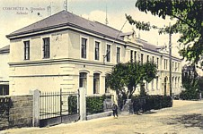Nach dem diese zu klein geworden war, entstand 1875 ein Neubau an der gleichen Straße. Das Grundstück kaufte die Gemeinde vom Gutsbesitzer Lohrmann für 1200 Mark. Die Grundsteinlegung erfolgte am 24. Mai 1875. Die Planung und Bauausführung übernahm der Plauener Baumeister Fichtner. Bereits am 9. Dezember des gleichen Jahres konnte das neue Schulhaus eingeweiht werden. Neben den Klassenräumen erhielt die neue Schule auch eine von den Inhabern der Coschützer Zentralziegelei gestiftete Schulbibliothek. Bereits wenige Jahre später machte sich eine Erweiterung um vier Klassenzimmer erforderlich, die im Jahr 1888 abgeschlossen war. Zehn Jahre später entstand in Gittersee eine Filialschule. Um die Jahrhundertwende zählte die Coschützer Schule bereits über 1000 Schüler, die in 20 Klassen von 13 Lehrern und drei Hilfslehrern unterrichtet wurden.

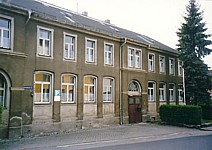Nach Auflösung des Schulverbandes mit dem Nachbarort Gittersee 1905 folgte zwei Jahre später der Bau des dritten Schulhauses im Hof des Grundstückes. Im Erdgeschoss gab es nun auch eine Turnhalle, welche nicht nur dem Turnunterricht, sondern auch als Sportstätte des Coschützer Turnvereins und für gelegentliche Ausstellungen und Versammlungen diente. Im Zuge der Eigemeindung von Coschütz wurde die 72. Volksschule in das Dresdner Schulnetz einbezogen. Bis zur Machtübernahme der Nationalsozialisten pflegte man hier ein hauswirtschaftliches Profil. Im Zweiten Weltkrieg befand sich in den Gebäuden zeitweise ein Auffanglager für Flüchtlinge und Ausgebombte, die Turnhalle diente als Lazarett für ausländische Kriegsgefangene. Im Zuge der Schulreformen in der DDR wurde aus der früheren Volksschule 1959 die zehnklassige 72. Polytechnische Oberschule. Nach 1990 wurden beide Häuser zuletzt von der 72. Mittelschule Dresden-Coschütz genutzt und im Sommer 2005 geschlossen _(Fotos um 1910 und 2006)_.

Zwei weitere Schulneubauten entstanden in den 1980er Jahren im Zusammenhang mit dem Neubaugebiet Kohlenstraße an der Cämmerswalder Straße und am Höckendorfer Weg. Die zunächst als 127. POS “Gottfried Ephraim Lessing” bezeichnete Schule wurde 1990 von der 127. Mittelschule übernommen und zum Ende des Schuljahres 2005/06 geschlossen. 2009 schloß auch die 126. Grundschule Cämmerswalder Straße wegen gesunkener Schülerzahlen.

Postwesen:

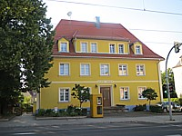Alt- und Neucoschütz gehörten postalisch ursprünglich zum Postbezirk Potschappel. Am 1. Juli 1876 erfolgte jedoch die Trennung der beiden Ortsteile. Während Neucoschütz auch weiterhin dem Potschappler Postamt zugeordnet blieb, gliederte man die Altgemeinde einschließlich der Zentralziegelei und der Gebäude am Felsenkeller dem Postamt Plauen an. 1889 wurde im Ort selbst eine Posthilfsstelle eingerichtet. 1897 erfolgte der Anschluss an das Telefonnetz. Nach der Jahrhundertwende befand sich die Coschützer Poststelle auf der Körnerstraße 17a (Windbergstraße), bevor sie 1925 zur damaligen Dresdner Straße 6 verlegt wurde.

Ab 1927 ist das Postamt Coschütz unter der Adresse Karlsruher Straße 7 im Adressbuch verzeichnet. Zum 1. Januar 1930 Jahre erfolgte eine erneute Verlegung zur Karlsruher Straße 30. Hier befand sich die Post des Stadtteils, zunächst als Postamt Dresden A40, später als Postamt 8040 bezeichnet, bis zum 31. Mai 2008. Seit dessen Schließung werden Postdienste heute von einer privaten Postagentur am Eckhaus Karlsruher Straße 3 / Kohlenstraße angeboten. Das alte Postamt _(Foto)_ dient heute als Wohnhaus.

Kleingartenanlage “Nautelweg”:

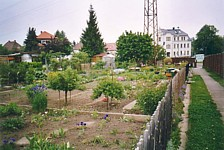Die Gartensparte am Nautelweg, einem ehemals beliebten Wanderweg zwischen Coschütz, Kaitz und Mockritz, entstand 1921. Damals überließen Coschützer Bauern Teile ihrer Felder interessierten Einwohnern, um hier eine Gartensparte anzulegen. Bereits zwei Jahre zuvor hatte die Gemeinde ein Darlehen aufgenommen, um Flächen für die Anlage von Schrebergärten und Kartoffeläckern zu erwerben.
Innerhalb weniger Jahre wurden auf ca. 3,7 Hektar Fläche 151 Parzellen geschaffen. Der neu gegründete Verein erhielt zunächst den Namen “Höhenluft II”, wurde jedoch 1991, um Verwechslungen mit einer gleichnamigen Sparte in Cotta zu vermeiden, umbenannt. 1935 entstand das Vereinsheim.

Wasserwerk Coschütz:

Die älteste nachweisbare Wasserversorgungsanlage erhielt Coschütz bereits im 17. Jahrhundert. Diese bestand aus Holzröhren und leitete das aus Gittersee stammende Quellwasser in den Gemeindeteich, so dass auch bei längeren Trockenperioden ausreichend Wasser zur Verfügung stand. Mehrfach wurden der Quellstollen und die Leitung erneuert, zuletzt 1868. Zudem profitierte Coschütz von der Gründung der Felsenkellerbrauerei, die ihr Wasser aus dem Kaitzgrund bezog und dafür alljährlich 50 Taler an die Gemeinde bezahlen musste.

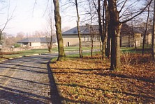Die wachsende Bevölkerungszahl und die Entstehung neuer Wohnsiedlungen machten jedoch Ende des 19. Jahrhunderts den Ausbau einer modernen Wasserversorgung erforderlich. Zunächst plante man einen Anschluss an das 1891 im [Kaitzgrund](../../sud/kaitz/kaitzbachtal/) errichtete Bienertsche Wasserwerk, konnte sich jedoch nicht über die Konditionen einigen. Nach mehreren erfolglosen Bohrversuchen entschloss sich die Gemeinde schließlich, in Gittersee ein Flurstück für die Errichtung eines Hochbehälters zu erwerben. Ab 1899 wurde im Kaitzgrund gewonnenes Grundwasser mittels Pumpen in den Behälter transportiert und von dort über ein neu geschaffenes Leitungsnetz an die Häuser verteilt. Der alte Dorfteich konnte daraufhin verfüllt werden. Mit dem Bau der Talsperren im Osterzgebirge bezog der Ort sein Trinkwasser zusätzlich von der Weißeritztalsperrengenossenschaft. Das Wasserwerk mit Sammelbehälter und Pumpmaschine befand sich zum Zeitpunkt der Eingemeindung auf der Schulstraße (Kleinnaundorfer Straße).

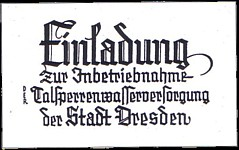Das neue Coschützer Wasserwerk entstand auf Grund eines Vertrages zwischen der Landesregierung und der Stadt Dresden von 1935 auf einer Freifläche an der Kohlenstraße. Zuvor existierte hier zeitweise eine Ziegelei. 1935 wurde ein Vertrag zwischen der sächsischen Landesregierung und der Stadt Dresden abgeschlossen, der die Nutzung der Weißeritztalsperren für die Trinkwasserversorgung der Landeshauptstadt vorsah. Zunächst wurde 1937 mit der Realisierung eines Stollensystems zur Zuführung des Rohwassers begonnen. Baubeginn für das eigentliche Werk war im Jahr 1939. Dabei entschied man sich aus Gründen des Luftschutzes für einen aus fünf Einzelbauten bestehenden Komplex, die sich um einen rechteckigen Ehrenhof gruppieren. Architektonisch vereinen die Gebäude den seinerzeit typischen Heimatschutzstil mit Elementen des Neuen Bauens. Für die Angestellten des Betriebes entstanden die Doppelhäuser Kohlenstraße 27 bis 37.

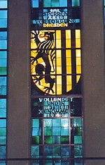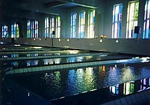Kriegsbedingt verzögerten sich die Arbeiten, so dass der Betrieb erst 1946/47 aufgenommen werden konnte. Die offizielle Inbetriebnahme erfolgte am 26. August 1946. Das Werk besteht aus mehreren Funktions- und Verwaltungsgebäuden mit Labor-, Büro-, Werkstatt- und Sozialräumen _(Bild oben)_. Blickfang ist die Filterhalle
für die Wasseraufbereitung. Die Halle mit den Wasserbecken ist mit farbigen Glasfenstern versehen, die u.a. das Dresdner Stadtwappen sowie das Signet des ersten DDR-Fünfjahrplanes zeigen _(Bilder links und rechts)_. Schöpfer war der akademische Glasmaler und Glasschleifer Oskar Fritz Beier. Das als einziger Teil beim Luftangriff 1945 zerstörte Werkstattgebäude wurde in der Nachkriegszeit wieder aufgebaut. 1952 entstand mit dem Bau des Pförtnerhauses das sechste und letzte Bauwerk der Anlage.

Das Wasser stammt aus den Talsperren Klingenberg und Lehnmühle und wird durch ca. 20 Kilometer lange Stollenanlagen über Dorfhain und Tharandt bis nach Coßmannsdorf geleitet. Dort beginnt eine Rohrleitung, die bis ins Coschützer Werk führt. Hier wird das ankommende Wasser mit Hilfe von Filteranlagen gereinigt und als Trinkwasser aufbereitet. Das Coschützer Wasserwerk deckt den Bedarf der gesamten südlichen Dresdner Stadtteile und ist bedeutendstes Werk in Dresden. Außerdem befindet sich auf dem Gelände die zentrale Steuerwarte für sämtliche Wasserversorgungsanlagen der Stadt sowie das Trinkwasserlabor zur Überwachung der Qualität des Wassers. Verschiedene Modernisierungsarbeiten erfolgten zwischen 1993 und 1996. In diesem Zusammenhang wurde 1994/96 auch ein neues Laborgebäude errichtet.

Elektrizitätswerk Coschütz:

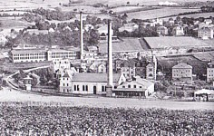Das Elektrizitätswerk entstand 1899 auf dem Grundstück der früheren Finkenmühle unterhalb des Collmberges an der Flurgrenze zwischen Coschütz und Birkigt. Zuvor war die 1843 eingerichtete Mühle als Getreidemühle genutzt worden. Ihre Wasserkraft erhielt sie teilweise durch das aus den Gitterseer Kohleschächten abgeleitete Grubenwasser. Nach dem Erwerb des Grundstücks begann der Bau eines modernen Kraftwerkes mit zwei Dampfmaschinen zu je 72 kW und einer weiteren mit 165 kW Leistung. Die technischen Anlagen stammten von dem in Niedersedlitz ansässigen Unternehmen [O. L. Kummer & Co.](../../ost/niedersedlitz/sachsenwerk/) Für den Kohletransport erhielt das Werk einen Gleisanschluss an die vorbeiführende [Windbergbahn](../../sud/gittersee/windbergbahn/).

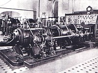Nach seiner Fertigstellung versorgte es ab 1. Oktober 1900 neben Coschütz auch die Dresdner Vorstadt [Naußlitz](../../sudwest/nausslitz/), die Orte Birkigt, Boderitz, Cunnersdorf, [Dölzschen](../../sudwest/dolzschen/), Gittersee, Groß- und Kleinburgk, Kleinnaundorf, Zschiedge sowie die Rittergüter in Burgk und Cunnersdorf mit Strom. Die elf Gemeinden hatten zuvor 1898 eigens einen Zweckverband gegründet. Zeitgleich erhielt Coschütz eine elektrische Straßenbeleuchtung. 1919 erfolgte ein Zusammenschluss mit den Gemeindeelektrizitätsverbänden Cossebaude, Niederlößnitz und Deuben zum Zweckverband "Vorortsammelschiene", um über eine 15 Kilometer lange Drehstromleitung einen Leistungsaustausch zu ermöglichen. 1937 wurde die Stromerzeugung im Coschützer Kraftwerk eingestellt. Die später gewerblich genutzten Gebäude sind jedoch noch erhalten.

## [Coschützer Straßen](../../sud/coschutz/strassen_coschutz/)

[_Weiterführende Literatur und Quellen_](../../impressum/quellenverzeichnis/)

 \[ [Home](../../index.html)\] \[ [Nord](../../nord/)\] \[ [Nordwest](../../nordwest/)\] \[ [Neustadt](../../neustadt/)\] \[ [Nordost](../../nordost/)\] \[ [West](../../west/)\] \[ [Zentrum](../../zentrum/)\] \[ [Südwest](../../sudwest/)\] \[ [Süd](../../sud/)\]
 \[ [Südost](../../sudost/)\] \[ [Ost](../../ost/)\] \[ [Register](../../Register/register.html)\] \[ [Kontakt](../../Kontakt/kontakt.html)\] \[ [Impressum](../../impressum/)\]
