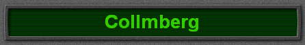
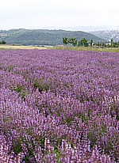
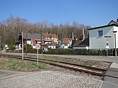
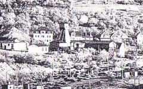
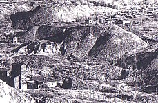

[\|](http://) Neucoschütz

* * *

* * *

Die mit 240 Metern höchste Erhebung auf Coschützer Flur wurde bereits im 12. Jahrhundert landwirtschaftlich genutzt. Frühgeschichtliche Keramikfunde, die 1909 und 1925 an der Ostseite des Collmberges gemacht wurden, belegen jedoch eine Besiedlung der Region bereits deutlich früher. Da die hier gelegenen Flurstücken einst dem Maternihospital gehörten, wurden diese auch als Spitalfelder und der Berg als Spittelberg bezeichnet. Die offizielle Namensgebung Collmberg ist vom slawischen Wort für Hügel abgeleitet. 1822 ist der Berg als "Kolbenberg", 1830 als "Der Kulben" urkundlich genannt. Im 19. Jahrhundert entstand ein Steinbruch.Zudem lagen hier die im Besitz Coschützer Bauern befindlichen Weinberge des Ortes. Letztmals wird eine Weinpresse im Jahr 1887 genannt. Die Felder wurden später für die Salbeipflanzungen des Bombastus-Werkes in Freital-Zauckerode genutzt _(Foto)_. Erst in der Nachkriegszeit mussten diese aufgegeben werden, da der Berg zur Abraumhalde des Wismut-Schachtes in Gittersee wurde. Zuvor wurde am Collmberg über 90 % des deutschen Gesamtbedarfes an dieser Heilpflanze gewonnen.

Ende des 18. Jahrhunderts wurde am Collmberg das erste Coschützer Steinkohlenbergwerk erschlossen. Inhaber war der Gutsbesitzer Daniel Lohrmann. Bereits um 1816 folgten weitere Gruben, die jedoch nur wenige Jahre Bestand hatten. Zwischen 1832 und 1836 ließ der Gutsbesitzer Pietzsch zwischen Collmberg und [Heidenschanze](../../../sud/coschutz/heidenschanze/) den Pietzsch-Stollen auffahren, dessen 1905 vermauertes Mundloch noch in der Nähe der Straße Heidenschanze zu sehen ist. Bedeutendstes Steinkohlebergwerk des Ortes war jedoch der Claus-Schacht. Diesen hatte der Besitzer des Gutes Kohlsdorf (heute Ortsteil von Freital) Ernst Adolf Claus 1830 anlegen lassen. Zehn Jahre später waren hier ca. 50 Arbeiter mit dem Abbau der Kohle beschäftigt. Der 1836 bis auf knapp 370 Meter erweiterte Stollen besaß zwei Lichtlöcher und blieb bis Mitte des 19. Jahrhunderts in Betrieb.

1877 ließen neue Eigentümer, unter Ihnen die Claus´schen Erben, Major von Serre und der Gutsbesitzer Gustav Hermann Klöber den Schacht wieder in Betrieb setzen und förderten hier ab 1878 als Coschützer Steinkohlenwerk noch einige Jahre Kohle, bevor der Abbau mangels Rentabilität 1888 endete. Für die Förderung hatte man ein Kessel- und Maschinenhaus errichtet, in dem zwei Dampfmaschinen die Fördermaschine antrieben.

Nach 1945 gerieten die stillgelegten Schächte wieder ins Interesse der Geologen. Grund war jedoch nicht die Steinkohle, sondern die ebenfalls vorkommende sogenannte "Erzkohle" mit Urangehalt. Dieser strategische Rohstoff war unabdingbar für das sowjetische Atomprogramm, weshalb ab Juli 1947 unter strenger Geheimhaltung eine Revision der Stollen erfolgte. Im Oktober bildete die sowjetische Aktiengesellschaft (SAG) Wismut am Collmberg das "Objekt 6" und begann im Folgejahr mit Probebohrungen und dem Abbau der Erze. Bereits bis Anfang 1950 wurden ca. 90.000 Tonnen gewonnen. Für die Förderung entstand ein Förderschacht an der Ecke Freitaler / Potschappler Straße _(Bild rechts)_. Weitere Gebäude am Collmberg und der Straße Heidenschanze dienten als Mannschaftsbad (Sanitärräume), Verwaltung, Klubraum und Kantine. Hinzu kamen Lagerplätze für Holz, eine radiometrische Kontrollstation und fünf Erzbunker als Zwischenlager. Am Collmberg wurden zudem mächtige Abraumhalden aufgeschüttet _(Bild unten links)_. Umweltschäden entstanden zudem durch häufige Schwelbrände und entweichende Grubengase.

Bis Mitte der 1950er Jahre wurden auf dem militärisch streng abgeschirmten Gelände mehrere Untertagestollen angelegt, die die Abbauggebiete am Collmberg, in [Gittersee](../../../sud/gittersee/bergbaubetrieb_willy_agatz/) und Freital-Birkigt verbanden. Im Zuge des Abbaus traten an einigen Gebäuden Bergschäden auf, so dass einige Wohnhäuser in Niedergittersee und Coschütz zeitweise sogar geräumt werden mussten. Für die zahlreichen Arbeiter der Wimsut wurden 1954/55 Wohnungen in der Südvorstadt errichtet. Zu Spitzenzeiten waren über 1500 Bergleute beschäftigt, der Ertrag lag bei monatlich ca. 5000 Tonnen.

1956 beendete die Wismut den Abbau der Erzkohle auf Coschützer Flur. Die Schächte gingen zum 1. Januar 1956 ins Eigentum des VEB Steinkohlenwerk Freital über, das noch bis zum 3. Februar 1958 Kohle für die Energiegewinnung abbaute. Danach konzentrierte man sich auf den Abbau der aufgeschütteten Halden, bevor 1964 die Kohlegewinnung am Collmberg endgültig eingestellt wurde. 1979 wurden die Schachtanlagen durch die Bergsicherung verwahrt. Eine Rekultivierung der verbliebenen Halden erfolgte nach 1990.

* * *

 \[ [Home](../../../index.html)\] \[ [Nord](../../../nord/)\] \[ [Nordwest](../../../nordwest/)\] \[ [Neustadt](../../../neustadt/)\] \[ [Nordost](../../../nordost/)\] \[ [West](../../../west/)\] \[ [Zentrum](../../../zentrum/)\] \[ [Südwest](../../../sudwest/)\] \[ [Süd](../../../sud/)\] \[ [Südost](../../../sudost/)\] \[ [Ost](../../../ost/)\] \[ [Register](../../../Register/register.html)\] \[ [Kontakt](../../../Kontakt/kontakt.html)\] \[ [Impressum](../../../impressum/)\]
