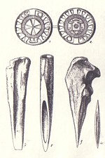
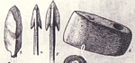
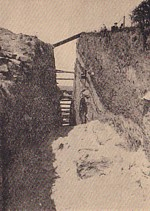
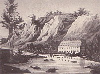
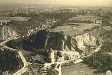
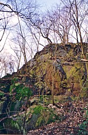
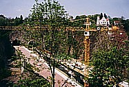
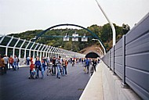

* * *

* * *

* * *

**Funde von der Heidenschanze**

_Aus: R. Naumann "Merk- und Denkwürdigkeiten von Coschütz" (1911)_

Das Gelände der Heidenschanze, einem Bergsporn 75 Meter über dem Plauenschen Grund, war bereits um 1200 v. Chr. besiedelt und gehört zu den ältesten nachgewiesenen Siedlungsplätzen im Dresdner Raum. Die Erstbesiedlung erfolgte wahrscheinlich in der Bronzezeit durch die Illyrer, die die strategisch günstige Lage 75 Meter über dem Weißeritztal als Wohnplatz nutzten. Um 800 v. Chr. wurde der einzige ungeschützte Zugang durch einen ca. 70 Meter langen Wall geschlossen _( **Foto:** Ausgrabungen von 1933)_. Die Burganlage diente nicht nur Verteidigungszwecken, sondern war auch ein wichtiges wirtschaftliches Zentrum der Bevölkerung. Bei Ausgrabungen entdeckte man auf dem Gelände Reste von Gebäuden, Pfeilspitzen und Alltagsgegenständen. Hier befand sich auch eine von bislang vier in Sachsen nachweisbaren Bronzegießereien aus illyrischer Zeit.

Mit dem Vordringen germanischer Stämme um 500 v. Chr. gaben die bisherigen Bewohner die Befestigungsanlage auf und setzten diese vermutlich in Brand. Der Legende nach sollen sich in den eingestürzten Kellern der Burg sieben silberne Särge mit den sterblichen Überresten begüterter Bewohner befinden, welche die Heidenschanze später zum Ziel von Schatzgräbern machten. Auch eine historisch nicht nachweisbare Siedlung “Küchendorf” wird mit dem Burgwall in Verbindung gebracht. Tatsächlich wurde die Brandstätte jedoch zunächst nicht wieder besiedelt und blieb bis zur Völkerwanderung verwaist.

Erst im 6./7. Jahrhundert nahmen slawische Stämme den alten Burgwall in Besitz und nutzten diesen für die folgenden 500 Jahre als Zufluchtsort. Während der deutschen Ostexpansion wurde die Siedlung von Soldaten Heinrich I. erobert, die die Slawen von diesem strategisch wichtigen Punkt vertrieben. Vermutlich wurde die Heidenschanze noch bis Ende des 11. Jahrhunderts als Verteidigungswarte genutzt und erst dann bei kriegerischen Handlungen zerstört bzw. von den Bewohnern endgültig aufgegeben. Bis zum 18. Jahrhundert wurde sie Coschützer Burgberg bzw. Coschützer Schanze genannt, bevor im Jahr 1878 erstmals der Name Heidenschanze auftaucht _(Kupferstich um 1770)_.

**_Foto:_** _Blick über den Plauenschen Grund zur Heidenschanze um 1935_

Im 19. Jahrhundert fielen Teile des Burggeländes dem Steinbruchbetrieb zum Opfer. Der verbliebene Rest des ursprünglich bis zu 5 Meter hohen Walles, der die ca. 200 Meter im Durchmesser messende Burganlage umgab, steht heute als frühgeschichtliches Bodendenkmal unter Schutz. 1865 fand auf dem Gelände der Heidenschanze eine Veranstaltung im Rahmen des 1. Deutschen Sängerbundfestes statt. Ein Jahr zuvor hatte die Wissenschaftliche Gesellschaft ISIS den Berg als alten Burgwall identifiziert und ins Interesse der historischen Forschung gerückt. 1870 nahm der Dresdner Hofapotheker Caro gemeinsam mit dem Coschützer Gutsbesitzer Körner einen Durchstich des Burgwalles vor. Zwischen 1871 und 1874 untersuchte der Anthropologe Rudolf Virchow die Anlage und besuchte sie erneut 1896.

Systematische archäologische Ausgrabungen erfolgten zwischen 1933 und 1935 und zuletzt 1956/57. Dabei entdeckte man u.a. Gefäßscherben unterschiedlicher Zeitepochen, Knochen, verkohlte Getreidereste, aber auch Kinderspielzeug und antike Münzen, was auf die einstige Bedeutung der Wallanlage hinweist. 1999 wurde unterhalb der Heidenschanze mit dem Bau des Autobahntunnels nach Kaitz begonnen. Von der Heidenschanze bietet sich ein schöner Blick nach Dölzschen und über das Weißeritztal des Plauenschen Grundes. Die unterhalb des Walls gelegenen und bis 1931 betriebenen Syenitsteinbrüche am Hang des Weißeritztals sind heute wegen ihrer geologischen Bedeutung und dem Vorkommen einiger seltener Pflanzenarten Flächennaturdenkmal.

**_Foto:_** _Blick von der Heidenschanze auf die neue Autobahnbrücke im Mai 2002 (links) und_

_am “Tag der offenen Tür” im September 2004 (rechts)_

* * *

 \[ [Nord](../../../nord/)\] \[ [Nordwest](../../../nordwest/)\] \[ [Neustadt](../../../neustadt/)\] \[ [Nordost](../../../nordost/)\]
 \[ [West](../../../west/)\] \[ [Zentrum](../../../zentrum/)\] \[ [Südwest](../../../sudwest/)\] \[ [Süd](../../../sud/)\] \[ [Südost](../../../sudost/)\] \[ [Ost](../../../ost/)\] \[ [Register](../../../Register/register.html)\] \[ [Kontakt](../../../Kontakt/kontakt.html)\] \[ [Impressum](../../../impressum/)\]
