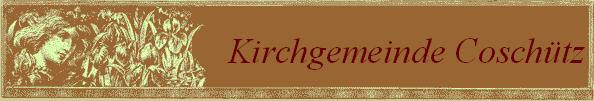
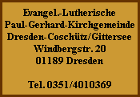
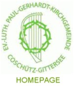
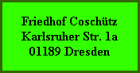
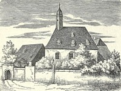
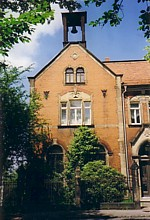
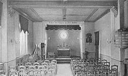

* * *

* * *

* * *

* * *

* * *

* * *

Coschütz unterstand gemeinsam mit zahlreichen weiteren Orten und Vorwerken ursprünglich der Bartholomäuskapelle, die sich in der Nähe des Freiberger Platzes in der Wilsdruffer Vorstadt befand _(Bild)_. Nach der Reformation wechselte die Zugehörigkeit 1578 zunächst zur Annen-, später zur Kreuzkirche und zur Frauenkirche. Für Beerdigungen blieb auch weiterhin die Annenkirche zuständig.

1876 gab es im Gemeinderat erste Überlegungen, die Auspfarrung des Ortes aus der Kreuzkirche zu beantragen und sich der Kirchgemeinde Plauen anzuschließen. Da es jedoch zu keiner Einigung über die finanziellen Folgen gab, unterblieb der Wechsel. 1890 lehnte der Gemeinderat erneut einen entsprechenden Antrag ab, "da man nicht nach Plauen wolle und bei der Kreuzkirche zu bleiben wünsche". Drei Jahre später kamen erstmals Ideen auf, gemeinsam mit dem Nachbarort Gittersee die kirchliche Selbständigkeit zu erlangen. Anlaß war der Vorschlag des Döhlener Pfarrers, einen gemeinsamen Hilfsgeistlichen für Coschütz und Gittersee anzustellen. Zuvor hatte bereits der Ortsteil Neucoschütz den Wechsel zur Potschappler Kirche vollzogen.

1896 beschlossen die Gemeinden Coschütz und Gittersee die Bildung einer eigenen Parochie, so dass am 1. Januar 1897 die Auspfarrung der beiden Orte erfolgte. Die Gottesdienste fanden zunächst abwechselnd im Saal der Coschützer Schule und im Betsaal zu Gittersee statt. Die Gemeinsamkeit endete jedoch bereits im gleichen Jahr am 1. August. Grund waren Streitigkeiten über den Standort einer geplanten gemeinsamen Kirche und die Nutzung des Friedhofes in Gittersee. Nach einer “Volksabstimmung” der Einwohner des Ortes beschloss man die künftige kirchliche Selbstständigkeit.

Als eine der ersten Amtshandlungen des neu gewählten Kirchenvorstandes konnte am 16. Januar 1898 der Coschützer Friedhof an der Karlsruher Straße eingeweiht werden. In unmittelbarer Nachbarschaft hatte bereits Plauen mit dem [Äußeren Plauenschen Friedhof](../../../sud/plauen/auferstehungskirche/) einen neuen Beerdigungsplatz für seine Toten geschaffen. Das Grundstück hatte der Coschützer Gemeindeälteste und Gutsbesitzer Paul Körner für 3000 Mark zur Verfügung gestellt. Noch im gleichen Jahr erhielt der Friedhof eine Totenhalle und wurde 1903 nochmals erweitert. Seit 1924 erinnert ein Kriegerdenkmal an die 138 gefallenen Einwohner des Ortes. Neben Namen und Jahreszahlen finden sich hier die Darstellung von zwei Soldaten mit Stahlhelm und die Inschrift "Unsere Toten. 1914-1918"

1900 errichtete der Ort an der Körnerstraße (Windbergstraße) 17 ein Pfarrhaus mit Betsaal _(Foto)_, welcher am 14. Oktober eingeweiht wurde. Die Finanzierung erfolgte vor allem durch Spenden der Einwohner sowie einen Zuschuss der Kreuzkirche als früherer “Mutterkirche” in Höhe von 10.000 Mark.
Die Bauausführung übernahm der ortsansässige Baumeister Max Seiffert. Die Ausstattung des ca. 200 Plätze umfassenden Kirchsaals erfolgte durch private Stifter. Für die musikalische Begleitung der Gottesdienste erwarb man ein Harmonium der Bornaer Firma Sindholm. Sein heutiges Aussehen erhielt dieser Saal bei einem Umbau 1955. Weitere Räume beherbergen die Wohnung des Pfarrers, Verwaltungsräume und das Pfarramtsarchiv.

Nach Fertigstellung des Gebäudes wurde mit den Vorbereitungen für einen Kirchenbau auf der gegenüberliegenden Straßenseite begonnen. Diese Planungen scheiterten jedoch an Grundstücksfragen, so dass die Gemeinde bis heute ohne eigene Kirche geblieben ist. In den Jahren nach dem Ersten Weltkrieg wurde eine Angliederung an die Plauener Kirche erwogen, jedoch bald wieder aufgegeben. 1953 erhielt das Pfarrhaus ein Glockentürmchen, in dem heute eine um 1490 gegossene Glocke schlägt, die nach dem Zweiten Weltkrieg vom Hamburger “Glockenfriedhof” geborgen werden konnte. Ihre ursprüngliche Herkunft ist unbekannt. 1958 erhielt das Gemeindehaus eine Orgel der Dresdner Orgelbaufirma Jehmlich. Das Instrument besitzt zwei Manuale und neun Register und wurde am 13. April 1958 feierlich geweiht.

Innerkirchliche Sparmaßnahmen und ein Rückgang der Gemeindemitgliederzahl waren der Grund für eine engere Zusammenarbeit der beiden Kirchgemeinden von Coschütz und [Gittersee](../../../sud/gittersee/kirche_gittersee/). Seit 1977 wurden beide von einem Pfarrer betreut und am 1. Januar 1987 schließlich vereinigt. Enge Bindungen bestehen zur Auferstehungsgemeinde Dresden-Plauen, der auch ein Großteil der Verwaltungsaufgaben übertragen wurden.

* * *

 \[ [Home](../../../index.html)\] \[ [Nord](../../../nord/)\] \[ [Nordwest](../../../nordwest/)\] \[ [Neustadt](../../../neustadt/)\] \[ [Nordost](../../../nordost/)\] \[ [West](../../../west/)\] \[ [Zentrum](../../../zentrum/)\] \[ [Südwest](../../../sudwest/)\] \[ [Süd](../../../sud/)\] \[ [Südost](../../../sudost/)\] \[ [Ost](../../../ost/)\] \[ [Register](../../../Register/register.html)\] \[ [Kontakt](../../../Kontakt/kontakt.html)\] \[ [Impressum](../../../impressum/)\]
