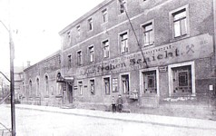

* * *

Die Siedlung Neu-Coschütz entstand Ende des 18. Jahrhunderts abseits des alten Dorfkerns im Weißeritztal und entwickelte sich nach Eröffnung des [Eisenhammerwerkes](../../../sud/plauen/plauenscher_grund/eisenhammerwerk/) zur Arbeitersiedlung der dort Beschäftigten. Außerdem lebten zahlreiche Bergleute des Burgker Steinkohlenreviers in Neucoschütz. Zählte der Ortsteil 1834 nur 66 Bewohner, waren es sechs Jahre später bereits 156. Nach Bildung der Landgemeinde Coschütz 1839 gehörten auch jeweils zwei Neucoschützer Einwohner dem Gemeinderat an. Drei Jahre später erteilte dieser dem Bäckergesellen Neubert die erste Gewerbekonzession zur Gründung einer Bäckerei. Wenig später folgten weitere Läden und Handwerksbetriebe, vorrangig zur Eigenversorgung des Ortsteils. Außerdem gab es ab 1869 den Gasthof “Zur frohen Schicht” _(Foto_). Der Konzessionserteilung waren jahrelange erfolglose Bemühungen vorausgegangen, da der Coschützer Gemeinderat für die Einrichtung eines weiteren Lokals in der Gemeinde keinen Bedarf sah. Um 1880 ließen die Besitzer ihr Lokal um einen großen Ballsaal erweitern, der bis 1945 für verschiedene Veranstaltungen genutzt wurde. 1995 erfolgte der Abriss des Saalgebäudes.

Bereits 1847 kamen erste Überlegungen auf, Alt- und Neucoschütz zu trennen und in zwei eigenständige Gemeinden umzuwandeln. Grund waren Differenzen bei der Abgrenzung des Schulbezirks, bei der Verteilung der Gemeinde- und Steuerlasten und der künftigen wirtschaftlichen Entwicklung des Ortes. Auch kirchlich waren die Bewohner rechts der Weißeritz zur Kreuzkirche, die des linken Ufers hingegen zur Pesterwitzer Kirche gepfarrt. Obwohl das Königliche Justizamt die Teilung befürwortete, versagte die Kreisdirektion Dresden ihre Zustimmung. Auch ein erneutes Ersuchen des Gemeinderates im Jahr 1857 brachte zunächst keinen Erfolg. Drei Jahre später genehmigte das Kultusministerium den Bau eines eigenen Schulhauses für Neucoschütz. Zu diesem Zeitpunkt wurde auch ein neuer Bebauungsplan für den Ortsteil erarbeitet. Um diesen zu finanzieren, beschloss der Coschützer Gemeinderat 1861, von jedem Bauwilligen künftig einen Taler zu erheben. Zwei Jahre später öffnete das Neucoschützer Schulhaus.

Im Zuge der Industrialisierung im Weißeritztal dehnte sich die Arbeitergemeinde Neucoschütz immer weiter aus und wuchs so mit dem benachbarten Potschappel auch baulich zusammen. Ab 1894 übernahm Potschappel die Wasserversorgung der Häuser, wenig später erfolgte der Anschluss der Neucoschützer Gebäude an das von den Ortschaften des Plauenschen Grundes gemeinsam betriebene Elektrizitätswerk in Deuben. Am 1. Januar 1896 wurde der Ortsteil mit ca. 1400 Einwohnern aus der Gemeinde Coschütz ausgegliedert und nach Potschappel eingemeindet.

* * *

 \[ [Home](../../../index.html)\] \[ [Nord](../../../nord/)\] \[ [Nordwest](../../../nordwest/)\] \[ [Neustadt](../../../neustadt/)\] \[ [Nordost](../../../nordost/)\] \[ [West](../../../west/)\] \[ [Zentrum](../../../zentrum/)\] \[ [Südwest](../../../sudwest/)\] \[ [Süd](../../../sud/)\] \[ [Südost](../../../sudost/)\] \[ [Ost](../../../ost/)\] \[ [Register](../../../Register/register.html)\] \[ [Kontakt](../../../Kontakt/kontakt.html)\] \[ [Impressum](../../../impressum/)\]
