Der Name Achtbeeteweg geht auf eine alte Coschützer Flurbezeichnung zurück. Gleicher Herkunft ist auch der Name des nahegelegenen Vierbeeteweges. Beide Bezeichnungen sind im Coschützer Flurregister von 1794 amtlich genannt. Früher hatte dieser Weg Bedeutung als Ortsverbindung zwischen Coschütz und Kaitz und wurde deshalb nach seinem Ausbau ab 1900 bis zur Eingemeindung Kaitzer Straße genannt. 1926 erhielt er seinen heutigen Namen.

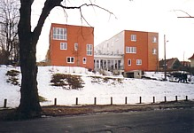Zwischen 1924 und 1928 errichtete der Deutsche Siedlerbund auf dem Gelände einer früheren Lehmgrube östlich der Karlsruher Straße zwischen Achtbeeteweg und der neu geschaffenen Straße Coschützer Höhe eine Reihenhaussiedlung. Die einheitlich gestalteten Gebäude mit kielbogenförmigen Dächern _(Fotos unten)_ bewohnten in den Anfangsjahren vor allem Angestellte der Felsenkellerbrauerei. 1998/99 entstand in der Nähe des Coschützer Dorfkerns durch eine Bauherrengemeinschaft die Wohnanlage “Sächsischer Rundling”, welche in modernen Bauformen die Idee früherer Dorfgemeinschaften aufnimmt (Nr. 49b). Idee und Planung stammen vom österreichischen Archichtekten Fritz Matzinger. Die Gebäude mit insgesamt 18 Wohnungen gruppieren sich um einen gemeinsam genutzten Mittelpunkt. Die Grundsteinlegung erfolgte am 27. März 1999, der Bezug ab 31. Juli des gleichen Jahres _(Foto links)_.

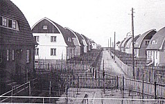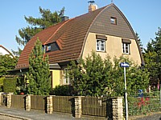

**_Fotos:_** _Wohnhäuser des Deutschen Siedlerbundes am Achtbeeteweg um 1930 (rechts) und 2014._

Die Straße Am Eiswurmlager, gelegen auf dem Gelände der [Felsenkellerbrauerei](../../../sud/plauen/plauenscher_grund/felsenkellerbrauerei/), erhielt ihren Namen 1926. Zuvor wurden die Gebäude als „einzelne Grundstücke“ der Flur Coschütz geführt bzw. Stufenweg genannt. Der kuriose Straßenname erinnert an eine Legende aus dem Jahre 1862. Damals hatten die Teilhaber der Brauerei einige Kleinaktionäre verunsichert, in dem sie die Existenz eines "Eiswurms" in den Lagerkellern behaupteten, der das Kühleis verspeise und so zum Verderben des gelagerten Biers führe. Bis heute ist am nach Coschütz führenden Weg „Eiswurms Lager“ durch eine Inschrift am Felsen zu finden.

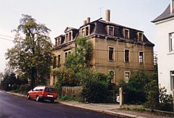Die Straße Am Hohen Stein geht auf einen alten Verbindungsweg zwischen dem Dorfkern von Altcoschütz und dem Nachbarort Plauen zurück. Da hier der Bauer Rietschel seine Scheune hatte, hieß dieser Weg im Volksmund Rietschelschuppenweg. Nach nach dem Ausbau des Weges zur Straße wurde diese ab 1902 bis zur Eingemeindung des Ortes als Plauensche Straße bezeichnet. Seit 1926 trägt sie offiziell ihren jetzigen Namen nach dem nahe gelegenen Aussichtspunkt [Hoher Stein](../../../sud/plauen/hoher_stein/). Die Gebäude, meist dreigeschossige Mietshäuser entstanden ab ca. 1900. In einigen gab es kleine Läden, so in Nr. 31 bis 1999 die Bäckerei Sarodnick. Das Haus im Bild entstand um 1895 und wurde 2003 nach längerem Leerstand wegen seines schlechten Bauzustandes abgerissen. Sechs Jahre später wurde an dieser Stelle ein Neubau errichtet

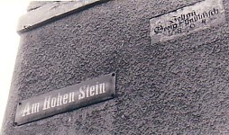Am Eckhaus Nr. 48 erinnert eine Steintafel an die Coschützer Bauernfamilie Palitzsch, aus der auch der bekannte Bauernastronom stammt ( _Johann Georg Palitzsch 1804_). Diese war ursprünglich Teil eines Grabsteins und wurde beim Bau des Vorgängergebäudes in die Fassade integriert. Das Grab auf dem Leubnitzer Friedhof existiert noch heute, hatte jedoch bereits Ende des 18. Jahrhunderts eine neue Gestaltung erhalten. Vermutlich in diesem Zusammenhang verbrachten Nachkommen von Palitzsch die alte Grabplatte nach Coschütz und ließen diese zunächst in eine Gartenmauer, 1804 in die Hausfassade einfügen. Nach dem Abriss des Gebäudes 1983 zugunsten des jetzigen Einfamilienhauses wurde sie geborgen und wieder angebracht _(Foto 1978)_. Vor dem Zweiten Weltkrieg gab es in diesem Haus eine Lebensmittelhandlung.

Die Birkigter Straße verläuft im Plauenschen Grund unmittelbar neben der Bahntrasse der Eisenbahnstrecke Dresden – Chemnitz in der Nähe der Weißeritz. Sie entstand bereits im 19. Jahrhundert als namenlose Verbindung zum Nachbarort Birkigt und wurde zwischen 1913 und 1920 ausgebaut. 1926 bekam sie ihren Namen nach dem heute zu Freital gehörenden Ort. Unter Denkmalschutz steht das um 1770 als Arbeiterwohnhaus der Pulvermühle errichtete Fachwerkhaus Nr. 2, welches jedoch nach jahrelangem Leerstand mittlerweile eine Ruine ist.

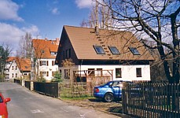Der Brendelweg an der Kohlenstraße wurde Mitte der 1930er Jahre beim Bau einer kleinen Wohnsiedlung angelegt und erhielt 1938 seinen Namen nach dem sächsischen Bergingenieur und Maschinendirektor Christian Friedrich Brendel (1776–1861). Brendel gilt als einer der bedeutendsten Bergbautechniker des 19. Jahrhunderts und erwarb sich große Verdienste bei der Industrialisierung des Bergbaus.

Nach der Erschließung entstanden hier auf ehemaligem Ziegeleigelände einige Siedlungshäuser. Weitere Einfamilienhäuser folgten nach 1990 _(Foto)_.

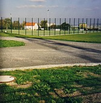Der heute nicht mehr vorhandene Bruchsaler Weg wurde um 1935 als Erschließungsstraße einer geplanten, aber nicht realisierten Erweiterung des Wohngebietes an der Coschützer Höhe angelegt. Ursprünglich sollte er die Cunnersdorfer Straße mit einer Verlängerung der Rastatter Straße verbinden. Letztlich erfolgte jedoch nur der Ausbau einer kurzen Sackgasse an der Cunnersdorfer Straße. Die Namensgebung erfolgte nach der Stadt Bruchsal im heutigen Bundesland Baden-Württemberg. In den Stadtplänen ist der Bruchsaler Weg noch bis Anfang der 1970er Jahre ausgewiesen. Heute befindet sich auf dem Areal der Sportplatz Stuttgarter Straße. Der 1999 eingeweihte Kunstrasenplatz _(Foto)_ wird vom FV Dresden Süd-West genutzt.

Die Straße in der Nähe des Coschützer Dorfkerns entstand 1892 als Verbindung zwischen Kleinnaundorfer und Freitaler Straße. Ursprünglich wurde sie wegen ihrer Lage ab 1902 Bergstraße genannt. Um Verwechslungen mit gleichnamigen Straßen zu vermeiden, erfolgte nach der Eingemeindung von Coschütz 1926 die Umbenennung in Coschützer Hang. Die Arbeiterwohnhäuser stammen meist aus der Zeit 1900.

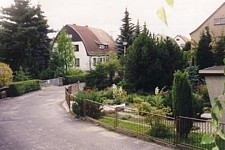Die Straße Coschützer Höhe wurde Anfang der 1920er Jahre südlich des Achtbeeteweges angelegt. Zu dieser Zeit ließ die "Siedlungsgesellschaft Dresden-Stadt und Land" hier eine neue Wohnsiedlung errichten. Deren Lage war Anlass, die bisherige Planstraße A ab März 1923 als Coschützer Höhe zu bezeichnen. Die Doppelhäuser entstanden zwischen 1924 und 1928 und fallen durch ihre ungewöhnlichen Dachkonstruktionen in Form eines Schiffskiels auf. Lediglich bei den Häusern Nr. 6/8, 10/12 und 14/16 wurden diese nach Bombenschäden in der Nachkriegszeit durch einfache Satteldächer ersetzt. Am 9. Juli 1925 erfolgte für die ersten Bauten der "Hebeschmaus (Richtfest), bezogen wurden sie ab 1926. Ursprünglich waren die Fassaden in verschiedenen Farben gestaltet.

Der seit 1926 benannte Coselweg verbindet den Dorfkern von Coschütz mit dem Plauenschen Grund. Von Bedeutung war er einst auch als Fußweg zum alten Plauener Bahnhof, der sich bis 1923 in der Nähe der Felsenkellerbrauerei befand. Bereits 1685 hatte der aus Italien stammender Goldsucher Johann Begge in der engen Schlucht oberhalb des Weißeritztales versucht, Gold und Silber zu schürfen, jedoch ohne Erfolg.

_Über das Wasser, die Weißeritz genandt, lieget ein Gründgen, nahe bei einem Dorff, so_

_Coschiz heisset, unten am Gründgen ist ein Goldgang, der aber mehr Silber als Gold hält ..._

_Weiter hinauf im Gründlein ist ein Stollen, darinnen viel Silber und Kupffer ist._

**Aufzeichnung des Italieners Johann Begge (1685): “Gründliche Nachricht vom Plauischen Grunde und unterschiedlicher Oerther, und derer daselbst befindlichen Gold-, Silber und Kupfer-Erzen”.**

Um den Coselgrund ranken sich mehrere Sagen, welche mit der Gräfin Cosel in Verbindung stehen. Diese soll demnach hier nach ihrer Verbannung gelebt und heimlich einen Sohn zur Welt gebracht haben, welcher im Grund ermordet wurde. Seitdem sei dieser Ort verflucht und bringe seinem Besitzer kein Glück. Tatsächlich entstand die für den Grund namensgebende Villa jedoch erst später für ihren Sohn Friedrich August.

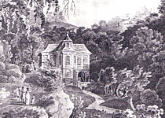Villa Cosel: 1767 erwarb Friedrich August von Cosel (1712-1770), ein Sohn August des Starken und der Gräfin Cosel, im Tal ein Grundstück und ließ dort ein Kupferbergwerk aufschließen, welches jedoch mangels Erträgen schon bald wieder einging. Am noch erhaltenen Mundloch findet sich die Inschrift: _17 DER NEUE SEGEN GOTTES 67._ Bei einer Befahrung des Stollns am 10. September 1925 führte von dort eine kleine Treppe zur Sohle, die in einen ungefähr 16 Meter langen Gang mündete. Das Bild zeigt das Gebäude um ca. 1820 (Sammlung Bienert).

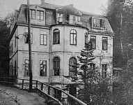Das frühere Huthaus wurde nach Stillegung des Bergwerks zu einer Villa umgebaut, die bis 1863 im Familienbesitz blieb. Zeitweise wohnte hier der frühere Ballettmeister des Leipziger Stadttheaters Karl Marquardt. Marquardt galt im Alter als skurriler Sonderling und soll Überlieferungen nach im Haus ein Zimmer als “Wolfsschlucht” eingerichtet haben, um dort für sich allein den “Freischütz” spielen zu können. Ein verschiedentlich erwähnter Aufenthalt des russischen Fürsten Repnin, ab 1813 Generalgouverneur von Sachsen, ist nicht belegbar.

1863 verkauften die Erben Friedrich August von Cosels das Haus an den Dresdner Apotheker Werner, der sie 1868 an einen Fleischermeisters veräußerte. Dieser ließ die Villa 1874 aufstocken und in ein Mietshaus umwandeln _(Foto rechts)_. Durch den Ausbau des Dachgeschosses verlor das Haus dabei sein ursprüngliches barockes Aussehen _(Foto)_. Zuletzt wurde die frühere Villa Cosel von der benachbarten Felsenkellerbrauerei genutzt und 1975 wegen Baufälligkeit abgetragen.

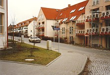Die heutige Cunnersdorfer Straße geht auf einen alten Verbindungsweg zwischen Coschütz und Cunnersdorf, einem Ortsteil der
Gemeinde Bannewitz zurück. Erstmals ist sie im Adressbuch von 1902 verzeichnet. Zu diesem Zeitpunkt gab es hier nur wenige Gebäude, jedoch zwei Ziegeleien. Außerdem hatte die Gemeinde diese Straße 1874 mit Obstbäumen bepflanzen lassen.

Erst nach dem Ersten Weltkrieg wurde auch das Gebiet südlich des Achtbeetewegs erschlossen. 1920 planten mehrere Baugenossenschaften die Errichtung von Einzel- und Doppelhäusern auf dem Areal der Lichtenbergerschen Ziegelei zwischen Kohlenstraße und Achtbeeteweg. Diese Planungen konnten jedoch erst in den 1930er Jahren durch den Kriegerheimstättenverein Coschütz realisiert werden. Im Zuge des Baus der [Brauerei Coschütz](../../../Sud/Coschutz/Strassen_Coschutz/Brauerei Coschütz/brauerei.html) (1973-1981) wurde die Cunnersdorfer Straße nochmals verlängert. 1994/95 folgte an der Einmündung des Achtbeeteweges die Wohnanlage "Cityhöhe" mit 73 Eigentumswohnungen. Zuvor war das Grundstück von einer Kohlenhandlung genutzt worden. Außerdem gab es bis 1989 an der Cunnersdorfer Straße eine von zwei Dresdner Mülldeponien.

Ziegelei Coschütz: Auf den Flächen südlich der Strehlener Straße (heute Kohlenstraße) befanden sich vor dem Ersten Weltkrieg zwei Ziegeleien. Die ältere entstand 1859 und gehörte Johann Friedrich Heymann. Ihr Standort war zwischen Kohlenstraße, Karlsruher Straße, Cunnersdorfer Straße und Achtbeeteweg. Bis 1870 errichtete Heymann dort mehrere Brennöfen, Ziegeltrockenschuppen, Lagerschuppen, Pferdeställe und Nebengebäude. Kurz darauf übernahm die Dresdner Baugesellschaft das Unternehmen, die mehrere Ziegeleien im Dresdner Südraum betrieb (Cunnersdorfer Straße 5).

Die zweite Ziegelei wurde in unmittelbarer Nachbarschaft 1872 an der Ecke Cunnersdorfer Straße / Achtbeeteweg gegründet und existierte bis 1920 (Nr. 7). In zahlreichen Unterlagen wird sie als Central-Ziegelei bezeichnet. Pächter war bis 1900 die Firma Lichtenberger & Gen., danach bis zur Betriebseinstellung Friedrich Kleinert. Der Abbruch erfolgte 1921, die verbliebenen Gebäude wurden an gewerbliche Interessenten vermietet.

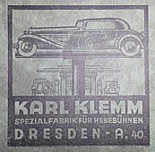Nach der Einstellung des Betriebs siedelten sich mehrere Firmen auf dem Areal an. So gab es auf dem Grundstück Cunnersdorfer Straße 7 die "Tivoli"-Maschinenbaugesellschaft m.b.H. von Otto Türcke. Anfang der 1930er Jahre erwarb der Unternehmer Karl Klemm die Trockenhallen der Ziegelei und richtete hier eine Spezialmaschinenfabrik ein. Noch vor Beginn des Zweiten Weltkriegs wurde das Unternehmen nach Bannewitz verlegt und ging dort nach 1945 im VEB Kompressorenbau auf. Die alten Fabrikgebäude wurden anschließend als Lager für russische Zwangsarbeiterinnen genutzt, die in Fabriken in Dresden-Plauen beschäftigt waren. Nach 1945 befand sich hier bis zum Abriss der Hallen ein Lager mit Verkaufsstelle für Möbel. Außerdem betrieb der Gastwirt des 1945 zerstörten Lokals "Gambrinus" am Postplatz zeitweise eine kleine Gaststätte.

Firma Paul Mittag:  Das Unternehmen entstand nach dem Ersten Weltkrieg als Baugeschäft auf ehemaligem Ziegeleigelände. Außerdem gab es hier das Cementwaren und Schlackensteinwerk Frieda Mittag. Nach 1945 wurde die Firma als privater Baubetrieb fortgeführt, 1972 jedoch verstaatlicht und zum Betriebsteil des VEB Betonwerk Dresden. Nach 1990 erhielten die Alteigentümer ihre Firma zurück und verkauften das Grundstück wenig später an ein Bauunternehmen. Heute stehen auf dem Areal mehrere Reihenhäuser.

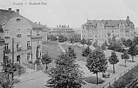Die Felsenkellerstraße wurde Anfang des 20. Jahrhunderts beim Ausbau der neuen Coschützer Wohnviertel westlich des Dorfkerns angelegt und mit mehrgeschossigen Wohnhäusern bebaut. Ihren Namen verdankt sie der im Plauenschen Grund auf Coschützer Flur gelegenen [Felsenkellerbrauerei](../../../sud/plauen/plauenscher_grund/felsenkellerbrauerei/). Benannt wurde die Felsenkellerstraße auf Beschluss des Bauausschusses des Coschützer Gemeinderats vom 3. Juli 1906, die offizielle Verkehrsübergabe erfolgte am 18. September 1908.

Um die Kreuzung Felsenkeller- / Karlsruher / Windbergstraße entwickelte sich um 1900 das neue Ortszentrum mit zahlreichen Geschäften. So gab es im Eckhaus zur Karlsruher Straße viele Jahre eine Drogerie. Im Erdgeschoss des Wohnhauses Nr. 4 befand sich eine Filiale des Konsumvereins “Vorwärts” _(im Bild ganz links)_.

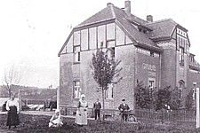Die Straße bildet den alten Verbindungsweg zwischen dem Coschützer Dorfkern und den benachbarten Orten Potschappel und Niedergittersee. Bis zur Eingemeindung wurde sie Potschappler Straße, danach ab 1926 Freitaler Straße genannt. Ältestes Gebäude ist das Wohnhaus der früheren Gärtnerei Schöne (Nr. 22) von 1904 _(Foto)_. Bis zur Schließung des Betriebes 1970 nahmen die Felder und Gewächshausanlagen einen großen Teil der Flächen zwischen Freitaler Straße und Collmberg ein. Zwischen 1951 und 1956 musste das Gebäude zeitweise wegen Bergschäden geräumt werden, blieb jedoch nach Reparatur letztlich erhalten und wird heute als Wohnhaus genutzt.

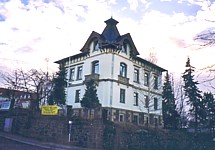Die Ende des 19. Jahrhunderts östlich des alten Dorfkerns angelegte Gebauerstraße erhielt ihren Namen nach dem ehemaligen Gemeindevorstand des Ortes Karl Traugott Gebauer (1828-1895). Gebauer übte dieses Amt von 1863 bis zu seinem Tod ehrenamtlich aus und war im Haupterwerb als Schmied und Gastwirt tätig. 1888 richtete die Gemeinde Coschütz zu seinen Ehren die Gebauer-Stiftung ein, die von Gebauer selbst finanziell unterstützt wurde und alljährlich Zuwendungen an arme Ortsbewohner gab. Er selbst lebte bis zu seinem Tod am 31. August 1895 in der 1889/90 errichteten Villa Gebauerstraße 2. Nach 1945 befand sich hier der Schulhort der 72. Polytechnischen Oberschule. 1998/99 wurde das Haus denkmalgerecht saniert _(Foto rechts)_.

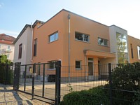Bis zur Eingemeindung von Coschütz wurde die Gebauerstraße ab April 1902 Gitterseerstraße (alternative Schreibweise: Gitterseer Straße) genannt. Die ältesten Gebäude in der Nähe des Dorfkerns stammen vom Ende des 19. Jahrhunderts. Weitere Mietshäuser folgten in den 1920er Jahren und stehen teilweise unter Denkmalschutz. 1979-81 wurde auf dem Grundstück Gebauerstraße 4 ein Wohnheim mit 180 Plätzen errichtet. Das Heim diente als Unterkunft für die Absolventen der Zentralberufsschule für Brauerei- und Molkereiindustrie, vor allem für Lehrlinge der Coschützer Brauerei. Nach 1990 wurde es geschlossen und 2010 abgerissen. Danach entstand an Stelle des früheren Wohnheims die Kindertagesstätte “Entdeckerkiste” mit ca. 100 Plätzen (Gebauerstraße 4 - _Foto_).

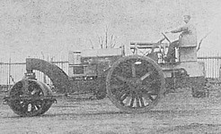Walzenfabrik Gebrüder Bobe: Das Unternehmen wurde 1899 von Ernst Bobe und seinem Bruder in Dresden gegründet und besaß auf dem Grundstück Gitterseestraße 13/15 (später Nr. 11) seine Werkstätten und Lagerräume. Sitz des Unternehmens war bis ca. 1930 die Pestitzer Straße 14 in Plauen. Die Firma stellte verschiedene Dampf- und Straßenwalzen _(Foto)_ sowie Maschinen zum Aufreißen von Straßen her, die man überwiegend an kommunale Auftraggeber, u.a. die Stadt Dresden verlieh. Auch das Bedienpersonal wurde dafür gestellt. 1907 erfolgte die Umwandlung in eine GmbH. 1914 wies die Bilanz der Gebrüder Bobe G.m.b.H. ein Stammkapital von 75.000 Mark und neun Straßenbauwalzen aus. Hinzu kamen weitere Fahrzeuge und Maschinen. Später wurden von Ernst Bobe, der mehrere Patente auf technische Neuerungen besaß, auch benzin- bzw. benzolgetriebene Walzen hergestellt und verkauft. Als einer der ersten Hersteller machte man sich dabei Erfahrungen aus dem Kraftfahrzeug- und Landmaschinenbau zu nutze. Heute nutzt eine Firma für Blitzschutztechnik das Areal.

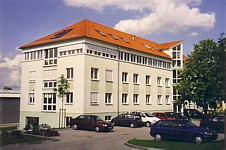Die Heidelberger Straße befindet sich im Gewerbegebiet Coschütz/Gittersee und wurde Mitte der 1990er Jahre angelegt. In Anlehnung an die nahegelegene Karlsruher Straße erhielten die neuen Straßen am 14. März 1996 Namen nach Städten in Baden-Württemberg, hier nach der Stadt Heidelberg am Neckar.

Das zwischen 1993 und 1999 erschlossene Areal war erstes kommunales Gewerbegebiet der Stadt Dresden. Zuvor befand sich hier das an Stelle einer früheren Uran-Aufbereitungsanlage der Wismut gegründete Pneumant-Reifenwerk. Nach Abriss der meisten Gebäude und der Sanierung des kontaminierten Bodens erfolgte am 22. September 1994 der erste Spatenstich durch den Dresdner Oberbürgermeister Herbert Wagner. Zu den ansässigen Firmen gehören u.a. die XENON Automatisierungstechnik GmbH (Nr. 1), die Wellpappenwerk Gittersee GmbH (Nr. 5), die ALS Anlagentechnik und Sondermaschinen GmbH (Nr. 12 - _Foto_), die rds Robotron Datenbank Software GmbH (Nr. 14) sowie ein Ingenieurbüro für Verfahrens- und Verpackungstechnik (Nr. 20). Aus dem ehemaligen Wohnheim des Reifenwerkes entstand das Apartementhaus "Ingeburg Apartments" (Nr. 6).

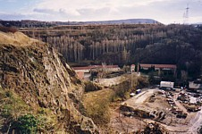Die nach dem angrenzenden [Burgwall](../../../sud/coschutz/heidenschanze/) benannte Straße Heidenschanze verbindet den alten Coschützer Dorfkern mit dem [Plauenschen Grund](../../../sud/plauen/plauenscher_grund/). Sie geht auf einen alten Fußweg zwischen Coschütz und Niederdölzschen zurück. 1832 erfolgte in der Nähe der Aufschluss des Coschützer Tagesschachts, auch Pietzsch-Stollen genannt. Das Mundloch des bis 1860 genutzten Steinkohlebergwerks wurde 1905 vermauert. Erstmals ist dieser Weg im Adressbuch von 1876 als Dölzschener Straße verzeichnet. Zuvor wurde er amtlich Coschütz-Dölzschener Kommunikationsweg genannt. Um Verwechslungen mit einer gleichnamigen Straße in Löbtau zu verhindert, erfolgte 1926 die Umbenennung in Heidenschanze. Neben und unterhalb der Straße fließt der heute völlig verrohrte Gitterseebach zur Weißeritz.

Vor dem Zweiten Weltkrieg gab es hier mehrere Steinbrüche. Inhaber waren Coschützer Gutsbesitzer bzw. die Gemeinde Coschütz. So gab es ab 1874 bis ca. 1930 den Steinbruch von Paul Körner, der den Betrieb an wechselnde Pächter (Wilhelm Wünschmann, Theodor Maul und Esche) verpachtete. Ein weiterer Steinbruch befand sich unmittelbar hinter der Garnisonsmühle. Besitzer dieses Bruchs war Wilhelm Günther, später Traugott Tischer und zuletzt Hermann Israel. 1907 verpachtete Tischers Witwe den Betrieb zeitweise an die bekannte Baufirma Dyckerhoff & Widmann). Der dritte Steinbruch an der Heidenschanze gehörte bis zu seiner Schließung zum Syenit- und Klarschlagwerk A. Lorenz. Das Unternehmen war 1892 von Gustav Patzig durch Übernahme eines 1877 erstmals genannten gemeindeeigenen Syenitsteinbruchs entstanden und besaß eine zunächst dampf-, ab ca. 1910 elektrisch betriebene Brecheranlage (Fa. Mäser & Patzig). Gewonnen wurden in den Coschützer Brüchen meist Klarschlag, der als Baustoff im Straßenbau oder der Betonherstellung benötigt wurde.

Im oberen Teil prägen Kleingärten und einige Einfamilienhäuser das Bild. Am unteren Ende der Straße befinden sich die Einrichtungen der Sprengschule Dresden mit einem Hotel (Nr. 6-8) sowie die verfallenden Gebäude der einstigen Weizenmühle, die in den kommenden Jahren zu einer Wohnanlage ausgebaut werden sollen. Von hier führt sie als Fuß- und Radweg durch eine Unterführung unter der Eisenbahnstrecke nach Chemnitz hindurch und mündet in die Tharandter Straße. Das Bild zeigt einen Blick von der Begerburg zur Heidenschänze und über das Areal der Sprengschule.

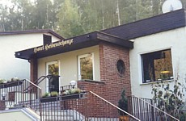Dresdner Sprengschule: Die Ausbildungsstätte für Sprengtechniker geht auf den Sprengingenieur Friedrich Weichelt zurück, der 1946 in Halle wieder mit Befähigungskursen und Prüfungen für angehende Sprengstoffexperten begann. Die ab 1948 unter der Schirmherrschaft der Geologischen Landesanstalt stehende Einrichtung wurde nach dem Tod Weichelts 1961 nach Dresden verlegt und hatte ihren Sitz zunächst in den Kellerräumen der Bayreuther Straße 21. 1965 erfolgte der Umzug zur Würzburger Straße 41. Die Trägerschaft lag nun beim Spezialbaukombinat Magdeburg - Betriebsteil Bohr- und Sprengtechnik Berlin. Um den gewachsenen Anforderungen in der Berufsausbildung begegnen zu könne, verlegte man die Einrichtung 1971 zur Heidenschanze 6-8, wo es neben Seminarräumen und Verpflegungseinrichtungen auch einen Übungsplatz gab.

1990 wurde die Ausbildungsstätte unter dem Namen Sprengschule Dresden umstrukturiert, gehörte zeitweise zur Verkehrsbau Union Berlin GmbH. Seit 1992 ist sie eine eigenständige GmbH. Ausgebildet werden Sprengtechniker, Pyrotechniker, Experten für den Transport gefährlicher Güter sowie Spezialisten für die Kampfmittelbeseitigung. Aus der früheren Kantine der Berufsschule ging das heutige Hotel Heidenschanze hervor _(Foto)_.

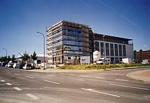Wie die benachbarten Straßen wurde auch die Heilbronner Straße Mitte der 1990er Jahre zur Erschließung des Gewerbegebiets Coschütz/Gittersee angelegt (Planstraße 2) und am 14. März 1996 nach der Stadt Heilbronn in Baden-Württemberg benannt. Mit der Namensgebung setzte sich die Tradition fort, Straßen in Coschütz nach Orten in Südwestdeutschland zu benennen. In den Folgejahren errichteten hier verschiedene mittelständische Firmen und Handwerksbetriebe Verwaltungs- und Produktionsgebäude.

Vor 1989 war das Areal Standort der Uran-Aufbereitungsanlage der Wismut, später des Reifenwerkes Pneumant. 2001 errichtete die aus dem ehemaligen Kombinat Robotron hervorgegangene Robotron Datenbank Software GmbH an der Ecke zur Stuttgarter Straße ein neues Bürohaus _(Foto)_.

Die Kinderhortstraße wurde Ende des 19. Jahrhunderts im Zusammenhang mit der Ortserweiterung von Coschütz als Fußweg angelegt, jedoch erst nach dem Ersten Weltkrieg mit Mehrfamilienhäusern bebaut. Von 1916 bis 1926 trug sie nach dem deutschen Generalfeldmarschall und späteren Reichspräsidenten Paul von Hindenburg den Namen Hindenburgstraße. Da sich im villenartigen Gebäude an der Einmündung der Gebauerstraße einst der Schulhort der 1875 eröffneten Volksschule befand, erhielt die Straße nach der Eingemeindung ihren jetzigen Namen. Einige Baulücken wurden 1997/98 mit modernen Wohnhäusern geschlosen.

Die Kleinnaundorfer Straße verbindet den Coschützer Dorfkern mit dem benachbarten Gittersee und führt von dort weiter nach Kleinnaundorf. Da an dieser Straße 1835 das erste [Schulhaus](../../../sud/coschutz/) des Ortes errichtet worden war (Nr. 2), erhielt sie 1902 zunächst den Namen Schulstraße. 1875 entstand hier ebenfalls das zweite, bis 2005 genutzte Schulgebäude. Nach der Eingemeindung nach Dresden wurde die Schulstraße 1926 in Kleinnaundorfer Straße umbenannt.

Ältestes Gebäude ist der [Gasthof](../../../sud/coschutz/strassen_coschutz/altcoschutz/) (Kleinnaundorfer Straße 1), der 1879 aus einem früheren Dreiseithof entstand und bis heute gastronomisch genutzt wird. Unweit davon steht auf der gegenüberliegenden Straßenseite noch das von 1838 bis 1879 genutzte alte Coschützer Schulhaus, das nach mehrfachem Umbau heute als Wohnhaus dient. Ebenfalls aus dieser Zeit stammte das Haus Nr. 4, welches jedoch 2004 einem modernen Neubau weichen musste. Weitere Gebäude wurden um die Jahrhundertwende und in den 1930er Jahren erbaut.

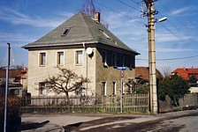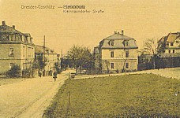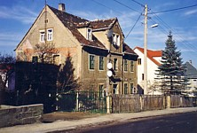

**_Fotos:_** _Die Kleinnaundorfer Straße, links das ehem. Schulhaus (Nr. 2), rechts das 2004 abgerissene Wohnhaus Nr. 4_

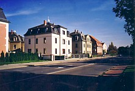Die Kohlenstraße ist Teil des alten Höhenweges auf den Südhängen des Elbtales und erhielt ihren Namen im Jahr 1877, da über diesen Weg einst die Steinkohle aus dem Gittersee - Burgker Revier transportiert wurde. Auch die heutige Karlsruher Straße wurde zeitweise als Kohlenstraße bezeichnet. Der zwischen dieser und der Bergstraße gelegene Straßenabschnitt wurde von 1899 bis 1926 offiziell Strehlener Straße genannt. 1898 entstanden hier die ersten Wohnhäuser. Weitere Flächen wurden von zwei bis zum Ersten Weltkrieg betriebenen Ziegeleien und von einer 1903 geschaffenen Kies- und Sandgrube eingenommen. Bei den Abbauarbeiten fand sich ein altgermanisches Gräberfeld mit zahlreichen Urnengräbern (600 bis 300 v. Chr.). Südlich der Kohlenstraße lagen bis ca. 1950 einige Salbeifelder der Freitaler Bombastus-Werke. Neben dem Collmberg war das Areal Deutschlands bedeutendstes Anbaugebiet mit bis zu 90% der Jahresproduktion. Erst im Zuge des Uranbergbaus wurden die Felder aufgegeben.

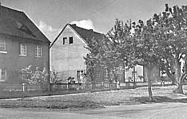Nach dem Ersten Weltkrieg wurde auf dem Gelände der früheren Ziegelei der Dresdner Baugesellschaft zwischen Karlsruher und Cunnersdorfer Straße eine Wohnsiedlung des Kriegerheimstätten-Vereins angelegt. Die Planungen stammten von Hans Waloschek, der als Leiter des Architekturbüros der GEWOG (Gemeinnützige Wohnungs- und Heimstätten- Gesellschaft für Arbeiter, Angestellte und Beamte m.b.H.) auch für die [Trachauer Siedlung](../../../nordwest/trachau/trachauer_siedlung/) verantwortlich zeichnete. Später folgten einige Reihenhäuser für die Beschäftigten des [Wasserwerkes](../../../sud/coschutz/) _(Foto)_. Die übrigen Flächen blieben hingegen weitgehend unbebaut. 1964/65 entstanden für die AWG "Glückauf Süd" zwei Wohnblocks zwischen Kohlenstraße, Cunnersdorfer Straße und Friedhof. Vier Jahre später folgte ein kleiner Garagenkomplex.

Erst 1981 begann der Bau eines Neubaugebietes auf den zuvor landwirtschaftlich genutzten Flächen zu beiden Seiten der Kohlenstraße. Neben Plattenbauten des Typs WBS 70, Schulen und Kindereinrichtungen entstanden an der Hangseite zum Kaitzbachtal auch insgesamt 86 Eigenheime in reihenhausartiger Bauweise. Nach 1990 wurde dieses Wohnviertel um ein Einkaufszentrum ergänzt. Von der integrierten Gaststätte ”Dresdner Aussicht” (früher “Panorama” bzw. “Dresden Blick”) bietet sich ein wunderschöner Blick über das gesamte Dresdner Elbtal.

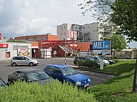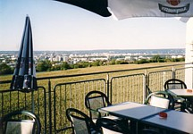

**_Fotos:_** _Einkaufszentrum Kohlenstraße (links) und Blick von der Terrasse_

_des Restaurants ”Dresdner Aussicht”  über die Stadt (rechts)_

Die Kreuznacher Straße wurde 1927 als Verbindungsstraße zwischen Saarstraße und Saarbrückener Straße angelegt und im Anschluss mit zwei Wohnhäusern bebaut. Benannt ist sie nach dem Kurort Bad Kreuznach in Rheinland-Pfalz.

Die Landauer Straße wurde Ende der 1920er Jahre in Verbindung mit einer geplanten Wohnsiedlung angelegt und ist 1929 erstmals im Stadtplan verzeichnet. Ihren Namen erhielt sie in Anlehnung an benachbarte Straßen nach der Stadt Landau in der Pfalz. Ursprünglich sollte sie als durchgängige Verbindung vom Saarplatz bis zur Coschützer Straße führen und dort eine Verbindung zur Kaitzer Straße bilden. Allerdings entstanden bis zum Zweiten Weltkrieg lediglich die beiden Wohnhäuser Nr. 11 und 15, so dass die Straße bis heute eine kurze Sackgasse ist.

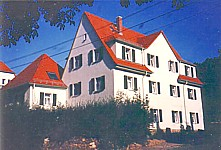Die Mainzer Straße entstand 1902 im Zusammenhang mit dem Bau des Coschützer Rathauses als Verbindung zwischen Körnerstraße (heute Windbergstraße) und dem Fußweg nach Plauen (Am Hohen Stein). Zunächst wurde sie ab dem 11. September 1903 Rathausstraße, nach der Eingemeindung ab 1926 Mainzer Straße genannt. Die ersten Wohnhäuser an der Mainzer Straße entstanden in den Jahren vor dem Ersten Weltkrieg und weisen stilistische Bezüge zu den Ideen der Gartenstadtbewegung auf. Bauherr war die Baugenossenschaft Groß-Dresden e.G.m.b.H. Weitere Häuser folgten 1928/29 durch den Baumeister und Architekten Max Seiffert, der auf der Windbergstraße 10 wohnte.

Die Mannheimer Straße wurde 1933 in Ergänzung der bereits zuvor auf dem Gelände einer früheren Ziegelei entstandenen Wohnsiedlung angelegt und erhielt ihren Namen im August 1933 nach der Stadt Mannheim (Baden-Württemberg). Bis zum Beginn des Zweiten Weltkriegs entstanden hier nach einheitlichem Konzept zweigeschossige Wohnhäuser. Ab 1950 bildete die Straße die Zufahrt zur Uranaufbereitungsfabrik der Wismut in Gittersee, später zum VEB Reifenwerk. Em Ende der Straße standen auch die kasernenartigen Wohnbaracken des sowjetischen Wachpersonals. Auf dem Areal befindet sich heute das Gewerbegebiet Coschütz-Gittersee.

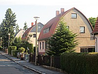Der Marienschachtweg wurde im Zusammenhang mit dem Bau einer Wohnsiedlung im Osten von Coschütz angelegt und ist 1925 erstmals im Stadtplan verzeichnet. Bauherr der nach einheitlichem Konzept mit Kielbogendächern gestalteten Häuser _(Foto)_ war die Siedlungsgesellschaft "Dresden-Stadt und Land" G.m.b.H. Die ersten Gebäude entstanden 1923, die letzten 1929. Eine weitere Siedlung, bestehend aus 19 Reihenhäusern, wurde zwischen 1994 und 1999 errichtet.

Seinen Namen erhielt der Weg nach dem auf Bannewitzer Flur gelegenen früheren Marienschacht. Das zu den Freiherrlich Burgker Steinkohlewerken gehörende Bergwerk wurde ab 1886 erschlossen und blieb bis 1930 in Betrieb. Nach dem Zweiten Weltkrieg wurde der Schacht als Teil des Steinkohlenwerks „Willi Agatz“ wieder aufgewältigt und diente ab 1968 der Wismut zur Förderung von uranhaltiger Kohle. Der 1891 errichtete Förderturm blieb bis heute erhalten und steht als technisches Denkmal unter Schutz.

Der heute nur noch in Teilabschnitten vorhandene Nautelweg verband einst Gittersee, Coschütz, Kaitz und Mockritz und war ein beliebter Wanderweg an den südlichen Höhen des Elbtals. Bereits 1785 ist der Weg im Sächsischen Meilenblatt eingezeichnet. Seinen Anfang nahm er an der heutigen Karlsruher Straße in Höhe der Friedhofstraße und führte von dort über Coschützer Flur nach Kaitz. Westlich des Dorfkerns vereinigte er sich mit dem Achtbeeteweg und verlief von dort Richtung Mockritz durch das Kaitzbachtal _(siehe Karte)_.

[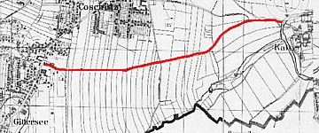](../../../sud/gittersee/strassen_gittersee/karlsruher_strasse/)

Bereits vor dem Ersten Weltkrieg wurde der Abschnitt in Gittersee ausgebaut und Friedhofstraße genannt. 1908 erwarb der Coschützer Bauverein einige Grundstücke am Nautelweg für den Bau von Eigenheimen. 1921 entstand die noch heute existierende [Kleingartensparte Nautelweg e. V.](../../../sud/coschutz/) In den Jahren nach 1945 wurde der Nautelweg auf Coschützer Flur durch die Wismut-Uranaufbereitungsanlage überbaut und ist 1954 nur noch zwischen Cunnersdorfer Straße und Kaitz vorhanden. 1961 verschwanden auch die übrigen Abschnitte im Zusammenhang mit der Errichtung der Absetzanlage Nautelwegsenke, in der Abraum und Schlämme der Uranverarbeitung abgelagert wurden. Seinem früheren Verlauf folgt heute zum Teil die Stuttgarter Straße.

Der Niederhäslicher Weg ist erstmals im Adressbuch von 1930 aufgeführt. Benannt wurde er im Juli 1929 nach dem kleinen Dorf Niederhäslich, heute ein Stadtteil von Freital. Der vom Achtbeetweg südlich abzweigende Weg erschließt eine um 1930 angelegte Wohnsiedlung des "Reichsbundes Schwerbeschädigter Siedler".

Auch der Ölsaer Weg wurde Mitte der 1920er Jahre zur Erschließung einer kleinen Wohnsiedlung südlich des Achtbeeteweges angelegt. Seinen Namen erhielt er im Dezember 1925 nach dem Ort Oelsa, seit 1994 ein Ortsteil der Stadt Rabenau. Die Wohnhäuser entstanden ab 1928 für den Reichsbund - Schwerbeschädigten-Siedlergruppe Dresden-Coschütz im Allgemeinen Sächsischen Siedlerverband e.V.

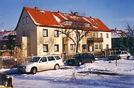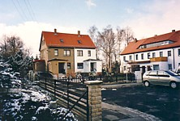

**_Fotos:_** _Blick in die Siedlung am Ölsaer Weg im Winter 1999_

Die Offenburger Straße wurde zur Erschließung des Gewerbegebietes Coschütz-Gittersee als Verbindung zwischen Karlsruher und Stuttgarter Straße angelegt (Planstraße 7) und auf Beschluss des Stadtrates vom 14. März 1996 benannt. Namensgeber war, einer Tradition des Stadtteils folgend, die Kreisstadt Offenburg im Westen Baden-Württembergs. Bebaut wurden die Flächen an der Offenburger Straße mit Büro- und Gewerbegebäuden verschiedener Unternehmen.

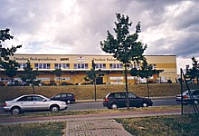Bekannteste Firma ist die Dr. Quendt Backwaren GmbH, die am 4. August 2000 ein ursprünglich für den Elektronikhersteller Robotron errichtetes Gebäude übernahm (Offenburger Straße 1). Die Geschichte des Betriebes reicht bis ins Jahr 1876 zurück, als die Dresdner Kaufleute Wenzel Hromadka und Heinrich Vollmann an der [Kaitzer Straße](../../../zentrum/sudvorstadt/strassen_sudvorstadt/kaitzer_strasse/) die "Original Wiener Waffel-, Hohlrippen-, Bisquit- etc. Special-Fabrik" gründeten. Das 1905 vom Konditor Richard Wiedner übernommene Unternehmen wurde als Hersteller von Russisch Brot ("BERBÖ", ab 1972 VEB Rubro") und anderen Dauerbackwaren bekannt und gehörte bis 1990 zum VEB Elite Dauerbackwaren. 1991 übernahm die neu gegründete Dr. Quendt Backwaren GmbH den Betrieb und nahm drei Jahre später auch die Produktion von Dresdner Christstollen sowie mit der Übernahme der insolventen Firma Herbert Wendler 1999 die von Dominosteinen auf. Platzgründe führten 2000 zur Verlegung des Werkes nach Coschütz, wo es seit 2008 auch einen Werksverkauf und ein Besucherzentrum gibt. Seit 2014 gehört die Firma zur Lambertz-Gruppe.

Die Pforzheimer Straße entstand beim Bau des zweiten Bauabschnittes des Coschützer Gewerbegebietes (Planstraße 6) und wurde 1996 ebenfalls nach einer Stadt in Baden-Württemberg benannt. Neben verschiedenen Unternehmen befindet sich hier seit dem 1. November 2006 ein kommunaler Wertstoffhof für die Abgabe von Sperrmüll und Elektrogroßgeräten. Zuvor befand sich auf dem Areal bis zum Abriss 1995 der VEB Reifenwerk Dresden.

Der Poisenweg wurde Ende der 1920er Jahre als Nebenstraße der Kohlenstraße angelegt und ab 1930 durch den Kriegerheimstättenverein Coschütz mit Einfamilienhäusern bebaut. Der im Dezember 1928 amtlich eingeführte Straßenname nimmt Bezug auf den zwischen Freital-Niederhäslich und Possendorf gelegenen Poisenwald und den durch diese Flur fließenden Poisenbach.

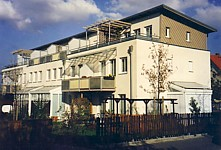Die Rastatter Straße entstand Mitte der 1930er Jahre im Zusammenhang mit dem Bau einer kleinen Wohnsiedlung und ist 1935 erstmals im Adressbuch aufgeführt. Die offizielle Namensgebung erfolgte jedoch bereits im September 1924. Die ursprünglich nur kurze Seitenstraße der Mannheimer Straße wurde nach der Stadt Rastatt in Baden-Württemberg benannt. Bis zum Zweiten Weltkrieg entstanden hier vier Siedlungshäuser. 1983 folgte eine Kinderkrippe in der Nr. 15. Das Gebäude wurde 2001 saniert und wird bis heute als Kita genutzt. Bereits Anfang der 1990er Jahre erfolgte eine Verlängerung der Straße und 1996/98 der Bau der Reihenhausgruppe Nr. 9-13, die die ältere Bebauung ergänzt _(Foto)_.

Der Reutlinger Weg wurde 2000 angelegt und bildet die südöstliche Begrenzung des Gewerbegebietes Coschütz-Gittersee. Er verläuft oberhalb des Kaitzgrundes auf einer früheren Uranhalde und wurde nach der Stadt Reutlingen in Baden-Württemberg benannt.

Die Saarbrückener Straße entstand Mitte der 1930er Jahre in der Nähe des Saarplatzes und der angrenzenden Saarstraße und wurde im Dezember 1937 nach der Hauptstadt des Saarlandes benannt. Bis zum Beginn des Zweiten Weltkrieges wurden hier einige Doppelhäuser errichtet. Seit 1993 ergänzen drei Einfamilienhäuser die vorhandene Bebauung.

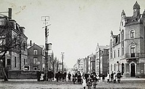Die Saarstraße sowie der angrenzende Saarplatz entstanden Ende des 19. Jahrhunderts im Zusammenhang mit der Erweiterung des Coschützer Ortskerns in Richtung Plauen. Noch heute erinnert die verzweigte Straßenkreuzung von Saar-, Cunnersdorfer und Karlsruher Straße auf Coschützer sowie von Bernhard- und Coschützer Straße auf Plauener Flur an die unterschiedlichen Bebauungspläne der beiden damals noch selbständigen Gemeinden _(Foto rechts)_. Im August 1899 war der Ausbau abgeschlossen, die Gestaltung des Saarplatzes folgte 1902.

Bis zur Eingemeindung von Coschütz wurde die Saarstraße Bismarckstraße, der Saarplatz Bismarckplatz genannt. 1926 erhielten beide wie auch einige benachbarte Straßen ihre Namen nach Landschafts- und Städtenamen im Rheinland und im Saargebiet. Auch bei der Erschließung des neuen Coschützer Gewerbegebietes östlich der Karlsruher Straße wurde nach 1990 diese Tradition fortgesetzt.

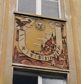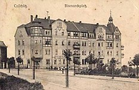Die ersten Wohnhäuser an der Saarstraße entstanden ab 1890 im Zusammenhang mit der Wandlung von Coschütz vom Bauerndorf zum Wohnvorort Dresdens. Vorrangig wurden hier und den angrenzenden Straßen mehrgeschossige Mietshäuser in offener Bauweise, teilweise mit Läden im Erdgeschoss, gebaut. Heute stehen diese 1895 vollendeten Gebäude (Nr. 1 - ehem. "Blumenhalle" im Erdgeschoss, Nr. 4, Nr. 8 und Nr. 28) unter Denkmalschutz. Im Wohn- und Geschäftshaus Saarstraße 2 gab es eine Filiale des "Waaren-Einkaufs-Verein zu Görlitz", nach 1945 bis 1999 einen Konsum. 1902 beschloss der Coschützer Gemeinderat die Errichtung weiterer "Gruppenbauten" am Saarplatz _(Foto links)_ und zwischen Bismarck- und Körnerstraße (heute Mainzer Straße). Vor dem Zweiten Weltkrieg folgten weitere Wohnhäuser an der Südwestseite des Saarplatzes und auf den noch vorhandenen Freiflächen. Bemerkenswert ist eine farbig gestaltete Sonnenuhr über der Haustür des 1938 vollendeten Hauses Saarplatz 3 _(Foto rechts)_. Interessante bauliche Details finden sich auch am Nachbarhaus Saarstraße 10 mit Sgraffito-Symbolen einer Schnecke und eines Bienenkorbes, die für Häuslichkeit und Fleißigkeit stehen.

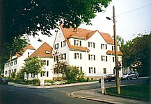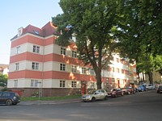

**_Fotos:_** _Wohnanlage an der Saarstraße/ Mainzer Straße (links) und am Saarplatz (rechts)_

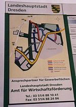Die Stuttgarter Straße bildet die Haupterschließungsstraße des nach 1990 entstandenen Gewerbegebietes Coschütz-Giottersee und verbindet die Karlsruher Straße mit der Bundesstraße 170 und dem Autobahnzubringer zur A 17. Ihren Namen erhielt sie auf Beschluss des Stadtrates am 14. März 1994 nach der Landeshauptstadt von Baden-Württemberg _( **Bild:** Übersichtsplan der Bautafel)_.

Die Flächen zu beiden Seiten der Straße wurden nach 1945 durch die SDAG Wismut genutzt, die hier ihre Uranfabrik 95 betrieb. Nach Aufgabe der Uranaufbereitung um 1962 übernahm der VEB Reifenwerk Dresden zahlreiche Gebäude für die Produktion von Lkw- und Großreifen. Im ehemaligen Verwaltungsgebäude der Uranfabrik 95 (Nr. 55) hatte bis in die 1990er Jahre die Baugrund Dresden Ingenieurgesellschaft mbH ihren Sitz. Heute haben sich auf dem einstigen Bergbaugelände verschiedene Firmen angesiedelt. Außerdem entstand ein neuer Sportplatz für den FV Dresden-Süd-West e.V. Der Kunstrasenplatz mit Beleuchtungsanlage, Sanitärgebäude und Vereinsheim wurde am 27. August 1999 eröffnet.

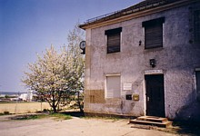Uranfabrik 95: Die Anlage entstand 1950 für die Erzaufbereitung der im Gitterseer Revier geförderten uranhaltigen Kohle. Betreiber war die [Sowjetisch-Deutsche Aktiengesellschaft Wismut](../../../sud/gittersee/bergbaubetrieb_willy_agatz/), die hier den Rohstoff für das sowjetische Atomprogramm gewann. Für den Betrieb wurde auf zuvor landwirtschaftlich genutzten Flächen ein militärisch abgeschirmter Gebäudekomplex geschaffen. Dazu gehörten Erzzerkleinerungsanlagen, eine Mischerei zur chemischen Aufbereitung des Erzes, Kesselhaus, Soda- und Säurestation, Werkstätten und drei große Hallen mit Kammerfilterpressen. Hinzu kamen ein Sanitärtrakt und ein Verwaltungsgebäude für die sowjetische Kommandantur _(Foto)_. Insgesamt waren bis zu 1000 Arbeiter in der Uranfabrik beschäftigt.

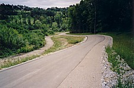Die Zufahrt zur Fabrik 95 erfolgte über die Mannheimer Straße, zudem gab es einen Bahnanschluss zur [Windbergbahn](../../../sud/gittersee/windbergbahn/). Innerhalb des Komplexes wurden die Rohstoffe über Förderbänder transportiert. Die Stromversorgung übernahm ein betriebseigenes Umspannwerk, die Wasserversorgung eine Pumpstation an der Weißeritzmündung in Cotta. Bis 1953 wurde ausschließlich Erzkohle aus der Region verarbeitet, später zur besseren Auslastung des Betriebes auch Uranerz aus Westsachsen und Thüringen. Besonders gefährliche und gesundheitsgefährdende Arbeiten mussten sowjetische Soldaten übernehmen. Bis zur Schließung der Fabrik 1962 wurden hier ca. 2,4 Millionen Tonnen Erz zu ungefähr 7.000 Tonnen Uran verarbeitet. Danach gab man das Werk auf und übergab die Bauten an den neu gegründeten VEB Reifenwerk Dresden, der hier noch bis 1991 Lkw-Reifen produzierte. Die Anlagen der früheren Sonderzeche übernahm 1964 der VEB Fettchemie Chemnitz als Betriebsteil Gittersee. Nach Schließung beider Unternehmen 1991/92 erwarb die Stadt Dresden 1993 die Grundstücke von der Treuhand. Anschließend wurden die verbliebenen Gebäude bis 2001 abgerissen und das Areal Standort des kommunalen Gewerbegebietes Coschütz/Gittersee . Gleichzeitig erfolgte eine Sanierung der Altlasten sowie eine Renaturierung der ehemaligen Absetzanlagen und Halden im Kaitzgrund _(Foto)_.

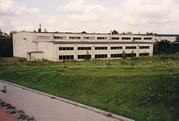VEB Reifenwerk Dresden: Das Unternehmen entstand 1962 auf dem Areal der früheren Uranaufbereitungsfabrik 95. Nach deren Schließung entschied man sich zur Schaffung von Ersatzarbeitsplätzen und richtete daraufhin in den Gebäuden eine Produktionsstätte für Lkw- und Traktorreifen ein. Der zum VEB Reifenkombinat Fürstenwalde gehörende Betrieb stellte vorrangig Großreifen für Lkw, Traktoren und Ackerschlepper her, die auch ins sozialistische Ausland und den arabischen Raum exportiert wurden. 1970 waren hier über 1000 Arbeitskräfte beschäftigt, darunter auch Gastarbeiter aus Kuba, Mocambique und Polen. Die Produktionsmenge betrug in Spitzenzeiten bis zu 2500 Reifen pro Tag. 1991 wurde der Betrieb geschlossen und nach Abbruch der Gebäude in das Gewerbegebiet Coschütz-Gittersee einbezogen. Das Foto zeigte eine der ehemaligen Fabrikhallen kurz vor dem Abriss 2001.

Die Tübinger Straße entstand nach 1990 als Plastraße 3 des Gewerbegebiets Coschütz-Gittersee und erhielt am 14. März 1994 auf Beschluss des Stadtrates nach der Universitätsstadt Tübingen in Baden-Württemberg ihren Namen. Der Ausbau erfolgte im Rahmen des 2. Bauabschnitt ab 1997.

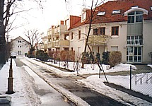Der Vierbeeteweg entstand im Zuge des Ausbaus der neuen Wohnsiedlung südlich des Achtbeeteweges und wurde im Januar 1927 benannt. Der Name nimmt Bezug auf eine bereits im Flurregister von 1794 erwähnte frühere Flurbezeichnung. Bis zum Ersten Weltkrieg befand sich hier die Lehmgruben der Ziegelei Vocke, woran noch die stufenartige Geländeform erinnert. Zwischen Achtbeete- und Poisenweg gab es zudem einen heute verschwundenen Teich. Nach 1990 wurden die verbliebenen Freflächen mit einer kleinen Wohnanlage (Nr. 2-6) bebaut _(Foto)_.

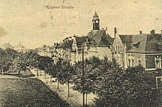Die Windbergstraße verbindet den alten Coschützer Dorfkern mit dem um 1900 entstandenen Geschäftszentrum im Bereich Windberg-, Karlsruher und Kohlenstraße und geht auf einen alten Verbindungsweg zwischen Coschütz und Kleinpestitz zurück. Ursprünglich wurde dieser Weg im Volksmund Milchweg, später ab 1899 bis zur Eingemeindung offiziell Körnerstraße genannt. Diese Namensgebung erfolgte in Erinnerung an den langjährigen Coschützer Gemeindeältesten Hermann Körner (+ 1900), der u.a. den Bauplatz für den Bau des Pfarrhauses zur Verfügung gestellt hatte.

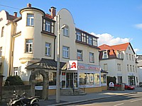Ihren heutigen Namen trägt die zwischen 1895 und 1898 ausgebaute Straße nach dem nahegelegenen Windberg in Freital. Nach 1870 entstanden hier Wohn- und Geschäftshäuser sowie als öffentliche Bauten das [Coschützer Rathaus](../../../sud/coschutz/) (Nr. 22 - 1902) und das [Pfarrhaus](../../../sud/coschutz/kirchgemeinde_coschutz/) des Ortes (Nr. 20 -1900). In einigen Gebäuden waren zudem Läden untergebracht. So gab es im Eckhaus zur Felsenkellerstraße / Karlsruher Straße (Nr. 2) früher eine Schuchmacherwerkstatt, später eine Fleischverkaufsstelle. Die Räume der heutigen Cosel-Apotheke beherbergten zu DDR-Zeiten eine Verkaufsstelle für Haushaltwaren _(Foto)_. Im Haus Nr. 24 gab es in den 1950er Jahren eine speziell für die Angehörigen der Wismut eingerichtete HO-Verkaufsstelle.

Zu den jüngeren Gebäuden gehören der 1965 von der Wohnungsbaugenossenschaft "Glückauf Süd" errichtete Wohnblock Windbergstraße 12/14/14a. Weitere Wohnhäuser entstanden nach 1990 in Baulücken bzw. an Stelle baufälliger Gründerzeithäuser. 2002 gründete ein Verein in einigen Räumen des früheren Rathauses die Kita "Kinderhaus Dresden-Plauen". Zwei Jahre später wurde auf einer Freifläche an der Einmündung des Achtbeeteweges durch eine Bürgerinitiative ein Spielplatz angelegt.

[Coschütz auf OpenStreetMap](https://www.openstreetmap.org/search?query=Dresden+Cosch%C3%BCtz)

* * *

 \[ [Home](../../../index.html)\] \[ [Nord](../../../nord/)\] \[ [Nordwest](../../../nordwest/)\] \[ [Neustadt](../../../neustadt/)\] \[ [Nordost](../../../nordost/)\] \[ [West](../../../west/)\] \[ [Zentrum](../../../zentrum/)\] \[ [Südwest](../../../sudwest/)\] \[ [Süd](../../../sud/)\] \[ [Südost](../../../sudost/)\] \[ [Ost](../../../ost/)\] \[ [Register](../../../Register/register.html)\] \[ [Kontakt](../../../Kontakt/kontakt.html)\] \[ [Impressum](../../../impressum/)\]
