* * *

* * *

**Details an Altcoschützer Bauernhäusern**

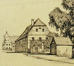

_Altcoschütz 10_

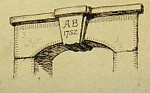

_Türsturz am_

_Bartschen Gut_

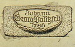

_Gedenktafel am Palitzsch-Gut_

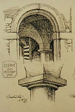

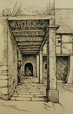

_Details des Hofes Altcoschütz 6_

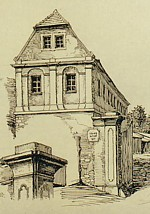

_Hornsches Gut_

**Zeichnungen:**

Richard Naumann:

_Merk- und Denkwürdigkeiten von Coschütz_ (1911)

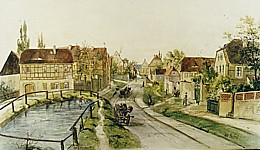Der sackgassenartige Dorfplatz des Ortes trägt seit 1926 den Namen Altcoschütz (zuvor Dorfstraße). Hier befindet sich das ursprüngliche Zentrum des Bauerndorfes Coschütz. Es entstand als slawischer Rundweiler und wurde später zum Gassendorf erweitert. Zu beiden Seiten der Straße stehen die früheren Bauernhöfe mit ihren Ställen und Scheunen. Abgegrenzt wurde der Dorfkern einst von einer heute noch in Teilen erhaltenen Plänermauer. 1547 bestand Coschütz aus 12 Gehöften, eine Zahl die sich bis Mitte des 19. Jahrhunderts nur unwesentlich veränderte. Zu den alteinsässigen Bauernfamilien gehörte die seit 1628 in Coschütz nachweisbare Familie Palitzsch, aus der auch der bekannte Prohliser Bauernastronom Johann Georg Palitzsch stammt. Sein Großvater hatte 1686 neben seinem Coschützer Besitz ein Gut in [Prohlis](../../../../sudost/prohlis/) erworben, welches er 1718 an seinen Sohn, den Vater des Astronomen, verkaufte. An ihn erinnert eine Gedenktafel am Grundstück Am Hohen Stein Nr. 48. Das Bild von Otto Schneider zeigt den Dorfplatz Altcoschütz um 1899 (Stadtmuseum).

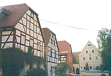Die Gesamtanlage mit ihren Bauerngehöften des 18. und 19. Jahrhunderts erhielt ihr heutiges Aussehen nach dem letzten großen Dorfbrand 1829 und steht unter Denkmalschutz _(Foto rechts)_. Bei diesem Brand wurden bis auf fünf Güter alle Gehöfte zerstört. Der Wiederaufbau erfolgte bis 1834, wobei die Neubauten neben den traditionellen Fachwerkobergeschossen teilweise auch klassizistische Steinfassaden bekamen.

An einigen Häusern haben sich Inschriftstafeln und Hausmarken erhalten, die an frühere Besitzer, historische Ereignisse oder an den früheren Weinbau erinnern. Bemerkenswert sind auch das noch erhaltene Gemeindespritzenhaus der Ortsfeuerwehr von 1868 _(im linken Bild ganz rechts)_ sowie die kleineren Wohn-Stall-Häuser am westlichen Ende des Dorfplatzes. Hinter den Gebäuden in Richtung Heidenschanze sind noch Reste der früheren Umfassungsmauer des Ortes zu sehen. An Stelle des im 17. Jahrhundert angelegten und 1899 verfüllten Dorfteiches vor dem Gasthof besteht heute eine kleine Grünanlage. Hier hatte ab 1900 bis ca. 1970 ein Trafo- und Verteilerhäuschen seinen Platz, nachdem kurz zuvor ein gemeindeeigenes Elektrizitätswerk der in Betrieb genommen worden war.

Nach 1890 entstanden am östlichen Rand des Dorfplatzes und der Einmündung der Windberg- und der Saarstraße mehrgeschossige Mietshäuser. 1980 bzw. nach 1990 wurden diese abgerissen und durch Neubauten ersetzt. In den letzten Jahren erfolgte auch eine Sanierung der meisten historischen Höfe sowie der Umbau der früheren Scheunen und Nebengebäude zu Wohnungen. Auf dem Grundstück des um ca. 1965 abgetragenen Gutes der Familie Gebauer (Nr. 6a) steht seit 1999 ein neues Wohnhaus.

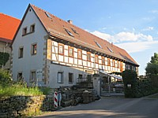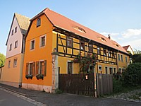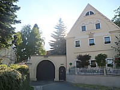

**_Fotos:_** _Altcoschützer Bauernhöfe: Nr. 15a (links), Nr. 3 und 5 (Mitte) und Nr. 13 (rechts)_

Einzelne Gebäude:

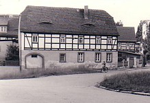Nr. 1: Der den Dorfplatz und den Eingang zum Dorfkern prägende Dreiseithof bildete ursprünglich mit dem Nachbargut eine Einheit, wurde jedoch 1628 geteilt. Besitzer dieses Gehöfts war 1794 die Familie Palitzsch. Die heutigen Fachwerkgebäude entstanden nach dem Dorfbrand von 1829. Noch bis in die Zeit nach dem Zweiten Weltkrieg wurden sie landwirtschaftlich genutzt _(Foto 1978)_. Ab 1995 erfolgte eine umfangreiche Sanierung. Das heute nach einer im Hof stehenden Bergulme "Ulmenhof" genannte Gut ist seitdem Sitz einer Baufirma, die sich auf ökologische Bautechniken und Lehmbau spezialisiert hat. Zudem gibt es in einer kleinen Galerie regelmäßig künstlerisch-kulturelle Angebote.

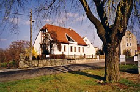Nr. 2: Das zu den jüngeren Bauten im alten Ortskern gehörende Mehrfamilienhaus wurde um 1910 erbaut, ebenso wie das benachbarte Eckhaus zur Saarstraße. In letzterem befand sich ein kleiner Lebensmittelladen. Nach jahrelangem Leerstand wurde dieses Haus um 1980 abgerissen und durch ein Einfamilienhaus ersetzt. Das Wohnhaus Nr. 2 blieb hingegen als Ruine erhalten. Nach 1990 trugen die Besitzer das Ober- und Dachgeschoss ab und bauten das verbliebene Restgebäude ebenfalls zu einem Einfamilienhaus um, das durch seine architektonische Gestaltung die Historie noch erkennen lässt _(Foto)_.

Nr. 3: Das Gebäude auf der linken Seite geht im Kern auf das Jahr 1745 zurück, wie ein Schlusstein belegt. Der Zweiseithof befand sich im Besitz eines Häuslers und gehörte somit zu den kleineren Coschützer Anwesen. Heute wird es nach denkmalgerechter Sanierung als Wohnhaus genutzt. Ein rückwärtiges Nebengebäude wurde nach 1990 durch einen Neubau ersetzt.

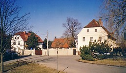Nr. 4:  Der ehemalige Dreiseithof an der Nordseite des Dorfplatzes _(Foto)_ wurde nach dem Dorfbrand von 1829 erbaut und befand sich im Besitz der Familie Horn. Erhalten blieb bis heute das frühere Wohnstallhaus, während die einstigen Wirtschaftsgebäude Mitte der 1990er Jahre durch Neubauten ersetzt wurden.

Nr .5: Das einstige Rühlesche Gut war vermutlich einst mit dem Nachbargut Nr. 7 verbunden und wurde später geteilt. Das 1829 errichtete Fachwerkgebäude wurde nach 1990 denkmalgerecht saniert. Im Erdgeschoss befindet sich seit 2004 das Handarbeitsgeschäft "Fadenladen".

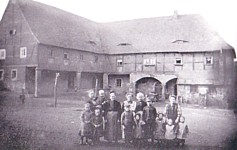Nr. 6: Das heute nicht mehr vorhandene Gehöft gehörte bis zu seinem Abbruch zu den ältesten und architektonisch interessantesten Coschützer Bauerngütern. Das im Winkel angeordnete Wohnstallgebäude _(Foto um 1910)_ besaß einen auf Säulen gelagerten Wandelgang, über dem das vorspringende Fachwerkobergeschoss lag. Im Kern stammte das Haus aus dem 16. Jahrhundert. Es befand sich ab 1745 im Besitz der Familie Gebauer, die über viele Generationen die Dorfschmiede betrieb. Verschiedene Schrifttafeln und Schlusssteine erinnerten an die Geschichte des Hofes.

1945 wurde das Gebauer-Gut bei einem Luftangriff schwer beschädigt und verfiel in der Nachkriegszeit. Trotz seiner historischen Bedeutung erfolgte um 1965 der Abriss der Gebäude. 1999 wurden auf dem Grundstück zwei Wohnhäuser gebaut, die sich in ihrer baulichen Gestaltung an den alten Dorfkern anlehnen.

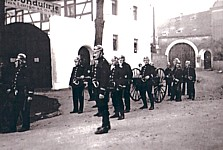Gemeindespritzenhaus: Nachdem die Brandbekämpfung jahrhundertelang zu den Aufgaben der gesamten Dorfgemeinschaft gehörte, legte ein Gesetz vom 11. August 1862 die Bildung von Spritzenkassen fest, wonach jeder Einwohner - entsprechend seiner wirtschaftlichen Leistungsfähigkeit - eine alljährliche Abgabe an die Gemeinde zu zahlen hatte. Diese diente dem Unterhalt der Feuerlöschgeräte. Im Brandfall waren die Dorfbewohner verpflichtet, Pferde und Kutscher zum Transport der Feuerspritze an den Unglücksort zur Verfügung zu stellen. Versäumnisse konnten mit Geldbußen oder bis zu acht Tagen Arrest bestraft werden.

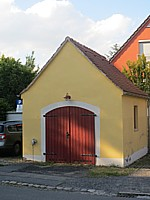Am 1. März 1863 beschloss der Coschützer Gemeinderat die Gründung einer Spritzenkasse, welche bis 1899 gemeinsam mit dem benachbarten Gittersee bestand. Zudem wurde ein Spritzenmeister, ein Stellvertreter und 12 "tüchtige Mannschaften" bestimmt, die im Brandfalle zum Einsatz kamen. 1901 bildete sich im Ort ein aus 26 Männern bestehender Feuerwehr-Verein, aus dem ein Jahr später die Freiwillige Feuerwehr Coschütz hervorging. Mit der Eingemeindung 1921 wurde der Feuerlöschverband von der Stadt Dresden übernommen.

Das Inventar des Spritzenhauses bestand zunächst aus einer vierrädrigen Spritze, fünf Schläuchen, 10 Feuereimern und diversen kleineren Gerätschaften. Erster Spritzenmeister wurde der Dorfschmied Gebauer, der im benachbarten Gut Nr. 6 wohnte. Zur Unterbringung der Spritze entstand 1868 ein neues Gemeindespritzenhaus, das bis heute erhalten blieb und jetzt als Garage genutzt wird _(Foto rechts)_.

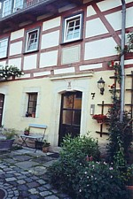Nr. 7: Das zu den kleineren Anwesen des Dorfes gehörende Gut Altcoschütz 7 entstand in heutiger Form nach dem Dorfbrand 1829, wie ein erhaltener Schlusstein mit den Initialen des früheren Besitzers Johann Christian Rühle über dem Eingang des Wohnhauses belegt. Ursprünglich gehörten neben dem Wohnstallhaus mit Fachwerkobergeschoss Scheune, Schuppen und ein Wirtschaftsgebäude dazu. In einem später errichteten Anbau des Gebäudes befand sich noch bis 1990 ein kleiner Laden. Mitte der 1990er Jahre wurde das Haus saniert und die früheren Wirtschaftsgebäude zu Wohnzwecken umgebaut.
Eine Steintafel trägt die Worte _(Bild unten links)_:

_Diß Haus steht in Gottes Hand von ihm sey alles Unglück abgewand_

_Und alle die hir gehn aus und ein Die möge Gottes Güte erfreun._

_Nach dem Brande 1829 wieder erbaut von Johan Christian Rühlen_

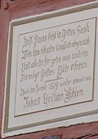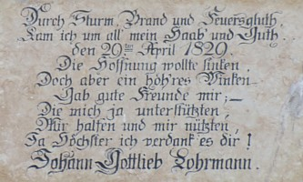

**_Fotos:_** _Schrifttafeln an Altcoschützer Bauernhöfen - links Nr. 7, rechts Nr. 13_

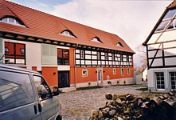Nr. 9: Auch dieser Dreiseithof entstand in heutiger Form nach dem Dorfbrand, ist im Kern jedoch deutlich älter. An der Giebelseite zur Straße nennt eine Schrifttafel das Jahr 1602. Ab 1928 befand sich im Erdgeschoss des Scheunengebäudes eine bis 1990 existierende Kistenfabrik. Nach 1990 wurde das stark verfallene Wohnstallhaus im vorderen Teil originalgetreu saniert und im ehemaligen Stallbereich in moderner Form neu aufgebaut _(Foto)_. An Stelle des Wirtschaftsgebäudes entstand 1994/95 ein Neubau mit Gewerberäumen. Erhalten blieb das 1998/99 ebenfalls sanierte frühere Altenteilhaus. Diese kleinen Gebäude dienten früher als Wohnung des Altbauern nach der Übernahme eines Gehöfts durch die Kinder.

Nr. 10: Das um ca. 1830 erbaute Gehöft am Eingang zum hinteren Dorfkern befand sich einst im Besitz der Familie Schneider. Diese ließ beim Wiederaufbau nach dem Dorfbrand über dem mittleren Fenster der Giebelseite eine Schrifttafel anbringen:

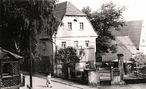_Denkschrift den 20. April 1829_

_Mein lieber Leser denke nach_

_Wie traurich war doch dieser Tag_

_Als unvermuth ich mußte sehn_

_Mein Haus in Feuersflam aufgehn_

_Da ich nun meinen Gott vertraut_

_Hab ich doch wieder aufgebaut._

_Johan Gottfried Schneider._

Um 1880 wurde das frühere Wohnstallhaus ausgebaut und erhielt dabei an der Hofseite einen Außenbalkon mit Treppenaufgang. Die am 24. August 1944 bei einem Bombenangriff zerstörte frühere Scheune wurde 2007/08 durch ein Einfamilienhaus ersetzt (Nr. 10a/b). Die übrigen Wirtschaftsgebäude hatte man bereits Anfang der 1950er Jahre abgerissen.

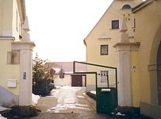 Nr. 11: Im Gegensatz zu vielen anderen Gebäuden wurde der große Dreiseithof Nr. 11 nach dem Dorfbrand massiv in Stein wiederaufgebaut und mit klassizistischen Fassadenelementen versehen. Das einstige Hornsche Gut (später Familie Köhler) blieb noch bis nach 1945 in landwirtschaftlicher Nutzung. Im Hausflur des Hauptgebäudes zeigen Plaketten mit Reliefbildern einen Reiter mit Gefolge sowie eine Zyklopenschlacht. Im Hof befindet sich ein Taubenschlag. Wohnhaus und Ausgedingehaus wurden nach 1990 saniert und zu Wohnungen umgebaut, die einstige Scheune wird als Lagerraum und Garage genutzt.

Nr. 12: Das ursprünglich in einfacher Blockbauweise errichtete Wohngebäude steht exemplarisch für die bescheidenen Häusleranwesen des Ortes. Hier wohnten Familien, die über keinen oder nur geringen Landbesitz verfügten. Nach 1990 wurde das Haus saniert.

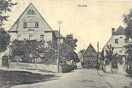Nr. 13: Das zu den größten Coschützer Gütern gehörte Hilbertsche Gut wurde in heutiger Form nach dem Dorfbrand 1829 gebaut. Im 18. Jahrhundert befand es sich im Besitz von Daniel Lohrmann, der 1790 als Erschließer der ersten Steinkohlengrube am Collmberg urkundlich erwähnt ist. Markant ist die mit klassizistischen Zierelementen gestaltete Giebelseite zum Dorfplatz _(Foto um 1910)_. Wie an mehreren Bauernhöfen erinnert auch hier eine Schrifttafel an den Brand vom 20. April 1829 _(Bild oben bei Nr. 7)_. Noch 1853 wird im Keller des Stall- und Wirtschaftsgebäudes eine Weinpresse erwähnt. Größere Umbauten erfolgten um 1871 (Inschrift am Torbogen). Aus dieser Zeit stammt auch die parkartige Gartenanlage und das mit den Initialien RH (= Hilbert) versehene Ziergitter am Eingang zum Garten. Im Zuge der Bodenreform 1946 wurde das Gut von zwei Neubauern bewirtschaftet. Nach seiner Sanierung wird es heute zu Wohnzwecken und als Pension genutzt.

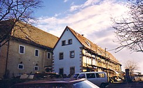Nr. 15: Der ehemalige Dreiseithof entstand wie die meisten Alt-Coschützer Anwesen nach dem Dorfbrand 1829 und ist durch einen Schlusstein (MDCCCXXX) auf das Jahr 1830 datiert. Um 1900 zerstörte ein Brand erneut Teile des Haupthauses, das man danach in massiver Bauweise erneuerte. 1945 wurde das Gut zum Teil zerstört, wobei später nur das Haupthaus wieder aufgebaut wurde. In der Nachkriegszeit diente es als Wohnhaus für mehrere Flüchtlingsfamilien. Im Hof befanden sich an Stelle der zerstörten Nebengebäude später Garagen der MTS zur Unterstellung landwirtschaftlicher Maschinen. Das Herrenhaus wurde ab 1978 als Werkstatt und Büro der Firma Uwe Naumann Raumausstattung genutzt. Zum Hof gehört auch das heute als Nr. 15b bezeichnete frühere Gesindehaus mit Fachwerkobergeschoss.

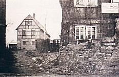Nr. 17: Das noch erhaltene Wohnstallhaus war ursprünglich Teil eines um 1830 errichteten kleinen Dreiseithofes. Teile des Hofes _(Bild um 1950)_ wurden am 24. August 1944 bei einem Bombenangriff schwer beschädigt und nach dem Zweiten Weltkrieg abgerissen und durch Garagen ersetzt. Die ehemalige Scheune verschwand erst nach 1990 zugunsten eines Wohnhausneubaus. Das verbliebene Hauptgebäude wurde 1995-97 rekonstruiert und beherbergt seitdem u.a. ein Büro für Baustatik und Wohnungen. Für die Umgestaltung des Hofes wurden die Besitzer 2002 mit dem erstmals vergebenen Baupreis Plauen (1. Platz) ausgezeichnet. Im hinteren Teil sind noch Reste der einstigen Trockenmauer erhalten, die einst das gesamte Dorf umschloss.

Nr. 19: Das im Kern aus dem 18. Jahrhundert stammende Fachwerkhaus mit massivem Untergeschoss ist letzter Teil einer größeren Gehöftanlage, zu der einst auch das Gut Nr. 17 gehörte.

Nr. 21: Der durch einen Schlusstein am Eingangsportal auf das Jahr 1760 datierte, später jedoch mehrfach umgebaute Hof wurde bereits nach dem Ersten Weltkrieg nicht mehr landwirtschaftlich genutzt, sondern war Sitz des Handwerksbetriebes Lehmann zur Polstermöbelherstellung. Auch nach 1945 dienten die Gebäude als Polsterwerkstatt. Ursprünglich war das Haus mit dem Nachbargehöft Nr. 23 durch einen gewölbten unterirdischen Gewölbegang verbunden. Der Überlieferung nach soll dieser Gang einst weitere Coschützer Höfe verbunden haben und früher bis zum Gasthof geführt haben. Später wurde er jedoch verfüllt.

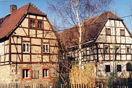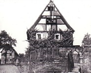

**_Fotos:_** _Altcoschützer Bauernhöfe: links Nr. 17 und 19 vor der Sanierung, rechts Nr. 21 in den 1950er Jahren_

Nr. 23: Der Dreiseithof Nr. 23 befand sich im 18. Jahrhundert im Besitz von Andreas Rühle. Auf diesen weist noch eine Inschrift im Schlusstein des Eingangstores hin (A. R. 1767). Im gleichen Jahr hatte Rühle für 150 Taler einen Teil seines Grundstücks an Friedrich August von Cosel verkauft, der im Coselgrund letztlich erfolglose Bergbauversuche nach Kupfer unternahm.

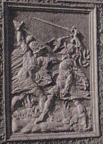Zwei Schrifttafeln berichten von der Geschichte des Gutes.

_Am 27. August 1753 fiel das Haus in Asche nieder_

_den 5. October stant es mit Gottes Hielfe wieder._

_den 10. December 1816 abgebrennt, 1817 erbauet_

_1828 der brante die Helfte vor Rettung wie durch Gott und den Menschen._

_Gottlieb Rühle_

_Krieg und Brand segnet Gott mit milder Hand._

_Auch im Kriege ao. 1760 ist dieses Hauß abgebrennt und ao. 1767 wieder erbauet._

_Andreas Rühle_

Demnach brannte der Hof am 27. August 1753 ab, wurde bis zum 5. Oktober wieder aufgebaut und am 10. Dezember 1816 erneut bei einem Brand zerstört. 1817 wiederaufgebaut, fielen Teile des Hofes 1828 erneut einem Brand zum Opfer. Sein heutiges Aussehen erhielt er bei einem größeren Umbau 1898. Links der Haustür befand sich bis 1986 eine historische Ofenplatte, welche vermutlich aus dem Coselschlösschen stammt und die Darstellung einer Römerschlacht zeigt _(Foto)_.

Nr. 25: Der langgestreckte Fachwerkbau wird durch einen Schlusstein über der Tür auf das Jahr 1752 datiert und ist somit ältestes noch erhaltenes Gebäude des Dorfkerns. Ab 1988 wurde das historische Bauernhaus saniert.

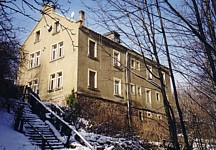Gemeindehaus: Das Gemeindehaus des Dorfes entstand im 18. Jahrhundert und diente ursprünglich als Wohnhaus des Kinderlehrers und des Gemeindehirten. Außerdem wurden hier unbemittelte Personen untergebracht, deren Versorgung der Gemeindearmenkasse oblag. Zudem gab es im Haus ein Arrestlokal für kleinere Vergehen. Sein Standort war am Ende des Dorfes in der Nähe des Fußweges in den Coselgrund.

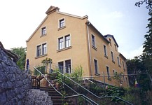1898 stellte der Coschützer Gemeinderat fest, dass sich das Gemeindehaus in einem solch schlechtem Zustand befand, dass die Unterbringung kaum noch zulässig erscheint. Aus diesem Grund entschloss man sich zum Abriss und Neubau. 1899/1900 entstand auf dem Grundstück des abzutragenden Armenhauses ein zweigeschossiger Neubau mit mehreren Wohnungen (Altcoschütz 27). Die Finanzierung übernahm die Gemeindearmenkasse, die zusätzlich einen Kredit aufnehmen musste. Zudem fanden alljährliche Sammlungen zugunsten der Gemeindearmen statt. Später diente das Haus bis 1990 als normales Mietswohnhaus, stand dann einige Jahre leer und wurde 2006/07 saniert. Die Bilder zeigen das Haus kurz vor und nach der Renovierung.

Gasthof Coschütz:

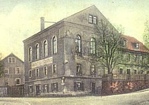Der Gasthof an der Kleinnaundorfer Straße 1 geht auf den früheren Reiheschank zurück, wie er bis ins 19. Jahrhundert in zahlreichen Orten üblich war. 1841 erwarb der Coschützer Dorfschmied Karl Gebauer das Schankrecht und richtete im früheren Schmiedegebäude eine feste Dorfschänke ein. Gebauer hatte zugleich viele Jahre das Amt des Gemeindevorstehers inne. Nach ihm übernahm 1879 Hermann Kippenhahn das Lokal und ließ den früheren Dreiseithof umbauen und um einen Tanzsaal und einen Biergarten erweitern. In diesem Zusammenhang erhielt es den Namen “Gasthof zu Altcoschütz”. Als erster Einwohner des Ortes veranlasste Kippenhahn zugleich den Anschluss seines Hauses an das öffentliche Elektrizitäts- und Wasserleitungsnetz. Fortan fanden hier regelmäßig Bälle, Vereinsfeste und kulturelle Veranstaltungen statt. Auch der 1903 gebildete Coschützer Turnverein nutzte Saal und Garten für seinen Turnbetrieb.

1919 erwarb Max Glöckner den Gasthof. Anfang der 1920er Jahre wurde noch ein kleiner Bühnenanbau errichtet, wodurch der Saal nun auch für kleinere Theateraufführungen nutzbar war. Nach dem tragischen Unfalltod Glöckners bei Baumfällarbeiten führte seine Witwe Hertha den Betrieb zunächst allein weiter. Seit ihrer Hochzeit mit dem Fleischermeister Erich Bukan befindet sich der Gasthof im Besitz dieser Familie. Während des Zweiten Weltkriegs waren im Saal französische Kriegsgefangene untergebracht. Später fanden hier wieder Tanzveranstaltungen statt, bevor in den 1950er Jahren ein Trickfilmstudio den Saal bezog. Danach diente dieser als Materiallager des [Transformatoren- und Röntgenwerkes](../../../../nordwest/ubigau/strassen_ubigau/koch___sterzel/) (TuR). Im Seitenflügel gab es zudem zeitweise eine Bettfedernfabrik, im Erdgeschoss eine Fleischerei. 1994 wurde der Gasthof Coschütz komplett renoviert und bietet seitdem auch Übernachtungsmöglichkeiten an.

* * *

 \[ [Home](../../../../index.html)\] \[ [Nord](../../../../nord/)\] \[ [Nordwest](../../../../nordwest/)\] \[ [Neustadt](../../../../neustadt/)\] \[ [Nordost](../../../../nordost/)\] \[ [West](../../../../west/)\] \[ [Zentrum](../../../../zentrum/)\] \[ [Südwest](../../../../sudwest/)\] \[ [Süd](../../../../sud/)\] \[ [Südost](../../../../sudost/)\] \[ [Ost](../../../../ost/)\] \[ [Register](../../../../Register/register.html)\] \[ [Kontakt](../../../../Kontakt/kontakt.html)\] \[ [Impressum](../../../../impressum/)\]
