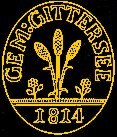
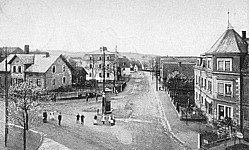
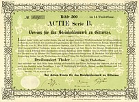
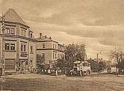
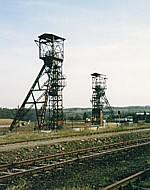
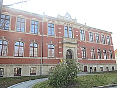
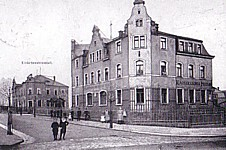
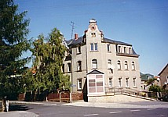
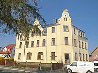

* * *

**Gemeindesiegel von Gittersee**

* * *

**Schulen in Gittersee:**

****

Das slawische Platzdorf Gittersee wurde 1349 im Lehnsbuch von Markgraf
Friedrich dem Strengen erstmals als Geterssin (= Besitz eines Jutros) urkundlich erwähnt und war damals Eigentum der Brüder Nickel und Ulrich von Maltitz. 1465 gehörte es zu den Besitzungen der Kreuzkirche und
unterstand dem Dresdner Brückenamt. Diese frühe Zuordnung zu einem kommunalen Grundherren ermöglichte es den hier ansässigen Bauern, ihre Frondienste bereits ab 1494 durch Geldzahlungen abzulösen, um somit den
Wiederaufbau der 1491 abgebrannten Stadt Dresden zu ermöglichen. Neben der Landwirtschaft war ab dem 16. Jahrhundert der Obstbau von Bedeutung,
der durch den Döhlener Pfarrer Martin Künzelmann eingeführt wurde. Künzelmann hatte für seine Verdienste um die
Durchsetzung der Reformation in Sachsen von Herzog Heinrich dem Frommen ein Erblehngut im Ort erhalten, welches
sich noch bis 1875 im Besitz seiner Familie befand. Mehrfach gingen aus dieser die Ortsrichter bzw. Gemeindevorstände
hervor. Einen Rückschlag erlitt die wirtschaftliche Entwicklung des Ortes  im Jahr 1759, als österreichische Soldaten
2500 Obstbäume für den Bau einer Schanze am Windberg abschlugen. Auch die Befreiungskriege von 1813 verschonten
Gittersee nicht. Zunächst waren hier Soldaten der Österreicher stationiert, später  zogen Napoleons Truppen durch den
Ort und entwendeten die Armenkasse. Im Künzelmannschen Gut richteten russische Soldaten im Zusammenhang mit der [Schlacht bei Dresden](../../sud/racknitz/schlacht_bei_dresden/) ein Feldlazarett ein.

Nachdem um 1800 bei Gittersee Steinkohlevorkommen entdeckt worden waren,
wandelte sich der Ort vom Bauerndorf zur Bergarbeitergemeinde. 1809 begann der Aufschluss des ersten Schachtes in Niedergittersee. 1837 gründete sich der Actien- Verein für das
Steinkohlenwerk zu Gittersee, der drei größere Schachtanlagen betrieb: den Meiselschacht, den Moritzschacht und den Emmaschacht. Zum Transport der Kohle des Burgker und Gitterseer Reviers entstand 1857 eine später [Windbergbahn](../../sud/gittersee/windbergbahn/) genannte Kohlenbahn, deren Station Obergittersee als Museumsbahnhof erhalten wird. Zur Verbesserung der Verkehrsverbindungen trug
auch der Ausbau der heutigen [Karlsruher Straße](../../sud/gittersee/strassen_gittersee/karlsruher_strasse/) zwischen 1841 und 1844 bei. Nach
Erschöpfung der meisten Steinkohlevorkommen wurde der Abbau 1861 eingestellt. Erst nach Ende des Zweiten Weltkriegs wurde dieser vom [VEB Steinkohlenwerk Freital](../../sud/gittersee/bergbaubetrieb_willy_agatz/) (ab 1958 “Willy Agatz”) wieder aufgenommen. Dafür wurden 1950 weitere Schächte abgeteuft.

Gittersee blieb auch in der Folgezeit Arbeiterwohngemeinde, in der sich einige
Gewerbebetriebe ansiedelten. 1897 wurde der Ort selbstständige Parochie mit einer eigenen [Kirche](../../sud/gittersee/kirche_gittersee/). Um 1910 entstanden in der Nähe des Bahnhofs eine Nagelfabrik
und ein Wellpappenwerk. Kurz nach dem Ersten Weltkrieg erwarb der bereits 1882 gegründete Arbeiterturnverein “Einigkeit” ein Grundstück an der Friedhofsstraße, welches heute als Trainingsgelände der [SG Gittersee](../../sud/gittersee/sg_gittersee/) genutzt wird. Ab 1922 verbesserte eine Buslinie zwischen Gittersee und der Dresdner Südvorstadt die Verkehrsverhältnisse im Ort _( **Foto:**_
_Karlsruher Straße)_. 1927 folgte der Anschluss an das Dresdner Straßenbahnnetz. Anfang der 1930er Jahre wurde die Wohnsiedlung am Birkigter Hang an der Grenze
zu Freital angelegt. Im Gegensatz zu Birkigt und Burgk schloss sich Gittersee jedoch nicht dieser 1921 neu gebildeten Stadt an, sondern bewahrte zunächst seine Selbständigkeit.

Am 24. August 1944 wurden Teile des Ortes bei einem Luftangriff zerstört, wobei 35 Menschen ums Leben kamen.
Nach dem Zweiten Weltkrieg erfolgte am 1. Juli 1945 die Eingemeindung nach Dresden. Der Gasthof des Ortes war in
der Nachkriegszeit Spielstätte der “Volksoper”, einer Vorläuferin der Landesbühnen Sachsen. Später dominierte vor
allem der Uranbergbau in den wieder geöffneten Schächten, der noch bis 1989 durch die SDAG Wismut betrieben wurde. Am 1. Dezember 1989 verließ der letzte geförderte Hunt das Gittersee-Bannewitzer Abbaufeld, womit die
Bergbaugeschichte des Ortes endete.

1988 kamen Pläne auf, auf dem Gelände des
Willi-Agatz-Schachtes ein Reinstsiliziumwerk zu errichten. Wegen der hohen Explosionsgefahr und der damit verbundenen Umweltgefährdung wurde dieses Vorhaben von der Bevölkerung abgelehnt. In diesem Zusammenhang entstand
unter dem Dach der Kirche eine Protestbewegung engagierter Einwohner. Eine Demonstration gegen das Projekt am 6. August 1989 wurde von der Staatssicherheit gewaltsam aufgelöst.
Erst die politischen Veränderungen wenige Wochen später führten schließlich zur Aufhebung des Beschlusses im Dezember 1989.

Nach 1990 wurden die verbliebenen Bergbauanlagen in Gittersee stillgelegt und gesichert. Nach dem Abriss der meisten Gebäude auf dem Gelände des Wismut-Schachtes blieben
lediglich die beiden Fördertürme als technische Denkmale erhalten _(Foto)_. Nach ihrer Demontage im Sommer 2003 wurden diese konserviert und nach Freital umgesetzt. Hier erinnern sie in den Stadtteilen
Burgk und Zauckerode an die Bergbautradition der Region. Ein neues Gewerbegebiet wurde ab 1993 zwischen Gittersee und Coschütz angelegt.

Schulen in Gittersee:

Ursprünglich besuchten die Kinder des Ortes die Kirchschule in Döhlen, die für
sämtliche Orte dieser Parochie zuständig war und deren Geschichte sich bis 1539 zurückverfolgen lässt. Später mussten nur noch die älteren Schüler den langen Weg
nach Döhlen zurücklegen, während die jüngeren die Schule im deutlich näheren Coschütz besuchen durften. Erst 1897 errichtete die Gemeinde Gittersee ein eigenes
Schulgebäude an der Wettinstraße (heute Schulstraße / Oskar- Seyffert-Straße). Zunächst gab es nur vier Klassenräume, weshalb sich bereits 1906 eine Erweiterung
notwendig machte. 1911 folgte der Bau einer Turnhalle. Heute befindet sich hier die 80. Grundschule “An der Windbergbahn”. Nach umfangreicher Sanierung und
Errichtung eines Neubaus im hinteren Bereich konnte diese im Frühjahr 2011 wieder eröffnet werden.

Rathaus:

Das Gitterseer Rathaus entstand
1901 auf einem Eckgrundstück an der Karlsruher Straße / Rathausstraße. Zuvor hatte sich der Gemeinderat in den Räumen des Ortsvorstehers getroffen. Der schlichte Bau mit einer Uhr im Eckrisalit diente
bis zur Eingemeindung 1945 seinem Zweck. Im Erdgeschoss des rechten Seitenflügels befand sich die Poststelle des Ortes (ab 1945 Postamt Dresden A 41). Nach 1945 nutzte bis 2000 die Stadtsparkasse das Haus. In diesem
Zusammenhang entstand an der Ecke ein vorgesetzer Treppenzugang. Auch der einst vorhandene Vorgarten verschwand zugunsten von Parkflächen. 2007 wurde das Gebäude saniert und zum Wohnhaus umgebaut.

**_Fotos:_** _das ehemalige Rathaus von Gittersee um 1910, 1999 und 2014 (v. l. n. r.)_

## [Gitterseer Straßen](../../sud/gittersee/strassen_gittersee/)

[_Weiterführende Literatur und Quellen_](../../impressum/quellenverzeichnis/)

 \[ [Home](../../index.html)\] \[ [Nord](../../nord/)\] \[ [Nordwest](../../nordwest/)\] \[ [Neustadt](../../neustadt/)\] \[ [Nordost](../../nordost/)\] \[ [West](../../west/)\] \[ [Zentrum](../../zentrum/)\] \[ [Südwest](../../sudwest/)\] \[ [Süd](../../sud/)\]
 \[ [Südost](../../sudost/)\] \[ [Ost](../../ost/)\] \[ [Register](../../Register/register.html)\] \[ [Kontakt](../../Kontakt/kontakt.html)\] \[ [Impressum](../../impressum/)\]
