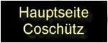
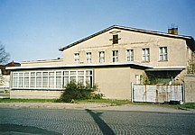
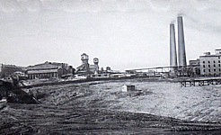
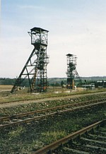
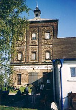
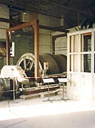

* * *

Nachdem die letzten Steinkohleschächte in und um Gittersee bereits in den
Dreißiger Jahren aus wirtschaftlichen Gründen geschlossen worden waren, entschied man sich in der schwierigen Nachkriegszeit nach dem Zweiten Weltkrieg für die
Wiederaufnahme des Kohlebergbaus. Zeitgleich fanden in Coschütz Erkundungen durch die SAG Wismut statt, welche zwischen 1947 und 1950 an der [Heidenschanze](../../../sud/coschutz/heidenschanze/) und am [Collmberg](../../../sud/coschutz/collmberg/) Probeerkundungen nach uranhaltigen Erzen vornahm. Der
strategisch wichtige Rohstoff sollte die Grundlage für das sowjetische Atomprogramm bilden. 1948 begann die Auffahrung des Grubenfeldes, wenig später die Förderung von Erzkohle in diesem Gebiet.

1950 übergab die Wismut die Anlagen an den VEB Steinkohlenwerk Freital. Der Betrieb ließ nun zwei neue Schächte
auf Gitterseer Flur abteufen und begann mit der Förderung von Steinkohle für die Energiewirtschaft. Am 3. September
1950 erfolgte der erste Spatenstich für die neue Schachtanlage. In der Nähe des Bahnhofes Obergittersee entstanden bis
1952 die Tagesschächte I und II mit zwei stählernen Fördergerüsten. Neben den technischen Anlagen und Gebäuden
erweiterte man auch die Anlagen der Windbergbahn, welche zum Abtransport der Rohkohle genutzt wurde. Im Eckhaus [Karlsruher/ Hermann-Michel-Straße](../../../sud/gittersee/strassen_gittersee/karlsruher_strasse/) befand sich die Verwaltung des Unternehmens, als Kantine und Kulturhaus diente
die frühere Gaststätte “Rehbockschänke”.

Bereits zwei Jahre nach dem Beginn des Kohleabbaus wurden die
Grubenanlagen in Gittersee wieder an die Wismut übergeben, fielen jedoch 1955 erneut an das Freitaler Steinkohlenwerk zurück. Drei Jahre später beendete man den Abbau an der Heidenschanze und konzentrierte sich auf die
beiden Gitterseer Schächte. Neben der Kohleförderung stand hier ab 1963 hauptsächlich die Urankohlegewinnung im Vordergrund. Zur Verarbeitung der gewonnenen Erze entstand eine bis 1962 betriebene [Uranaufbereitungsanlage](../../../sud/coschutz/strassen_coschutz/) (Uranfabrik 95). Später nutzte bis 1991 der VEB Reifenwerk diese Gebäude für die Fertigung von Lkw- und Traktorreifen. Durch den Abbau der uranhaltigen Kohle und der bei der Aufbereitung
anfallenden Abfälle entstanden erhebliche Umweltschäden. So musste der Salbeiabbau am [Collmberg](../../../sud/coschutz/) eingestellt werden,
da der Berg zum Abbrennen der Kohle für die Urangewinnnung und als Aschehalde genutzt wurde. Nicht verwendbarer Abraum wurde zudem im oberen Teil des [Kaitzgrundes](../../../sud/kaitz/kaitzbachtal/) abgekippt, wo es auch zwei große Schlammbecken mit
radioaktiven Aufbereitungsresten gab.

1958 erhielt das Unternehmen den Namen VEB Steinkohlewerk “Willi Agatz”. Mit der Namensgebung sollte an den aus
dem Ruhrgebiet stammenden Bergmann und Arbeiterfunktionär Willi Agatz (1904-1957) erinnert werden. Agatz gehört
bis 1933 als Abgeordneter der KPD dem Reichstag an und war nach 1945 zeitweise Landtagsmitglied in Nordrhein-
Westfalen und stellvertretender Vorsitzender des Industrieverbandes Bergbau in der Britischen Zone. 1953 übersiedelte er in die DDR.

Der Steinkohleabbau in Gittersee wurde 1967 eingestellt. Ab 1. Januar 1968 war wieder die
Wismut Betreiber der Schachtanlagen und förderte bis 1989 Erzkohle zur Urangewinnung. Zeitweise waren hier bis zu 1.250 Menschen beschäftigt. Rückläufige Vorräte und zunehmend
kompliziertere Abbaubedingungen führten in den 1980er Jahren zu Überlegungen für die künftige Nachnutzung des Geländes. Befürwortet wurde die Einrichtung eines
Reinstsiliziumwerkes. Wegen der damit verbundenen erheblichen Gefahren lehnten die Anwohner diese Planungen jedoch kategorisch ab. Unter dem Schutz der Kirche und
argwöhnisch von den DDR-Sicherheitsorganen beobachtet formierte sich 1988 erheblicher Widerstand gegen das Vorhaben. Erst die politische Wende beendete schließlich alle weiteren
Planungen. Am 23. Juni 1989 verließ der letzte Hunt das Gitterseer Abbaufeld, am 1. Dezember 1989 das Baufeld Bannewitz, womit die über 450-jährige Bergbaugeschichte des
Döhlener Reviers endgültig ihr Ende fand. Im Anschluss begann die Sicherung und Verwahrung der verbliebenen Schächte. Zur Regulierung des Entwässerung wurde ab 2007 der ca. 3 Kilometer lange Wismut-Stollen
in den Berg getrieben. Außerdem erfolgte ab 1992 eine Rekultivierung der früheren Bergbauhalden. Zwei historische
Fördertürme befinden sich heute als technische Denkmale in Freital- Burgk und in Zauckerode. Auf dem Gelände des Bergbaubetriebes und der ehemaligen Uranaufbereitungsanlage befinden sich heute ein Gewerbegebiet.

**_Fotos:_** _Förderturm des auf Bannewitzer Flur gelegenen Marienschachtes (Malakowturm)_

* * *

 \[ [Home](../../../index.html)\] \[ [Nord](../../../nord/)\] \[ [Nordwest](../../../nordwest/)\] \[ [Neustadt](../../../neustadt/)\] \[ [Nordost](../../../nordost/)\] \[ [West](../../../west/)\] \[ [Zentrum](../../../zentrum/)\] \[ [Südwest](../../../sudwest/)\] \[ [Süd](../../../sud/)\] \[ [Südost](../../../sudost/)\] \[ [Ost](../../../ost/)\] \[ [Register](../../../Register/register.html)\] \[ [Kontakt](../../../Kontakt/kontakt.html)\] \[ [Impressum](../../../impressum/)\]
