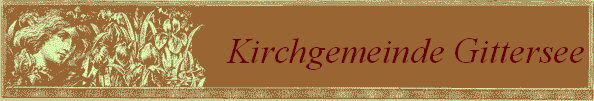
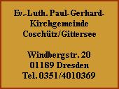
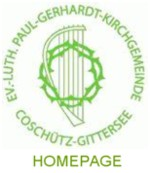
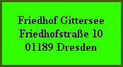
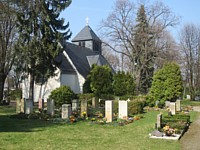
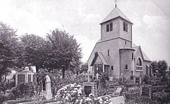
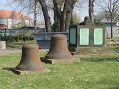
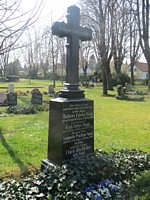
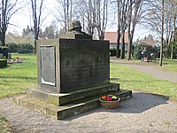
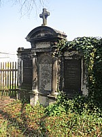

* * *

* * *

* * *

* * *

* * *

* * *

Gittersee gehörte kirchlich ursprünglich zu Döhlen, wo bereits im 15. Jahrhundert
eine Kirche existierte. Um 1560 war dort der Pfarrer Martin Küntzelmann angestellt, der in Gittersee ein Bauerngut besaß und hier den Obstbau einführte.
Nachkommen dieses ersten evangelischen Pfarrers waren noch bis um 1875 in Gittersee ansässig. Die wenigen Bewohner des Ortes mussten bis 1887 den
langen beschwerlichen Weg nach Döhlen antreten, wollten sie einen Gottesdienst besuchen. Erst dann entstand im Fiedlerschen Gut in Gittersee ein kleiner
Betsaal, in dem jeden dritten Sonntag der Döhlener Pfarrer seine Predigt abhielt. Ab 1894 gab es im Ort einen Hilfsgeistlichen, der die kirchliche Betreuung der Bevölkerung übernahm.

Nachdem im 19. Jahrhundert zahlreiche Bergleute und Arbeiterfamilien zugezogen waren, entstand der Wunsch nach Ausgliederung des Ortes aus der Döhlener Parochie. Gemeinsam mit Kleinnaundorf und Coschütz bildete
Gittersee ab 1896 eine gemeinsame Kirchgemeinde. Bereits ein Jahr zuvor legte der Ort einen eigenen Friedhof an, der am 24. November 1895 feierlich geweiht wurde. Hier fanden auch drei in Leipzig gegossene Glocken ihre
vorläufige Aufstellung. Schon bald gab es jedoch Konflikte zwischen den Gemeinden Coschütz und Gittersee, die sich vor allem am Standort eines vorgesehenen Kirchenbaus entzündeten.  Nachdem Coschütz eine gemeinsame
Kirche mit Friedhof im Nachbarort abgelehnt hatte, löste sich die Parochie [Coschütz-Gittersee](../../../sud/coschutz/kirchgemeinde_coschutz/) bereits zum 1. August 1897 wieder auf.

Der nun wieder selbstständige Ort konnte am 12. Dezember 1897 eine
Parentationshalle auf dem Friedhof einweihen _(Foto)_, die zugleich als Gemeindesaal diente. Architekt des Gebäudes war Woldemar Kandler, der sich für einen schlichten Bau im historisierenden Stil entschied. Die
Kapelle ist ein einfacher Hallenbau ohne Seitenschiffe und wird von einer hölzernen Spitzbogendecke geschlossen. An der Rückwand des Chores befindet sich in rundes Fenster mit einer Darstellung des segnenden
Christus. Die übrigen Fenster sind mit farbigen Mustern gestaltet.

Im Jahr 1903 entstand ein Pfarrhaus, welches 1904 bezogen wurde. Nach dem Ersten Weltkrieg gelang es der
Gemeinde, zunächst neue Glocken als Ersatz für das im Ersten Weltkrieg eingeschmolzene Geläut zu beschaffen.
1928 erfolgte eine Erweiterung der Friedhofshalle, die nun in den Rang einer vollwertigen Kirche erhoben wurde. Die Baupläne für den Umbau sowie den neu errichteten 14 Meter hohen Glockenturm stammen von der Plauener
Baufirma Gebrüder Fichtner.

Am 3. Januar 1945 wurde die Gitterseer Kirche in Paul-Gerhardt-Kirche
umbenannt. Namenspatron war der 1607 in Gräfenhainichen geborene Pfarrer und Kirchenlieder-Dichter Paul Gerhardt. 1951 erhielt sie eine Orgel der Firma
Jehmlich. Ab 1954 ergänzten zwei Stahlglocken das im Zweiten Weltkrieg erneut verlorene Geläut. Diese läuteten noch bis Ende 2006 im Turm, mussten dann jedoch wegen technischer Mängel am Glockenstuhl entfernt werden.
Heute sind sie aiuf der Wiese vor dem Kirchengebäude zu sehen _(Foto)._ Im Dezember 2007 bekam die Kirche zwei in Lauchhammer gegossene neue
Bronzeglocken, die mit der letzten noch erhaltenen Glocke von 1930 das neue Geläut bilden. Bemerkenswert sind auch einige künstlerisch gestaltete Glasfenster der Entstehungszeit.

Die rückläufige Zahl an Gläubigen und innerkirchliche Umstrukturierungen führten 1977 zur Einrichtung einer gemeinsamen Pfarrstelle für Coschütz und Gittersee. Zehn Jahre später, am 1. Januar 1987, wurden beide
Gemeinden schließlich zur gemeinsamen Paul-Gerhardt-Kirchgemeinde Dresden-Coschütz/Gittersee vereinigt. Für überregionales Aufsehen sorgten 1989 die in der Kirche von Gittersee durchgeführten Protestveranstaltungen
engagierter Christen gegen den Bau eines Reinstsiliziumwerkes im Stadtteil. Seit 1998 bestehen partnerschaftliche Kontakte zur Gemeinde der Auferstehungskirche im Nachbarort Plauen und zur Zionskirche in der Südvorstadt.

**_Fotos:_** _historische Grabstätten auf dem Gitterseer Friedhof, in der Mitte das Kriegerdenkmal_

* * *

 \[ [Home](../../../index.html)\] \[ [Nord](../../../nord/)\] \[ [Nordwest](../../../nordwest/)\] \[ [Neustadt](../../../neustadt/)\] \[ [Nordost](../../../nordost/)\] \[ [West](../../../west/)\] \[ [Zentrum](../../../zentrum/)\] \[ [Südwest](../../../sudwest/)\] \[ [Süd](../../../sud/)\] \[ [Südost](../../../sudost/)\] \[ [Ost](../../../ost/)\] \[ [Register](../../../Register/register.html)\] \[ [Kontakt](../../../Kontakt/kontakt.html)\] \[ [Impressum](../../../impressum/)\]
