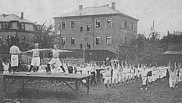
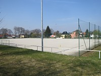

* * *

* * *

* * *

* * *

* * *

* * *

Die Sportgemeinschaft Gittersee wurde 1882 als Turnverein “Einigkeit” von
Gitterseer Arbeitern gegründet und ist ältester noch existierender Arbeitersportverein Dresdens. Zunächst widmete sich der Verein ausschließlich dem Turnsport und der Gymnastik, bevor 1907 auch die
Ballsportarten hinzukamen **_(Foto:_** _Turnergruppe um 1900 / Archiv Verein)_. Bereits ein Jahr zuvor war der Verein Mitglied des ATSB (Arbeiter-
Turn- und Sportbund) geworden. 1912 entstand die Fußballabteilung, die sich drei Jahre später als Dresdner Ballspielverein DBV 15 selbständig machte, organisatorisch jedoch eng mit dem TV Einigkeit verbunden blieb.
1919 konnte der Verein sein noch heute genutztes Gelände an der Friedhofstraße erwerben. Wenig später folgte noch ein
zweiter, heute nicht mehr vorhandener Turnplatz hinter den Gebäuden Karlsruher Straße 85/87. Ende 1930 zählte man 220 Vereinsmitglieder, die in fünf Fußball-, drei Handball- und zwei Jugendmannschaften aktiv waren.

Als Arbeiter-Sportvereine mussten sich 1933 sowohl die TV Einigkeit wie auch der DBV 15 zwangsweise auflösen und
ihre Vermögenswerte abgeben. Zwei historische Vereinsfahnen und weitere Gegenstände konnten jedoch vor dem Zugriff
der Nazis gerettet und in eine Zwischenwand der 1930 errichteten Turnhalle eingemauert werden. Erst beim Abriss des
Gebäudes im Jahr 2005 wurden die Fahnen entdeckt und geborgen. Die Sportler schlossen sich nach der Auflösung der TG Coschütz/Gittersee bzw. dem Fußballverein FV Süd-West an.

Während des Zweiten Weltkrieges diente die Turnhalle zeitweise als
Kriegsgefangenenlager, später dem Schul- und Vereinssport. Der 1945 als SG Gittersee wieder gegründete Verein war in den 1950er und 60er Jahren im
Regionalfußball erfolgreich. 1953 konnten die Sportanlagen in ehrenamtlicher Arbeit und mit städtischer Unterstützung erneuert werden. Trotzdem wurde die
Fußballmannschaft 1973 aufgelöst und in die BSG “Pneumant” eingegliedert. Weitere Sektionen widmeten sich dem Turnen, dem Rollschuhsport, dem Kegeln, Billard,
Handball oder Tischtennis. 1957 folgte die Gründung der überregional erfolgreichen Sektion Federball.

1991 erhielt der Verein sein altes Vereinsgrundstück an der Friedhofsstraße zurück. Gleichzeitig konnte auch wieder eine
eigene Fußballmannschaft in Gittersee gebildet werden. Die baufällige Turnhalle musste jedoch 1997 geschlossen und im
November 2005 abgebrochen werden. Ein Neubau ist geplant. Heute gehören dem Verein ca. 300 Mitglieder an, welche
im Badminton, im Fußball, im Handball, in der Gymnastik und in einer 2011 gebildeten Abteilung Gesundheitssport aktiv sind.
