* * *

Die Straße Am Bahndamm zweigt von der Paul-Büttner-Straße ab und führt von dort als Sackgasse in südlicher Richtung bis zum Bahndamm der [Windbergbahn](../../../sud/gittersee/windbergbahn/). Bis 1945 wurde sie Herbert-Norkus-Straße genannt. Herbert Norkus (1916-1932)
war ein Hitlerjunge, der am 24. Januar 1932 in Berlin bei Auseinandersetzungen zwischen Nationalsozialisten und Kommunisten ums Leben kam und während der NS-Zeit als „Blutzeuge der Bewegung“ und Vorbild der Hitlerjugend
verehrt wurde.

Die in den 1930er Jahren angelegte Straße Birkigter Hang verläuft als Verlängerung der Bruno-Bürgel-Straße bogenförmig
am Rande des Kesselgrundes und bildet zugleich die Stadtgrenze zwischen Dresden und Freital. Benannt wurde sie nach dem Freitaler Stadtteil Birkigt. Bis 1932 wurden hier auf gemeindeeigenen Grundstücken einfache Doppelhäuser für
Arbeitslose und arme Familien erbaut. Die Kleinteiligkeit der gesamten Anlage brachte der Siedlung im Volksmund den Namen “Piependorf” ein.

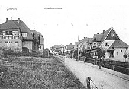Die Bruno-Bürgel-Straße erhielt ihren Namen in der
Zeit nach dem Zweiten Weltkrieg nach dem Berliner Astronomen Bruno Bürgel (1875-1948). Der aus einfachen Verhältnissen stammende Bürgel befasste sich autodidaktisch mit der Sternenkunde
und wurde vor allem durch seine populärwissenschaftlichen Bücher zur Astronomie bekannt. Bis 1946 wurde die Straße Eigenheimstraße genannt. In den Jahren vor dem
Ersten Weltkrieg entstanden hier vorrangig Doppelhäuser für wohlhabendere Einwohner der Gemeinde.

Der Collmweg am Fuße des gleichnamigen [Collmberges](../../../sud/coschutz/collmberg/) führt parallel zur Trasse der Windbergbahn und dann auf den Gipfel der 240 Meter hohen Erhebung. Ursprünglich betrieben hier Coschützer Bauern Weinbau. Später wurden die Felder bis 1945 von den Freital-Zauckeroder Bombastus-Werken für den Salbeianbau genutzt. Ab 1948 diente der Berg als Abraumhalde des Bergbauunternehmens der Wismut, später als Müll- und Aschedeponie und wurde dabei weitgehend überschüttet. In diesem Zusammenhang verschwand auch der größte Teil des Collmweges, der heute nur noch in einem Reststück an der Potschappler Straße existiert.

Die Cornelius-Gurlitt-Straße verläuft am westlichen Rand der Gitterseer Flur und verbindet den Ort mit dem angrenzenden Freitaler Stadtteil Birkigt.
Bis zur Eingemeindung des Ortes 1945 wurde sie deshalb Birkigter Straße (zuvor auch Obere bzw. Untere Birkigtstraße) genannt. Ihren heutigen Namen verdankt sie dem Kunsthistoriker Cornelius Gurlitt (1850-1938),
der zahlreiche Werke zur sächsischen Architekturgeschichte verfasste und sich auch auf dem Gebiet der Stadtplanung und des Denkmalschutzes engagierte.

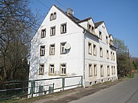Auf dem Grundstück Cornelius-Gurlitt-Straße 18 befand sich im 19. Jahrhundert der
Förderturm des Moritzschachtes, der vom Steinkohlen-Bauverein Gittersee betrieben wurde und 1857 Anschluss an die Windbergbahn erhielt. Nach dem Konkurs des
Unternehmens 1860 diente das heute nicht mehr vorhandene Huthaus als Gasthaus. Weitere Gebäude wurden noch bis um 1960 vom Sägewerk und der Kistenfabrik Paul
Reichelt genutzt, an die noch heute eine Inschrift an der Fassade erinnert. Ein in der Nähe ansässiger Metallbaubetrieb wurde während des Zweiten Weltkrieges in die Produktion
von Raketenteilen der V1 einbezogen, was 1944 zur Bombardierung von Birkigt und Gittersee führte. Dabei wurden auch einige Häuser an der Cornelius-Gurlitt-Straße
zerstört. Erhalten blieb eines der älteren Gebäude Niedergittersees (Nr. 24), welches sich nach Sanierung äußerlich wieder
weitgehend im Ursprungszustand zeigt und so ein interessantes Zeugnis der Ortsgeschichte der Arbeitergemeinde darstellt _(Foto)_. Unter der Straße verläuft die Haupttrinkwasserleitung von der Klingenberger Talstraße zum [Wasserwerk Coschütz](../../../sud/coschutz/).

**_Foto:_** _Das Huthaus des Gitterseer Steinkohle-Aktienvereins als “Dresslers Restaurant” um 1910._

Die frühere Bismarckstraße in Gittersee wurde 1899 als östliche Verlängerung des alten Dorfkerns (Potschappler Straße)
angelegt und in den Folgejahren mit Arbeiterwohnhäusern bebaut. Im Erdgeschoss des Eckhauses zur Karlsruher Straße
befand sich viele Jahre ein Bäckerladen. 1928 erfolgte die Umbenennung der Bismarckstraße in August-Bebel-Straße. Mit dieser sollte der sozialdemokratische Arbeiterführer August Bebel geehrt werden. Da diese Namensgebung von den
Nationalsozialisten als unpassend abgelehnt wurde, änderte man 1934 den Namen wieder zurück in Bismarckstraße.

Nach der Eingemeindung von Gittersee wurde die Straße 1945 in Emil-Rosenow-Straße umbenannt. Emil Rosenow
(1871-1904) war zeitweise Chefredakteur der Zeitung “Chemnitzer Beobachter” und gehörte als Abgeordneter der SPD dem Reichstag an. Bekannt wurde sein Volksstück “Kater Lampe” über einen erzgebirgischen Spielzeugmacher. 2002
wurde dieses mit großem Erfolg an der “Komödie Dresden” neu inszeniert.

Die Försterstraße verdankt ihren Namen dem deutschen Theologen und Erziehungswissenschaftler Friedrich Wilhelm
Foerster (1869–1966). Foerster (so die korrekte Schreibweise) verfasste mehrere pazifistischer Schriften gegen die
deutsche Kriegspolitik im Ersten Weltkrieg und wurde deshalb von nationalistischen Kreisen heftig angefeindet. In seinen
Werken setzte er sich mit ethischen, sozialen und religiösen Themen auseinander und forderte eine Erziehung auf christlicher und ethischer Grundlage. Die Wohnhäuser der Försterstraße entstanden überwiegend in den 1930er Jahren.

Der kurze Grenzweg zweigt am östlichen Ende von der Emil-Rosenow-Straße als Sackgasse ab. Seinen Namen erhielt er, da hier die Flurgrenze zwischen Gittersee und Coschütz verläuft. Ursprünglich war die Wegführung bis zur Gebauerstraße durchgehend, wurde später jedoch teilweise überbaut.

Der 1943 erstmals genannte Grubenweg führt von der Potschappler Straße in westliche Richtung zu einer Wochenendhaussiedlung. Sein Name erinnert an die einst zahlreichen Steinkohlengruben auf Coschütz-Gitterseer Flur.

Der nach seiner topografischen Lage benannte Grundweg führt von der Gitterseer Straße in Freital als Fußweg bis zum Meiselschachtweg in Gittersee und bildet in seinem Verlauf teilweise die Ortsgrenze zwischen Freital und Dresden.

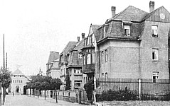Die Hermann-Michel-Straße verbindet die Karlsruher Straße mit dem früheren Bahnhof von Obergittersee und wurde deshalb bis 1945 Bahnhofstraße genannt. Der entlang der Gleisanlagen entlang führende Teil trug den Namen Fabrikstraße. Nach der Eingemeindung wurden beide Straßen 1945 vereinigt. Ihren heutigen Namen erhielt sie nach dem früheren Gemeindeältesten Hermann Michel (1875-1944), der sich im Widerstandskampf gegen das Naziregime engagierte. Michel gehörte der SPD an, betätigte sich nach 1933 im Untergrund und wurde deshalb inhaftiert. 1944 verstarb er an Misshandlungen im Gefängnis.

An der nördlichen Straßenseite entstanden um 1910 einige mehrgeschossige Wohnhäuser mit interessanten architektonischen Details _(Foto)_. Das gegenüberliegende Areal wurde, begünstigt durch den Bahnanschluss, gewerblich genutzt. Hier gab es u.a. seit 1910 eine Drahtnagel- und eine Wellpappenfabrik. Im Zuge der Reaktivierung einiger alter Schachtanlagen kam das Gelände nach 1945 zur Wismut und wurde bis 1995 vom Bergbaubetrieb “Willy Agatz” genutzt. Die beiden Fördertürme des Schachts kamen 2003 als technische Denkmale nach Freital und sind heute in Burgk und Zauckerode zu besichtigen.

Am Ende der Sackgasse befindet sich das Empfangsgebäude Obergittersee der [Windbergbahn](../../../sud/gittersee/windbergbahn/). Der heutige Endpunkt der Museumsbahn wurde in den letzten Jahren vom Traditionsverein “Windbergbahn e.V.” originalgetreu restauriert. In den Räumen erinnert eine kleine Ausstellung an die Geschichte der ältesten deutschen Gebirgsbahn.

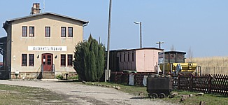

**_Foto:_** _Das Bahnhofsgelände an der Hermann-Michel-Straße im Frühjahr 2014_

Der von der Potschappler Straße abgehende Hüttenweg verbindet Niedergittersee parallel zur Bruno-Bürgel-Straße mit einer Wochenendsiedlung. Erst nach 1991 ist dieser Name im Stadtplan zu finden.

Die Karl-Stein-Straße in Gittersee (früher Bergstraße) wurde nach 1945 nach dem
kommunistischen Widerstandskämpfer Karl Stein (1902-1942) benannt, der ab 1934 der Gruppe um Fritz Schulze und Albert Hensel angehörte. Stein wurde mit
seinen Mitkämpfern 1942 zum Tode verurteilt und hingerichtet. An ihn erinnert ein Gedenkstein an der Einmündung Potschappler Straße.

Auf dem Grundstück Karl-Stein-Straße 10/11 bestand von 1832 bis 1859 der
Emmaschacht des Gitterseer Steinkohlenbauvereins. 1993 wurde das stillgelegte Bergwerk zum Schutz vor Bergschäden erneut aufgewältigt und mit Beton verwahrt.
Nach 1880 entstanden an der Straße mehrgeschossige Arbeiterwohnhäuser, welche bis heute weitgehend erhalten blieben _(Foto um 1935)_
. Bemerkenswert ist u.a. das Eckhaus zur Cornelius-Gurlitt-Straße (Nr. 15), in dem sich seit vielen  Jahrzehnten ein Bäckereiladen befindet.

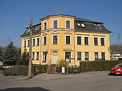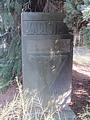

**_Fotos:_** _Wohnhaus Nr. 15  und Gedenkstein für den Widerstandskämpfer Karl Stein an der Potschappler Straße_

Der Meiselschachtweg an der Ortsgrenze zu Kleinnaundorf verdankt seinen Namen dem früheren Meiselschacht, der 1828 abgeteuft und
vom Gitterseer Steinkohlenbauverein betrieben wurde. Die Schachtanlage, die sich hinter dem heutigen Grundstück Karlsruher Straße 122 befand, war bis zum Konkurs der Vereins 1859 in Betrieb. Das frühere Huthaus an der
Ecke Meiselschachtweg/Karlsruher Straße dient heute als Wohnhaus. 1991 stürzten Teile des nur unzureichend verfüllten Schachtes ein und mussten im Anschluss aufwendig gesichert werden.

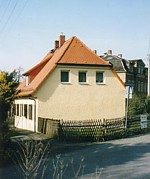

**_Foto:_** _Das frühere Huthaus des Meiselschachtes an der Ecke zur Karlsruher Straße_

__

Die landhausartigen Einfamilienhäuser der Moritzschachtstraße wurden kurz vor dem Ersten Weltkrieg errichtet und besitzen
zum Teil Fachwerk- bzw. holzverkleidete Obergeschosse. Ursprünglich wurde diese Straße Daheimstraße genannt, bevor sie
1945 ihren jetzigen Namen erhielt. Dieser erinnert an den einstigen Moritzschacht, eine von drei Schachtanlagen des 1837 gegründeten Gitterseer Steinkohlen-Bauvereins.

Die Oskar-Seyffert-Straße wurde im Zusammenhang mit dem Bau der Wohnsiedlung am Birkigter Hang in den Dreißiger
Jahren angelegt. Der Name erinnert an den Maler und Volkskundler Oskar Seyffert (1862-1940), der 1897 zu den Mitbegründern des Vereins für Sächsische Volkskunde gehörte. Die von ihm zusammengetragene Sammlung wurde 1913 als
Volkskunstmuseum im Jägerhof eröffnet und trug bis 1949 den Namen Oskar-Seyffert-Museum. In den Jahren bis zum
Zweiten Weltkrieg entstanden an der Oskar-Seyffert-Straße Ein- und Zweifamilienhäuser. 1945 richtete die sowjetische
Besatzungsmacht in den Gebäuden Nr. 10 und 11 ihre Kommandantur ein. Auf dem Gelände einer früheren Gärtnerei wurde zwischen 1995 und 1998 eine Neubausiedlung mit Doppelhäusern errichtet.

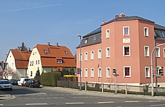Die heutige Paul-Büttner-Straße wurde 1911 im westlichen Teil der Ortsflur angelegt
und zunächst Gartenstraße genannt. In den Jahren vor dem Ersten Weltkrieg entstanden hier Wohnhäuser im Landhausstil mit ausgebauten Mansardgeschossen. Nach 1930 folgten zweigeschossige Mietshäuser in sachlicheren Bauformen und mit
einfachen Walmdächern. Zeitweise gab es auch eine Rosengärtnerei.

Nach 1945 wurde die Gartenstraße im Zusammenhang mit der Eingemeindung des Ortes in Paul-Büttner-Straße umbenannt. Ihren heutigen Namen verdankt sie dem
Komponisten und Dirigenten Paul Büttner (1870-1943), der ab 1924 Direktor des Dresdner Konservatoriums war. Als Leiter des Arbeitersängerbundes und Mitarbeiter der “Dresdner Volkszeitung”
engagierte sich Büttner auch politisch und wurde deshalb von den Nazis nach 1933 aller Ämter enthoben.

Die Potschappler Straße verbindet Gittersee mit dem Freitaler Stadtteil Potschappel.
Im oberen Teil befindet sich an der Einmündung in die Karlsruher Straße der alte Dorfkern _(Foto)_, in dem sich jedoch nur noch wenige Reste der früheren dörflichen
Bebauung erhalten haben. Ursprünglich gab es hier neben einigen Giebelhäusern einen größeren Dreiseithof. In der ersten Hälfte des 19. Jahrhunderts folgten kleinere
Häusleranwesen für Bergleute und Arbeiterfamilien. Bereits um 1960 wurden die meisten Gebäude wegen ihres schlechten Bauzustandes abgerissen. 1991 entstand
am Hang ein architektonischer interessanter Neubau mit Einkaufspassage und 70 Wohnungen (Nr. 4).

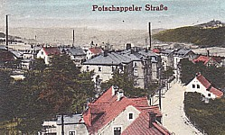Der Ortsteil im unteren Teil der Straße an der Stadtgrenze zu Freital _(Foto um 1910)_ wurde früher als Niedergittersee bezeichnet und war Ausgangspunkt des
einst bedeutenden Steinkohlebergbaus. Am Fuße des Collmberges befand sich der Clausschacht, eine von mehreren Schachtanlagen des Ortes. Ab 1820 begann hier die Bebauung mit Bergarbeiterhäusern. Viele dieser Häuser besaßen
zudem Schuppen, Kleintierställe und Gärten, um den kärglichen Lohn etwas aufzubessern. Um 1900 zählte Niedergittersee bereits 1.500 Einwohner, die meist als Bergleute bzw. in den Industriebetrieben des Plauenschen Grundes
beschäftigt waren.

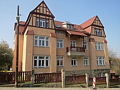Für diese entstanden zu beiden Seiten der Potschappler Straße und an der sogenanten
“Niedergitterseer Terrasse” an der heutigen Karl-Stein-Straße größere Mietshäuser. Aus dieser Zeit stammt auch der frühere Gasthof Niedergittersee, später  “Potschappler Hof”
genannt (Nr. 41). Das 1893 errichtete Gebäude ist noch erhalten, steht jedoch seit vielen Jahren leer. Zu den architektonisch interessantesten Häusern gehört das sogenannte
“Thüme-Haus” (Nr. 27), welches 1901 vom Dresdner Spar- und Bauverein errichtet wurde. Dach und Fassade sind durch verschiedene Zierelemente gegliedert, die sich am
Landhausstil Dresdner Villen orientieren. Eine umfassende Sanierung unter weitgehender Wahrung des ursprünglichen Bildes erfolgte nach 1990 _(Foto)_.

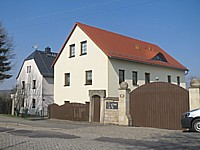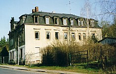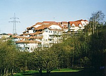

**_Fotos:_** _Die Potschappler Straße - links ein Gehöft des alten Dorfkerns - in der Mitte der frühere Niedergitterseer Gasthof Potschappler Hof - rechts das moderne Einkaufszentrum mit Wohnungen_

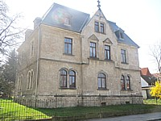
Die Rathausstraße entstand als Nebenstraße der Karlsruher Straße Ende des 19. Jahrhunderts. Ihren Namen verdankt sie dem an der Einmündung stehenden, 1901 errichteten früheren [Rathaus](../../../sud/gittersee/) des Ortes, welches heute Wohnzwecken dient. Die übrigen Grundstücke wurden um 1900 mit mehrgeschossigen Wohnhäusern in offener Bauweise
bebaut. Im Haus Nr. 4 befand sich ab 1904 der Dienstsitz des Pfarrers und das Pfarrgemeindeamt _(Foto)_. Noch heute erinnert an Kreuz am Giebel an diese Funktion. Im
Nachbargebäude Nr. 6 gab es noch bis um 1990 eine Bäckerei. Das Eckhaus gegenüber (Ecke Schulstraße) diente einst als Kinderbewahranstalt und war später Sitz einer Haushaltsschule.

Die heutige Schulstraße wurde 1899 im Zusammenhang mit der Erschließung eines neuen Wohnviertels angelegt und
zunächst nach dem sächsischen Königshaus Wettinstraße genannt. Bis 1905 entstanden hier mehrgeschossige Würfelhäuser, welche im Volksmund
“Kaffeemühlen” genannt werden. 1945 erfolgte die Umbenennung in Schulstraße, da diese zum 1897 eröffneten Schulhaus des Ortes führt.

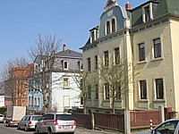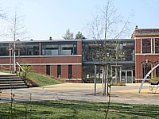

**_Fotos:_** _Blick in die Schulstraße - rechts der moderne Neubau der Gitterseer Schule von 2011_

[Gittersee auf OpenStreetMap](https://www.openstreetmap.org/search?query=Dresden+Gittersee)

* * *

 \[ [Home](../../../index.html)\] \[ [Nord](../../../nord/)\] \[ [Nordwest](../../../nordwest/)\] \[ [Neustadt](../../../neustadt/)\] \[ [Nordost](../../../nordost/)\] \[ [West](../../../west/)\] \[ [Zentrum](../../../zentrum/)\] \[ [Südwest](../../../sudwest/)\] \[ [Süd](../../../sud/)\] \[ [Südost](../../../sudost/)\] \[ [Ost](../../../ost/)\] \[ [Register](../../../Register/register.html)\] \[ [Kontakt](../../../Kontakt/kontakt.html)\] \[ [Impressum](../../../impressum/)\]
