* * *

* * *

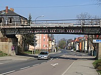Die heutige Karlsruher Straße verbindet die Stadtteile Coschütz und Gittersee mit Plauen und ist zugleich wichtige Verkehrsverbindung nach Freital. Nachdem in Gittersee um 1810 Steinkohlevorkommen entdeckt worden waren, wuchs die Bedeutung dieses Verkehrsweges, der zwischen 1841 und 1844 zur Chaussee ausgebaut wurde. Ab 1855 überquerte eine Steinbogenbrücke der Windbergbahn die Straße. Nach dem Zweiten Weltkrieg wurde sie 1965 durch eine Stahlträgerbrücke ersetzt _(Foto rechts)_. Vor allem im oberen Abschnitt entstanden zwischen 1860 und 1870 einfache Wohnhäuser für Arbeiter- und Bergmannsfamilien.

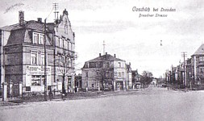Ende des 19. Jahrhunderts begann die zunehmende Bebauung der Straße mit größeren Mietshäusern sowie kleineren Geschäften _(Foto links um 1910)_. Zu den markanten öffentlichen Gebäuden gehören das [Gitterseer Rathaus](../../../../sud/gittersee/) und das Postamt Coschütz. Vor der Eingemeindung wurde die Straße in Coschütz Dresdner Straße bzw. Kohlenstraße, in Gittersee Kohlenstraße, später ebenfalls Dresdner Straße genannt. Der anschließende Straßenabschnitt des ehemaligen Kohlenweges heißt auf Plauener Flur bis heute Coschützer Straße. 1926 erfolgte die Umbenennung des Coschützer Abschnittes nach der badischen Stadt Karlsruhe. 1945 wurde dieser auch auf den Straßenteil in Gittersee übertragen.

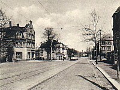Kurz nach dem Ersten Weltkrieg hatte man begonnen, die Chaussee auf eine Fahrbahnbreite von ca. 11 bis 15 Meter zu verbreitern und dabei zugleich Fußwege anzulegen. Dabei griff man auf die bereits 1897 erarbeiteten Planungen des Geometers Emil Ueberall zurück. Diesem umfassenden Ausbau fielen die meisten Alleebäume und auch viele Vorgärten zum Opfer. Ab 18. Oktober 1927 verkehrte die von [Altplauen](../../../../sud/plauen/strassen_plauen/altplauen/) über den Plauenschen Ring bis nach Coschütz verlängerte Straßenbahn über die Karlsruher Straße _(Foto)_. Zuvor hatte man bereits am 19. April 1922 eine Buslinie nach Coschütz eingerichtet, die 1927 als Linie B bis zur Gaststätte “Hopfenblüte” in Kleinnaundorf verlängert wurde. Bereits wenige Tage nach Eröffnung der verlängerten Straßenbahnlinie kam es am 29. Oktober 1927 zu einem der schwersten Straßenbahnunfälle in Dresden. Ein aus Coschütz kommender Straßenbahnzug durchfuhr die Haarnadelkurve am Plauenschen Ring zu schnell. Dabei kippte der gut besetzte Beiwagen um, 18 Personen wurden zum Teil schwer verletzt. Ein ähnliches Unglück mit 11 Toten ereignete sich an gleicher Stelle am 9. Dezember 1959.

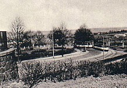Mehrfach wechselte die Liniennummer der Strecke nach Coschütz. Verkehrte anfangs die Linie 15 zwischen Coschütz und [Mickten](../../../../nordwest/mickten/)/Coswig wurde diese im Zuge einer Linienreform 1931 durch die Linie 6 bzw. 106 zum [Wilden Mann](../../../../nordwest/trachenberge/) ersetzt. Nach dem Zweiten Weltkrieg erhielten die Bahnen die Liniennummern 4 (12. November 1946 - 25. April 1947 nach [Zschertnitz](../../../../sud/zschertnitz/)) bzw. 11 (ab 26. April 1947 nach [Bühlau](../../../../nordost/buhlau/)). Zwischen 1947 und 1972 kamen auf der Straßenbahnlinie vorrangig die modernen Hechtwagen zum Einsatz _( **Foto:** Kurve am Plauenschen Ring)_. 1972 wurde im Zusammenhang mit der Einführung der Tatra-Großzüge die alte Rangierendstelle an der Kleinnaundorfer Straße durch eine Gleisschleife in Höhe des Achtbeeteweges ersetzt und die Linie 12 [Niedersedlitz](../../../../ost/niedersedlitz/) \- Coschütz eingeführt. Mit Fertigstellung der neuen Gleistrasse in Plauen fahren seit 1999 moderne Stadtbahnzüge als Linie 3 zur Endstation Coschütz.

Einzelne Gebäude:

_**Coschütz:**_

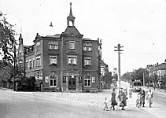Coschützer Höhe (Nr. 1): Das Lokal wurde am 9. September 1897 im Eckhaus Cunnersdorfer/ Karlsruher Straße _(Foto)_ eröffnet und befand sich ab 1908 im Besitz von Max Arthur Bertram. Zur Gaststätte gehörten neben der Schankstube auch zwei repräsentative Vereinszimmer sowie eine Kegelbahn und das über einen separaten Eingang zugängliche Braustübl. 1927 kam die “Coschützer Höhe” in den Besitz von Georg Baake, wurde nach 1945 von der HO übernommen und 1990 wegen ihres schlechten Bauzustandes geschlossen. Zeitweise befand sich in den Räumen dann eine Tierpension. 2002 begann eine umfassende Sanierung des Gebäudes, welches seit Oktober 2003 wieder gastronomisch genutzt wird. Nach mehrfachem Betreiberwechsel, u.a. als mediterranes Lokal "Adriatico" (2005), griechische Taverne "El Greko" (2008), bzw. italienisches Restaurant “La Crappa” (2012) trägt das Lokal seit 2012 wieder seinen ursprünglichen Namen und wird als historisches Gasthaus betrieben.

Nr. 9: Eine weitere Gaststätte befindet sich seit 1994 im seitlichen Anbau des Wohnhauses Nr. 9. Das Lokal trägt den Namen "Coschützer Stübchen" und bietet vorrangig gutbürgerliche Küche an. Zuvor befand sich in den Räumen vor 1945 ein Lebensmittelgeschäft, später ein Friseursalon.

Nr. 10: Das villenartige Wohnhaus mit seiner im Schweizerhausstil gestalteten Dachform und der hölzernen Verande entstand um 1900 und steht unter Denkmalschutz. In einem heute nicht mehr vorhandenen Seitengebäude befand sich früher eine Lebensmittelhandlung.

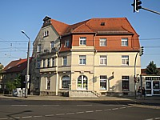Nr. 13: Das ebenfalls unter Denkmalschutz stehende Eckhaus _(Foto)_ an der Einmündung der Kohlenstraße wurde 1905 als Wohn- und Geschäftshaus errichtet. Im Erdgeschoss befand sich ursprünglich eine Molkereiwarenhandlung, später ein Fleischerladen. Gemeinsam mit den benachbarten Wohn- und Geschäftshäusern Karlsruher Straße 3 (ehem. Drogerie und Fotohandlung), 11 (Tabak- und Zeitungshandlung, 1994/95 Eulen-Apotheke, ab 2004 Elisabeth-Drogerie), 14 (ehem. Elisabeth-Drogerie) und 16 sowie einigen Häusern an der Windbergstraße und der Felsenkellerstraße entwickelte sich hier vor dem Ersten Weltkrieg das neue Ortszentrum der Gemeinde Coschütz. Nach 1990 bezog ein Fachgeschäft für Rundfunk und Fernsehen die Räume.

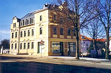Nr. 16: Das markante Eckhaus zur Windbergstraße entstand 1895. Im Gegensatz zu den meisten Coschützer Neubauten dieser Zeit erhielt es eine Fassade mit verblendeten Klinkern und einer Löwenplastik im Ziergiebel, um dem Haus ein repräsentatives Äußeres zu verleihen. Im Erdgeschoss gab es früher eine Bäckerei sowie ein Kolonialwarengeschäft, nach 1945 ein Schuhgeschäft. Anfang der 1990er Jahre bezog zunächst ein An- & Verkauf, später ein Friseursalon die Räume. Das Gebäude steht als Baudenkmal unter Schutz und wurde 1998/99 renoviert.

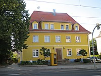Nr. 30: Dieses 1930 von der Heimstättengesellschaft Sachsen gGmbH erbaute Gebäude beherbergte noch bis 2004 das Coschützer Postamt. Ursprünglich befand sich die Post auf der Körnerstraße 17a (heute Windbergstraße), bevor sie 1925 zur damaligen Dresdner Straße 6 verlegt wurde. Ab 1927 ist das Postamt unter der Adresse Karlsruher Straße 7 im Adressbuch verzeichnet. 1931 verzog es zur Karlsruher Straße 30 und fungierte dort als Postamt Dresden A 40, später als Postamt 8040. Heute dient das Gebäude als Wohnhaus. Eine Inschrift an der Fassade erinnert jedoch noch an die frühere Nutzung.

Nr. 34: Das Wohn- und Geschäftshaus entstand um ca. 1900 und beherbergte im Erdgeschoss früher eine Lebensmittelverkaufsstelle. Bis 1997 wurden die Räume vom Konsum als Laden für Obst- und Gemüse genutzt. Eine umfassende Sanierung des Eckhauses erfolgte 2005. Unmittelbar neben dem Haus zweigt seit 1972 das Gleis der Straßenbahn von der Karlsruher Straße ab und führt zur Gleisschleife. Zuvor mussten die Straßenbahnen in Höhe der Einmündung der Gebauerstraße auf der Straße rangieren, was jedoch zunehmend zu Verkehrsbehinderungen führte.

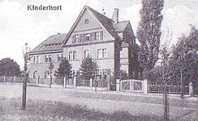Nr. 36: Das 1914 errichtete Haus diente ursprünglich als Kinderhort der Gemeinde Coschütz. Noch heute erinnert ein Schlussstein mit Kinderkopf über dem Eingangsportal an die einstige Funktion. Die Einrichtung entstand auf Beschluss des Coschützer Gemeinderates vom 19. Juni 1913 und wurde von einer eigens ins Leben gerufenen "Kaiser-Wilhelm-II.-Jubiläumsstiftung" finanziert. Zuvor befand sich auf dem Grundstück bereits ein Kinderspielplatz. Die Betreuung der Kinder im Alter von drei bis sechs Jahren übernahmen der Gemeindepflegeverein sowie der Frauenhilfsverein. Neben den Gruppenräumen gab es im Haus vier Mietwohnungen. Im Ersten und Zweiten Weltkrieg wurde das Gebäude als Lazarett, nach 1945 als Wohnhaus genutzt. Seit 1995 beherbergt es ein Übergangswohnheim für Jugendliche.

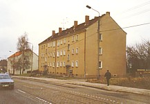Nr. 39-51: Die dreigeschossigen Wohnblocks _(Foto links)_ wurden 1955 - 1960 von der Arbeiter-Wohnungsgenossenschaft "Glückauf Süd" errichtet und vorrangig von Mitarbeitern der Wismut bzw. des Reifenwerkes bewohnt. Das Werk war nach Ende der Uranverarbeitung auf dem Gelände der früheren Aufbereitungsanlage errichtet worden. Eine Sanierung der Gebäude, die sich heute im Besitz der WG "Glückauf" befinden, erfolgte ab 1995.

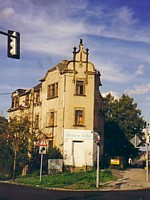Nr. 50: Das Mehrfamilienhaus an der Einmündung der Gebauerstraße entstand Ende des 19. Jahrhunderts (1895) und steht unter Denkmalschutz. Bis 1990 befand sich im Erdgeschoss die "Betten-Ecke", ein Fachgeschäft für Betten und Kissen. Nach jahrelangem Leerstand und Verfall wurde das Gebäude 2003/04 saniert. Das Foto (rechts) zeigt das Gebäude kurz vor Beginn der Sanierungsarbeiten.

Das Haus steht exemplarisch für viele ältere Coschützer Wohnhäuser, die zu DDR-Zeiten leergewohnt und dem Verfall preisgegeben waren. Das betraf auch das gegenüberliegende Mietshaus Karlsruher Straße 53. Die letzten Mieter verließen das Gebäude Mitte der 1980er Jahre wegen des desolaten Bauzustandes. Bis 1989 gab es in einem Seitengebäude noch eine Reinigungsanstalt für Bettfedern (Firma Naumann). Im Frühjahr 2005 erfolgte schließlich der Abbruch.

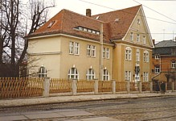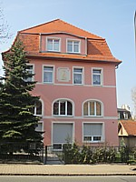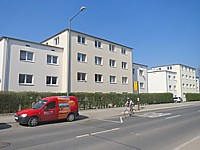

**_Fotos v. l. n. r.:_**

_ehem. Kinderhort (Karlsruher Straße 36) - ehem. Eulen-Apotheke (Nr. 78) - Wohnhäuser Nr. 128 bis 130)_

_**Gittersee:**_

Nr. 78: Das Gebäude oberhalb des Abzweigs der Potschappler Straße wurde 1908 als Eulen-Apotheke errichtet. Noch heute erinnert im Obergeschoss ein Wandbild mit einer Eule, die eine Schlange in den Krallen hält, an diese Nutzung. 1994 verzog die Apotheke zur Karlsruher Straße 11 (Ecke Kohlenstraße). Heute dient das Haus Wohnzwecken.

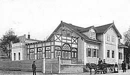Taubmanns Restaurant (Nr. 73):
Die kleine Gaststätte auf der stadtauswärts linken Straßenseite wurde 1857 erbaut und befand sich viele Jahre im Besitz der Familie Taubmann. An der Nordseite gab es einen in
Fachwerkbauweise errichteten Saalanbau für verschiedene Veranstaltungen, der später durch einen massiven Neubau ersetzt wurde. Außerdem gehörte zum Lokal ein Gästegarten. Nach 1945 wurde die
Gaststätte “Zur Einkehr” genannt und hatte noch bis Anfang der 1990er Jahre geöffnet. Danach verfiel das Haus zur Ruine. 2014 wurde es umfassend saniert und dabei zum Wohnhaus umgebaut.

Küntzelmann-Gut: Das heute nicht mehr vorhandene größte Bauerngut des Ortes befand sich an der Einmündung
Karlsruher / Oskar-Seyffert-Straße und gehörte der Familie Küntzelmann. Martin Küntzelmann war erster evangelischer
Pfarrer der Parochie Döhlen und erhielt für seine Verdienste um die Einführung der Reformation von Herzog Heinrich
dem Frommen in Gittersee ein Erblehngut mit 7 Hufen Land übertragen. Neben seiner geistlichen Tätigkeit befasste sich
Küntzelmann mit der Obstbaumzucht und gilt als Begründer des Obstbaus in der Region. Nach seinem Tod 1569 ging
das Gut in den Besitz seiner Erben über und blieb bis 1875 im Familienbesitz. Heute befindet sich auf dem Areal ein Supermarkt (Nr. 80).

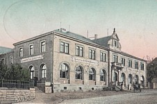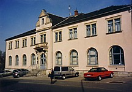Gasthof Gittersee (Nr. 83): Der Gasthof von Gittersee entstand um 1890 als Konzert- und Ballhaus und erhielt dabei den noch heute vorhandenen Saal, der über 800 Plätze bot. Während des Zweiten Weltkrieges wurden die Räume als Wohnlager des Döhlener Gußstahlwerkes genutzt. Nach 1945 diente dieser Saal als erste Spielstätte der neu gegründeten “Volksoper”, aus der 1950 die Landesbühnen Sachsen hervorgingen. Bereits am 12. August 1945 fand hier erstmals ein festliches Opernkonzert statt, am 24, November die erste Nachkriegsaufführung der Oper “Der Bajazzo”. 1950 verlegte das Theater seinen Stammsitz nach Radebeul. Der Gasthof wurde daraufhin in ein Klubhaus der Gewerkschaften umgewandelt. Später befand sich hier die HO-Gaststätte “Friedenswacht”, während der Saal nur noch Lagerzwecken diente. Zeitweise wurden die Räumlichkeiten auch als Tonstudio des DEFA-Studios für Trickfilme sowie für die Schulspeisung der nahegelegenen 80. POS genutzt. Heute befindet sich im ehemaligen Saal ein Lager des Buchhandels. Das Hauptgebäude wurde nach 1990 saniert.

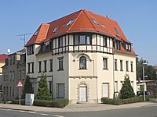Nr. 91:
Das markante Eckgebäude gegenüber des ehemaligen Gemeindeamtes entstand 1901. Im Erdgeschoss gab es ursprünglich einen Lebensmittelladen, das Obergeschoss mit Fachwerk-Zierelementen dient Wohnzwecken. Im baulich
verbundenen Nachbarhaus hatte einst die Ortsbibliothek ihr Domizil. Auch in einigen weiteren Gebäuden, so in Nr. 85 und 87 befinden sich Ladenlokale, die diesen
Abschnitt der Karlsruher Straße zum Geschäftszentrum der Gemeinde machten.

Bergbaubetrieb “Willy  Agatz” (Nr. 117):
Das Eckgebäude an der Hermann-Michel-Straße diente bis 1996 als Verwaltungsgebäude des [Bergbaubetriebes “Willy Agatz”](../../../../sud/gittersee/bergbaubetrieb_willy_agatz/). Der 1951 zur Gewinnung von Restvorräten an Steinkohle
gegründete Betrieb widmete sich später der Gewinnung uranhaltiger Kohle für die sowjetische Atomindustrie. Für den
Abbau erweiterte man die bestehenden Gleisanlagen der Windbergbahn und richtete eine Aufbereitungsanlage für Uran
ein. Später diente diese ab 1962 bis 1991 als Reifenwerk. 1990 stellte das Unternehmen als letzter Bergbaubetrieb der
Dresdner Region endgültig den Abbau ein und ist seitdem mit der Verwahrung und Sicherung der bestehenden Schachtanlagen beschäftigt.

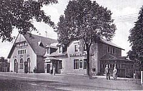Rehbockschänke (Filmtheater “Glück Auf”):
Das Gasthaus entstand 1887 als Ausflugslokal auf der Gitterseer Höhe gegenüber der Einmündung der Bahnhofstraße (heute Hermann-Michel-Straße). Erster Besitzer war ein
Dresdner Kaufmann. Die Namensgebung Rehbockschänke soll auf eine kuriose Begebenheit zurückgehen, nach der der Wirt gemeinsam mit zwei Stammgästen auf die Jagd gegangen war. Die beiden Jäger ließen ihn dabei auf
einen Rehbock schießen, den er jedoch, waidmännischem Brauch entsprechend, erst am Folgetag in Augenschein nehmen durfte. Am nächsten Tag brach der Wirt gemeinsam mit seinem Hausknecht auf und bemerkte nun,
das er auf ein Schaukelpferd geschossen hatte. Die Geschichte wurde später werbewirksam verbreitet und trug zur
Popularität des Lokals bei. Neben Ausflüglern wurde die Rehbockschänke wegen ihrer Nähe zum Bahnhof auch von
den Fahrgästen der Windbergbahn gern besucht. 1936 richteten die Besitzer im Saal des Gebäudes das Kino “Capitol” ein.

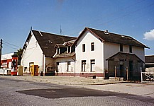Nach 1945 ging das Gebäude an der Karlsruher Straße 136  in den Besitz der
Wismut über. Im Saal entstand um 1950 das neue “Filmtheater Glück Auf” mit ca. 250 Plätzen. Kino und Gaststätte dienten nun vorrangig der kulturellen Betreuung
der Arbeiter des Gitterseer Wismut-Schachtes, später als Schulungsstätte des Unternehmens. Zur Versorgung der Bergleute errichtete man um 1980 ein
zusätzliches Kantinengebäude mit Großküche und Speisesaal. 1991 wurde das Filmtheater geschlossen und das verfallene Gebäude 2006 abgerissen. An seiner Stelle entstand eine kleine Wohnanlage.

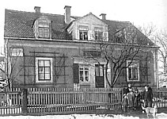Nr. 158: Das letzte Haus auf Obergitterseer Flur an der westlichen Straßenseite
entstand um 1860 und gehört zu den ältesten Bauten der oberen Karlsruher Straße. Das ursprünglich eingeschossige Gebäude mit ausgebautem Dachgeschoss
beherbergte neben Wohnräumen zugleich ein kleines Ladengeschäft für Textilwaren und ist typisches Beispiel für die Arbeiterwohnhäuser des Ortes. Kleine Läden
sollten das oft karge Familieneinkommen der Bergleute aufbessern und dienten zugleich der Versorgung der Bevölkerung vor Ort. 1929 wurde das Haus um ein
Ober- und Mansardgeschoss erweitert. Das Foto zeigt es im ursprünglichen Zustand um 1925.

* * *

 \[ [Home](../../../../index.html)\] \[ [Nord](../../../../nord/)\] \[ [Nordwest](../../../../nordwest/)\] \[ [Neustadt](../../../../neustadt/)\] \[ [Nordost](../../../../nordost/)\] \[ [West](../../../../west/)\] \[ [Zentrum](../../../../zentrum/)\] \[ [Südwest](../../../../sudwest/)\] \[ [Süd](../../../../sud/)\] \[ [Südost](../../../../sudost/)\] \[ [Ost](../../../../ost/)\] \[ [Register](../../../../Register/register.html)\] \[ [Kontakt](../../../../Kontakt/kontakt.html)\] \[ [Impressum](../../../../impressum/)\]
